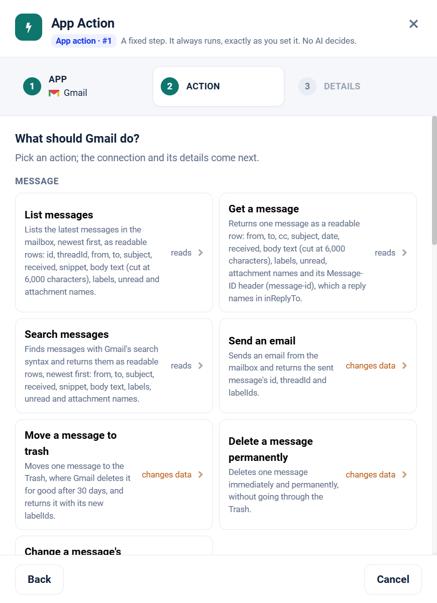

.. _app-action-gmail:

.. rst-class:: agentic-tutorial

Gmail App Actions
=================

.. raw:: html

   

     
     <dl class="tool-facts">
     
<dt>Node</dt><dd>App Action</dd>

     
<dt>Actions</dt><dd>22 across 5 resources</dd>

     
<dt>Reads / changes data</dt><dd>11 / 11</dd>

     
<dt>Connection</dt><dd>Google</dd>

     </dl>
   

.. container:: tutorial-intro

   Gmail as a fixed workflow step: search, read and label email, draft or send replies, and save attachments. An App Action runs every time the flow reaches it, exactly as you set it; no model decides. To let an agent choose instead, use the :doc:`Gmail agent tools </agentic-ai-guide/tools-integrations/connector-tools/gmail>`.

.. contents:: On this page
   :local:
   :depth: 1
   :class: tool-toc

Prerequisites
-------------

* **Connection:** A **Google** connection: a client ID, client secret and refresh token from a Google Cloud OAuth client. One Google connection serves Gmail, Calendar, Docs, Drive and Sheets; the scopes on its refresh token decide which of them it can reach.
* The **Gmail API** enabled in the Google Cloud project behind the connection.
* A refresh token with ``https://www.googleapis.com/auth/gmail.readonly`` for the read tools, or ``gmail.modify`` plus ``gmail.send`` to draft, send, label and trash. **Delete a message permanently** needs the full ``https://mail.google.com/`` scope.
* How to create the connection: :ref:`connector-tools-gmail`.

Add a Gmail App Action
----------------------

#. Drag **App Action** from **Commonly used** onto the canvas and connect it where the step belongs in the flow.
#. **App:** choose **Gmail**, or type ``gmail`` in **Search apps**.
#. **Action:** pick one of the 22 actions below. Each is marked **reads** or **changes data**.
#. **Details:** choose the Google connection and click **Test**, then fill in the inputs. Click a field under **What arrives here** to insert a value from an earlier step.
#. For a read, click **Load the fields** so later steps can use the columns it returns. Then click **Save action**.

   Step 2, **Action**, for Gmail.

.. tip::

   A canvas run skips actions that change data unless **Write when run from the canvas** is on; full and scheduled runs always perform them. Every write hands on ``result_status``, ``result_id`` and ``result_error`` for each row. See :doc:`/agentic-ai-guide/tools-integrations/app-actions`.

Actions
-------

The inputs are the boxes on the **Details** step, by their label. Any input can take a value from an earlier step with a ``${...}`` reference.

Message
~~~~~~~

.. raw:: html

   

     <a class="tool-op" href="../connector-tools/gmail/message-getmany.html" target="_blank" rel="noopener">
       List messagesReads
       Lists the latest messages in the mailbox, newest first, as readable rows: id, threadId, from, to, subject, received, snippet, body text (cut at 6,000 characters), labels, unread and attachment names.
     </a>
     <a class="tool-op" href="../connector-tools/gmail/message-get.html" target="_blank" rel="noopener">
       Get a messageReads
       Returns one message as a readable row: from, to, cc, subject, date, received, body text (cut at 6,000 characters), labels, unread, attachment names and its Message-ID header (message-id), which a reply names in inReplyTo.
     </a>
     <a class="tool-op" href="../connector-tools/gmail/message-search.html" target="_blank" rel="noopener">
       Search messagesReads
       Finds messages with Gmail&#x27;s search syntax and returns them as readable rows, newest first: from, to, subject, received, snippet, body text, labels, unread and attachment names.
     </a>
     <a class="tool-op" href="../connector-tools/gmail/message-send.html" target="_blank" rel="noopener">
       Send an emailChanges data
       Sends an email from the mailbox and returns the sent message&#x27;s id, threadId and labelIds.
     </a>
     <a class="tool-op" href="../connector-tools/gmail/message-trash.html" target="_blank" rel="noopener">
       Move a message to trashChanges data
       Moves one message to the Trash, where Gmail deletes it for good after 30 days, and returns it with its new labelIds.
     </a>
     <a class="tool-op" href="../connector-tools/gmail/message-delete.html" target="_blank" rel="noopener">
       Delete a message permanentlyChanges data
       Deletes one message immediately and permanently, without going through the Trash.
     </a>
     <a class="tool-op" href="../connector-tools/gmail/message-modify.html" target="_blank" rel="noopener">
       Change a message&#x27;s labelsChanges data
       Adds or removes labels on one message and returns its new labelIds.
     </a>
   

Draft
~~~~~

.. raw:: html

   

     <a class="tool-op" href="../connector-tools/gmail/draft-getmany.html" target="_blank" rel="noopener">
       List draftsReads
       Lists the drafts in the mailbox as readable rows: the draft id, messageId, to, cc, subject, snippet and body text.
     </a>
     <a class="tool-op" href="../connector-tools/gmail/draft-get.html" target="_blank" rel="noopener">
       Get a draftReads
       Returns one draft as a readable row: the draft id, messageId, to, cc, subject and body text.
     </a>
     <a class="tool-op" href="../connector-tools/gmail/draft-create.html" target="_blank" rel="noopener">
       Create a draftChanges data
       Saves an email as a draft without sending it and returns the draft id with its message id.
     </a>
     <a class="tool-op" href="../connector-tools/gmail/draft-send.html" target="_blank" rel="noopener">
       Send a draftChanges data
       Sends a saved draft as it stands and returns the sent message&#x27;s id, threadId and labelIds; the draft itself is removed.
     </a>
     <a class="tool-op" href="../connector-tools/gmail/draft-delete.html" target="_blank" rel="noopener">
       Delete a draftChanges data
       Deletes a draft immediately and permanently; it does not go to the Trash.
     </a>
   

Label
~~~~~

.. raw:: html

   

     <a class="tool-op" href="../connector-tools/gmail/label-getmany.html" target="_blank" rel="noopener">
       List labelsReads
       Lists the mailbox&#x27;s labels with id, name and type (system or user), without any message counts.
     </a>
     <a class="tool-op" href="../connector-tools/gmail/label-get.html" target="_blank" rel="noopener">
       Get a label with countsReads
       Returns one label with exact counts: messagesTotal, messagesUnread, threadsTotal and threadsUnread.
     </a>
     <a class="tool-op" href="../connector-tools/gmail/label-create.html" target="_blank" rel="noopener">
       Create a labelChanges data
       Creates a user label and returns it with its id (Label_...).
     </a>
     <a class="tool-op" href="../connector-tools/gmail/label-update.html" target="_blank" rel="noopener">
       Update a labelChanges data
       Renames a user label or changes its visibility or colors, and returns the updated label.
     </a>
     <a class="tool-op" href="../connector-tools/gmail/label-delete.html" target="_blank" rel="noopener">
       Delete a labelChanges data
       Deletes a user label for good and removes it from every message and thread that carries it; the messages themselves stay.
     </a>
   

Attachment
~~~~~~~~~~

.. raw:: html

   

     <a class="tool-op" href="../connector-tools/gmail/attachment-getmany.html" target="_blank" rel="noopener">
       Read attachmentsReads
       Saves the attachments of one or more emails to the engine&#x27;s disk and returns one row per file: messageId, from, subject, received, filename, extension, mimeType, size, path and, with extractText, the file&#x27;s text, text_status and text_source.
     </a>
     <a class="tool-op" href="../connector-tools/gmail/attachment-download.html" target="_blank" rel="noopener">
       Download attachmentsReads
       Saves the attachments of one or more emails into a folder on the engine&#x27;s disk, without reading them, and returns one row per file: messageId, from, subject, received, filename, extension, mimeType, size, path (where the file was saved) and save_status (saved, or skipped when the file was already there).
     </a>
   

Thread
~~~~~~

.. raw:: html

   

     <a class="tool-op" href="../connector-tools/gmail/thread-getmany.html" target="_blank" rel="noopener">
       List threadsReads
       Lists conversation threads, newest first, with each thread&#x27;s id and a snippet of its latest message.
     </a>
     <a class="tool-op" href="../connector-tools/gmail/thread-get.html" target="_blank" rel="noopener">
       Get a threadReads
       Returns every message of one conversation as readable rows, oldest first: from, to, subject, received, body text, labels and attachment names.
     </a>
     <a class="tool-op" href="../connector-tools/gmail/thread-trash.html" target="_blank" rel="noopener">
       Move a thread to trashChanges data
       Moves every message of one conversation to the Trash, where Gmail deletes them for good after 30 days, and returns the thread.
     </a>
   

Start a flow from Gmail
-----------------------

A :doc:`Trigger </agentic-ai-guide/triggers-automation/triggers>` can watch Gmail and start the flow when one of these events happens. Pick Gmail in the Trigger, then the event.

.. list-table::
   :header-rows: 1
   :widths: 34 66
   :class: tool-table

   * - Event
     - What it reports
   * - **Email received**
     - Reports each email that arrives, sent mail and drafts left out. Mailbox is blank for the connection's own mailbox.
   * - **Email received from a sender**
     - Filter is the sender's address, a name, or a domain such as acme.com. Reports each email from that sender.
   * - **Email matching a search**
     - Filter is a search in Gmail's search box syntax, for example from:billing@vendor.com has:attachment subject:invoice. Reports each new email that matches it.
   * - **Email received with words in the subject**
     - Filter is one or more words that must all appear in the subject, for example purchase order, or a phrase in double quotes. Reports each new email received with such a subject.
   * - **Email received at an address**
     - Filter is the address on the To line, for example support@company.com or a plus address such as finance+invoices@company.com. Reports each new email sent to it.
   * - **Email with an attachment received**
     - Reports each new email that carries attachments, one record per email with the file names in attachments; Attachment received saves the files themselves.
   * - **Email received with a label**
     - Filter is the label as Gmail search writes it, with hyphens for spaces and slashes, for example client-invoices. Reports each new email that arrives carrying the label, such as one a Gmail filter labels on arrival.
   * - **Important email received**
     - Reports each new email that Gmail marks as important.
   * - **Email received in the Primary tab**
     - Reports each new email that Gmail sorts into Primary, leaving out Promotions, Social, Updates and Forums.
   * - **Email sent**
     - Reports each email the mailbox sends, with its recipients, subject and text.
   * - **Label added to an email**
     - Filter is the label as Gmail search writes it, for example to-agent. The first check records the emails that already carry it; later checks report each email from the last seven days that gains it.
   * - **Email starred**
     - The first check records the starred emails; later checks report each email from the last seven days that is newly starred.
   * - **Attachment received**
     - Reports one record per attachment of each new email, with the file saved on the engine's disk (path) and its text (text). Images in signatures count as attachments; Attachment of a file type received leaves them out.
   * - **Attachment of a file type received**
     - File types lists the extensions to watch, comma-separated, for example pdf, xlsx. Reports one record per matching attachment of each new email, with the file saved on the engine's disk (path) and its text (text).

Related
-------

* :doc:`/agentic-ai-guide/tools-integrations/app-actions` - how App Actions work, reads, writes and safety
* :doc:`/agentic-ai-guide/tools-integrations/app-action-apps/index` - every App Action app
* :doc:`Gmail agent tools </agentic-ai-guide/tools-integrations/connector-tools/gmail>` - the same operations for an Agent Node, with every parameter
