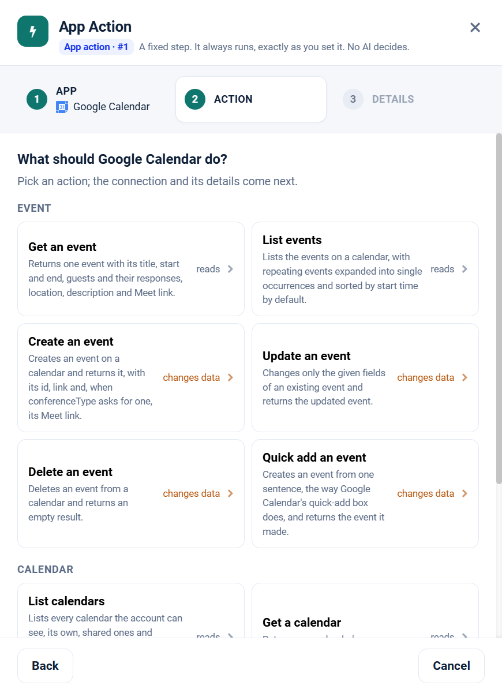

.. _app-action-google-calendar:

.. rst-class:: agentic-tutorial

Google Calendar App Actions
===========================

.. raw:: html

   

     
     <dl class="tool-facts">
     
<dt>Node</dt><dd>App Action</dd>

     
<dt>Actions</dt><dd>9 across 3 resources</dd>

     
<dt>Reads / changes data</dt><dd>5 / 4</dd>

     
<dt>Connection</dt><dd>Google</dd>

     </dl>
   

.. container:: tutorial-intro

   Google Calendar as a fixed workflow step: list events, find busy times, and create or update events. An App Action runs every time the flow reaches it, exactly as you set it; no model decides. To let an agent choose instead, use the :doc:`Google Calendar agent tools </agentic-ai-guide/tools-integrations/connector-tools/google-calendar>`.

.. contents:: On this page
   :local:
   :depth: 1
   :class: tool-toc

Prerequisites
-------------

* **Connection:** A **Google** connection: a client ID, client secret and refresh token from a Google Cloud OAuth client. One Google connection serves Gmail, Calendar, Docs, Drive and Sheets; the scopes on its refresh token decide which of them it can reach.
* The **Google Calendar API** enabled in the Google Cloud project.
* A refresh token with ``https://www.googleapis.com/auth/calendar.readonly`` to read, or ``https://www.googleapis.com/auth/calendar`` to create and change events.
* How to create the connection: :ref:`connector-tools-google-calendar`.

Add a Google Calendar App Action
--------------------------------

#. Drag **App Action** from **Commonly used** onto the canvas and connect it where the step belongs in the flow.
#. **App:** choose **Google Calendar**, or type ``calendar`` in **Search apps**.
#. **Action:** pick one of the 9 actions below. Each is marked **reads** or **changes data**.
#. **Details:** choose the Google connection and click **Test**, then fill in the inputs. Click a field under **What arrives here** to insert a value from an earlier step.
#. For a read, click **Load the fields** so later steps can use the columns it returns. Then click **Save action**.

   Step 2, **Action**, for Google Calendar.

.. tip::

   A canvas run skips actions that change data unless **Write when run from the canvas** is on; full and scheduled runs always perform them. Every write hands on ``result_status``, ``result_id`` and ``result_error`` for each row. See :doc:`/agentic-ai-guide/tools-integrations/app-actions`.

Actions
-------

The inputs are the boxes on the **Details** step, by their label. Any input can take a value from an earlier step with a ``${...}`` reference.

Event
~~~~~

.. raw:: html

   

     <a class="tool-op" href="../connector-tools/google-calendar/event-get.html" target="_blank" rel="noopener">
       Get an eventReads
       Returns one event with its title, start and end, guests and their responses, location, description and Meet link.
     </a>
     <a class="tool-op" href="../connector-tools/google-calendar/event-getmany.html" target="_blank" rel="noopener">
       List eventsReads
       Lists the events on a calendar, with repeating events expanded into single occurrences and sorted by start time by default.
     </a>
     <a class="tool-op" href="../connector-tools/google-calendar/event-create.html" target="_blank" rel="noopener">
       Create an eventChanges data
       Creates an event on a calendar and returns it, with its id, link and, when conferenceType asks for one, its Meet link.
     </a>
     <a class="tool-op" href="../connector-tools/google-calendar/event-update.html" target="_blank" rel="noopener">
       Update an eventChanges data
       Changes only the given fields of an existing event and returns the updated event.
     </a>
     <a class="tool-op" href="../connector-tools/google-calendar/event-delete.html" target="_blank" rel="noopener">
       Delete an eventChanges data
       Deletes an event from a calendar and returns an empty result.
     </a>
     <a class="tool-op" href="../connector-tools/google-calendar/event-quickadd.html" target="_blank" rel="noopener">
       Quick add an eventChanges data
       Creates an event from one sentence, the way Google Calendar&#x27;s quick-add box does, and returns the event it made.
     </a>
   

Calendar
~~~~~~~~

.. raw:: html

   

     <a class="tool-op" href="../connector-tools/google-calendar/calendar-getmany.html" target="_blank" rel="noopener">
       List calendarsReads
       Lists every calendar the account can see, its own, shared ones and subscribed ones such as holidays, with each calendar&#x27;s id, name, time zone and access role.
     </a>
     <a class="tool-op" href="../connector-tools/google-calendar/calendar-get.html" target="_blank" rel="noopener">
       Get a calendarReads
       Returns one calendar&#x27;s name, description and time zone.
     </a>
   

Free Time
~~~~~~~~~

.. raw:: html

   

     <a class="tool-op" href="../connector-tools/google-calendar/free-time-find.html" target="_blank" rel="noopener">
       Find busy timesReads
       Returns the busy intervals of one or more calendars between timeMin and timeMax, so the free slots are the gaps between them.
     </a>
   

Start a flow from Google Calendar
---------------------------------

A :doc:`Trigger </agentic-ai-guide/triggers-automation/triggers>` can watch Google Calendar and start the flow when one of these events happens. Pick Google Calendar in the Trigger, then the event.

.. list-table::
   :header-rows: 1
   :widths: 34 66
   :class: tool-table

   * - Event
     - What it reports
   * - **Event created**
     - Reports each event newly created on the calendar; a repeating series is reported once, with its recurrence rule. Calendar is blank for the primary calendar.
   * - **Event created or updated**
     - Reports each event created or changed since the last check; a repeating series is reported once, and cancelled events are left out. Calendar is blank for the primary calendar.
   * - **Event cancelled**
     - Reports each event deleted or cancelled, including one cancelled occurrence of a repeating event; a deleted event can carry little more than its id. Calendar is blank for the primary calendar.
   * - **Event created matching a search**
     - Filter is words to find in the title, description, location or guests, for example interview. Reports each new event that matches them. Calendar is blank for the primary calendar.
   * - **Event starting within the hour**
     - Reports each event once, about an hour before it starts, or on the first check after it is booked when it starts sooner; each occurrence of a repeating event counts. Events already that close at the first check are recorded, not reported. Calendar is blank for the primary calendar.
   * - **Invitation received**
     - Reports each event organised by someone else that reaches the calendar while a guest has yet to answer it, once per change. Calendar is blank for the primary calendar.
   * - **Out of office added**
     - Reports each out-of-office block newly added, with its start, end and decline message; Google Workspace accounts only. Calendar is blank for the primary calendar.
   * - **Calendar added**
     - The first check records the calendars the account can see; later checks report each calendar created, shared with it or subscribed to.

Related
-------

* :doc:`/agentic-ai-guide/tools-integrations/app-actions` - how App Actions work, reads, writes and safety
* :doc:`/agentic-ai-guide/tools-integrations/app-action-apps/index` - every App Action app
* :doc:`Google Calendar agent tools </agentic-ai-guide/tools-integrations/connector-tools/google-calendar>` - the same operations for an Agent Node, with every parameter
