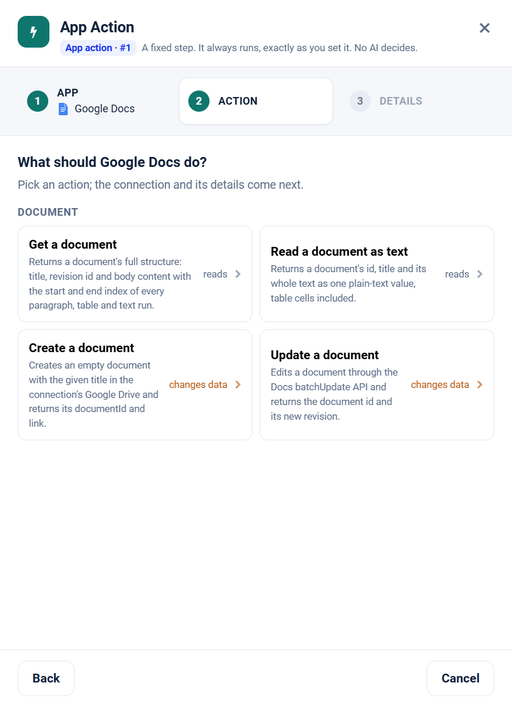

.. _app-action-google-docs:

.. rst-class:: agentic-tutorial

Google Docs App Actions
=======================

.. raw:: html

   

     
     <dl class="tool-facts">
     
<dt>Node</dt><dd>App Action</dd>

     
<dt>Actions</dt><dd>4 across 1 resource</dd>

     
<dt>Reads / changes data</dt><dd>2 / 2</dd>

     
<dt>Connection</dt><dd>Google</dd>

     </dl>
   

.. container:: tutorial-intro

   Google Docs as a fixed workflow step: read documents as text, create them and edit their content. An App Action runs every time the flow reaches it, exactly as you set it; no model decides. To let an agent choose instead, use the :doc:`Google Docs agent tools </agentic-ai-guide/tools-integrations/connector-tools/google-docs>`.

.. contents:: On this page
   :local:
   :depth: 1
   :class: tool-toc

Prerequisites
-------------

* **Connection:** A **Google** connection: a client ID, client secret and refresh token from a Google Cloud OAuth client. One Google connection serves Gmail, Calendar, Docs, Drive and Sheets; the scopes on its refresh token decide which of them it can reach.
* The **Google Docs API** enabled in the Google Cloud project.
* A refresh token with ``https://www.googleapis.com/auth/documents.readonly`` to read, or ``https://www.googleapis.com/auth/documents`` to create and edit.
* To let the agent find documents by name, add Google Drive tools (and the ``drive.metadata.readonly`` scope).
* How to create the connection: :ref:`connector-tools-google-docs`.

Add a Google Docs App Action
----------------------------

#. Drag **App Action** from **Commonly used** onto the canvas and connect it where the step belongs in the flow.
#. **App:** choose **Google Docs**, or type ``docs`` in **Search apps**.
#. **Action:** pick one of the 4 actions below. Each is marked **reads** or **changes data**.
#. **Details:** choose the Google connection and click **Test**, then fill in the inputs. Click a field under **What arrives here** to insert a value from an earlier step.
#. For a read, click **Load the fields** so later steps can use the columns it returns. Then click **Save action**.

   Step 2, **Action**, for Google Docs.

.. tip::

   A canvas run skips actions that change data unless **Write when run from the canvas** is on; full and scheduled runs always perform them. Every write hands on ``result_status``, ``result_id`` and ``result_error`` for each row. See :doc:`/agentic-ai-guide/tools-integrations/app-actions`.

Actions
-------

The inputs are the boxes on the **Details** step, by their label. Any input can take a value from an earlier step with a ``${...}`` reference.

Document
~~~~~~~~

.. raw:: html

   

     <a class="tool-op" href="google-docs/document-get.html" target="_blank" rel="noopener">
       Get a documentReads
       Returns a document&#x27;s full structure: title, revision id and body content with the start and end index of every paragraph, table and text run.
     </a>
     <a class="tool-op" href="google-docs/document-gettext.html" target="_blank" rel="noopener">
       Read a document as textReads
       Returns a document&#x27;s id, title and its whole text as one plain-text value, table cells included.
     </a>
     <a class="tool-op" href="google-docs/document-create.html" target="_blank" rel="noopener">
       Create a documentChanges data
       Creates an empty document with the given title in the connection&#x27;s Google Drive and returns its documentId and link.
     </a>
     <a class="tool-op" href="google-docs/document-update.html" target="_blank" rel="noopener">
       Update a documentChanges data
       Edits a document through the Docs batchUpdate API and returns the document id and its new revision.
     </a>
   

Start a flow from Google Docs
-----------------------------

A :doc:`Trigger </agentic-ai-guide/triggers-automation/triggers>` can watch Google Docs and start the flow when one of these events happens. Pick Google Docs in the Trigger, then the event.

.. list-table::
   :header-rows: 1
   :widths: 34 66
   :class: tool-table

   * - Event
     - What it reports
   * - **Document changed**
     - Document is the document's URL or id. Reports the document each time it is edited; the connection needs edit access to it, since Google gives the revision only to editors.
   * - **Document text changed**
     - Document is the document's URL or id. Reports the document with its whole text each time its text or title changes, in any tab; formatting-only edits are not reported.
   * - **Text appears in a document**
     - Document is the document's URL or id, and Filter the word or phrase to watch for, for example Approved. Reports the document when the phrase appears in text that did not hold it at the previous check.

Related
-------

* :doc:`/agentic-ai-guide/tools-integrations/app-actions` - how App Actions work, reads, writes and safety
* :doc:`/agentic-ai-guide/tools-integrations/app-action-apps/index` - every App Action app
* :doc:`Google Docs agent tools </agentic-ai-guide/tools-integrations/connector-tools/google-docs>` - the same operations for an Agent Node, with every parameter
