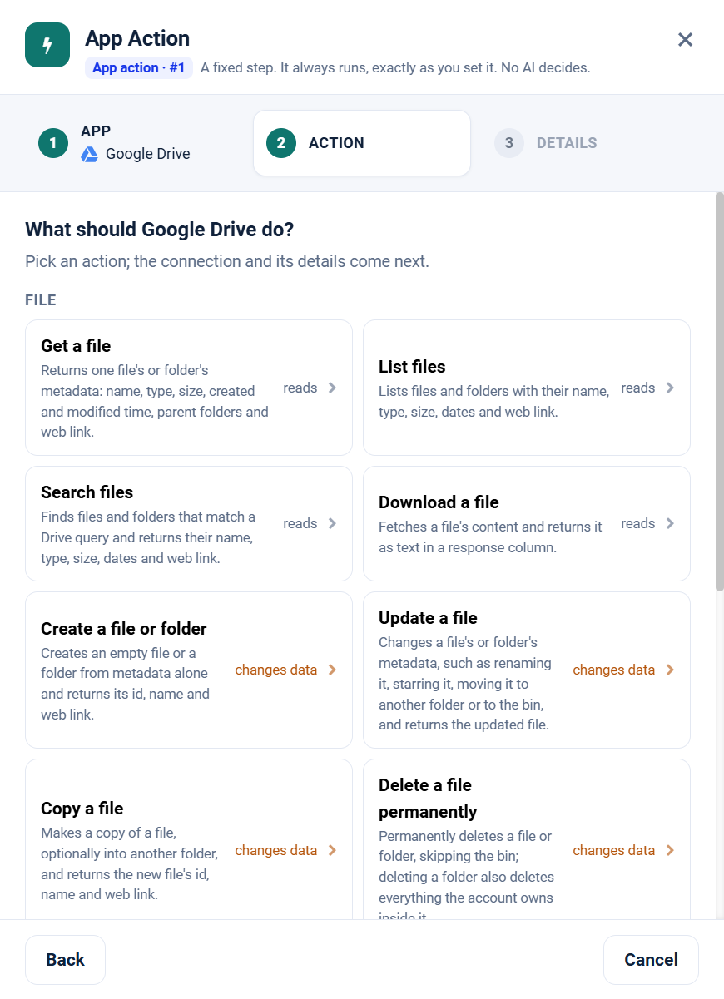

.. _app-action-google-drive:

.. rst-class:: agentic-tutorial

Google Drive App Actions
========================

.. raw:: html

   

     
     <dl class="tool-facts">
     
<dt>Node</dt><dd>App Action</dd>

     
<dt>Actions</dt><dd>12 across 3 resources</dd>

     
<dt>Reads / changes data</dt><dd>6 / 6</dd>

     
<dt>Connection</dt><dd>Google</dd>

     </dl>
   

.. container:: tutorial-intro

   Google Drive as a fixed workflow step: search, read, upload, organise and share files and folders. An App Action runs every time the flow reaches it, exactly as you set it; no model decides. To let an agent choose instead, use the :doc:`Google Drive agent tools </agentic-ai-guide/tools-integrations/connector-tools/google-drive>`.

.. contents:: On this page
   :local:
   :depth: 1
   :class: tool-toc

Prerequisites
-------------

* **Connection:** A **Google** connection: a client ID, client secret and refresh token from a Google Cloud OAuth client. One Google connection serves Gmail, Calendar, Docs, Drive and Sheets; the scopes on its refresh token decide which of them it can reach.
* The **Google Drive API** enabled in the Google Cloud project.
* A refresh token with ``https://www.googleapis.com/auth/drive.readonly`` to read, or ``https://www.googleapis.com/auth/drive`` to create, move, share or delete. Drive is the broadest scope of the five; grant write only when the agent needs it.
* How to create the connection: :ref:`connector-tools-google-drive`.

Add a Google Drive App Action
-----------------------------

#. Drag **App Action** from **Commonly used** onto the canvas and connect it where the step belongs in the flow.
#. **App:** choose **Google Drive**, or type ``drive`` in **Search apps**.
#. **Action:** pick one of the 12 actions below. Each is marked **reads** or **changes data**.
#. **Details:** choose the Google connection and click **Test**, then fill in the inputs. Click a field under **What arrives here** to insert a value from an earlier step.
#. For a read, click **Load the fields** so later steps can use the columns it returns. Then click **Save action**.

   Step 2, **Action**, for Google Drive.

.. tip::

   A canvas run skips actions that change data unless **Write when run from the canvas** is on; full and scheduled runs always perform them. Every write hands on ``result_status``, ``result_id`` and ``result_error`` for each row. See :doc:`/agentic-ai-guide/tools-integrations/app-actions`.

Actions
-------

The inputs are the boxes on the **Details** step, by their label. Any input can take a value from an earlier step with a ``${...}`` reference.

File
~~~~

.. raw:: html

   

     <a class="tool-op" href="google-drive/file-get.html" target="_blank" rel="noopener">
       Get a fileReads
       Returns one file&#x27;s or folder&#x27;s metadata: name, type, size, created and modified time, parent folders and web link.
     </a>
     <a class="tool-op" href="google-drive/file-getmany.html" target="_blank" rel="noopener">
       List filesReads
       Lists files and folders with their name, type, size, dates and web link.
     </a>
     <a class="tool-op" href="google-drive/file-search.html" target="_blank" rel="noopener">
       Search filesReads
       Finds files and folders that match a Drive query and returns their name, type, size, dates and web link.
     </a>
     <a class="tool-op" href="google-drive/file-download.html" target="_blank" rel="noopener">
       Download a fileReads
       Fetches a file&#x27;s content and returns it as text in a response column.
     </a>
     <a class="tool-op" href="google-drive/file-create.html" target="_blank" rel="noopener">
       Create a file or folderChanges data
       Creates an empty file or a folder from metadata alone and returns its id, name and web link.
     </a>
     <a class="tool-op" href="google-drive/file-update.html" target="_blank" rel="noopener">
       Update a fileChanges data
       Changes a file&#x27;s or folder&#x27;s metadata, such as renaming it, starring it, moving it to another folder or to the bin, and returns the updated file.
     </a>
     <a class="tool-op" href="google-drive/file-copy.html" target="_blank" rel="noopener">
       Copy a fileChanges data
       Makes a copy of a file, optionally into another folder, and returns the new file&#x27;s id, name and web link.
     </a>
     <a class="tool-op" href="google-drive/file-delete.html" target="_blank" rel="noopener">
       Delete a file permanentlyChanges data
       Permanently deletes a file or folder, skipping the bin; deleting a folder also deletes everything the account owns inside it.
     </a>
     <a class="tool-op" href="google-drive/file-upload.html" target="_blank" rel="noopener">
       Upload a fileChanges data
       Uploads a file from the engine&#x27;s disk into Drive and returns the new file&#x27;s id, name and web link.
     </a>
   

Permission
~~~~~~~~~~

.. raw:: html

   

     <a class="tool-op" href="google-drive/permission-getmany.html" target="_blank" rel="noopener">
       List who has accessReads
       Lists the permissions on a file or folder: who has access (a user, group, domain or anyone with the link) and with which role.
     </a>
     <a class="tool-op" href="google-drive/permission-create.html" target="_blank" rel="noopener">
       Share a fileChanges data
       Gives a user, a group, a whole domain or anyone with the link access to a file or folder with the given role, and returns the new permission.
     </a>
   

Drive
~~~~~

.. raw:: html

   

     <a class="tool-op" href="google-drive/drive-getmany.html" target="_blank" rel="noopener">
       List shared drivesReads
       Lists the shared drives the account is a member of, with each drive&#x27;s id and name.
     </a>
   

Start a flow from Google Drive
------------------------------

A :doc:`Trigger </agentic-ai-guide/triggers-automation/triggers>` can watch Google Drive and start the flow when one of these events happens. Pick Google Drive in the Trigger, then the event.

.. list-table::
   :header-rows: 1
   :widths: 34 66
   :class: tool-table

   * - Event
     - What it reports
   * - **File created**
     - Reports each file created, uploaded or copied into the account's Drive or shared with it, folders left out.
   * - **File created or modified**
     - Reports each file added or edited since the last check, with who changed it last in lastModifyingUser.
   * - **File created in a folder**
     - Folder id is the id of the folder to watch, the part of its address after /folders/. Reports each file uploaded, created or copied directly into it; files in its subfolders are not included.
   * - **File added or changed in a folder**
     - Folder id is the id of the folder to watch, the part of its address after /folders/. Reports each file directly inside it that is added or edited, with who changed it last in lastModifyingUser.
   * - **File added to a folder (moves included)**
     - Folder id is the id of the folder to watch, the part of its address after /folders/. The first check records what the folder holds; later checks report each file that appears in it, uploaded, copied or moved in.
   * - **Folder created in a folder**
     - Parent folder id is the id of the folder to watch, the part of its address after /folders/. Reports each folder created directly inside it.
   * - **Specific file changed**
     - File id is the id of the file to watch, the long key in its address; a Google Doc, Sheet or Slides file works too. Reports the file each time it is changed, with who changed it last.
   * - **File shared with me**
     - Reports each file or folder newly shared with the account, with who shared it in sharingUser.
   * - **Google Doc created**
     - Reports each new Google Docs document in the account's Drive or shared with it; its id is what the Google Docs app takes as Document.
   * - **Google Sheet created**
     - Reports each new Google Sheets spreadsheet in the account's Drive or shared with it; its id is what the Google Sheets app takes as Spreadsheet.
   * - **File created matching a search**
     - Filter is a Drive search, for example name contains 'invoice' and mimeType = 'application/pdf'. Reports each new file that matches it.
   * - **File created in a shared drive**
     - Filter is the shared drive's id, from a Drive list or the part of the drive's address after /folders/. Reports each file created anywhere in that drive, in any of its folders.
   * - **Shared drive added**
     - The first check records the shared drives the account belongs to; later checks report each shared drive created or joined.

Related
-------

* :doc:`/agentic-ai-guide/tools-integrations/app-actions` - how App Actions work, reads, writes and safety
* :doc:`/agentic-ai-guide/tools-integrations/app-action-apps/index` - every App Action app
* :doc:`Google Drive agent tools </agentic-ai-guide/tools-integrations/connector-tools/google-drive>` - the same operations for an Agent Node, with every parameter
