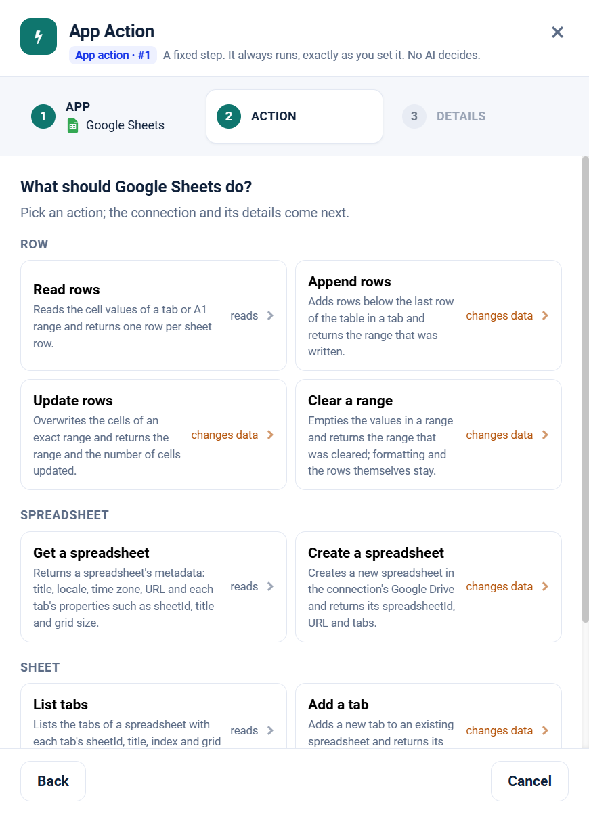

.. _app-action-google-sheets:

.. rst-class:: agentic-tutorial

Google Sheets App Actions
=========================

.. raw:: html

   

     
     <dl class="tool-facts">
     
<dt>Node</dt><dd>App Action</dd>

     
<dt>Actions</dt><dd>9 across 3 resources</dd>

     
<dt>Reads / changes data</dt><dd>3 / 6</dd>

     
<dt>Connection</dt><dd>Google</dd>

     </dl>
   

.. container:: tutorial-intro

   Google Sheets as a fixed workflow step: read rows, append and update them, and manage tabs. An App Action runs every time the flow reaches it, exactly as you set it; no model decides. To let an agent choose instead, use the :doc:`Google Sheets agent tools </agentic-ai-guide/tools-integrations/connector-tools/google-sheets>`.

.. contents:: On this page
   :local:
   :depth: 1
   :class: tool-toc

Prerequisites
-------------

* **Connection:** A **Google** connection: a client ID, client secret and refresh token from a Google Cloud OAuth client. One Google connection serves Gmail, Calendar, Docs, Drive and Sheets; the scopes on its refresh token decide which of them it can reach.
* The **Google Sheets API** enabled in the Google Cloud project.
* A refresh token with ``https://www.googleapis.com/auth/spreadsheets.readonly`` to read, or ``https://www.googleapis.com/auth/spreadsheets`` to write.
* How to create the connection: :ref:`connector-tools-google-sheets`.

Add a Google Sheets App Action
------------------------------

#. Drag **App Action** from **Commonly used** onto the canvas and connect it where the step belongs in the flow.
#. **App:** choose **Google Sheets**, or type ``sheets`` in **Search apps**.
#. **Action:** pick one of the 9 actions below. Each is marked **reads** or **changes data**.
#. **Details:** choose the Google connection and click **Test**, then fill in the inputs. Click a field under **What arrives here** to insert a value from an earlier step.
#. For a read, click **Load the fields** so later steps can use the columns it returns. Then click **Save action**.

   Step 2, **Action**, for Google Sheets.

.. tip::

   A canvas run skips actions that change data unless **Write when run from the canvas** is on; full and scheduled runs always perform them. Every write hands on ``result_status``, ``result_id`` and ``result_error`` for each row. See :doc:`/agentic-ai-guide/tools-integrations/app-actions`.

Actions
-------

The inputs are the boxes on the **Details** step, by their label. Any input can take a value from an earlier step with a ``${...}`` reference.

Row
~~~

.. raw:: html

   

     <a class="tool-op" href="google-sheets/row-getmany.html" target="_blank" rel="noopener">
       Read rowsReads
       Reads the cell values of a tab or A1 range and returns one row per sheet row.
     </a>
     <a class="tool-op" href="google-sheets/row-append.html" target="_blank" rel="noopener">
       Append rowsChanges data
       Adds rows below the last row of the table in a tab and returns the range that was written.
     </a>
     <a class="tool-op" href="google-sheets/row-update.html" target="_blank" rel="noopener">
       Update rowsChanges data
       Overwrites the cells of an exact range and returns the range and the number of cells updated.
     </a>
     <a class="tool-op" href="google-sheets/row-clear.html" target="_blank" rel="noopener">
       Clear a rangeChanges data
       Empties the values in a range and returns the range that was cleared; formatting and the rows themselves stay.
     </a>
   

Spreadsheet
~~~~~~~~~~~

.. raw:: html

   

     <a class="tool-op" href="google-sheets/spreadsheet-get.html" target="_blank" rel="noopener">
       Get a spreadsheetReads
       Returns a spreadsheet&#x27;s metadata: title, locale, time zone, URL and each tab&#x27;s properties such as sheetId, title and grid size.
     </a>
     <a class="tool-op" href="google-sheets/spreadsheet-create.html" target="_blank" rel="noopener">
       Create a spreadsheetChanges data
       Creates a new spreadsheet in the connection&#x27;s Google Drive and returns its spreadsheetId, URL and tabs.
     </a>
   

Sheet
~~~~~

.. raw:: html

   

     <a class="tool-op" href="google-sheets/sheet-getmany.html" target="_blank" rel="noopener">
       List tabsReads
       Lists the tabs of a spreadsheet with each tab&#x27;s sheetId, title, index and grid size.
     </a>
     <a class="tool-op" href="google-sheets/sheet-add.html" target="_blank" rel="noopener">
       Add a tabChanges data
       Adds a new tab to an existing spreadsheet and returns its sheetId, title and index.
     </a>
     <a class="tool-op" href="google-sheets/sheet-delete.html" target="_blank" rel="noopener">
       Delete a tabChanges data
       Deletes a tab and everything on it from a spreadsheet.
     </a>
   

Start a flow from Google Sheets
-------------------------------

A :doc:`Trigger </agentic-ai-guide/triggers-automation/triggers>` can watch Google Sheets and start the flow when one of these events happens. Pick Google Sheets in the Trigger, then the event.

.. list-table::
   :header-rows: 1
   :widths: 34 66
   :class: tool-table

   * - Event
     - What it reports
   * - **Row added**
     - Spreadsheet is the spreadsheet's URL or id, and Range the tab, for example Sheet1, in single quotes when its name has spaces. Reports each row added at the end of the sheet, with the header row's names.
   * - **Row added (by a key column)**
     - Spreadsheet is the spreadsheet's URL or id, Range the tab such as Sheet1, and Filter the header of a column with a value unique to each row, for example Order ID. Reports each row whose value in that column is new, wherever the row is inserted.
   * - **Form response received**
     - Spreadsheet is the spreadsheet's URL or id that a Google Form sends its responses to; the tab read is Form Responses 1. Reports each new response as one record with fields named after the form's questions.
   * - **Cells changed in a sheet or range**
     - Spreadsheet is the spreadsheet's URL or id, and Range the tab or cells to watch, for example Sheet1!A1:F50 or a single cell such as Summary!B2. Reports every row of the range whenever any value in it changes.
   * - **Tab added**
     - Spreadsheet is the spreadsheet's URL or id. The first check records its tabs; later checks report each new tab, with its title in properties.title.

Related
-------

* :doc:`/agentic-ai-guide/tools-integrations/app-actions` - how App Actions work, reads, writes and safety
* :doc:`/agentic-ai-guide/tools-integrations/app-action-apps/index` - every App Action app
* :doc:`Google Sheets agent tools </agentic-ai-guide/tools-integrations/connector-tools/google-sheets>` - the same operations for an Agent Node, with every parameter
