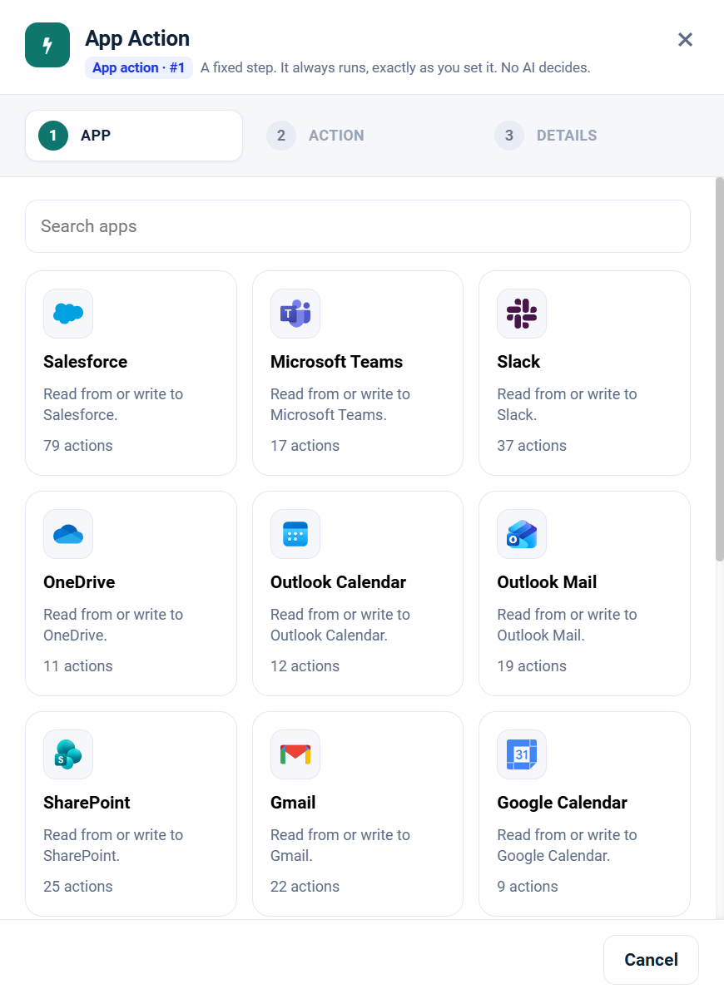

.. _app-action-apps:

.. rst-class:: agentic-tutorial

App Action Apps
===============

.. container:: tutorial-intro

   An App Action is one fixed operation in a connected app. It always runs, exactly as you set it; no AI decides. 17 apps offer 331 actions today, and 200 trigger events that can start a flow.

.. container:: tutorial-start

   **New to App Actions?** Read :doc:`/agentic-ai-guide/tools-integrations/app-actions` first. When the model should decide whether and how to call an app, use :doc:`connector tools </agentic-ai-guide/tools-integrations/connector-tools/index>` instead.

   Drop **App Action** on the canvas and pick the app. Each card shows how many actions it offers.

.. contents:: On this page
   :local:
   :depth: 1
   :class: tool-toc

Choose an app
-------------

Google Workspace
~~~~~~~~~~~~~~~~

.. raw:: html

   

     <article class="tutorial-card tool-card">
       
<h3><a href="gmail.html">Gmail</a></h3>

       
Search, read and label email, draft or send replies, and save attachments.

       
22 actions · 11 read, 11 change data 14 trigger events · Google connection

     </article>
     <article class="tutorial-card tool-card">
       
<h3><a href="google-calendar.html">Google Calendar</a></h3>

       
List events, find busy times, and create or update events.

       
9 actions · 5 read, 4 change data 8 trigger events · Google connection

     </article>
     <article class="tutorial-card tool-card">
       
<h3><a href="google-docs.html">Google Docs</a></h3>

       
Read documents as text, create them and edit their content.

       
4 actions · 2 read, 2 change data 3 trigger events · Google connection

     </article>
     <article class="tutorial-card tool-card">
       
<h3><a href="google-drive.html">Google Drive</a></h3>

       
Search, read, upload, organise and share files and folders.

       
12 actions · 6 read, 6 change data 13 trigger events · Google connection

     </article>
     <article class="tutorial-card tool-card">
       
<h3><a href="google-sheets.html">Google Sheets</a></h3>

       
Read rows, append and update them, and manage tabs.

       
9 actions · 3 read, 6 change data 5 trigger events · Google connection

     </article>
   

Microsoft 365
~~~~~~~~~~~~~

.. raw:: html

   

     <article class="tutorial-card tool-card">
       
<h3><a href="outlook-mail.html">Outlook Mail</a></h3>

       
Search and read email, reply, forward, draft, move and flag.

       
19 actions · 9 read, 10 change data 12 trigger events · Microsoft Graph connection

     </article>
     <article class="tutorial-card tool-card">
       
<h3><a href="outlook-calendar.html">Outlook Calendar</a></h3>

       
Read calendars, check free/busy, and manage meetings.

       
12 actions · 6 read, 6 change data 12 trigger events · Microsoft Graph connection

     </article>
     <article class="tutorial-card tool-card">
       
<h3><a href="onedrive.html">OneDrive</a></h3>

       
Browse a OneDrive, read file text, upload, move and share.

       
11 actions · 5 read, 6 change data 6 trigger events · Microsoft Graph connection

     </article>
     <article class="tutorial-card tool-card">
       
<h3><a href="sharepoint-online.html">SharePoint</a></h3>

       
Find sites, read and upload library files, and edit list items.

       
25 actions · 15 read, 10 change data 13 trigger events · Microsoft Graph or SharePoint connection

     </article>
     <article class="tutorial-card tool-card">
       
<h3><a href="microsoft-teams.html">Microsoft Teams</a></h3>

       
Read teams, channels, posts and chats, and create meetings.

       
17 actions · 12 read, 5 change data 11 trigger events · Microsoft Graph connection

     </article>
   

Messaging and email
~~~~~~~~~~~~~~~~~~~

.. raw:: html

   

     <article class="tutorial-card tool-card">
       
<h3><a href="slack.html">Slack</a></h3>

       
Read channels and threads, look people up, and post messages.

       
37 actions · 16 read, 21 change data 13 trigger events · Slack connection

     </article>
   

CRM and commerce
~~~~~~~~~~~~~~~~

.. raw:: html

   

     <article class="tutorial-card tool-card">
       
<h3><a href="salesforce.html">Salesforce</a></h3>

       
Look up and change accounts, contacts, leads, opportunities and cases.

       
79 actions · 35 read, 44 change data 24 trigger events · Salesforce connection

     </article>
   

Developer and work tracking
~~~~~~~~~~~~~~~~~~~~~~~~~~~

.. raw:: html

   

     <article class="tutorial-card tool-card">
       
<h3><a href="jira-cloud.html">Jira</a></h3>

       
Search issues with JQL, create, update, transition and comment.

       
28 actions · 18 read, 10 change data 18 trigger events · Jira connection

     </article>
   

Databases
~~~~~~~~~

.. raw:: html

   

     <article class="tutorial-card tool-card">
       
<h3><a href="mysql.html">MySQL</a></h3>

       
Read, filter and count rows, describe tables, and write rows.

       
11 actions · 6 read, 5 change data 12 trigger events · MySQL connection

     </article>
     <article class="tutorial-card tool-card">
       
<h3><a href="postgresql.html">PostgreSQL</a></h3>

       
Read, filter and count rows, describe tables, and write rows.

       
11 actions · 6 read, 5 change data 12 trigger events · PostgreSQL connection

     </article>
     <article class="tutorial-card tool-card">
       
<h3><a href="sql-server.html">SQL Server</a></h3>

       
Read, filter and count rows, describe tables, and write rows.

       
11 actions · 6 read, 5 change data 12 trigger events · SQL Server connection

     </article>
   

Web
~~~

.. raw:: html

   

     <article class="tutorial-card tool-card">
       
<h3><a href="web-search.html">Web Search</a></h3>

       
Search the web and news, fetch pages, read feeds, call URLs.

       
14 actions · 10 read, 4 change data 12 trigger events · Serper connection

     </article>
   

.. note::

   GitHub, Notion, Stripe, Email (IMAP and SMTP) and SQL Database are available as :doc:`agent tools </agentic-ai-guide/tools-integrations/connector-tools/index>` only. Their App Actions are still marked **Coming soon**.

App Action or agent tool?
-------------------------

.. list-table::
   :header-rows: 1
   :widths: 26 37 37

   * -
     - App Action
     - Agent tool
   * - **Who decides**
     - You. The step always runs, with the inputs you set.
     - The model, from the request and the tool descriptions.
   * - **Operations**
     - One action per node.
     - As many as you tick, on one node.
   * - **Best for**
     - Steps that must always happen: save an approved result, send a fixed report, look up a record by key.
     - Looking things up when needed, and acting on a request.
   * - **Writes**
     - Run when the flow reaches the step; put a Human Approval in front where it matters.
     - Each write call waits for approval.

.. toctree::
   :hidden:

   Gmail <gmail>
   Google Calendar <google-calendar>
   Google Docs <google-docs>
   Google Drive <google-drive>
   Google Sheets <google-sheets>
   Outlook Mail <outlook-mail>
   Outlook Calendar <outlook-calendar>
   OneDrive <onedrive>
   SharePoint <sharepoint-online>
   Microsoft Teams <microsoft-teams>
   Slack <slack>
   Salesforce <salesforce>
   Jira <jira-cloud>
   MySQL <mysql>
   PostgreSQL <postgresql>
   SQL Server <sql-server>
   Web Search <web-search>
