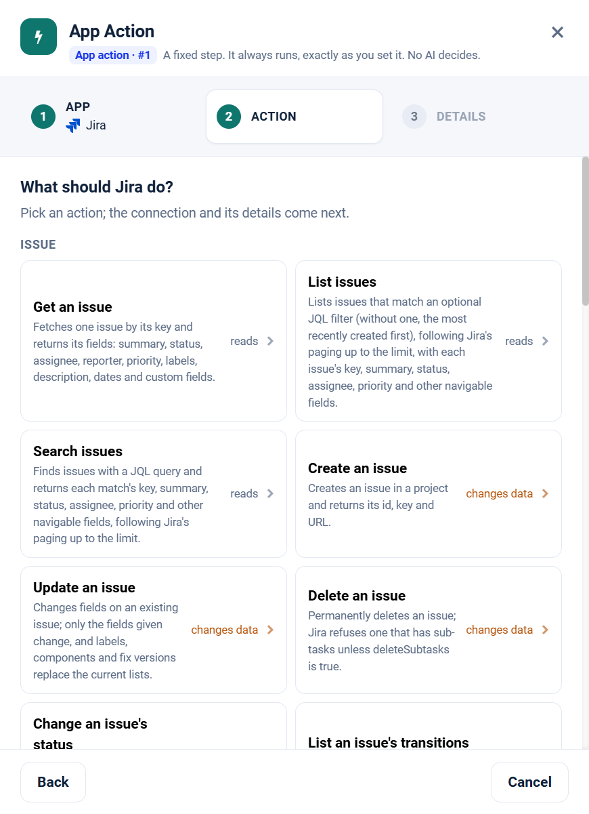

.. _app-action-jira-cloud:

.. rst-class:: agentic-tutorial

Jira App Actions
================

.. raw:: html

   

     
     <dl class="tool-facts">
     
<dt>Node</dt><dd>App Action</dd>

     
<dt>Actions</dt><dd>28 across 8 resources</dd>

     
<dt>Reads / changes data</dt><dd>18 / 10</dd>

     
<dt>Connection</dt><dd>Jira</dd>

     </dl>
   

.. container:: tutorial-intro

   Jira as a fixed workflow step: search issues with JQL, create, update, transition and comment. An App Action runs every time the flow reaches it, exactly as you set it; no model decides. To let an agent choose instead, use the :doc:`Jira Cloud agent tools </agentic-ai-guide/tools-integrations/connector-tools/jira-cloud>`.

.. contents:: On this page
   :local:
   :depth: 1
   :class: tool-toc

Prerequisites
-------------

* **Connection:** A **Jira** connection: the site URL (``https://your-site.atlassian.net``), the account's email and an API token from ``id.atlassian.com``.
* A Jira Cloud account with access to the projects the agent works in, and an API token for it.
* How to create the connection: :ref:`connector-tools-jira-cloud`.

Add a Jira App Action
---------------------

#. Drag **App Action** from **Commonly used** onto the canvas and connect it where the step belongs in the flow.
#. **App:** choose **Jira**, or type ``jira`` in **Search apps**.
#. **Action:** pick one of the 28 actions below. Each is marked **reads** or **changes data**.
#. **Details:** choose the Jira connection and click **Test**, then fill in the inputs. Click a field under **What arrives here** to insert a value from an earlier step.
#. For a read, click **Load the fields** so later steps can use the columns it returns. Then click **Save action**.

   Step 2, **Action**, for Jira.

.. tip::

   A canvas run skips actions that change data unless **Write when run from the canvas** is on; full and scheduled runs always perform them. Every write hands on ``result_status``, ``result_id`` and ``result_error`` for each row. See :doc:`/agentic-ai-guide/tools-integrations/app-actions`.

Actions
-------

The inputs are the boxes on the **Details** step, by their label. Any input can take a value from an earlier step with a ``${...}`` reference.

Issue
~~~~~

.. raw:: html

   

     <a class="tool-op" href="jira-cloud/issue-get.html" target="_blank" rel="noopener">
       Get an issueReads
       Fetches one issue by its key and returns its fields: summary, status, assignee, reporter, priority, labels, description, dates and custom fields.
     </a>
     <a class="tool-op" href="jira-cloud/issue-getmany.html" target="_blank" rel="noopener">
       List issuesReads
       Lists issues that match an optional JQL filter (without one, the most recently created first), following Jira&#x27;s paging up to the limit, with each issue&#x27;s key, summary, status, assignee, priority and other navigable fields.
     </a>
     <a class="tool-op" href="jira-cloud/issue-search.html" target="_blank" rel="noopener">
       Search issuesReads
       Finds issues with a JQL query and returns each match&#x27;s key, summary, status, assignee, priority and other navigable fields, following Jira&#x27;s paging up to the limit.
     </a>
     <a class="tool-op" href="jira-cloud/issue-create.html" target="_blank" rel="noopener">
       Create an issueChanges data
       Creates an issue in a project and returns its id, key and URL. Values go in as plain text: the connector turns the project key, issue type, priority, assignee and parent into the objects Jira expects and the description into Jira&#x27;s rich-text format.
     </a>
     <a class="tool-op" href="jira-cloud/issue-update.html" target="_blank" rel="noopener">
       Update an issueChanges data
       Changes fields on an existing issue; only the fields given change, and labels, components and fix versions replace the current lists.
     </a>
     <a class="tool-op" href="jira-cloud/issue-delete.html" target="_blank" rel="noopener">
       Delete an issueChanges data
       Permanently deletes an issue; Jira refuses one that has sub-tasks unless deleteSubtasks is true.
     </a>
     <a class="tool-op" href="jira-cloud/issue-transition.html" target="_blank" rel="noopener">
       Change an issue&#x27;s statusChanges data
       Moves an issue to another status, such as In Progress or Done, by performing one of its workflow&#x27;s transitions.
     </a>
     <a class="tool-op" href="jira-cloud/issue-listtransitions.html" target="_blank" rel="noopener">
       List an issue&#x27;s transitionsReads
       Lists the transitions the issue can take from its current status, each with its id, name and the status it leads to.
     </a>
     <a class="tool-op" href="jira-cloud/issue-assign.html" target="_blank" rel="noopener">
       Assign an issueChanges data
       Assigns an issue to one person, or to the project&#x27;s default assignee with -1.
     </a>
     <a class="tool-op" href="jira-cloud/issue-changelog.html" target="_blank" rel="noopener">
       Get an issue&#x27;s historyReads
       Returns an issue&#x27;s change history, oldest first and following Jira&#x27;s paging up to the limit: who changed which field, when, and from which value to which.
     </a>
   

Comment
~~~~~~~

.. raw:: html

   

     <a class="tool-op" href="jira-cloud/comment-get.html" target="_blank" rel="noopener">
       Get a commentReads
       Fetches one comment on an issue by its id and returns its author, body (in Atlassian Document Format) and created and updated times.
     </a>
     <a class="tool-op" href="jira-cloud/comment-getmany.html" target="_blank" rel="noopener">
       List comments on an issueReads
       Lists the comments on an issue, oldest first unless ordered otherwise, each with its id, author, body (in Atlassian Document Format) and created and updated times.
     </a>
     <a class="tool-op" href="jira-cloud/comment-create.html" target="_blank" rel="noopener">
       Add a commentChanges data
       Adds a comment to an issue and returns it with its id.
     </a>
     <a class="tool-op" href="jira-cloud/comment-update.html" target="_blank" rel="noopener">
       Edit a commentChanges data
       Replaces the text of an existing comment and returns the updated comment.
     </a>
     <a class="tool-op" href="jira-cloud/comment-delete.html" target="_blank" rel="noopener">
       Delete a commentChanges data
       Permanently deletes one comment from an issue.
     </a>
   

Attachment
~~~~~~~~~~

.. raw:: html

   

     <a class="tool-op" href="jira-cloud/attachment-get.html" target="_blank" rel="noopener">
       Get an attachment&#x27;s detailsReads
       Returns the details of one attachment: file name, size, MIME type, author, created time and the URL of its content; it does not download the file.
     </a>
     <a class="tool-op" href="jira-cloud/attachment-getmany.html" target="_blank" rel="noopener">
       List an issue&#x27;s attachmentsReads
       Lists the files attached to an issue, each with its id, file name, size, MIME type, author, created time and content URL. Use it to find the attachment id that Attachment get and Attachment delete need.
     </a>
     <a class="tool-op" href="jira-cloud/attachment-delete.html" target="_blank" rel="noopener">
       Delete an attachmentChanges data
       Permanently deletes one attachment from its issue.
     </a>
   

Worklog
~~~~~~~

.. raw:: html

   

     <a class="tool-op" href="jira-cloud/worklog-getmany.html" target="_blank" rel="noopener">
       List an issue&#x27;s worklogsReads
       Lists the time logged on an issue, each entry with its id, author, time spent, start time and note.
     </a>
     <a class="tool-op" href="jira-cloud/worklog-create.html" target="_blank" rel="noopener">
       Log work on an issueChanges data
       Logs time spent on an issue and returns the new worklog with its id.
     </a>
   

Project
~~~~~~~

.. raw:: html

   

     <a class="tool-op" href="jira-cloud/project-get.html" target="_blank" rel="noopener">
       Get a projectReads
       Fetches one project by its key or id and returns its name, type, lead, description, issue types and components.
     </a>
     <a class="tool-op" href="jira-cloud/project-getmany.html" target="_blank" rel="noopener">
       List projectsReads
       Lists the projects the connection can see, with key, name, type and id, following Jira&#x27;s paging up to the limit.
     </a>
   

Sprint
~~~~~~

.. raw:: html

   

     <a class="tool-op" href="jira-cloud/sprint-get.html" target="_blank" rel="noopener">
       Get a sprintReads
       Fetches one sprint by its id and returns its name, state (future, active or closed), goal, board and start, end and completion dates.
     </a>
     <a class="tool-op" href="jira-cloud/sprint-getmany.html" target="_blank" rel="noopener">
       List a board&#x27;s sprintsReads
       Lists the sprints of a Scrum board, each with its id, name, state, goal and dates, following Jira&#x27;s paging up to the limit.
     </a>
   

Board
~~~~~

.. raw:: html

   

     <a class="tool-op" href="jira-cloud/board-getmany.html" target="_blank" rel="noopener">
       List boardsReads
       Lists the Scrum and Kanban boards the connection can see, with each board&#x27;s id, name, type and project, following Jira&#x27;s paging up to the limit.
     </a>
   

User
~~~~

.. raw:: html

   

     <a class="tool-op" href="jira-cloud/user-get.html" target="_blank" rel="noopener">
       Get a userReads
       Fetches one user by Atlassian account id and returns the display name, email address (when the user&#x27;s privacy settings show it), active flag and time zone.
     </a>
     <a class="tool-op" href="jira-cloud/user-getmany.html" target="_blank" rel="noopener">
       List usersReads
       Lists every user of the site, including app and bot accounts, with account id, display name, account type and active flag, following Jira&#x27;s paging up to the limit.
     </a>
     <a class="tool-op" href="jira-cloud/user-search.html" target="_blank" rel="noopener">
       Find usersReads
       Finds users whose display name or email address starts with the given text and returns their account ids, display names and active flags.
     </a>
   

Start a flow from Jira
----------------------

A :doc:`Trigger </agentic-ai-guide/triggers-automation/triggers>` can watch Jira and start the flow when one of these events happens. Pick Jira in the Trigger, then the event.

.. list-table::
   :header-rows: 1
   :widths: 34 66
   :class: tool-table

   * - Event
     - What it reports
   * - **Issue created**
     - Reports each issue created since the last check, in every project the connection can see.
   * - **Issue updated**
     - Reports each issue every time it is updated: a new comment, a changed field or a transition.
   * - **Issue resolved**
     - Reports each issue resolved since the last check, with its resolution.
   * - **Issue status changed**
     - Reports each issue whose status changed since the last check; fields.status holds the new status.
   * - **Issue moved to a status**
     - Filter is the status name as the workflow shows it, for example In Review, without quotes. Reports each issue that moved into that status since the last check.
   * - **Issue created in a project**
     - Filter is the project key, for example FIN. Reports each issue created in that project since the last check.
   * - **Issue created matching JQL**
     - Filter is a JQL condition without ORDER BY, for example project = FIN AND issuetype = Bug. Reports each issue created since the last check that meets it.
   * - **Issue updated matching JQL**
     - Filter is a JQL condition without ORDER BY, for example project = FIN AND priority = Highest. Reports each issue updated since the last check that meets it.
   * - **Issue starts matching JQL**
     - Filter is a JQL condition without ORDER BY, for example status = Blocked or labels = escalation. The first check records the issues that already match; later checks report each issue that newly matches. Best for conditions that fewer than 500 issues meet.
   * - **Issue assigned to me**
     - Reports each issue assigned to the connection's own user since the last check.
   * - **Issue assigned to a person**
     - Filter is the person's Atlassian account id, which a User search returns. Reports each issue assigned to that person since the last check.
   * - **Issue priority changed**
     - Reports each issue whose priority changed since the last check; fields.priority holds the new one.
   * - **Issue became overdue**
     - Reports each unresolved issue once, on the first check after its due date passes. The first check records the issues that are already overdue.
   * - **Comment added to an issue**
     - Issue key is the issue to watch, for example FIN-12. Reports each comment added to it since the last check, with the text as HTML in renderedBody and the writer in author.displayName.
   * - **Attachment added to an issue**
     - Issue key is the issue to watch, for example FIN-12. Reports each file attached to it since the last check, with its name, size, type, author and content address.
   * - **Sprint started**
     - Board id is the Scrum board's id, which a Board list returns. The first check records the active sprint; later checks report each sprint that starts on the board.
   * - **Sprint completed**
     - Board id is the Scrum board's id, which a Board list returns. Reports each sprint of the board completed since the last check.
   * - **Project created**
     - The first check records the projects the connection can see; later checks report each new one.

Related
-------

* :doc:`/agentic-ai-guide/tools-integrations/app-actions` - how App Actions work, reads, writes and safety
* :doc:`/agentic-ai-guide/tools-integrations/app-action-apps/index` - every App Action app
* :doc:`Jira Cloud agent tools </agentic-ai-guide/tools-integrations/connector-tools/jira-cloud>` - the same operations for an Agent Node, with every parameter
