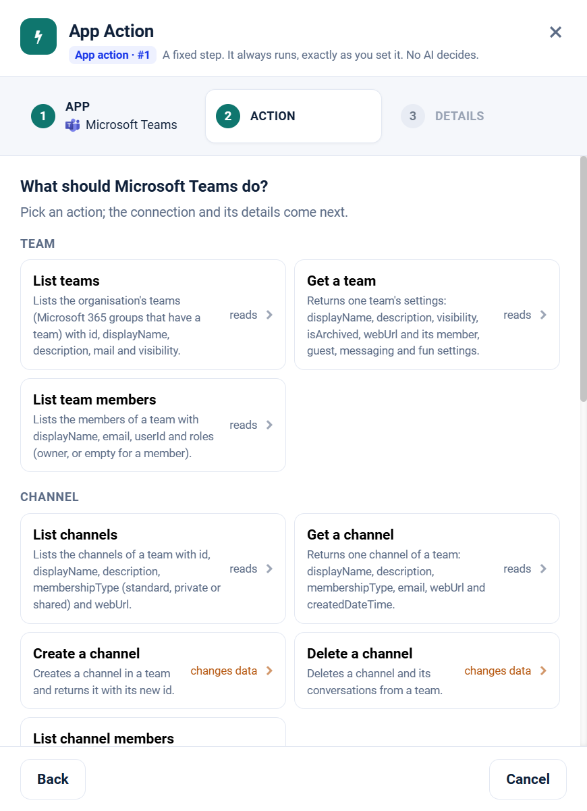

.. _app-action-microsoft-teams:

.. rst-class:: agentic-tutorial

Microsoft Teams App Actions
===========================

.. raw:: html

   

     
     <dl class="tool-facts">
     
<dt>Node</dt><dd>App Action</dd>

     
<dt>Actions</dt><dd>17 across 5 resources</dd>

     
<dt>Reads / changes data</dt><dd>12 / 5</dd>

     
<dt>Connection</dt><dd>Microsoft Graph</dd>

     </dl>
   

.. container:: tutorial-intro

   Microsoft Teams as a fixed workflow step: read teams, channels, posts and chats, and create meetings. An App Action runs every time the flow reaches it, exactly as you set it; no model decides. To let an agent choose instead, use the :doc:`Microsoft Teams agent tools </agentic-ai-guide/tools-integrations/connector-tools/microsoft-teams>`.

.. contents:: On this page
   :local:
   :depth: 1
   :class: tool-toc

Prerequisites
-------------

* **Connection:** A **Microsoft Graph** connection: an Entra ID app registration with its tenant ID, client ID and client secret, and the Microsoft Graph **application** permissions below granted with admin consent.
* ``Team.ReadBasic.All``, ``Channel.ReadBasic.All`` and ``TeamMember.Read.All`` to list teams, channels and members.
* ``ChannelMember.Read.All`` for channel members, ``ChannelMessage.Read.All`` for channel posts and ``Chat.Read.All`` for chats.
* ``Channel.Create`` and ``Channel.Delete.All`` to create and delete channels, and ``OnlineMeetings.ReadWrite.All`` for online meetings.
* Posting a channel or chat message needs a connection that signs in as a user (delegated access). With application credentials Graph refuses the call before anything is sent.
* How to create the connection: :ref:`connector-tools-microsoft-teams`.

Add a Microsoft Teams App Action
--------------------------------

#. Drag **App Action** from **Commonly used** onto the canvas and connect it where the step belongs in the flow.
#. **App:** choose **Microsoft Teams**, or type ``teams`` in **Search apps**.
#. **Action:** pick one of the 17 actions below. Each is marked **reads** or **changes data**.
#. **Details:** choose the Microsoft Graph connection and click **Test**, then fill in the inputs. Click a field under **What arrives here** to insert a value from an earlier step.
#. For a read, click **Load the fields** so later steps can use the columns it returns. Then click **Save action**.

   Step 2, **Action**, for Microsoft Teams.

.. tip::

   A canvas run skips actions that change data unless **Write when run from the canvas** is on; full and scheduled runs always perform them. Every write hands on ``result_status``, ``result_id`` and ``result_error`` for each row. See :doc:`/agentic-ai-guide/tools-integrations/app-actions`.

Actions
-------

The inputs are the boxes on the **Details** step, by their label. Any input can take a value from an earlier step with a ``${...}`` reference.

Team
~~~~

.. raw:: html

   

     <a class="tool-op" href="microsoft-teams/team-getmany.html" target="_blank" rel="noopener">
       List teamsReads
       Lists the organisation&#x27;s teams (Microsoft 365 groups that have a team) with id, displayName, description, mail and visibility.
     </a>
     <a class="tool-op" href="microsoft-teams/team-get.html" target="_blank" rel="noopener">
       Get a teamReads
       Returns one team&#x27;s settings: displayName, description, visibility, isArchived, webUrl and its member, guest, messaging and fun settings.
     </a>
     <a class="tool-op" href="microsoft-teams/team-members.html" target="_blank" rel="noopener">
       List team membersReads
       Lists the members of a team with displayName, email, userId and roles (owner, or empty for a member).
     </a>
   

Channel
~~~~~~~

.. raw:: html

   

     <a class="tool-op" href="microsoft-teams/channel-getmany.html" target="_blank" rel="noopener">
       List channelsReads
       Lists the channels of a team with id, displayName, description, membershipType (standard, private or shared) and webUrl.
     </a>
     <a class="tool-op" href="microsoft-teams/channel-get.html" target="_blank" rel="noopener">
       Get a channelReads
       Returns one channel of a team: displayName, description, membershipType, email, webUrl and createdDateTime.
     </a>
     <a class="tool-op" href="microsoft-teams/channel-create.html" target="_blank" rel="noopener">
       Create a channelChanges data
       Creates a channel in a team and returns it with its new id.
     </a>
     <a class="tool-op" href="microsoft-teams/channel-delete.html" target="_blank" rel="noopener">
       Delete a channelChanges data
       Deletes a channel and its conversations from a team.
     </a>
     <a class="tool-op" href="microsoft-teams/channel-members.html" target="_blank" rel="noopener">
       List channel membersReads
       Lists the members of one channel with displayName, email, userId and roles.
     </a>
   

Channel Message
~~~~~~~~~~~~~~~

.. raw:: html

   

     <a class="tool-op" href="microsoft-teams/channel-message-getmany.html" target="_blank" rel="noopener">
       List channel messagesReads
       Lists the top-level posts of a channel with id, from, subject, body (HTML), createdDateTime and webUrl; replies are left out unless expand is replies.
     </a>
     <a class="tool-op" href="microsoft-teams/channel-message-send.html" target="_blank" rel="noopener">
       Post a channel messageChanges data
       Posts a new message in a channel and returns it with its id and webUrl; the text is sent as HTML. Microsoft Graph posts only for a signed-in user, so the connection needs a user (delegated) access token; with app-only credentials the call is refused before anything is sent.
     </a>
     <a class="tool-op" href="microsoft-teams/channel-message-replies.html" target="_blank" rel="noopener">
       List replies to a postReads
       Lists the replies to one channel post with id, from, body (HTML) and createdDateTime.
     </a>
   

Chat
~~~~

.. raw:: html

   

     <a class="tool-op" href="microsoft-teams/chat-getmany.html" target="_blank" rel="noopener">
       List chatsReads
       Lists one-on-one, group and meeting chats with id, topic, chatType, createdDateTime and lastUpdatedDateTime.
     </a>
     <a class="tool-op" href="microsoft-teams/chat-get.html" target="_blank" rel="noopener">
       Get a chatReads
       Returns one chat: topic, chatType (oneOnOne, group or meeting), createdDateTime, lastUpdatedDateTime and webUrl.
     </a>
     <a class="tool-op" href="microsoft-teams/chat-messages.html" target="_blank" rel="noopener">
       List chat messagesReads
       Lists the messages of one chat, most recently changed first, with id, from, body (HTML) and createdDateTime.
     </a>
     <a class="tool-op" href="microsoft-teams/chat-send.html" target="_blank" rel="noopener">
       Send a chat messageChanges data
       Sends a message in an existing chat and returns it with its id; the text is sent as HTML. Graph sends only for a signed-in user, so the connection needs a user (delegated) access token; with app-only credentials the call is refused before anything is sent.
     </a>
   

Meeting
~~~~~~~

.. raw:: html

   

     <a class="tool-op" href="microsoft-teams/meeting-create.html" target="_blank" rel="noopener">
       Create an online meetingChanges data
       Creates a Teams online meeting on behalf of a user and returns its joinWebUrl, id, start and end.
     </a>
     <a class="tool-op" href="microsoft-teams/meeting-get.html" target="_blank" rel="noopener">
       Get an online meetingReads
       Returns one online meeting: subject, startDateTime, endDateTime, joinWebUrl, participants and dial-in details.
     </a>
   

Start a flow from Microsoft Teams
---------------------------------

A :doc:`Trigger </agentic-ai-guide/triggers-automation/triggers>` can watch Microsoft Teams and start the flow when one of these events happens. Pick Microsoft Teams in the Trigger, then the event.

.. list-table::
   :header-rows: 1
   :widths: 34 66
   :class: tool-table

   * - Event
     - What it reports
   * - **Message posted in a channel**
     - Team id and Channel id are the ids a Team list and a Channel list return. Reports each new post in the channel; replies and system notices are left out.
   * - **Channel message containing a keyword**
     - Team id and Channel id are the ids a Team list and a Channel list return, and Filter the words to look for, for example outage. Reports each new post in the channel whose text contains them.
   * - **Person mentioned in a channel**
     - Team id and Channel id are the ids a Team list and a Channel list return, and Filter the mentioned person's user id or display name. Reports each new post in the channel that mentions that person.
   * - **Channel message posted by a person**
     - Team id and Channel id are the ids a Team list and a Channel list return, and Filter the author's user id or display name. Reports each new post in the channel written by that person.
   * - **Important message posted in a channel**
     - Team id and Channel id are the ids a Team list and a Channel list return. Reports each new post in the channel marked as important.
   * - **Reply posted to a channel message**
     - Team id and Channel id are the ids a Team list and a Channel list return, and Post the id of the post to follow, from a Channel Message list. Reports each new reply to that post.
   * - **Message received in a chat**
     - Chat id is the chat's id, such as 19:...@thread.v2, from a Chat list. Reports each new message in the chat; system notices such as members being added are left out.
   * - **Chat message containing a keyword**
     - Chat id is the chat's id from a Chat list, and Filter the words to look for. Reports each new message in the chat whose text contains them.
   * - **Chat started**
     - User is the person whose chats to watch, as an address or a user id. Reports each new one-on-one, group or meeting chat that person takes part in.
   * - **Channel created**
     - Team id is the team's id, a GUID from a Team list. The first check records the channels; later checks report each channel created in the team.
   * - **Member added to a team**
     - Team id is the team's id, a GUID from a Team list. The first check records the members; later checks report each person added to the team.

Related
-------

* :doc:`/agentic-ai-guide/tools-integrations/app-actions` - how App Actions work, reads, writes and safety
* :doc:`/agentic-ai-guide/tools-integrations/app-action-apps/index` - every App Action app
* :doc:`Microsoft Teams agent tools </agentic-ai-guide/tools-integrations/connector-tools/microsoft-teams>` - the same operations for an Agent Node, with every parameter
