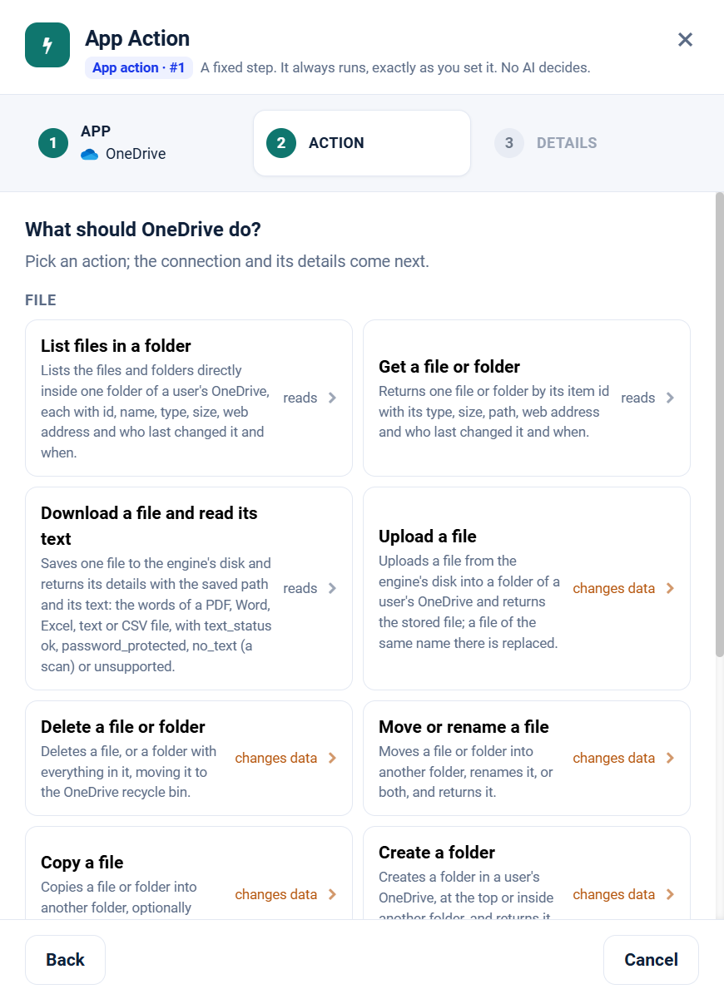

.. _app-action-onedrive:

.. rst-class:: agentic-tutorial

OneDrive App Actions
====================

.. raw:: html

   

     
     <dl class="tool-facts">
     
<dt>Node</dt><dd>App Action</dd>

     
<dt>Actions</dt><dd>11 across 2 resources</dd>

     
<dt>Reads / changes data</dt><dd>5 / 6</dd>

     
<dt>Connection</dt><dd>Microsoft Graph</dd>

     </dl>
   

.. container:: tutorial-intro

   OneDrive as a fixed workflow step: browse a OneDrive, read file text, upload, move and share. An App Action runs every time the flow reaches it, exactly as you set it; no model decides. To let an agent choose instead, use the :doc:`OneDrive agent tools </agentic-ai-guide/tools-integrations/connector-tools/onedrive>`.

.. contents:: On this page
   :local:
   :depth: 1
   :class: tool-toc

Prerequisites
-------------

* **Connection:** A **Microsoft Graph** connection: an Entra ID app registration with its tenant ID, client ID and client secret, and the Microsoft Graph **application** permissions below granted with admin consent.
* ``Files.Read.All`` to read and ``Files.ReadWrite.All`` to upload, move, copy, delete or share.
* Every file tool takes a ``user`` (the OneDrive owner's address or id). Fix it in **Fixed settings** to keep the agent in one person's drive.
* How to create the connection: :ref:`connector-tools-onedrive`.

Add a OneDrive App Action
-------------------------

#. Drag **App Action** from **Commonly used** onto the canvas and connect it where the step belongs in the flow.
#. **App:** choose **OneDrive**, or type ``onedrive`` in **Search apps**.
#. **Action:** pick one of the 11 actions below. Each is marked **reads** or **changes data**.
#. **Details:** choose the Microsoft Graph connection and click **Test**, then fill in the inputs. Click a field under **What arrives here** to insert a value from an earlier step.
#. For a read, click **Load the fields** so later steps can use the columns it returns. Then click **Save action**.

   Step 2, **Action**, for OneDrive.

.. tip::

   A canvas run skips actions that change data unless **Write when run from the canvas** is on; full and scheduled runs always perform them. Every write hands on ``result_status``, ``result_id`` and ``result_error`` for each row. See :doc:`/agentic-ai-guide/tools-integrations/app-actions`.

Actions
-------

The inputs are the boxes on the **Details** step, by their label. Any input can take a value from an earlier step with a ``${...}`` reference.

File
~~~~

.. raw:: html

   

     <a class="tool-op" href="../connector-tools/onedrive/file-getmany.html" target="_blank" rel="noopener">
       List files in a folderReads
       Lists the files and folders directly inside one folder of a user&#x27;s OneDrive, each with id, name, type, size, web address and who last changed it and when.
     </a>
     <a class="tool-op" href="../connector-tools/onedrive/file-get.html" target="_blank" rel="noopener">
       Get a file or folderReads
       Returns one file or folder by its item id with its type, size, path, web address and who last changed it and when.
     </a>
     <a class="tool-op" href="../connector-tools/onedrive/file-download.html" target="_blank" rel="noopener">
       Download a file and read its textReads
       Saves one file to the engine&#x27;s disk and returns its details with the saved path and its text: the words of a PDF, Word, Excel, text or CSV file, with text_status ok, password_protected, no_text (a scan) or unsupported.
     </a>
     <a class="tool-op" href="../connector-tools/onedrive/file-upload.html" target="_blank" rel="noopener">
       Upload a fileChanges data
       Uploads a file from the engine&#x27;s disk into a folder of a user&#x27;s OneDrive and returns the stored file; a file of the same name there is replaced.
     </a>
     <a class="tool-op" href="../connector-tools/onedrive/file-delete.html" target="_blank" rel="noopener">
       Delete a file or folderChanges data
       Deletes a file, or a folder with everything in it, moving it to the OneDrive recycle bin.
     </a>
     <a class="tool-op" href="../connector-tools/onedrive/file-move.html" target="_blank" rel="noopener">
       Move or rename a fileChanges data
       Moves a file or folder into another folder, renames it, or both, and returns it.
     </a>
     <a class="tool-op" href="../connector-tools/onedrive/file-copy.html" target="_blank" rel="noopener">
       Copy a fileChanges data
       Copies a file or folder into another folder, optionally under a new name.
     </a>
     <a class="tool-op" href="../connector-tools/onedrive/file-createfolder.html" target="_blank" rel="noopener">
       Create a folderChanges data
       Creates a folder in a user&#x27;s OneDrive, at the top or inside another folder, and returns it with its id.
     </a>
     <a class="tool-op" href="../connector-tools/onedrive/file-sharelink.html" target="_blank" rel="noopener">
       Create a sharing linkChanges data
       Creates a sharing link to a file or folder and returns the link with its web address, type and scope.
     </a>
   

Drive
~~~~~

.. raw:: html

   

     <a class="tool-op" href="../connector-tools/onedrive/drive-get.html" target="_blank" rel="noopener">
       Get a user&#x27;s OneDriveReads
       Returns a user&#x27;s OneDrive with its id, owner, web address and storage quota (total, used and remaining).
     </a>
     <a class="tool-op" href="../connector-tools/onedrive/drive-getmany.html" target="_blank" rel="noopener">
       List drivesReads
       Lists a user&#x27;s drives with their ids, names, types and owners.
     </a>
   

Start a flow from OneDrive
--------------------------

A :doc:`Trigger </agentic-ai-guide/triggers-automation/triggers>` can watch OneDrive and start the flow when one of these events happens. Pick OneDrive in the Trigger, then the event.

.. list-table::
   :header-rows: 1
   :widths: 34 66
   :class: tool-table

   * - Event
     - What it reports
   * - **File added to a folder**
     - User is the OneDrive owner's address, and Folder the folder to watch: a path such as Reports/2026, an item id, or / for the top. The first check records the folder's files; later checks report each file that appears directly in it, uploaded, copied or moved in.
   * - **File created or modified in a folder**
     - User is the OneDrive owner's address, and Folder the folder to watch: a path such as Reports/2026, an item id, or / for the top. Reports each file directly in it that is added or saved since the last check.
   * - **File added with a name containing**
     - User is the OneDrive owner's address, and Folder the folder to watch: a path such as Reports/2026, an item id, or / for the top, and Filter a text the file name contains, such as .pdf or invoice. The first check records the matching files; later checks report each new one that appears directly in the folder.
   * - **Folder created in a folder**
     - User is the OneDrive owner's address, and Folder the folder to watch: a path such as Reports/2026, an item id, or / for the top. The first check records its folders; later checks report each folder created directly inside it.
   * - **Specific file changed**
     - User is the OneDrive owner's address, and File id the file's item id, from the id column of a folder list. Reports the file each time it is saved.
   * - **Storage state changed**
     - User is the OneDrive owner's address. Reports the drive whenever its storage state changes, for example from normal to nearing or critical.

Related
-------

* :doc:`/agentic-ai-guide/tools-integrations/app-actions` - how App Actions work, reads, writes and safety
* :doc:`/agentic-ai-guide/tools-integrations/app-action-apps/index` - every App Action app
* :doc:`OneDrive agent tools </agentic-ai-guide/tools-integrations/connector-tools/onedrive>` - the same operations for an Agent Node, with every parameter
