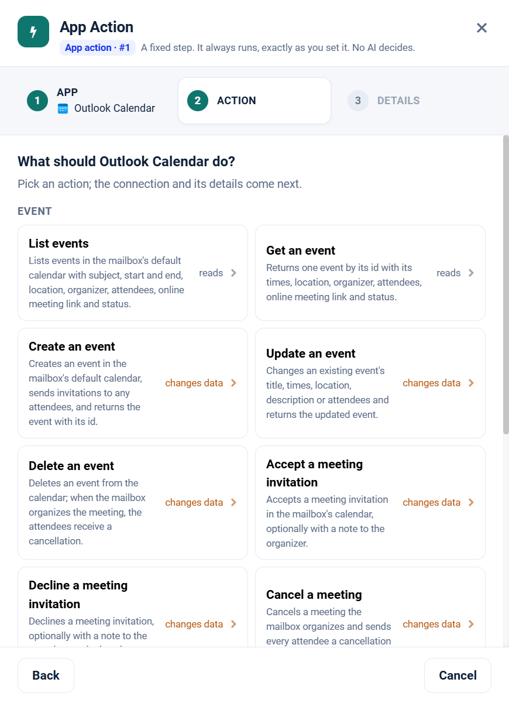

.. _app-action-outlook-calendar:

.. rst-class:: agentic-tutorial

Outlook Calendar App Actions
============================

.. raw:: html

   

     
     <dl class="tool-facts">
     
<dt>Node</dt><dd>App Action</dd>

     
<dt>Actions</dt><dd>12 across 3 resources</dd>

     
<dt>Reads / changes data</dt><dd>6 / 6</dd>

     
<dt>Connection</dt><dd>Microsoft Graph</dd>

     </dl>
   

.. container:: tutorial-intro

   Outlook Calendar as a fixed workflow step: read calendars, check free/busy, and manage meetings. An App Action runs every time the flow reaches it, exactly as you set it; no model decides. To let an agent choose instead, use the :doc:`Outlook Calendar agent tools </agentic-ai-guide/tools-integrations/connector-tools/outlook-calendar>`.

.. contents:: On this page
   :local:
   :depth: 1
   :class: tool-toc

Prerequisites
-------------

* **Connection:** A **Microsoft Graph** connection: an Entra ID app registration with its tenant ID, client ID and client secret, and the Microsoft Graph **application** permissions below granted with admin consent.
* ``Calendars.Read`` to read and ``Calendars.ReadWrite`` to create, update, accept, decline or cancel.
* Every tool takes a ``mailbox``; event tools always work on that mailbox's default calendar.
* How to create the connection: :ref:`connector-tools-outlook-calendar`.

Add a Outlook Calendar App Action
---------------------------------

#. Drag **App Action** from **Commonly used** onto the canvas and connect it where the step belongs in the flow.
#. **App:** choose **Outlook Calendar**, or type ``outlook calendar`` in **Search apps**.
#. **Action:** pick one of the 12 actions below. Each is marked **reads** or **changes data**.
#. **Details:** choose the Microsoft Graph connection and click **Test**, then fill in the inputs. Click a field under **What arrives here** to insert a value from an earlier step.
#. For a read, click **Load the fields** so later steps can use the columns it returns. Then click **Save action**.

   Step 2, **Action**, for Outlook Calendar.

.. tip::

   A canvas run skips actions that change data unless **Write when run from the canvas** is on; full and scheduled runs always perform them. Every write hands on ``result_status``, ``result_id`` and ``result_error`` for each row. See :doc:`/agentic-ai-guide/tools-integrations/app-actions`.

Actions
-------

The inputs are the boxes on the **Details** step, by their label. Any input can take a value from an earlier step with a ``${...}`` reference.

Event
~~~~~

.. raw:: html

   

     <a class="tool-op" href="outlook-calendar/event-getmany.html" target="_blank" rel="noopener">
       List eventsReads
       Lists events in the mailbox&#x27;s default calendar with subject, start and end, location, organizer, attendees, online meeting link and status.
     </a>
     <a class="tool-op" href="outlook-calendar/event-get.html" target="_blank" rel="noopener">
       Get an eventReads
       Returns one event by its id with its times, location, organizer, attendees, online meeting link and status.
     </a>
     <a class="tool-op" href="outlook-calendar/event-create.html" target="_blank" rel="noopener">
       Create an eventChanges data
       Creates an event in the mailbox&#x27;s default calendar, sends invitations to any attendees, and returns the event with its id.
     </a>
     <a class="tool-op" href="outlook-calendar/event-update.html" target="_blank" rel="noopener">
       Update an eventChanges data
       Changes an existing event&#x27;s title, times, location, description or attendees and returns the updated event.
     </a>
     <a class="tool-op" href="outlook-calendar/event-delete.html" target="_blank" rel="noopener">
       Delete an eventChanges data
       Deletes an event from the calendar; when the mailbox organizes the meeting, the attendees receive a cancellation.
     </a>
     <a class="tool-op" href="outlook-calendar/event-accept.html" target="_blank" rel="noopener">
       Accept a meeting invitationChanges data
       Accepts a meeting invitation in the mailbox&#x27;s calendar, optionally with a note to the organizer.
     </a>
     <a class="tool-op" href="outlook-calendar/event-decline.html" target="_blank" rel="noopener">
       Decline a meeting invitationChanges data
       Declines a meeting invitation, optionally with a note to the organizer, and takes the meeting off the calendar.
     </a>
     <a class="tool-op" href="outlook-calendar/event-cancel.html" target="_blank" rel="noopener">
       Cancel a meetingChanges data
       Cancels a meeting the mailbox organizes and sends every attendee a cancellation carrying the comment.
     </a>
   

Calendar
~~~~~~~~

.. raw:: html

   

     <a class="tool-op" href="outlook-calendar/calendar-getmany.html" target="_blank" rel="noopener">
       List calendarsReads
       Lists the calendars of a mailbox with their ids, names, colours, owners and which one is the default.
     </a>
     <a class="tool-op" href="outlook-calendar/calendar-get.html" target="_blank" rel="noopener">
       Get a calendarReads
       Returns one calendar by its id with its name, colour, owner and edit and sharing rights.
     </a>
   

Free Time
~~~~~~~~~

.. raw:: html

   

     <a class="tool-op" href="outlook-calendar/free-time-find.html" target="_blank" rel="noopener">
       Find meeting timesReads
       Suggests meeting times when the organizer and the attendees are free, one row per suggestion with its time, a confidence score and who is available; when nothing fits, one row gives Graph&#x27;s emptySuggestionsReason.
     </a>
     <a class="tool-op" href="outlook-calendar/free-time-schedule.html" target="_blank" rel="noopener">
       Get free/busy schedulesReads
       Returns the free/busy schedule of people or rooms over a period, one row per address: an availability view with one digit per slot (0 free, 1 tentative, 2 busy, 3 out of office, 4 working elsewhere) and the busy items.
     </a>
   

Start a flow from Outlook Calendar
----------------------------------

A :doc:`Trigger </agentic-ai-guide/triggers-automation/triggers>` can watch Outlook Calendar and start the flow when one of these events happens. Pick Outlook Calendar in the Trigger, then the event.

.. list-table::
   :header-rows: 1
   :widths: 34 66
   :class: tool-table

   * - Event
     - What it reports
   * - **Event created**
     - Mailbox is the calendar to watch. Reports each event added to the calendar, created there or accepted from an invitation.
   * - **Event created or changed**
     - Mailbox is the calendar to watch. Reports each event added or changed since the last check, including a guest's reply.
   * - **Event starting within the hour**
     - Mailbox is the calendar to watch. Reports each meeting once, about an hour before it starts, or on the first check after it is booked when it starts sooner. Meetings already that close at the first check are recorded, not reported.
   * - **Event cancelled**
     - Mailbox is the calendar to watch. Reports each meeting its organizer cancels; a meeting the mailbox itself cancels leaves the calendar and is not seen.
   * - **Event created with a title containing**
     - Mailbox is the calendar to watch, and Filter the words to find in the title, for example interview. Reports each new event whose title contains them, regardless of case.
   * - **Event created with an attendee**
     - Mailbox is the calendar to watch, and Filter an attendee's email address or domain, for example contoso.com. Reports each new event that invites a matching attendee.
   * - **Event created by an organizer**
     - Mailbox is the calendar to watch, and Filter the organizer's email address. Reports each new event in the calendar that this person organizes.
   * - **Event created at a location**
     - Mailbox is the calendar to watch, and Filter the words to find in the location, for example Boardroom. Reports each new event booked at a matching location.
   * - **Online meeting scheduled**
     - Mailbox is the calendar to watch. Reports each new event that carries an online meeting, such as a Teams meeting.
   * - **Out-of-office time booked**
     - Mailbox is the calendar to watch. Reports each new event shown as Out of office, such as leave or travel.
   * - **Recurring meeting created**
     - Mailbox is the calendar to watch. Reports each new repeating meeting once, as its series.
   * - **Meeting rescheduled or changed**
     - Mailbox is the calendar to watch, and Event id the meeting's id from an Event list. Reports the meeting each time its title, time, location, attendees or cancellation change.

Related
-------

* :doc:`/agentic-ai-guide/tools-integrations/app-actions` - how App Actions work, reads, writes and safety
* :doc:`/agentic-ai-guide/tools-integrations/app-action-apps/index` - every App Action app
* :doc:`Outlook Calendar agent tools </agentic-ai-guide/tools-integrations/connector-tools/outlook-calendar>` - the same operations for an Agent Node, with every parameter
