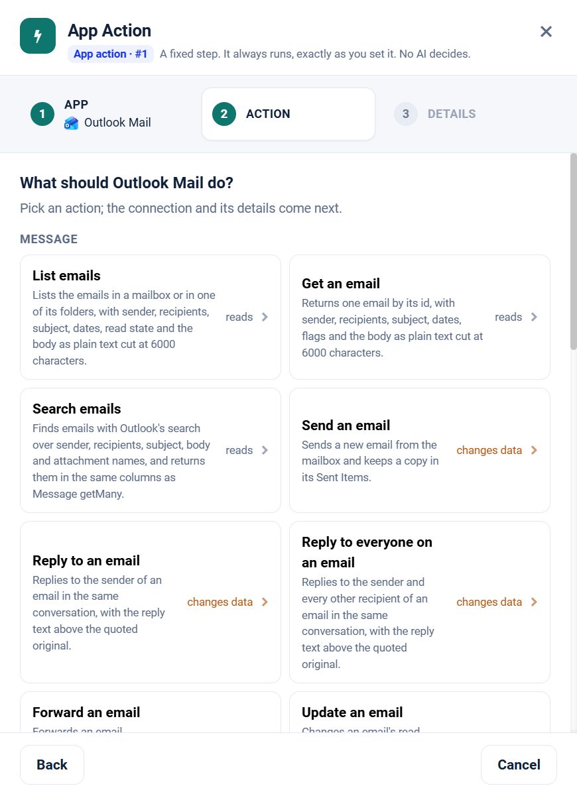

.. _app-action-outlook-mail:

.. rst-class:: agentic-tutorial

Outlook Mail App Actions
========================

.. raw:: html

   

     
     <dl class="tool-facts">
     
<dt>Node</dt><dd>App Action</dd>

     
<dt>Actions</dt><dd>19 across 3 resources</dd>

     
<dt>Reads / changes data</dt><dd>9 / 10</dd>

     
<dt>Connection</dt><dd>Microsoft Graph</dd>

     </dl>
   

.. container:: tutorial-intro

   Outlook Mail as a fixed workflow step: search and read email, reply, forward, draft, move and flag. An App Action runs every time the flow reaches it, exactly as you set it; no model decides. To let an agent choose instead, use the :doc:`Outlook Mail agent tools </agentic-ai-guide/tools-integrations/connector-tools/outlook-mail>`.

.. contents:: On this page
   :local:
   :depth: 1
   :class: tool-toc

Prerequisites
-------------

* **Connection:** A **Microsoft Graph** connection: an Entra ID app registration with its tenant ID, client ID and client secret, and the Microsoft Graph **application** permissions below granted with admin consent.
* ``Mail.Read`` to read and ``Mail.ReadWrite`` to draft, move, flag or delete; ``Mail.Send`` to send, reply and forward.
* Every tool takes a ``mailbox`` (a user's address). With application permissions the app can reach any mailbox in the tenant unless an Exchange application access policy limits it; fix ``mailbox`` in **Fixed settings** to keep the agent on one.
* How to create the connection: :ref:`connector-tools-outlook-mail`.

Add a Outlook Mail App Action
-----------------------------

#. Drag **App Action** from **Commonly used** onto the canvas and connect it where the step belongs in the flow.
#. **App:** choose **Outlook Mail**, or type ``outlook`` in **Search apps**.
#. **Action:** pick one of the 19 actions below. Each is marked **reads** or **changes data**.
#. **Details:** choose the Microsoft Graph connection and click **Test**, then fill in the inputs. Click a field under **What arrives here** to insert a value from an earlier step.
#. For a read, click **Load the fields** so later steps can use the columns it returns. Then click **Save action**.

   Step 2, **Action**, for Outlook Mail.

.. tip::

   A canvas run skips actions that change data unless **Write when run from the canvas** is on; full and scheduled runs always perform them. Every write hands on ``result_status``, ``result_id`` and ``result_error`` for each row. See :doc:`/agentic-ai-guide/tools-integrations/app-actions`.

Actions
-------

The inputs are the boxes on the **Details** step, by their label. Any input can take a value from an earlier step with a ``${...}`` reference.

Message
~~~~~~~

.. raw:: html

   

     <a class="tool-op" href="outlook-mail/message-getmany.html" target="_blank" rel="noopener">
       List emailsReads
       Lists the emails in a mailbox or in one of its folders, with sender, recipients, subject, dates, read state and the body as plain text cut at 6000 characters.
     </a>
     <a class="tool-op" href="outlook-mail/message-get.html" target="_blank" rel="noopener">
       Get an emailReads
       Returns one email by its id, with sender, recipients, subject, dates, flags and the body as plain text cut at 6000 characters.
     </a>
     <a class="tool-op" href="outlook-mail/message-search.html" target="_blank" rel="noopener">
       Search emailsReads
       Finds emails with Outlook&#x27;s search over sender, recipients, subject, body and attachment names, and returns them in the same columns as Message getMany.
     </a>
     <a class="tool-op" href="outlook-mail/message-send.html" target="_blank" rel="noopener">
       Send an emailChanges data
       Sends a new email from the mailbox and keeps a copy in its Sent Items.
     </a>
     <a class="tool-op" href="outlook-mail/message-reply.html" target="_blank" rel="noopener">
       Reply to an emailChanges data
       Replies to the sender of an email in the same conversation, with the reply text above the quoted original.
     </a>
     <a class="tool-op" href="outlook-mail/message-replyall.html" target="_blank" rel="noopener">
       Reply to everyone on an emailChanges data
       Replies to the sender and every other recipient of an email in the same conversation, with the reply text above the quoted original.
     </a>
     <a class="tool-op" href="outlook-mail/message-forward.html" target="_blank" rel="noopener">
       Forward an emailChanges data
       Forwards an email, attachments included, to other people with an optional note above it.
     </a>
     <a class="tool-op" href="outlook-mail/message-update.html" target="_blank" rel="noopener">
       Update an emailChanges data
       Changes an email&#x27;s read state, importance, categories or follow-up flag and returns the updated email.
     </a>
     <a class="tool-op" href="outlook-mail/message-move.html" target="_blank" rel="noopener">
       Move an email to a folderChanges data
       Moves an email to another folder and returns it; the moved email has a new id.
     </a>
     <a class="tool-op" href="outlook-mail/message-delete.html" target="_blank" rel="noopener">
       Delete an emailChanges data
       Deletes an email; Outlook moves it to the mailbox&#x27;s Deleted Items folder.
     </a>
     <a class="tool-op" href="outlook-mail/message-createdraft.html" target="_blank" rel="noopener">
       Create a draft emailChanges data
       Saves a new email in the mailbox&#x27;s Drafts folder without sending it, and returns the draft with its id.
     </a>
   

Folder
~~~~~~

.. raw:: html

   

     <a class="tool-op" href="outlook-mail/folder-getmany.html" target="_blank" rel="noopener">
       List mail foldersReads
       Lists the top-level mail folders of a mailbox with their ids, names and unread and total counts; child folders are not included.
     </a>
     <a class="tool-op" href="outlook-mail/folder-get.html" target="_blank" rel="noopener">
       Get a mail folderReads
       Returns one mail folder with its id, name, parent and unread, total and child folder counts.
     </a>
     <a class="tool-op" href="outlook-mail/folder-getmessages.html" target="_blank" rel="noopener">
       List the emails in a folderReads
       Lists the emails inside one mail folder, named by a well-known name or its id, as Microsoft Graph returns them: subject, sender, recipients, dates, read state and a preview.
     </a>
     <a class="tool-op" href="outlook-mail/folder-create.html" target="_blank" rel="noopener">
       Create a mail folderChanges data
       Creates a mail folder at the top level of the mailbox and returns it with its id.
     </a>
     <a class="tool-op" href="outlook-mail/folder-delete.html" target="_blank" rel="noopener">
       Delete a mail folderChanges data
       Deletes a mail folder together with the emails in it.
     </a>
   

Attachment
~~~~~~~~~~

.. raw:: html

   

     <a class="tool-op" href="outlook-mail/attachment-getmany.html" target="_blank" rel="noopener">
       Read email attachmentsReads
       Saves the attachments of one or more emails to the engine&#x27;s disk and returns one row per file: the email it came in, the file name, type and size, the saved path, and with extractText the file&#x27;s text, text_status and text_source.
     </a>
     <a class="tool-op" href="outlook-mail/attachment-download.html" target="_blank" rel="noopener">
       Download email attachmentsReads
       Saves the attachments of one or more emails into a folder on the engine&#x27;s disk, without reading them, and returns one row per file: the email it came in, the file name, type and size, path (where the file was saved) and save_status (saved, skipped when the file was already there, or not_a_file for an attached item or link).
     </a>
     <a class="tool-op" href="outlook-mail/attachment-get.html" target="_blank" rel="noopener">
       Read one email attachmentReads
       Saves one attachment to the engine&#x27;s disk and returns it as one row with its email, name, type, size, saved path and, with extractText, its text, text_status and text_source, read the same way Attachment getMany reads them.
     </a>
   

Start a flow from Outlook Mail
------------------------------

A :doc:`Trigger </agentic-ai-guide/triggers-automation/triggers>` can watch Outlook Mail and start the flow when one of these events happens. Pick Outlook Mail in the Trigger, then the event.

.. list-table::
   :header-rows: 1
   :widths: 34 66
   :class: tool-table

   * - Event
     - What it reports
   * - **Email received**
     - Mailbox is the address to watch. Reports each email that arrives in the Inbox.
   * - **Email received from a sender**
     - Mailbox is the address to watch, and Filter the sender's email address, for example billing@vendor.com. Reports each email from that sender that arrives in the Inbox.
   * - **Email received from a domain**
     - Mailbox is the address to watch, and Filter the sender's domain, for example contoso.com. Reports each email arriving in the Inbox from an address at that domain.
   * - **Email received for an address**
     - Mailbox is the address to watch, and Filter an address on the To line, for example support@contoso.com. Reports each email arriving in the Inbox that was sent to it.
   * - **Email received with a subject containing**
     - Mailbox is the address to watch, and Filter the words to find in the subject, for example invoice. Reports each email arriving in the Inbox whose subject contains them, regardless of case.
   * - **Email with an attachment received**
     - Mailbox is the address to watch. Reports each email that arrives in the Inbox with a file attached; images embedded in the body do not count.
   * - **High-importance email received**
     - Mailbox is the address to watch. Reports each email marked high importance that arrives in the Inbox.
   * - **Email received in a folder**
     - Mailbox is the address to watch, and Folder a well-known folder name such as archive or junkemail, or a folder id from a Folder list. Reports each email delivered to that folder; an email moved there later keeps its received time and is not reported.
   * - **Email sent**
     - Mailbox is the address to watch. Reports each email the mailbox sends, as saved in Sent Items.
   * - **Email matching a search received**
     - Mailbox is the address to watch, and Filter an Outlook search, for example invoice from:billing@vendor.com hasattachments:yes. Reports each email arriving in the Inbox that matches it.
   * - **Email flagged for follow-up**
     - Mailbox is the address to watch. The first check records the emails already flagged; later checks report each Inbox email flagged for follow-up.
   * - **Email given a category**
     - Mailbox is the address to watch, and Filter the category name exactly as Outlook shows it, for example Invoices. The first check records the emails that already have it; later checks report each Inbox email given it.

Related
-------

* :doc:`/agentic-ai-guide/tools-integrations/app-actions` - how App Actions work, reads, writes and safety
* :doc:`/agentic-ai-guide/tools-integrations/app-action-apps/index` - every App Action app
* :doc:`Outlook Mail agent tools </agentic-ai-guide/tools-integrations/connector-tools/outlook-mail>` - the same operations for an Agent Node, with every parameter
