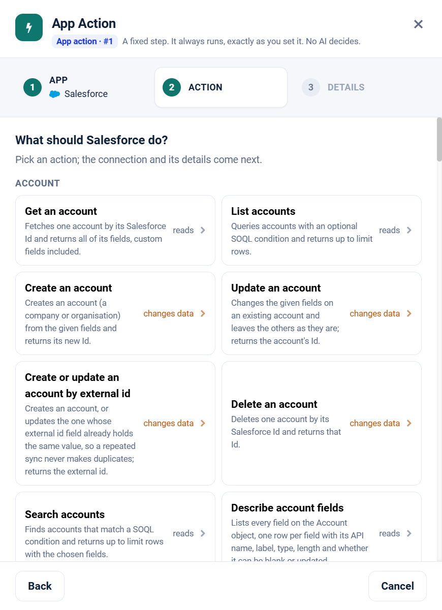

.. _app-action-salesforce:

.. rst-class:: agentic-tutorial

Salesforce App Actions
======================

.. raw:: html

   

     
     <dl class="tool-facts">
     
<dt>Node</dt><dd>App Action</dd>

     
<dt>Actions</dt><dd>79 across 13 resources</dd>

     
<dt>Reads / changes data</dt><dd>35 / 44</dd>

     
<dt>Connection</dt><dd>Salesforce</dd>

     </dl>
   

.. container:: tutorial-intro

   Salesforce as a fixed workflow step: look up and change accounts, contacts, leads, opportunities and cases. An App Action runs every time the flow reaches it, exactly as you set it; no model decides. To let an agent choose instead, use the :doc:`Salesforce agent tools </agentic-ai-guide/tools-integrations/connector-tools/salesforce>`.

.. contents:: On this page
   :local:
   :depth: 1
   :class: tool-toc

Prerequisites
-------------

* **Connection:** A **Salesforce** connection to your org. The agent can see and change only what that Salesforce user can.
* A Salesforce user with **API Enabled**, and object and field access for everything the agent reads or writes.
* A saved Salesforce connection that passes **Test Connection**.
* How to create the connection: :ref:`connector-tools-salesforce`.

Add a Salesforce App Action
---------------------------

#. Drag **App Action** from **Commonly used** onto the canvas and connect it where the step belongs in the flow.
#. **App:** choose **Salesforce**, or type ``salesforce`` in **Search apps**.
#. **Action:** pick one of the 79 actions below. Each is marked **reads** or **changes data**.
#. **Details:** choose the Salesforce connection and click **Test**, then fill in the inputs. Click a field under **What arrives here** to insert a value from an earlier step.
#. For a read, click **Load the fields** so later steps can use the columns it returns. Then click **Save action**.

   Step 2, **Action**, for Salesforce.

.. tip::

   A canvas run skips actions that change data unless **Write when run from the canvas** is on; full and scheduled runs always perform them. Every write hands on ``result_status``, ``result_id`` and ``result_error`` for each row. See :doc:`/agentic-ai-guide/tools-integrations/app-actions`.

Actions
-------

The inputs are the boxes on the **Details** step, by their label. Any input can take a value from an earlier step with a ``${...}`` reference.

Account
~~~~~~~

.. raw:: html

   

     <a class="tool-op" href="salesforce/account-get.html" target="_blank" rel="noopener">
       Get an accountReads
       Fetches one account by its Salesforce Id and returns all of its fields, custom fields included.
     </a>
     <a class="tool-op" href="salesforce/account-getmany.html" target="_blank" rel="noopener">
       List accountsReads
       Queries accounts with an optional SOQL condition and returns up to limit rows.
     </a>
     <a class="tool-op" href="salesforce/account-create.html" target="_blank" rel="noopener">
       Create an accountChanges data
       Creates an account (a company or organisation) from the given fields and returns its new Id.
     </a>
     <a class="tool-op" href="salesforce/account-update.html" target="_blank" rel="noopener">
       Update an accountChanges data
       Changes the given fields on an existing account and leaves the others as they are; returns the account&#x27;s Id.
     </a>
     <a class="tool-op" href="salesforce/account-upsert.html" target="_blank" rel="noopener">
       Create or update an account by external idChanges data
       Creates an account, or updates the one whose external id field already holds the same value, so a repeated sync never makes duplicates; returns the external id.
     </a>
     <a class="tool-op" href="salesforce/account-delete.html" target="_blank" rel="noopener">
       Delete an accountChanges data
       Deletes one account by its Salesforce Id and returns that Id.
     </a>
     <a class="tool-op" href="salesforce/account-search.html" target="_blank" rel="noopener">
       Search accountsReads
       Finds accounts that match a SOQL condition and returns up to limit rows with the chosen fields.
     </a>
     <a class="tool-op" href="salesforce/account-describe.html" target="_blank" rel="noopener">
       Describe account fieldsReads
       Lists every field on the Account object, one row per field with its API name, label, type, length and whether it can be blank or updated.
     </a>
     <a class="tool-op" href="salesforce/account-count.html" target="_blank" rel="noopener">
       Count accountsReads
       Counts the accounts that match a SOQL condition and returns one row with the total, without fetching the records.
     </a>
     <a class="tool-op" href="salesforce/account-addnote.html" target="_blank" rel="noopener">
       Add a note to an accountChanges data
       Attaches a note (a classic Salesforce Note with a title and body) to the account and returns the note&#x27;s Id.
     </a>
   

Contact
~~~~~~~

.. raw:: html

   

     <a class="tool-op" href="salesforce/contact-get.html" target="_blank" rel="noopener">
       Get a contactReads
       Fetches one contact by its Salesforce Id and returns all of its fields, custom fields included.
     </a>
     <a class="tool-op" href="salesforce/contact-getmany.html" target="_blank" rel="noopener">
       List contactsReads
       Queries contacts with an optional SOQL condition and returns up to limit rows.
     </a>
     <a class="tool-op" href="salesforce/contact-create.html" target="_blank" rel="noopener">
       Create a contactChanges data
       Creates a contact (a person, usually at an account) from the given fields and returns its new Id.
     </a>
     <a class="tool-op" href="salesforce/contact-update.html" target="_blank" rel="noopener">
       Update a contactChanges data
       Changes the given fields on an existing contact and leaves the others as they are; returns the contact&#x27;s Id.
     </a>
     <a class="tool-op" href="salesforce/contact-upsert.html" target="_blank" rel="noopener">
       Create or update a contact by external idChanges data
       Creates a contact, or updates the one whose external id field already holds the same value, so a repeated sync never makes duplicates; returns the external id.
     </a>
     <a class="tool-op" href="salesforce/contact-delete.html" target="_blank" rel="noopener">
       Delete a contactChanges data
       Deletes one contact by its Salesforce Id and returns that Id.
     </a>
     <a class="tool-op" href="salesforce/contact-describe.html" target="_blank" rel="noopener">
       Describe contact fieldsReads
       Lists every field on the Contact object, one row per field with its API name, label, type, length and whether it can be blank or updated.
     </a>
     <a class="tool-op" href="salesforce/contact-addnote.html" target="_blank" rel="noopener">
       Add a note to a contactChanges data
       Attaches a note (a classic Salesforce Note with a title and body) to the contact and returns the note&#x27;s Id.
     </a>
     <a class="tool-op" href="salesforce/contact-addtocampaign.html" target="_blank" rel="noopener">
       Add a contact to a campaignChanges data
       Adds the contact to a campaign as a campaign member and returns the member&#x27;s Id.
     </a>
   

Lead
~~~~

.. raw:: html

   

     <a class="tool-op" href="salesforce/lead-get.html" target="_blank" rel="noopener">
       Get a leadReads
       Fetches one lead by its Salesforce Id and returns all of its fields, custom fields included.
     </a>
     <a class="tool-op" href="salesforce/lead-getmany.html" target="_blank" rel="noopener">
       List leadsReads
       Queries leads with an optional SOQL condition and returns up to limit rows.
     </a>
     <a class="tool-op" href="salesforce/lead-create.html" target="_blank" rel="noopener">
       Create a leadChanges data
       Creates a lead (a prospect not yet qualified) from the given fields and returns its new Id.
     </a>
     <a class="tool-op" href="salesforce/lead-update.html" target="_blank" rel="noopener">
       Update a leadChanges data
       Changes the given fields on an existing lead and leaves the others as they are; returns the lead&#x27;s Id.
     </a>
     <a class="tool-op" href="salesforce/lead-upsert.html" target="_blank" rel="noopener">
       Create or update a lead by external idChanges data
       Creates a lead, or updates the one whose external id field already holds the same value, so a repeated sync never makes duplicates; returns the external id.
     </a>
     <a class="tool-op" href="salesforce/lead-delete.html" target="_blank" rel="noopener">
       Delete a leadChanges data
       Deletes one lead by its Salesforce Id and returns that Id.
     </a>
     <a class="tool-op" href="salesforce/lead-describe.html" target="_blank" rel="noopener">
       Describe lead fieldsReads
       Lists every field on the Lead object, one row per field with its API name, label, type, length and whether it can be blank or updated.
     </a>
     <a class="tool-op" href="salesforce/lead-addnote.html" target="_blank" rel="noopener">
       Add a note to a leadChanges data
       Attaches a note (a classic Salesforce Note with a title and body) to the lead and returns the note&#x27;s Id.
     </a>
     <a class="tool-op" href="salesforce/lead-addtocampaign.html" target="_blank" rel="noopener">
       Add a lead to a campaignChanges data
       Adds the lead to a campaign as a campaign member and returns the member&#x27;s Id.
     </a>
     <a class="tool-op" href="salesforce/lead-convert.html" target="_blank" rel="noopener">
       Convert a leadChanges data
       Converts a lead into an account and a contact, plus an opportunity unless doNotCreateOpportunity is true, and returns Salesforce&#x27;s answer.
     </a>
   

Opportunity
~~~~~~~~~~~

.. raw:: html

   

     <a class="tool-op" href="salesforce/opportunity-get.html" target="_blank" rel="noopener">
       Get an opportunityReads
       Fetches one opportunity by its Salesforce Id and returns all of its fields, custom fields included.
     </a>
     <a class="tool-op" href="salesforce/opportunity-getmany.html" target="_blank" rel="noopener">
       List opportunitiesReads
       Queries opportunities with an optional SOQL condition and returns up to limit rows.
     </a>
     <a class="tool-op" href="salesforce/opportunity-create.html" target="_blank" rel="noopener">
       Create an opportunityChanges data
       Creates an opportunity (a deal in progress) from the given fields and returns its new Id.
     </a>
     <a class="tool-op" href="salesforce/opportunity-update.html" target="_blank" rel="noopener">
       Update an opportunityChanges data
       Changes the given fields on an existing opportunity and leaves the others as they are; returns the opportunity&#x27;s Id.
     </a>
     <a class="tool-op" href="salesforce/opportunity-upsert.html" target="_blank" rel="noopener">
       Create or update an opportunity by external idChanges data
       Creates an opportunity, or updates the one whose external id field already holds the same value, so a repeated sync never makes duplicates; returns the external id.
     </a>
     <a class="tool-op" href="salesforce/opportunity-delete.html" target="_blank" rel="noopener">
       Delete an opportunityChanges data
       Deletes one opportunity by its Salesforce Id and returns that Id.
     </a>
     <a class="tool-op" href="salesforce/opportunity-describe.html" target="_blank" rel="noopener">
       Describe opportunity fieldsReads
       Lists every field on the Opportunity object, one row per field with its API name, label, type, length and whether it can be blank or updated.
     </a>
     <a class="tool-op" href="salesforce/opportunity-addnote.html" target="_blank" rel="noopener">
       Add a note to an opportunityChanges data
       Attaches a note (a classic Salesforce Note with a title and body) to the opportunity and returns the note&#x27;s Id.
     </a>
   

Case
~~~~

.. raw:: html

   

     <a class="tool-op" href="salesforce/case-get.html" target="_blank" rel="noopener">
       Get a caseReads
       Fetches one case by its Salesforce Id and returns all of its fields, custom fields included.
     </a>
     <a class="tool-op" href="salesforce/case-getmany.html" target="_blank" rel="noopener">
       List casesReads
       Queries cases with an optional SOQL condition and returns up to limit rows.
     </a>
     <a class="tool-op" href="salesforce/case-create.html" target="_blank" rel="noopener">
       Create a caseChanges data
       Creates a case (a customer issue or support request) from the given fields and returns its new Id.
     </a>
     <a class="tool-op" href="salesforce/case-update.html" target="_blank" rel="noopener">
       Update a caseChanges data
       Changes the given fields on an existing case and leaves the others as they are; returns the case&#x27;s Id.
     </a>
     <a class="tool-op" href="salesforce/case-delete.html" target="_blank" rel="noopener">
       Delete a caseChanges data
       Deletes one case by its Salesforce Id and returns that Id.
     </a>
     <a class="tool-op" href="salesforce/case-describe.html" target="_blank" rel="noopener">
       Describe case fieldsReads
       Lists every field on the Case object, one row per field with its API name, label, type, length and whether it can be blank or updated.
     </a>
     <a class="tool-op" href="salesforce/case-addcomment.html" target="_blank" rel="noopener">
       Add a case commentChanges data
       Adds a comment to the case&#x27;s Case Comments and returns the comment&#x27;s Id.
     </a>
   

Task
~~~~

.. raw:: html

   

     <a class="tool-op" href="salesforce/task-get.html" target="_blank" rel="noopener">
       Get a taskReads
       Fetches one task by its Salesforce Id and returns all of its fields, custom fields included.
     </a>
     <a class="tool-op" href="salesforce/task-getmany.html" target="_blank" rel="noopener">
       List tasksReads
       Queries tasks with an optional SOQL condition and returns up to limit rows.
     </a>
     <a class="tool-op" href="salesforce/task-create.html" target="_blank" rel="noopener">
       Create a taskChanges data
       Creates a task (a to-do or a logged activity) from the given fields and returns its new Id.
     </a>
     <a class="tool-op" href="salesforce/task-update.html" target="_blank" rel="noopener">
       Update a taskChanges data
       Changes the given fields on an existing task and leaves the others as they are; returns the task&#x27;s Id.
     </a>
     <a class="tool-op" href="salesforce/task-delete.html" target="_blank" rel="noopener">
       Delete a taskChanges data
       Deletes one task by its Salesforce Id and returns that Id.
     </a>
     <a class="tool-op" href="salesforce/task-describe.html" target="_blank" rel="noopener">
       Describe task fieldsReads
       Lists every field on the Task object, one row per field with its API name, label, type, length and whether it can be blank or updated.
     </a>
   

Event
~~~~~

.. raw:: html

   

     <a class="tool-op" href="salesforce/event-get.html" target="_blank" rel="noopener">
       Get an eventReads
       Fetches one event by its Salesforce Id and returns all of its fields, custom fields included.
     </a>
     <a class="tool-op" href="salesforce/event-getmany.html" target="_blank" rel="noopener">
       List eventsReads
       Queries events with an optional SOQL condition and returns up to limit rows.
     </a>
     <a class="tool-op" href="salesforce/event-create.html" target="_blank" rel="noopener">
       Create an eventChanges data
       Creates an event (a meeting on the Salesforce calendar) from the given fields and returns its new Id.
     </a>
     <a class="tool-op" href="salesforce/event-update.html" target="_blank" rel="noopener">
       Update an eventChanges data
       Changes the given fields on an existing event and leaves the others as they are; returns the event&#x27;s Id.
     </a>
     <a class="tool-op" href="salesforce/event-delete.html" target="_blank" rel="noopener">
       Delete an eventChanges data
       Deletes one event by its Salesforce Id and returns that Id.
     </a>
   

Campaign
~~~~~~~~

.. raw:: html

   

     <a class="tool-op" href="salesforce/campaign-get.html" target="_blank" rel="noopener">
       Get a campaignReads
       Fetches one campaign by its Salesforce Id and returns all of its fields, custom fields included.
     </a>
     <a class="tool-op" href="salesforce/campaign-getmany.html" target="_blank" rel="noopener">
       List campaignsReads
       Queries campaigns with an optional SOQL condition and returns up to limit rows.
     </a>
     <a class="tool-op" href="salesforce/campaign-create.html" target="_blank" rel="noopener">
       Create a campaignChanges data
       Creates a campaign (a marketing initiative) from the given fields and returns its new Id.
     </a>
     <a class="tool-op" href="salesforce/campaign-update.html" target="_blank" rel="noopener">
       Update a campaignChanges data
       Changes the given fields on an existing campaign and leaves the others as they are; returns the campaign&#x27;s Id.
     </a>
     <a class="tool-op" href="salesforce/campaign-delete.html" target="_blank" rel="noopener">
       Delete a campaignChanges data
       Deletes one campaign by its Salesforce Id and returns that Id.
     </a>
   

Attachment
~~~~~~~~~~

.. raw:: html

   

     <a class="tool-op" href="salesforce/attachment-get.html" target="_blank" rel="noopener">
       Get an attachmentReads
       Fetches one attachment by its Salesforce Id and returns all of its fields, custom fields included.
     </a>
     <a class="tool-op" href="salesforce/attachment-getmany.html" target="_blank" rel="noopener">
       List attachmentsReads
       Queries attachments with an optional SOQL condition and returns up to limit rows.
     </a>
     <a class="tool-op" href="salesforce/attachment-create.html" target="_blank" rel="noopener">
       Create an attachmentChanges data
       Creates an attachment (a file on a record) from the given fields and returns its new Id.
     </a>
     <a class="tool-op" href="salesforce/attachment-update.html" target="_blank" rel="noopener">
       Update an attachmentChanges data
       Changes the given fields on an existing attachment and leaves the others as they are; returns the attachment&#x27;s Id.
     </a>
     <a class="tool-op" href="salesforce/attachment-delete.html" target="_blank" rel="noopener">
       Delete an attachmentChanges data
       Deletes one attachment by its Salesforce Id and returns that Id.
     </a>
   

Custom Object
~~~~~~~~~~~~~

.. raw:: html

   

     <a class="tool-op" href="salesforce/custom-object-get.html" target="_blank" rel="noopener">
       Get a custom object recordReads
       Fetches one record of the custom object by its Salesforce Id and returns all of its fields.
     </a>
     <a class="tool-op" href="salesforce/custom-object-getmany.html" target="_blank" rel="noopener">
       List custom object recordsReads
       Queries records of the custom object with an optional SOQL condition and returns up to limit rows.
     </a>
     <a class="tool-op" href="salesforce/custom-object-create.html" target="_blank" rel="noopener">
       Create a custom object recordChanges data
       Creates a record of the custom object from the given fields and returns its new Id.
     </a>
     <a class="tool-op" href="salesforce/custom-object-update.html" target="_blank" rel="noopener">
       Update a custom object recordChanges data
       Changes the given fields on an existing record of the custom object and leaves the others as they are; returns the record&#x27;s Id.
     </a>
     <a class="tool-op" href="salesforce/custom-object-upsert.html" target="_blank" rel="noopener">
       Create or update a custom object record by external idChanges data
       Creates a record of the custom object, or updates the one whose external id field already holds the same value, so a repeated sync never makes duplicates; returns the external id.
     </a>
     <a class="tool-op" href="salesforce/custom-object-delete.html" target="_blank" rel="noopener">
       Delete a custom object recordChanges data
       Deletes one record of the custom object by its Salesforce Id and returns that Id.
     </a>
     <a class="tool-op" href="salesforce/custom-object-describe.html" target="_blank" rel="noopener">
       Describe custom object fieldsReads
       Lists every field on the custom object named in objectApiName, one row per field with its API name, label, type, length and whether it can be blank or updated.
     </a>
     <a class="tool-op" href="salesforce/custom-object-count.html" target="_blank" rel="noopener">
       Count custom object recordsReads
       Counts the records of the custom object that match a SOQL condition and returns one row with the total, without fetching them.
     </a>
   

User
~~~~

.. raw:: html

   

     <a class="tool-op" href="salesforce/user-get.html" target="_blank" rel="noopener">
       Get a userReads
       Fetches one Salesforce user by Id and returns all of their fields, such as name, email, username, profile and whether they are active.
     </a>
     <a class="tool-op" href="salesforce/user-getmany.html" target="_blank" rel="noopener">
       List usersReads
       Queries users with an optional SOQL condition and returns up to limit rows.
     </a>
     <a class="tool-op" href="salesforce/user-describe.html" target="_blank" rel="noopener">
       Describe user fieldsReads
       Lists every field on the User object, one row per field with its API name, label, type, length and whether it can be blank or updated.
     </a>
   

Flow
~~~~

.. raw:: html

   

     <a class="tool-op" href="salesforce/flow-getmany.html" target="_blank" rel="noopener">
       List flowsReads
       Lists the active autolaunched flows that can be run through the API, one row per flow with its API name and label.
     </a>
     <a class="tool-op" href="salesforce/flow-invoke.html" target="_blank" rel="noopener">
       Run a flowChanges data
       Runs an active autolaunched flow by its API name with the given input variables and returns the flow&#x27;s response, output variables included.
     </a>
   

Search
~~~~~~

.. raw:: html

   

     <a class="tool-op" href="salesforce/search-soql.html" target="_blank" rel="noopener">
       Run a SOQL queryReads
       Runs any SOQL statement and returns every matching row, following Salesforce&#x27;s paging, with relationship fields nested.
     </a>
   

Start a flow from Salesforce
----------------------------

A :doc:`Trigger </agentic-ai-guide/triggers-automation/triggers>` can watch Salesforce and start the flow when one of these events happens. Pick Salesforce in the Trigger, then the event.

.. list-table::
   :header-rows: 1
   :widths: 34 66
   :class: tool-table

   * - Event
     - What it reports
   * - **Account created**
     - Reports each account created since the last check, with its standard fields.
   * - **Account updated**
     - Reports each account every time it is changed, with its standard fields.
   * - **Contact created**
     - Reports each contact created since the last check, with its standard fields.
   * - **Contact updated**
     - Reports each contact every time it is changed, with its standard fields.
   * - **Lead created**
     - Reports each lead created since the last check, with its standard fields.
   * - **Lead updated**
     - Reports each lead every time it is changed, with its standard fields.
   * - **Opportunity created**
     - Reports each opportunity created since the last check, with its standard fields.
   * - **Opportunity updated**
     - Reports each opportunity every time it is changed, with its standard fields.
   * - **Case created**
     - Reports each case created since the last check, with its standard fields.
   * - **Case updated**
     - Reports each case every time it is changed, with its standard fields.
   * - **Opportunity stage changed**
     - Reports each opportunity whose stage changed since the last check, with the new stage in StageName.
   * - **Opportunity closed won**
     - Reports each opportunity moved to a won stage since the last check.
   * - **Opportunity closed lost**
     - Reports each opportunity moved to a lost stage since the last check.
   * - **Opportunity starts matching a condition**
     - Filter is a SOQL condition without WHERE, for example Amount > 100000 AND IsClosed = false. The first check records the opportunities that already match; later checks report each one that newly matches. Best for conditions that fewer than 500 opportunities meet.
   * - **Lead created matching a condition**
     - Filter is a SOQL condition without WHERE, for example LeadSource = 'Web' AND Country = 'India'. Reports each lead created since the last check that meets it.
   * - **Lead converted**
     - Reports each lead converted since the last check, with the account, contact and opportunity it became in ConvertedAccountId, ConvertedContactId and ConvertedOpportunityId.
   * - **Case created matching a condition**
     - Filter is a SOQL condition without WHERE, for example Priority = 'High' AND Origin = 'Email'. Reports each case created since the last check that meets it.
   * - **Case escalated**
     - Reports each escalated case each time it is changed; a case has no escalation time of its own.
   * - **Case closed**
     - Reports each case closed since the last check, with its status and closed date.
   * - **Case comment added**
     - Reports each comment added to a case since the last check, with the case number, the text and whether the comment is public.
   * - **Task completed**
     - Reports each task completed since the last check, with its subject, owner and the record it relates to.
   * - **Campaign member added**
     - Reports each lead or contact added to a campaign since the last check, with the campaign name and the member's status.
   * - **Record created (any object)**
     - Filter is the object's API name, for example Invoice\_\_c or Contract. Reports each record of that object created since the last check, with all its fields, at most 200 per check.
   * - **Record updated (any object)**
     - Filter is the object's API name, for example Invoice\_\_c or Contract. Reports each record of that object every time it is changed, with all its fields, at most 200 per check.

Related
-------

* :doc:`/agentic-ai-guide/tools-integrations/app-actions` - how App Actions work, reads, writes and safety
* :doc:`/agentic-ai-guide/tools-integrations/app-action-apps/index` - every App Action app
* :doc:`Salesforce agent tools </agentic-ai-guide/tools-integrations/connector-tools/salesforce>` - the same operations for an Agent Node, with every parameter
