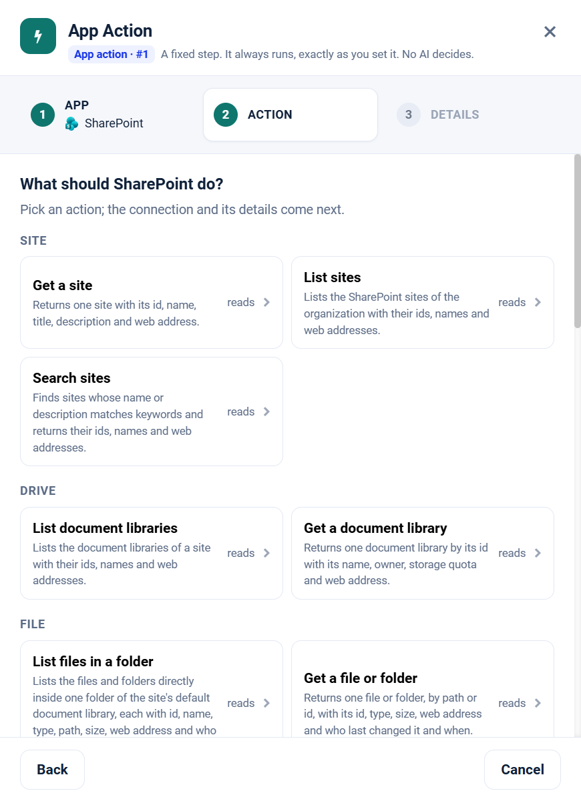

.. _app-action-sharepoint-online:

.. rst-class:: agentic-tutorial

SharePoint App Actions
======================

.. raw:: html

   

     
     <dl class="tool-facts">
     
<dt>Node</dt><dd>App Action</dd>

     
<dt>Actions</dt><dd>25 across 6 resources</dd>

     
<dt>Reads / changes data</dt><dd>15 / 10</dd>

     
<dt>Connection</dt><dd>Microsoft Graph or SharePoint</dd>

     </dl>
   

.. container:: tutorial-intro

   SharePoint as a fixed workflow step: find sites, read and upload library files, and edit list items. An App Action runs every time the flow reaches it, exactly as you set it; no model decides. To let an agent choose instead, use the :doc:`SharePoint Online agent tools </agentic-ai-guide/tools-integrations/connector-tools/sharepoint-online>`.

.. contents:: On this page
   :local:
   :depth: 1
   :class: tool-toc

Prerequisites
-------------

* **Connection:** A **Microsoft Graph** connection (an Entra ID app registration with tenant ID, client ID and client secret), or a **SharePoint** connection. Grant the Microsoft Graph application permissions below with admin consent.
* ``Sites.Read.All`` to read sites, libraries, files and lists; ``Sites.ReadWrite.All`` to upload, move, create folders and change list items.
* To limit the app to chosen sites, use ``Sites.Selected`` and grant it each site.
* How to create the connection: :ref:`connector-tools-sharepoint-online`.

Add a SharePoint App Action
---------------------------

#. Drag **App Action** from **Commonly used** onto the canvas and connect it where the step belongs in the flow.
#. **App:** choose **SharePoint**, or type ``sharepoint`` in **Search apps**.
#. **Action:** pick one of the 25 actions below. Each is marked **reads** or **changes data**.
#. **Details:** choose the Microsoft Graph or SharePoint connection and click **Test**, then fill in the inputs. Click a field under **What arrives here** to insert a value from an earlier step.
#. For a read, click **Load the fields** so later steps can use the columns it returns. Then click **Save action**.

   Step 2, **Action**, for SharePoint.

.. tip::

   A canvas run skips actions that change data unless **Write when run from the canvas** is on; full and scheduled runs always perform them. Every write hands on ``result_status``, ``result_id`` and ``result_error`` for each row. See :doc:`/agentic-ai-guide/tools-integrations/app-actions`.

Actions
-------

The inputs are the boxes on the **Details** step, by their label. Any input can take a value from an earlier step with a ``${...}`` reference.

Site
~~~~

.. raw:: html

   

     <a class="tool-op" href="sharepoint-online/site-get.html" target="_blank" rel="noopener">
       Get a siteReads
       Returns one site with its id, name, title, description and web address.
     </a>
     <a class="tool-op" href="sharepoint-online/site-getmany.html" target="_blank" rel="noopener">
       List sitesReads
       Lists the SharePoint sites of the organization with their ids, names and web addresses.
     </a>
     <a class="tool-op" href="sharepoint-online/site-search.html" target="_blank" rel="noopener">
       Search sitesReads
       Finds sites whose name or description matches keywords and returns their ids, names and web addresses.
     </a>
   

Drive
~~~~~

.. raw:: html

   

     <a class="tool-op" href="sharepoint-online/drive-getmany.html" target="_blank" rel="noopener">
       List document librariesReads
       Lists the document libraries of a site with their ids, names and web addresses.
     </a>
     <a class="tool-op" href="sharepoint-online/drive-get.html" target="_blank" rel="noopener">
       Get a document libraryReads
       Returns one document library by its id with its name, owner, storage quota and web address.
     </a>
   

File
~~~~

.. raw:: html

   

     <a class="tool-op" href="sharepoint-online/file-getmany.html" target="_blank" rel="noopener">
       List files in a folderReads
       Lists the files and folders directly inside one folder of the site&#x27;s default document library, each with id, name, type, path, size, web address and who last changed it and when.
     </a>
     <a class="tool-op" href="sharepoint-online/file-get.html" target="_blank" rel="noopener">
       Get a file or folderReads
       Returns one file or folder, by path or id, with its id, type, size, web address and who last changed it and when.
     </a>
     <a class="tool-op" href="sharepoint-online/file-search.html" target="_blank" rel="noopener">
       Search filesReads
       Finds files and folders in the site&#x27;s default document library whose names or contents match words, and returns them in the same columns as File getMany.
     </a>
     <a class="tool-op" href="sharepoint-online/file-download.html" target="_blank" rel="noopener">
       Download a file and read its textReads
       Saves one file to the engine&#x27;s disk and returns its details with the saved path and its text: the words of a PDF, Word, Excel, text or CSV file, with text_status ok, password_protected, no_text (a scan) or unsupported.
     </a>
     <a class="tool-op" href="sharepoint-online/file-upload.html" target="_blank" rel="noopener">
       Upload a fileChanges data
       Uploads a file from the engine&#x27;s disk into a folder of the site&#x27;s default document library and returns the stored file; a file of the same name there is replaced.
     </a>
     <a class="tool-op" href="sharepoint-online/file-createfolder.html" target="_blank" rel="noopener">
       Create a folderChanges data
       Creates a folder in the site&#x27;s default document library and returns it with its id.
     </a>
     <a class="tool-op" href="sharepoint-online/file-delete.html" target="_blank" rel="noopener">
       Delete a file or folderChanges data
       Deletes a file, or a folder with everything in it, moving it to the site&#x27;s recycle bin.
     </a>
     <a class="tool-op" href="sharepoint-online/file-move.html" target="_blank" rel="noopener">
       Move or rename a fileChanges data
       Moves a file or folder into another folder of the same library, renames it, or both, and returns it.
     </a>
     <a class="tool-op" href="sharepoint-online/file-copy.html" target="_blank" rel="noopener">
       Copy a fileChanges data
       Copies a file or folder into another folder, optionally under a new name.
     </a>
   

List
~~~~

.. raw:: html

   

     <a class="tool-op" href="sharepoint-online/list-getmany.html" target="_blank" rel="noopener">
       List the site&#x27;s listsReads
       Lists the lists and libraries of a site with their ids, names and web addresses.
     </a>
     <a class="tool-op" href="sharepoint-online/list-get.html" target="_blank" rel="noopener">
       Get a listReads
       Returns one list, by name or id, with its display name, template and web address, plus its column definitions when expand is columns.
     </a>
     <a class="tool-op" href="sharepoint-online/list-create.html" target="_blank" rel="noopener">
       Create a listChanges data
       Creates a list on the site with a Title column plus any text columns named, and returns it with its id.
     </a>
     <a class="tool-op" href="sharepoint-online/list-delete.html" target="_blank" rel="noopener">
       Delete a listChanges data
       Deletes a list together with all its items, moving it to the site&#x27;s recycle bin.
     </a>
   

List Item
~~~~~~~~~

.. raw:: html

   

     <a class="tool-op" href="sharepoint-online/list-item-getmany.html" target="_blank" rel="noopener">
       List items in a listReads
       Lists the items of a list, each as one row with its id, dates, author and every column of the list.
     </a>
     <a class="tool-op" href="sharepoint-online/list-item-get.html" target="_blank" rel="noopener">
       Get a list itemReads
       Returns one list item by its id with its dates, author and every column.
     </a>
     <a class="tool-op" href="sharepoint-online/list-item-create.html" target="_blank" rel="noopener">
       Create a list itemChanges data
       Adds an item to a list and returns it with its id and columns.
     </a>
     <a class="tool-op" href="sharepoint-online/list-item-update.html" target="_blank" rel="noopener">
       Update a list itemChanges data
       Changes columns of an existing list item and returns its columns; columns not named keep their values.
     </a>
     <a class="tool-op" href="sharepoint-online/list-item-delete.html" target="_blank" rel="noopener">
       Delete a list itemChanges data
       Deletes an item from a list, moving it to the site&#x27;s recycle bin.
     </a>
   

Page
~~~~

.. raw:: html

   

     <a class="tool-op" href="sharepoint-online/page-getmany.html" target="_blank" rel="noopener">
       List site pagesReads
       Lists the pages of a site with their ids, names, titles, web addresses and dates.
     </a>
     <a class="tool-op" href="sharepoint-online/page-get.html" target="_blank" rel="noopener">
       Get a site pageReads
       Returns one site page by its id with its name, title, layout, web address and dates.
     </a>
   

Start a flow from SharePoint
----------------------------

A :doc:`Trigger </agentic-ai-guide/triggers-automation/triggers>` can watch SharePoint and start the flow when one of these events happens. Pick SharePoint in the Trigger, then the event.

.. list-table::
   :header-rows: 1
   :widths: 34 66
   :class: tool-table

   * - Event
     - What it reports
   * - **File added to a folder**
     - Folder is a folder in the site's default library, a path such as Finance/Invoices, or / for the top. The first check records its files; later checks report each file that appears directly in it. Site is the site's address, which a SharePoint connection can already hold.
   * - **File added or changed in a folder**
     - Folder is a folder in the site's default library, a path such as TestData, or / for the top. Reports each file directly in it that is added or saved since the last check. Site is the site's address, which a SharePoint connection can already hold.
   * - **Folder created in a folder**
     - Folder is a folder in the site's default library, a path such as Finance, or / for the top. The first check records its folders; later checks report each folder created directly inside it. Site is the site's address, which a SharePoint connection can already hold.
   * - **Specific file changed**
     - File is the file's path in the site's default library, for example Finance/Budget 2026.xlsx. Reports the file each time it is saved. Site is the site's address, which a SharePoint connection can already hold.
   * - **File created in a library**
     - List is the document library's name, for example Documents. Reports each file added anywhere in the library, in any folder. Site is the site's address, which a SharePoint connection can already hold.
   * - **File created or modified in a library**
     - List is the document library's name, for example Documents. Reports each file added or saved anywhere in the library, with its name in FileLeafRef and its address in webUrl. Site is the site's address, which a SharePoint connection can already hold.
   * - **File matching a search added or changed**
     - Search text is the words to find in file names and contents, for example contract renewal. Reports each file of the site's default library that matches and is added or saved since the last check. Site is the site's address, which a SharePoint connection can already hold.
   * - **List item created**
     - List is the list's name, for example Tasks. Reports each item added to it since the last check. Site is the site's address, which a SharePoint connection can already hold.
   * - **List item created or modified**
     - List is the list's name, for example Tasks. Reports each item added or edited since the last check. Site is the site's address, which a SharePoint connection can already hold.
   * - **List item changed to match a condition**
     - List is the list's name, and Filter a condition on its columns by internal name, for example fields/Status eq 'Approved'. Reports each item that is edited and then meets the condition. Site is the site's address, which a SharePoint connection can already hold.
   * - **List or library created**
     - The first check records the site's lists; later checks report each list or document library created on the site. Site is the site's address, which a SharePoint connection can already hold.
   * - **News post published**
     - Reports each news post published on the site. Site is the site's address, which a SharePoint connection can already hold.
   * - **Page published**
     - Reports each site page or news post that is published or republished. Site is the site's address, which a SharePoint connection can already hold.

Related
-------

* :doc:`/agentic-ai-guide/tools-integrations/app-actions` - how App Actions work, reads, writes and safety
* :doc:`/agentic-ai-guide/tools-integrations/app-action-apps/index` - every App Action app
* :doc:`SharePoint Online agent tools </agentic-ai-guide/tools-integrations/connector-tools/sharepoint-online>` - the same operations for an Agent Node, with every parameter
