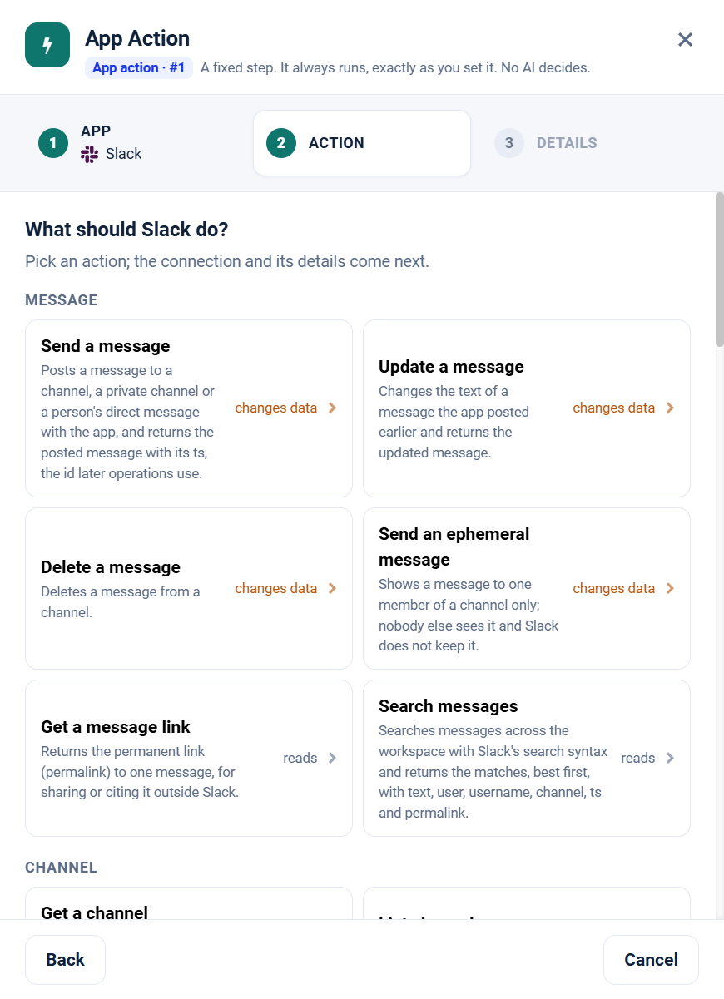

.. _app-action-slack:

.. rst-class:: agentic-tutorial

Slack App Actions
=================

.. raw:: html

   

     
     <dl class="tool-facts">
     
<dt>Node</dt><dd>App Action</dd>

     
<dt>Actions</dt><dd>37 across 6 resources</dd>

     
<dt>Reads / changes data</dt><dd>16 / 21</dd>

     
<dt>Connection</dt><dd>Slack · Bot Token</dd>

     </dl>
   

.. container:: tutorial-intro

   Slack as a fixed workflow step: read channels and threads, look people up, and post messages. An App Action runs every time the flow reaches it, exactly as you set it; no model decides. To let an agent choose instead, use the :doc:`Slack agent tools </agentic-ai-guide/tools-integrations/connector-tools/slack>`.

.. contents:: On this page
   :local:
   :depth: 1
   :class: tool-toc

Prerequisites
-------------

* **Connection:** A **Slack** connection that holds one **Bot Token** (``xoxb-``). Sparkflows calls Slack's own API, so there is no URL or username to enter.
* A Slack app installed in the workspace, with its Bot User OAuth Token.
* The bot scopes for the operations you tick. Slack refuses a call whose scope is missing with ``missing_scope``.
* The app invited to each channel it reads or posts in, private channels included.
* How to create the connection: :ref:`connector-tools-slack`.

Add a Slack App Action
----------------------

#. Drag **App Action** from **Commonly used** onto the canvas and connect it where the step belongs in the flow.
#. **App:** choose **Slack**, or type ``slack`` in **Search apps**.
#. **Action:** pick one of the 37 actions below. Each is marked **reads** or **changes data**.
#. **Details:** choose the Slack connection and click **Test**, then fill in the inputs. Click a field under **What arrives here** to insert a value from an earlier step.
#. For a read, click **Load the fields** so later steps can use the columns it returns. Then click **Save action**.

   Step 2, **Action**, for Slack.

.. tip::

   A canvas run skips actions that change data unless **Write when run from the canvas** is on; full and scheduled runs always perform them. Every write hands on ``result_status``, ``result_id`` and ``result_error`` for each row. See :doc:`/agentic-ai-guide/tools-integrations/app-actions`.

Actions
-------

The inputs are the boxes on the **Details** step, by their label. Any input can take a value from an earlier step with a ``${...}`` reference.

Message
~~~~~~~

.. raw:: html

   

     <a class="tool-op" href="slack/message-send.html" target="_blank" rel="noopener">
       Send a messageChanges data
       Posts a message to a channel, a private channel or a person&#x27;s direct message with the app, and returns the posted message with its ts, the id later operations use.
     </a>
     <a class="tool-op" href="slack/message-update.html" target="_blank" rel="noopener">
       Update a messageChanges data
       Changes the text of a message the app posted earlier and returns the updated message.
     </a>
     <a class="tool-op" href="slack/message-delete.html" target="_blank" rel="noopener">
       Delete a messageChanges data
       Deletes a message from a channel.
     </a>
     <a class="tool-op" href="slack/message-sendephemeral.html" target="_blank" rel="noopener">
       Send an ephemeral messageChanges data
       Shows a message to one member of a channel only; nobody else sees it and Slack does not keep it.
     </a>
     <a class="tool-op" href="slack/message-getpermalink.html" target="_blank" rel="noopener">
       Get a message linkReads
       Returns the permanent link (permalink) to one message, for sharing or citing it outside Slack.
     </a>
     <a class="tool-op" href="slack/message-search.html" target="_blank" rel="noopener">
       Search messagesReads
       Searches messages across the workspace with Slack&#x27;s search syntax and returns the matches, best first, with text, user, username, channel, ts and permalink.
     </a>
   

Channel
~~~~~~~

.. raw:: html

   

     <a class="tool-op" href="slack/channel-get.html" target="_blank" rel="noopener">
       Get a channelReads
       Returns one channel&#x27;s details: name, topic, purpose, created, creator, is_private, is_archived and, when asked, num_members.
     </a>
     <a class="tool-op" href="slack/channel-getmany.html" target="_blank" rel="noopener">
       List channelsReads
       Lists the workspace&#x27;s channels with id, name, is_private, is_archived, topic, purpose and num_members.
     </a>
     <a class="tool-op" href="slack/channel-history.html" target="_blank" rel="noopener">
       Read channel historyReads
       Returns the messages of one channel, newest first, each with ts, user, text, thread_ts and reply_count; thread replies are not included.
     </a>
     <a class="tool-op" href="slack/channel-replies.html" target="_blank" rel="noopener">
       Read thread repliesReads
       Returns one thread: the parent message followed by its replies, oldest first, each with ts, user and text.
     </a>
     <a class="tool-op" href="slack/channel-members.html" target="_blank" rel="noopener">
       List channel membersReads
       Lists the members of one channel, one row per member with the user ID in id.
     </a>
     <a class="tool-op" href="slack/channel-create.html" target="_blank" rel="noopener">
       Create a channelChanges data
       Creates a public or private channel and returns it with its new ID; the app becomes its first member.
     </a>
     <a class="tool-op" href="slack/channel-invite.html" target="_blank" rel="noopener">
       Invite members to a channelChanges data
       Adds up to 1,000 members to a channel and returns the channel.
     </a>
     <a class="tool-op" href="slack/channel-kick.html" target="_blank" rel="noopener">
       Remove a member from a channelChanges data
       Removes one member from a channel.
     </a>
     <a class="tool-op" href="slack/channel-join.html" target="_blank" rel="noopener">
       Join a channelChanges data
       Adds the app to a public channel so it can read and post there, and returns the channel.
     </a>
     <a class="tool-op" href="slack/channel-leave.html" target="_blank" rel="noopener">
       Leave a channelChanges data
       Removes the app from a channel, so it stops reading and posting there.
     </a>
     <a class="tool-op" href="slack/channel-archive.html" target="_blank" rel="noopener">
       Archive a channelChanges data
       Archives a channel: it becomes read-only and leaves the channel list, while its history is kept.
     </a>
     <a class="tool-op" href="slack/channel-unarchive.html" target="_blank" rel="noopener">
       Unarchive a channelChanges data
       Reopens an archived channel so members can post in it again.
     </a>
     <a class="tool-op" href="slack/channel-rename.html" target="_blank" rel="noopener">
       Rename a channelChanges data
       Renames a channel and returns it with the new name.
     </a>
     <a class="tool-op" href="slack/channel-settopic.html" target="_blank" rel="noopener">
       Set a channel topicChanges data
       Sets the topic shown in the channel header and returns the channel.
     </a>
     <a class="tool-op" href="slack/channel-setpurpose.html" target="_blank" rel="noopener">
       Set a channel purposeChanges data
       Sets the channel&#x27;s description (purpose) and returns the channel.
     </a>
   

User
~~~~

.. raw:: html

   

     <a class="tool-op" href="slack/user-get.html" target="_blank" rel="noopener">
       Get a userReads
       Returns one member&#x27;s account: id, name, real_name, profile (display name, email, title, phone), tz, is_admin, is_bot and deleted.
     </a>
     <a class="tool-op" href="slack/user-getmany.html" target="_blank" rel="noopener">
       List usersReads
       Lists the workspace&#x27;s members, bots and deactivated accounts included (deleted is true), with id, name, real_name, profile and tz.
     </a>
     <a class="tool-op" href="slack/user-getprofile.html" target="_blank" rel="noopener">
       Get a user&#x27;s profileReads
       Returns a member&#x27;s profile: display_name, real_name, email, phone, title, status_text and status_emoji.
     </a>
     <a class="tool-op" href="slack/user-getstatus.html" target="_blank" rel="noopener">
       Get a user&#x27;s presenceReads
       Returns whether a member is active or away (presence) and, for the token&#x27;s own user, online and auto_away details.
     </a>
     <a class="tool-op" href="slack/user-lookupbyemail.html" target="_blank" rel="noopener">
       Find a user by emailReads
       Finds the member who uses an email address and returns their account with id, name, real_name and profile.
     </a>
   

File
~~~~

.. raw:: html

   

     <a class="tool-op" href="slack/file-get.html" target="_blank" rel="noopener">
       Get a fileReads
       Returns one file&#x27;s details: name, title, filetype, size, user, created, permalink and the channels it was shared in.
     </a>
     <a class="tool-op" href="slack/file-getmany.html" target="_blank" rel="noopener">
       List filesReads
       Lists files shared in the workspace, newest first, with id, name, title, filetype, size, user, created and permalink; filter by channel, user, type or time.
     </a>
     <a class="tool-op" href="slack/file-delete.html" target="_blank" rel="noopener">
       Delete a fileChanges data
       Deletes a file from Slack for everyone.
     </a>
   

Reaction
~~~~~~~~

.. raw:: html

   

     <a class="tool-op" href="slack/reaction-add.html" target="_blank" rel="noopener">
       Add a reactionChanges data
       Adds an emoji reaction to a message as the app, for example to acknowledge it.
     </a>
     <a class="tool-op" href="slack/reaction-get.html" target="_blank" rel="noopener">
       Get a message&#x27;s reactionsReads
       Returns one message with its reactions: each emoji name, its count and the users who added it.
     </a>
     <a class="tool-op" href="slack/reaction-remove.html" target="_blank" rel="noopener">
       Remove a reactionChanges data
       Removes a reaction the app added to a message.
     </a>
   

User Group
~~~~~~~~~~

.. raw:: html

   

     <a class="tool-op" href="slack/user-group-getmany.html" target="_blank" rel="noopener">
       List user groupsReads
       Lists the workspace&#x27;s user groups (the @handles that mention a team) with id, name, handle, description and, when asked, their user count and member IDs.
     </a>
     <a class="tool-op" href="slack/user-group-create.html" target="_blank" rel="noopener">
       Create a user groupChanges data
       Creates a user group, an @handle that mentions several people at once, and returns it with its ID (S0123ABC).
     </a>
     <a class="tool-op" href="slack/user-group-update.html" target="_blank" rel="noopener">
       Update a user groupChanges data
       Changes a user group&#x27;s name, handle, description or default channels and returns the group.
     </a>
     <a class="tool-op" href="slack/user-group-enable.html" target="_blank" rel="noopener">
       Enable a user groupChanges data
       Re-enables a disabled user group so its @handle works again, and returns the group.
     </a>
     <a class="tool-op" href="slack/user-group-disable.html" target="_blank" rel="noopener">
       Disable a user groupChanges data
       Disables a user group: its @handle stops notifying anyone, while the group and its settings are kept.
     </a>
   

Start a flow from Slack
-----------------------

A :doc:`Trigger </agentic-ai-guide/triggers-automation/triggers>` can watch Slack and start the flow when one of these events happens. Pick Slack in the Trigger, then the event.

.. list-table::
   :header-rows: 1
   :widths: 34 66
   :class: tool-table

   * - Event
     - What it reports
   * - **Message posted in a channel**
     - Channel is the channel id, for example C0123ABC, which a Channel list returns. Reports each new message posted in the channel.
   * - **Message containing text**
     - Channel is the channel id, for example C0123ABC, which a Channel list returns, and Filter the text to look for, matched regardless of case. Reports each new message in the channel whose text contains it.
   * - **Member mentioned in a channel**
     - Channel is the channel id, for example C0123ABC, which a Channel list returns, and Filter the member's user id, for example U0123ABC. Reports each new message in the channel that mentions the member.
   * - **Message posted by a member**
     - Channel is the channel id, for example C0123ABC, which a Channel list returns, and Filter the member's user id, for example U0123ABC. Reports each new message the member posts in the channel.
   * - **Reply posted in a thread**
     - Channel is the channel id, for example C0123ABC, which a Channel list returns, and Thread ts the ts of the thread's first message, for example 1712345678.000100. Reports each reply posted in the thread since the last check.
   * - **Message matching a search**
     - Search text takes Slack's search syntax, for example deploy in:#releases from:@asha. Reports each new message in the workspace that matches it. Searching needs a user token (xoxp-) on the connection.
   * - **File shared**
     - Reports each file shared in the workspace since the last check, with its name, type, size, uploader and permalink. A bot token lists only the files the bot can see.
   * - **File shared in a channel**
     - Filter is the channel id, for example C0123ABC. Reports each file shared in that channel since the last check, with its name, type, size, uploader and permalink.
   * - **Reaction added or removed**
     - Channel is the channel id, for example C0123ABC, which a Channel list returns, and Message ts the message's ts, for example 1712345678.000100. Reports the message with every reaction and who added it, each time a reaction is added or removed.
   * - **Channel created**
     - Reports each channel created since the last check, among the first 500 the workspace lists.
   * - **Member joined a channel**
     - Channel is the channel id, for example C0123ABC, which a Channel list returns. The first check records the members; later checks report the user id of each member who joins.
   * - **Member joined the workspace**
     - The first check records the workspace's members; later checks report each person who joins, bots left out.
   * - **Member deactivated**
     - The first check records the accounts already deactivated; later checks report each member whose account is deactivated.

Related
-------

* :doc:`/agentic-ai-guide/tools-integrations/app-actions` - how App Actions work, reads, writes and safety
* :doc:`/agentic-ai-guide/tools-integrations/app-action-apps/index` - every App Action app
* :doc:`Slack agent tools </agentic-ai-guide/tools-integrations/connector-tools/slack>` - the same operations for an Agent Node, with every parameter
