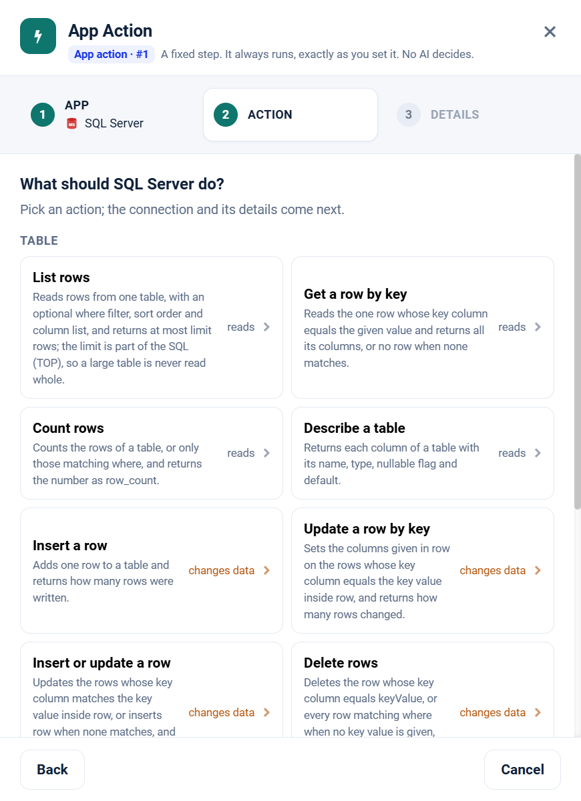

.. _app-action-sql-server:

.. rst-class:: agentic-tutorial

SQL Server App Actions
======================

.. raw:: html

   

     
     <dl class="tool-facts">
     
<dt>Node</dt><dd>App Action</dd>

     
<dt>Actions</dt><dd>11 across 2 resources</dd>

     
<dt>Reads / changes data</dt><dd>6 / 5</dd>

     
<dt>Connection</dt><dd>SQL Server connection</dd>

     </dl>
   

.. container:: tutorial-intro

   SQL Server as a fixed workflow step: read, filter and count rows, describe tables, and write rows. An App Action runs every time the flow reaches it, exactly as you set it; no model decides. To let an agent choose instead, use the :doc:`SQL Server agent tools </agentic-ai-guide/tools-integrations/connector-tools/sql-server>`.

.. contents:: On this page
   :local:
   :depth: 1
   :class: tool-toc

Prerequisites
-------------

* **Connection:** A database connection for SQL Server: JDBC URL, user and password. The picker lists every connection in the project, so choose the one that points at this database.
* A SQL Server database the Sparkflows server can reach (default port 1433).
* A database user with ``SELECT`` on the tables the agent reads. Grant ``INSERT``, ``UPDATE`` or ``DELETE`` only on the tables it may change.
* A saved connection that passes **Test Connection**. See :doc:`/agentic-ai-guide/quick-start/model-connections`.
* How to create the connection: :ref:`connector-tools-sql-server`.

Add a SQL Server App Action
---------------------------

#. Drag **App Action** from **Commonly used** onto the canvas and connect it where the step belongs in the flow.
#. **App:** choose **SQL Server**, or type ``sql server`` in **Search apps**.
#. **Action:** pick one of the 11 actions below. Each is marked **reads** or **changes data**.
#. **Details:** choose the SQL Server connection connection and click **Test**, then fill in the inputs. Click a field under **What arrives here** to insert a value from an earlier step.
#. For a read, click **Load the fields** so later steps can use the columns it returns. Then click **Save action**.

   Step 2, **Action**, for SQL Server.

.. tip::

   A canvas run skips actions that change data unless **Write when run from the canvas** is on; full and scheduled runs always perform them. Every write hands on ``result_status``, ``result_id`` and ``result_error`` for each row. See :doc:`/agentic-ai-guide/tools-integrations/app-actions`.

Actions
-------

The inputs are the boxes on the **Details** step, by their label. Any input can take a value from an earlier step with a ``${...}`` reference.

Table
~~~~~

.. raw:: html

   

     <a class="tool-op" href="../connector-tools/sql-server/table-getmany.html" target="_blank" rel="noopener">
       List rowsReads
       Reads rows from one table, with an optional where filter, sort order and column list, and returns at most limit rows; the limit is part of the SQL (TOP), so a large table is never read whole.
     </a>
     <a class="tool-op" href="../connector-tools/sql-server/table-get.html" target="_blank" rel="noopener">
       Get a row by keyReads
       Reads the one row whose key column equals the given value and returns all its columns, or no row when none matches.
     </a>
     <a class="tool-op" href="../connector-tools/sql-server/table-count.html" target="_blank" rel="noopener">
       Count rowsReads
       Counts the rows of a table, or only those matching where, and returns the number as row_count.
     </a>
     <a class="tool-op" href="../connector-tools/sql-server/table-describe.html" target="_blank" rel="noopener">
       Describe a tableReads
       Returns each column of a table with its name, type, nullable flag and default.
     </a>
     <a class="tool-op" href="../connector-tools/sql-server/table-insert.html" target="_blank" rel="noopener">
       Insert a rowChanges data
       Adds one row to a table and returns how many rows were written.
     </a>
     <a class="tool-op" href="../connector-tools/sql-server/table-update.html" target="_blank" rel="noopener">
       Update a row by keyChanges data
       Sets the columns given in row on the rows whose key column equals the key value inside row, and returns how many rows changed.
     </a>
     <a class="tool-op" href="../connector-tools/sql-server/table-upsert.html" target="_blank" rel="noopener">
       Insert or update a rowChanges data
       Updates the rows whose key column matches the key value inside row, or inserts row when none matches, and returns how many rows were updated and inserted.
     </a>
     <a class="tool-op" href="../connector-tools/sql-server/table-delete.html" target="_blank" rel="noopener">
       Delete rowsChanges data
       Deletes the row whose key column equals keyValue, or every row matching where when no key value is given, and returns how many rows were deleted.
     </a>
     <a class="tool-op" href="../connector-tools/sql-server/table-listtables.html" target="_blank" rel="noopener">
       List tablesReads
       Lists the tables in one schema, one row per table with its schema and name.
     </a>
     <a class="tool-op" href="../connector-tools/sql-server/table-listschemas.html" target="_blank" rel="noopener">
       List schemasReads
       Lists the schemas in the database, one row each, such as dbo and the built-in ones.
     </a>
   

Query
~~~~~

.. raw:: html

   

     <a class="tool-op" href="../connector-tools/sql-server/query-run.html" target="_blank" rel="noopener">
       Run a SQL statementChanges data
       Runs one SQL Server statement and commits it: a SELECT or WITH query returns its rows up to limit, and any other statement returns rowsAffected.
     </a>
   

Start a flow from SQL Server
----------------------------

A :doc:`Trigger </agentic-ai-guide/triggers-automation/triggers>` can watch SQL Server and start the flow when one of these events happens. Pick SQL Server in the Trigger, then the event.

.. list-table::
   :header-rows: 1
   :widths: 34 66
   :class: tool-table

   * - Event
     - What it reports
   * - **Row added (by a date/time column)**
     - Table is the table to watch, for example orders, or sales.orders with its schema, and Filter the column that holds when a row was created, for example created\_at. Reports each row created since the last check. The column is compared with the check time in UTC.
   * - **Row changed (by an updated-at column)**
     - Table is the table to watch, for example orders, or sales.orders with its schema, and Filter the column that holds when a row was last changed, for example updated\_at. Reports each row every time it is changed. The column is compared with the check time in UTC.
   * - **Row added (by an increasing id column)**
     - Table is the table to watch, for example orders, or sales.orders with its schema, and Filter the id column, for example id. The first check records the newest 500 rows; later checks report each row with a new id.
   * - **Row starts matching a condition**
     - Table is the table to watch, for example orders, or sales.orders with its schema. Where is a SQL condition such as status = 'failed', followed by ORDER BY the key column, for example ORDER BY id DESC, when more than 500 rows can meet it; Filter is that key column, for example id. The first check records the rows that already meet the condition; later checks report each row that newly meets it, inserted or updated into it.
   * - **Row count changed**
     - Table is the table to watch, for example orders, or sales.orders with its schema. The first check records the number of rows; later checks report the new number as row\_count whenever it differs, rows added or removed.
   * - **Count of matching rows changed**
     - Table is the table to watch, for example orders, or sales.orders with its schema, and Where a SQL condition such as status = 'open', without ORDER BY. The first check records how many rows meet it; later checks report the new number as row\_count whenever it differs.
   * - **Specific row changed**
     - Table is the table to watch, for example orders, or sales.orders with its schema, and Key column and Row key value the one row to watch, for example order\_id and 1042; the key column must be unique. Reports the row whenever any of its values changes.
   * - **Values changed in chosen columns**
     - Table is the table to watch, for example orders, or sales.orders with its schema. Columns to return lists the columns to watch, for example id, status, and Order by a unique column such as id, so the rows keep their order; the first 500 rows are watched. Reports every row, with those columns, whenever a value changes or a row is added or removed.
   * - **Table structure changed**
     - Table is the table to watch, for example orders, or sales.orders with its schema. The first check records its columns; later checks report the full column list, with name, type, nullable and default, whenever a column is added, removed, renamed or altered.
   * - **Table created**
     - Watches the schema named, or the connection's default one: its database in MySQL, usually public in PostgreSQL and dbo in SQL Server. The first check records the tables already there; later checks report each new table.
   * - **Query result changed**
     - SQL is one SELECT statement in this database's own dialect, ending in ORDER BY, without values that change by themselves such as NOW(); only the first 500 rows are compared. The first check records the result; later checks report all of its rows whenever any value in it differs. A statement that writes is refused.
   * - **New row in a query result**
     - SQL is one SELECT statement, joins allowed, kept to recent rows with ORDER BY and LIMIT or TOP, and Filter the result column that identifies a row, for example id. The first check records the rows already returned; later checks report each row with a new value in that column. A statement that writes is refused.

Related
-------

* :doc:`/agentic-ai-guide/tools-integrations/app-actions` - how App Actions work, reads, writes and safety
* :doc:`/agentic-ai-guide/tools-integrations/app-action-apps/index` - every App Action app
* :doc:`SQL Server agent tools </agentic-ai-guide/tools-integrations/connector-tools/sql-server>` - the same operations for an Agent Node, with every parameter
