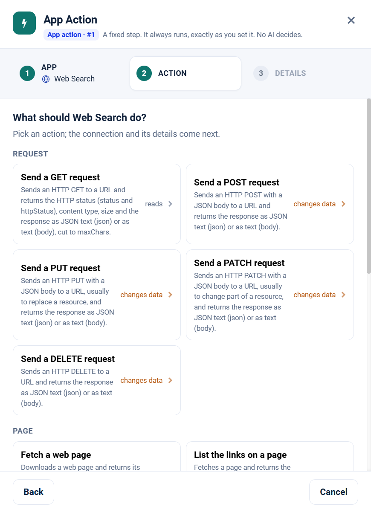

.. _app-action-web-search:

.. rst-class:: agentic-tutorial

Web Search App Actions
======================

.. raw:: html

   

     
     <dl class="tool-facts">
     
<dt>Node</dt><dd>App Action</dd>

     
<dt>Actions</dt><dd>14 across 4 resources</dd>

     
<dt>Reads / changes data</dt><dd>10 / 4</dd>

     
<dt>Connection</dt><dd>Serper (searches only)</dd>

     </dl>
   

.. container:: tutorial-intro

   Web Search as a fixed workflow step: search the web and news, fetch pages, read feeds, call URLs. An App Action runs every time the flow reaches it, exactly as you set it; no model decides. To let an agent choose instead, use the :doc:`Web Search agent tools </agentic-ai-guide/tools-integrations/connector-tools/web-search>`.

.. contents:: On this page
   :local:
   :depth: 1
   :class: tool-toc

Prerequisites
-------------

* **Connection:** A **Serper** connection that holds a Serper API key, for the four search tools only. Page, feed and request tools go straight to the address and need no connection.
* For search: a Serper API key in a **Serper** connection.
* For pages, feeds and requests: the address must be reachable from the Sparkflows server.
* How to create the connection: :ref:`connector-tools-web-search`.

Add a Web Search App Action
---------------------------

#. Drag **App Action** from **Commonly used** onto the canvas and connect it where the step belongs in the flow.
#. **App:** choose **Web Search**, or type ``web`` in **Search apps**.
#. **Action:** pick one of the 14 actions below. Each is marked **reads** or **changes data**.
#. **Details:** choose the Serper (searches only) connection and click **Test**, then fill in the inputs. Click a field under **What arrives here** to insert a value from an earlier step.
#. For a read, click **Load the fields** so later steps can use the columns it returns. Then click **Save action**.

   Step 2, **Action**, for Web Search.

.. tip::

   A canvas run skips actions that change data unless **Write when run from the canvas** is on; full and scheduled runs always perform them. Every write hands on ``result_status``, ``result_id`` and ``result_error`` for each row. See :doc:`/agentic-ai-guide/tools-integrations/app-actions`.

Actions
-------

The inputs are the boxes on the **Details** step, by their label. Any input can take a value from an earlier step with a ``${...}`` reference.

Request
~~~~~~~

.. raw:: html

   

     <a class="tool-op" href="../connector-tools/web-search/request-get.html" target="_blank" rel="noopener">
       Send a GET requestReads
       Sends an HTTP GET to a URL and returns the HTTP status (status and httpStatus), content type, size and the response as JSON text (json) or as text (body), cut to maxChars.
     </a>
     <a class="tool-op" href="../connector-tools/web-search/request-post.html" target="_blank" rel="noopener">
       Send a POST requestChanges data
       Sends an HTTP POST with a JSON body to a URL and returns the response as JSON text (json) or as text (body).
     </a>
     <a class="tool-op" href="../connector-tools/web-search/request-put.html" target="_blank" rel="noopener">
       Send a PUT requestChanges data
       Sends an HTTP PUT with a JSON body to a URL, usually to replace a resource, and returns the response as JSON text (json) or as text (body).
     </a>
     <a class="tool-op" href="../connector-tools/web-search/request-patch.html" target="_blank" rel="noopener">
       Send a PATCH requestChanges data
       Sends an HTTP PATCH with a JSON body to a URL, usually to change part of a resource, and returns the response as JSON text (json) or as text (body).
     </a>
     <a class="tool-op" href="../connector-tools/web-search/request-delete.html" target="_blank" rel="noopener">
       Send a DELETE requestChanges data
       Sends an HTTP DELETE to a URL and returns the response as JSON text (json) or as text (body).
     </a>
   

Page
~~~~

.. raw:: html

   

     <a class="tool-op" href="../connector-tools/web-search/page-fetch.html" target="_blank" rel="noopener">
       Fetch a web pageReads
       Downloads a web page and returns its title and readable text with scripts and styles removed, cut to maxChars, or the raw HTML when stripTags is false.
     </a>
     <a class="tool-op" href="../connector-tools/web-search/page-links.html" target="_blank" rel="noopener">
       List the links on a pageReads
       Fetches a page and returns the unique links in it as absolute URLs with their host, capped at limit; by default only links to the page&#x27;s own host.
     </a>
     <a class="tool-op" href="../connector-tools/web-search/page-status.html" target="_blank" rel="noopener">
       Check a URLReads
       Sends a HEAD request, following redirects, and returns the HTTP status and the final URL after them.
     </a>
     <a class="tool-op" href="../connector-tools/web-search/page-crawl.html" target="_blank" rel="noopener">
       Crawl a siteReads
       Starts at a URL and follows links breadth-first, returning one row per page visited with its URL, title and the first 4,000 characters of its text, up to limit pages.
     </a>
   

Search
~~~~~~

.. raw:: html

   

     <a class="tool-op" href="../connector-tools/web-search/search-web.html" target="_blank" rel="noopener">
       Search the webReads
       Searches Google through Serper and returns the organic results with title, link, snippet and position.
     </a>
     <a class="tool-op" href="../connector-tools/web-search/search-news.html" target="_blank" rel="noopener">
       Search the newsReads
       Searches Google News through Serper and returns articles with title, link, snippet, date and source.
     </a>
     <a class="tool-op" href="../connector-tools/web-search/search-images.html" target="_blank" rel="noopener">
       Search imagesReads
       Searches Google Images through Serper and returns images with title, imageUrl, the page link and source.
     </a>
     <a class="tool-op" href="../connector-tools/web-search/search-places.html" target="_blank" rel="noopener">
       Search placesReads
       Searches Google Maps through Serper and returns places with title, address, rating, category, phone number and website.
     </a>
   

Feed
~~~~

.. raw:: html

   

     <a class="tool-op" href="../connector-tools/web-search/feed-read.html" target="_blank" rel="noopener">
       Read a feedReads
       Downloads an RSS or Atom feed and returns its entries with title, link, published date and summary, capped at limit.
     </a>
   

Start a flow from Web Search
----------------------------

A :doc:`Trigger </agentic-ai-guide/triggers-automation/triggers>` can watch Web Search and start the flow when one of these events happens. Pick Web Search in the Trigger, then the event.

.. list-table::
   :header-rows: 1
   :widths: 34 66
   :class: tool-table

   * - Event
     - What it reports
   * - **Page changed**
     - URL is the page to watch. Each check reads the page as text and reports it when the text differs from the last check; the first check records the page. A page that answers with an error fails the check.
   * - **Page starts showing a text**
     - URL is the page to watch, and Filter the text to look for, such as In stock or Registration open, matched regardless of case. The page is reported once, on the first check that finds the text; a text already on the page at the first check is recorded, not reported.
   * - **Page status changed**
     - URL is the address to check with a HEAD request that follows redirects. The first check records the HTTP status; later checks report the address with its status and final URL whenever the status differs, for example 200 to 503. An address that cannot be reached at all fails the check.
   * - **API response changed**
     - URL is the address to call with GET. The first check records the answer; later checks report it, with httpStatus and the json or body, whenever anything in it differs. An answer holding a time or a request id differs on every check.
   * - **New link on a page**
     - URL is a listing page to watch, such as a news, careers or tenders page; links to other sites are left out. The first check records the links already there; later checks report each new link address.
   * - **New link containing a text**
     - URL is the page to watch, and Filter a text the link address must contain, such as .pdf or /careers/, links to other sites included. The first check records the matching links already there; later checks report each new one.
   * - **New item in a feed**
     - URL is the RSS or Atom feed. The first check records the items already there; later checks report the new ones.
   * - **New feed item with a text in its title**
     - URL is the RSS or Atom feed, and Filter a text the item's title must contain, such as a company or product name. The first check records the matching items already there; later checks report each new one.
   * - **New web search result**
     - Search text is what to search Google for through the Serper connection. The first check records the results already there; later checks report pages that newly appear among the top results.
   * - **New news article for a search**
     - Search text is what to search Google News for through the Serper connection. The first check records the articles already there; later checks report the new ones.
   * - **New image result for a search**
     - Search text is what to search Google Images for through the Serper connection. The first check records the images already listed; later checks report each image whose address is new.
   * - **New place for a search**
     - Search text names the kind of place and the area, for example coffee shops in Koramangala Bangalore, searched on Google Maps through the Serper connection. The first check records the places already listed; later checks report each new one.

Related
-------

* :doc:`/agentic-ai-guide/tools-integrations/app-actions` - how App Actions work, reads, writes and safety
* :doc:`/agentic-ai-guide/tools-integrations/app-action-apps/index` - every App Action app
* :doc:`Web Search agent tools </agentic-ai-guide/tools-integrations/connector-tools/web-search>` - the same operations for an Agent Node, with every parameter
