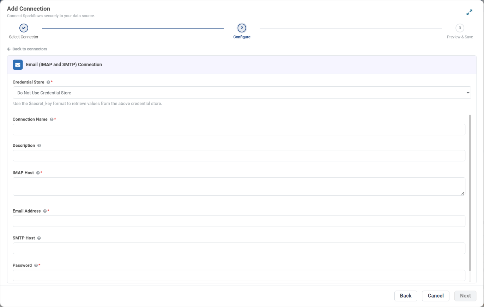

.. _connector-tools-email-imap-smtp:

.. rst-class:: agentic-tutorial

Email (IMAP and SMTP) Tools
===========================

.. raw:: html

   

     
     <dl class="tool-facts">
     
<dt>Connection</dt><dd>Email (IMAP and SMTP) · host and password</dd>

     
<dt>Tools</dt><dd>12 across 3 resources</dd>

     
<dt>Reads / writes</dt><dd>5 / 7</dd>

     
<dt>Available as</dt><dd>Agent tool only</dd>

     </dl>
     
New

   

.. container:: tutorial-intro

   Let an agent read, search, reply to and organise email in any mailbox that speaks IMAP, and send plain-text email over SMTP.

.. container:: tutorial-start

   **Agent tool only.** Email (IMAP and SMTP) is available in the agent tool picker. It is not offered as an :doc:`App Action </agentic-ai-guide/tools-integrations/app-actions>` node yet, so a fixed workflow step cannot call it.

.. contents:: On this page
   :local:
   :depth: 1
   :class: tool-toc

Prerequisites
-------------

* **Connection:** An **Email (IMAP and SMTP)** connection: IMAP host, email address and password, plus an optional SMTP host.
* IMAP enabled for the mailbox, and the Sparkflows server able to reach port 993 (IMAP) and 587 (SMTP).
* An app password where the provider requires one.

Set up the connection
---------------------

#. Open **Administration → Global/Group Connections → Add Connection** and choose **Tools → Email (IMAP and SMTP)**.
#. Fill in the fields below, click **Test Connection** and save.

.. list-table:: Email (IMAP and SMTP) connection fields
   :header-rows: 1
   :widths: 22 12 66

   * - Field
     - Required
     - What to enter
   * - **Connection Name**
     - Yes
     - The name agents and App Actions pick it by, for example ``support-mailbox``.
   * - **Description**
     - No
     - A note for the people who share the connection.
   * - **IMAP Host**
     - Yes
     - The server that reads mail, without a port, for example ``imap.gmail.com`` or ``outlook.office365.com``. IMAP uses SSL on port 993.
   * - **Email Address**
     - Yes
     - The mailbox the tools read from and send as.
   * - **Password**
     - Yes
     - The mailbox password. Gmail and Outlook accounts with two-step verification need an **app password**.
   * - **SMTP Host**
     - No
     - The server that sends mail, for example ``smtp.gmail.com`` or ``smtp.office365.com``. Leave it blank to use the IMAP host with ``imap`` replaced by ``smtp``. SMTP uses port 587.

   The **Configure** step for a Email (IMAP and SMTP) connection. To keep the secret in a credential store instead, pick it under **Credential Store** and enter ``$secret_key``.

Add Email (IMAP and SMTP) to an agent
-------------------------------------

#. In Agent Studio, open the **Tools** group and click **Add tools**, or click **+ Tool** on an Agent Node on the canvas.
#. Choose **Email, IMAP and SMTP** under **Connectors**, or type ``email`` in the search box.
#. **Connect.** Choose your Email (IMAP and SMTP) connection and click **Test connection**. The rest of the screen unlocks when it shows **Connected**.
#. **How the agent sees it.** Keep **A separate tool for each one**, so the agent picks each operation by name.
#. **Tick the operations.** The grid opens with the **Look things up** pack: reads only. Add each write the agent needs; every write waits for approval when it runs.
#. Click **Add to agent**. The ticked operations arrive as one Email, IMAP and SMTP node, joined to the Agent Node by a dashed tool link.

Tools
-----

Each ticked operation becomes one tool, named ``mail_tools_<resource>_<operation>``. **Read** tools run straight away. **Write** and **Delete** tools change data in the mailbox, so each call waits for :doc:`human approval </agentic-ai-guide/safety-guardrails/human-in-the-loop>` before it takes effect. Click a tool to open its page with every parameter.

.. raw:: html

   <nav class="tool-jump" aria-label="Jump to a resource"><a href="#res-message">Message10</a><a href="#res-folder">Folder1</a><a href="#res-attachment">Attachment1</a></nav>

.. raw:: html

   

Message
~~~~~~~

.. raw:: html

   

     <a class="tool-op" href="email-imap-smtp/message-getmany.html" target="_blank" rel="noopener">
       List messagesRead
       Returns the newest messages in a folder, newest first, with subject, sender, recipients, date, Message-ID, attachment count and the plain-text body (HTML when there is no text part).
     </a>
     <a class="tool-op" href="email-imap-smtp/message-get.html" target="_blank" rel="noopener">
       Read a messageRead
       Returns one message by its UID in the folder, with subject, sender, recipients, date, Message-ID, attachment count and plain-text body.
     </a>
     <a class="tool-op" href="email-imap-smtp/message-search.html" target="_blank" rel="noopener">
       Search messagesRead
       Finds the messages in a folder that match IMAP search criteria and returns them newest first, with the same columns as List messages.
     </a>
     <a class="tool-op" href="email-imap-smtp/message-send.html" target="_blank" rel="noopener">
       Send an emailWrite
       Sends one plain-text email over SMTP to every address in to and returns sent.
     </a>
     <a class="tool-op" href="email-imap-smtp/message-reply.html" target="_blank" rel="noopener">
       Reply to a messageWrite
       Sends a plain-text reply to the sender of one message, threaded with In-Reply-To and References, and returns sent.
     </a>
     <a class="tool-op" href="email-imap-smtp/message-markread.html" target="_blank" rel="noopener">
       Mark a message as readWrite
       Sets the Seen flag on one message.
     </a>
     <a class="tool-op" href="email-imap-smtp/message-markunread.html" target="_blank" rel="noopener">
       Mark a message as unreadWrite
       Removes the Seen flag from one message, so it shows as unread again.
     </a>
     <a class="tool-op" href="email-imap-smtp/message-move.html" target="_blank" rel="noopener">
       Move a messageWrite
       Moves one message from folder to another folder, with UID MOVE where the server offers it and otherwise a copy and a delete, and returns the folder it went to.
     </a>
     <a class="tool-op" href="email-imap-smtp/message-delete.html" target="_blank" rel="noopener">
       Delete a messageDelete
       Flags one message as deleted and expunges it, which removes it for good rather than moving it to Trash (on Gmail the account&#x27;s IMAP setting decides).
     </a>
     <a class="tool-op" href="email-imap-smtp/message-flag.html" target="_blank" rel="noopener">
       Flag a messageWrite
       Sets the Flagged flag, a star in most mail clients, on one message.
     </a>
   

.. raw:: html

   

Folder
~~~~~~

.. raw:: html

   

     <a class="tool-op" href="email-imap-smtp/folder-getmany.html" target="_blank" rel="noopener">
       List foldersRead
       Lists the mailbox&#x27;s folders, one row per folder name, for use as folder in the other operations.
     </a>
   

.. raw:: html

   

Attachment
~~~~~~~~~~

.. raw:: html

   

     <a class="tool-op" href="email-imap-smtp/attachment-getmany.html" target="_blank" rel="noopener">
       List attachmentsRead
       Lists the attachments of one message with filename, content type and size in bytes; the file contents are not returned.
     </a>
   

Good to know
------------

* Reading never changes a message's read state. Use **Mark a message as read** when the agent should.
* Message ids are IMAP UIDs and belong to a folder. A moved message gets a new UID in its new folder.
* **Send an email** sends plain text to the addresses in ``to``, on one To line, with no Cc, Bcc, HTML or attachments. **Reply to a message** answers the original sender only.
* **Delete a message** expunges it for good rather than moving it to Trash (on Gmail the account's IMAP setting decides). Prefer **Move a message**.
* For Microsoft 365 or Google mailboxes, :doc:`Outlook Mail <outlook-mail>` and :doc:`Gmail <gmail>` offer more, such as HTML, drafts and attachments.

Example
-------

**Sort an info@ mailbox.** Tick reads, Move a message and Mark a message as read. Then give the Agent Node instructions like these:

.. code-block:: text

   Search the INBOX for unseen messages (criteria UNSEEN).
   Move each order email to the folder Orders and each invoice to Invoices.
   Mark the moved messages as read. Leave everything else untouched.

Other common uses:

* Watch a shared info@ mailbox on any provider and sort what arrives.
* Reply to routine questions from a hosted mailbox after approval.
* List attachments on incoming orders before another tool processes them.

Troubleshooting
---------------

***The mail server rejected the email address or password*.**
   Check the address and password. Gmail and Outlook accounts with two-step verification need an app password, not the normal one.

***Unable to reach the IMAP server ... on port 993*.**
   Check the IMAP host (no ``https://`` and no port) and that the Sparkflows server can reach port 993.

**Reading works but sending fails.**
   The SMTP host was derived from the IMAP host and is wrong for this provider. Enter the **SMTP Host** explicitly.

**The agent does not call the tool, or picks the wrong one.**
   Name the tool in the instructions and untick operations that sound alike. See :ref:`making-tools-reliable`.

FAQ
---

**Is it available as an App Action?**
   Not yet. Email (IMAP and SMTP) is offered as an agent tool; its App Action is still marked Coming soon.

**What do the search criteria look like?**
   IMAP search keys, for example ``UNSEEN``, ``FROM "billing@acme.com"`` or ``SINCE 01-Oct-2026``. Blank criteria match every message.

Related
-------

* :doc:`/agentic-ai-guide/tools-integrations/tools-connectors` - how tools work, choosing operations, and fixed settings
* :doc:`/agentic-ai-guide/tools-integrations/connector-tools/index` - every connector
* :doc:`/agentic-ai-guide/safety-guardrails/human-in-the-loop` - approving writes
