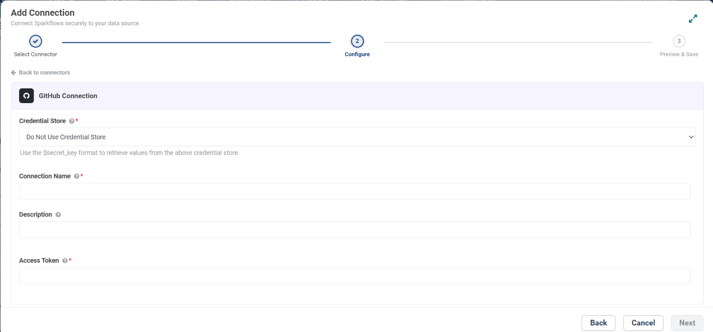
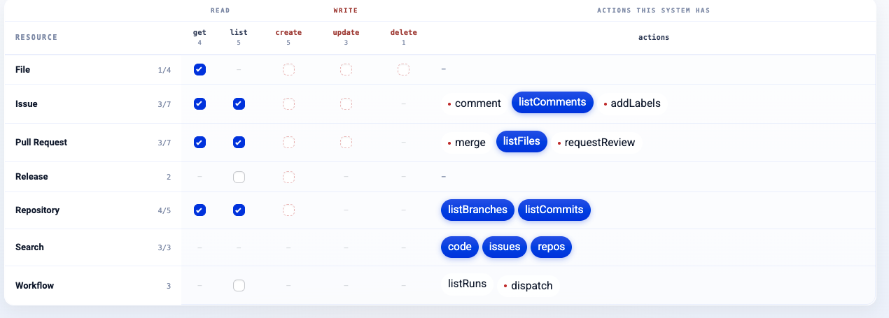

.. _connector-tools-github:

.. rst-class:: agentic-tutorial

GitHub Tools
============

.. raw:: html

   

     
     <dl class="tool-facts">
     
<dt>Connection</dt><dd>GitHub · Access Token</dd>

     
<dt>Tools</dt><dd>31 across 7 resources</dd>

     
<dt>Reads / writes</dt><dd>17 / 14</dd>

     
<dt>Available as</dt><dd>Agent tool only</dd>

     </dl>
     
New

   

.. container:: tutorial-intro

   Let an agent work with GitHub: read and file issues, comment and label, open, review and merge pull requests, read and commit files, run Actions workflows, create releases, and search code, issues and repositories.

.. container:: tutorial-start

   **Agent tool only.** GitHub is available in the agent tool picker. It is not offered as an :doc:`App Action </agentic-ai-guide/tools-integrations/app-actions>` node yet, so a fixed workflow step cannot call it.

.. contents:: On this page
   :local:
   :depth: 1
   :class: tool-toc

Prerequisites
-------------

* **Connection:** A **GitHub** connection that holds one **Access Token**: a personal access token, classic or fine-grained. Sparkflows calls ``api.github.com``, so there is no URL or username to enter.
* A GitHub account with access to the repositories, and a personal access token.

Set up the connection
---------------------

#. In GitHub, open **Settings → Developer settings → Personal access tokens**.
#. Create a **fine-grained** token limited to the repositories the agent works in, with the permissions below. A **classic** token needs ``repo`` for private repositories (``public_repo`` is enough for public ones).
#. If the organisation uses SAML single sign-on, authorise the token for it.
#. In Sparkflows, open **Administration → Global/Group Connections → Add Connection**, choose **Tools → GitHub**, enter a **Connection Name**, paste the token into **Access Token**, click **Test Connection** and save.

.. list-table:: What each group of tools needs
   :header-rows: 1
   :widths: 55 45

   * - Tools
     - Fine-grained permission
   * - Repositories, branches, commits (always needed)
     - Metadata: Read
   * - Issues, comments and labels
     - Issues: Read, or Read and write
   * - Pull requests and reviews
     - Pull requests: Read, or Read and write
   * - Files, merging and releases
     - Contents: Read, or Read and write
   * - Workflows and runs
     - Actions: Read, or Read and write to run a workflow

   The **Configure** step for a GitHub connection. To keep the secret in a credential store instead, pick it under **Credential Store** and enter ``$secret_key``.

.. tip::

   Grant only what the agent needs. The connection decides what GitHub allows at all; the operations you tick decide what this agent may do with it.

Add GitHub to an agent
----------------------

#. In Agent Studio, open the **Tools** group and click **Add tools**, or click **+ Tool** on an Agent Node on the canvas.
#. Choose **GitHub** under **Connectors**, or type ``github`` in the search box.
#. **Connect.** Choose your GitHub connection and click **Test connection**. The rest of the screen unlocks when it shows **Connected**.
#. **How the agent sees it.** Keep **A separate tool for each one**, so the agent picks each operation by name.
#. **Tick the operations.** The grid opens with the **Look things up** pack: reads only. Add each write the agent needs; every write waits for approval when it runs.
#. Click **Add to agent**. The ticked operations arrive as one GitHub node, joined to the Agent Node by a dashed tool link.

   What the agent may do in GitHub. Blue ticks are the **Look things up** pack; dashed boxes are writes, and a red dot marks an action that writes.

.. figure:: ../../../_assets/agentic-ai-guide/tools/connectors/github-packs.png
   :alt: The tools counter and the Start from a pack list for GitHub
   :width: 340px

   **Start from a pack** ticks a set in one click. The counter shows how many named tools the agent gets and how many of them write.

.. figure:: ../../../_assets/agentic-ai-guide/tools/connectors/github-on-canvas.png
   :alt: A GitHub node with its tool count, joined to an Agent Node by the dashed tool link T1
   :width: 100%

   On the canvas: one GitHub node carrying every ticked tool, joined to the Agent Node by the dashed tool link **T1**. Click it to change what the agent may do.

Tools
-----

Each ticked operation becomes one tool, named ``github_<resource>_<operation>``. **Read** tools run straight away. **Write** and **Delete** tools change data in GitHub, so each call waits for :doc:`human approval </agentic-ai-guide/safety-guardrails/human-in-the-loop>` before it takes effect. Click a tool to open its page with every parameter.

.. raw:: html

   <nav class="tool-jump" aria-label="Jump to a resource"><a href="#res-repository">Repository5</a><a href="#res-issue">Issue7</a><a href="#res-pull_request">Pull Request7</a><a href="#res-file">File4</a><a href="#res-workflow">Workflow3</a><a href="#res-release">Release2</a><a href="#res-search">Search3</a></nav>

.. raw:: html

   

Repository
~~~~~~~~~~

.. raw:: html

   

     <a class="tool-op" href="github/repository-get.html" target="_blank" rel="noopener">
       Get a repositoryRead
       Fetches one repository and returns its description, default branch, visibility, topics, open issue count, stars, forks and URLs.
     </a>
     <a class="tool-op" href="github/repository-getmany.html" target="_blank" rel="noopener">
       List repositoriesRead
       Lists the repositories the authenticated user owns, collaborates on or reaches through an organisation, with full name, visibility, default branch, description and last push time.
     </a>
     <a class="tool-op" href="github/repository-create.html" target="_blank" rel="noopener">
       Create a repositoryWrite
       Creates a repository owned by the authenticated user and returns it with its full name and clone URLs.
     </a>
     <a class="tool-op" href="github/repository-listbranches.html" target="_blank" rel="noopener">
       List branchesRead
       Lists a repository&#x27;s branches with each branch&#x27;s name, latest commit SHA and protected flag.
     </a>
     <a class="tool-op" href="github/repository-listcommits.html" target="_blank" rel="noopener">
       List commitsRead
       Lists commits on a branch, newest first, with SHA, message, author, committer and date.
     </a>
   

.. raw:: html

   

Issue
~~~~~

.. raw:: html

   

     <a class="tool-op" href="github/issue-get.html" target="_blank" rel="noopener">
       Get an issueRead
       Fetches one issue by its number and returns title, body, state, labels, assignees, milestone, author and comment count.
     </a>
     <a class="tool-op" href="github/issue-getmany.html" target="_blank" rel="noopener">
       List issuesRead
       Lists a repository&#x27;s issues, newest first, with number, title, state, labels, assignees and dates; GitHub includes pull requests in this list, marked by a pull_request field.
     </a>
     <a class="tool-op" href="github/issue-create.html" target="_blank" rel="noopener">
       Create an issueWrite
       Opens a new issue in a repository and returns it with its number and URL. Use it to file a bug, request or task; to add to an existing issue use Issue comment.
     </a>
     <a class="tool-op" href="github/issue-update.html" target="_blank" rel="noopener">
       Update an issueWrite
       Changes an issue&#x27;s title, body, state, labels, assignees or milestone and returns the updated issue; labels and assignees replace the current lists.
     </a>
     <a class="tool-op" href="github/issue-comment.html" target="_blank" rel="noopener">
       Comment on an issueWrite
       Adds a comment to the conversation of an issue or a pull request and returns it with its id and URL. Line-level review comments on a pull request&#x27;s code are not covered.
     </a>
     <a class="tool-op" href="github/issue-listcomments.html" target="_blank" rel="noopener">
       List an issue&#x27;s commentsRead
       Lists the comments on an issue or pull request conversation, oldest first, with id, author, body and times.
     </a>
     <a class="tool-op" href="github/issue-addlabels.html" target="_blank" rel="noopener">
       Add labels to an issueWrite
       Adds labels to an issue or pull request while keeping the ones it has, and returns the full label list.
     </a>
   

.. raw:: html

   

Pull Request
~~~~~~~~~~~~

.. raw:: html

   

     <a class="tool-op" href="github/pull-request-get.html" target="_blank" rel="noopener">
       Get a pull requestRead
       Fetches one pull request by number and returns title, body, state, author, head and base branches, draft and merged flags, mergeability and counts of commits, changed files and lines.
     </a>
     <a class="tool-op" href="github/pull-request-getmany.html" target="_blank" rel="noopener">
       List pull requestsRead
       Lists a repository&#x27;s pull requests, newest first, with number, title, state, author, draft flag, head and base branches.
     </a>
     <a class="tool-op" href="github/pull-request-create.html" target="_blank" rel="noopener">
       Open a pull requestWrite
       Opens a pull request from one branch into another and returns it with its number and URL. Both branches must exist and differ, and GitHub refuses a second open pull request for the same pair.
     </a>
     <a class="tool-op" href="github/pull-request-update.html" target="_blank" rel="noopener">
       Update a pull requestWrite
       Changes a pull request&#x27;s title, body, base branch or state and returns the updated pull request.
     </a>
     <a class="tool-op" href="github/pull-request-merge.html" target="_blank" rel="noopener">
       Merge a pull requestWrite
       Merges a pull request into its base branch and returns the merge commit SHA and a message.
     </a>
     <a class="tool-op" href="github/pull-request-listfiles.html" target="_blank" rel="noopener">
       List a pull request&#x27;s filesRead
       Lists the files a pull request changes, with each file&#x27;s status (added, modified, removed or renamed), added and deleted line counts and patch.
     </a>
     <a class="tool-op" href="github/pull-request-requestreview.html" target="_blank" rel="noopener">
       Request a reviewWrite
       Asks people or teams to review a pull request and returns the pull request with its requested reviewers.
     </a>
   

.. raw:: html

   

File
~~~~

.. raw:: html

   

     <a class="tool-op" href="github/file-get.html" target="_blank" rel="noopener">
       Get a fileRead
       Fetches one file from a repository and returns its name, path, size, SHA and content, which GitHub sends Base64-encoded; a folder path returns the folder&#x27;s entries instead.
     </a>
     <a class="tool-op" href="github/file-create.html" target="_blank" rel="noopener">
       Create a fileWrite
       Commits a new file to a branch and returns the commit and the file&#x27;s new SHA. The content must be Base64-encoded; to change a file that already exists use File update.
     </a>
     <a class="tool-op" href="github/file-update.html" target="_blank" rel="noopener">
       Update a fileWrite
       Commits new content for an existing file and returns the commit and the file&#x27;s new SHA. It needs the file&#x27;s current SHA from File get, and the content Base64-encoded.
     </a>
     <a class="tool-op" href="github/file-delete.html" target="_blank" rel="noopener">
       Delete a fileDelete
       Deletes a file from a branch with a commit and returns that commit.
     </a>
   

.. raw:: html

   

Workflow
~~~~~~~~

.. raw:: html

   

     <a class="tool-op" href="github/workflow-getmany.html" target="_blank" rel="noopener">
       List workflowsRead
       Lists the GitHub Actions workflows defined in a repository, each with its id, name, file path and state.
     </a>
     <a class="tool-op" href="github/workflow-listruns.html" target="_blank" rel="noopener">
       List workflow runsRead
       Lists recent GitHub Actions runs across all of a repository&#x27;s workflows, with id, workflow name, branch, event, status, conclusion, actor and times.
     </a>
     <a class="tool-op" href="github/workflow-dispatch.html" target="_blank" rel="noopener">
       Run a workflowWrite
       Starts a workflow that has a workflow_dispatch trigger, on a branch or tag, with optional inputs.
     </a>
   

.. raw:: html

   

Release
~~~~~~~

.. raw:: html

   

     <a class="tool-op" href="github/release-getmany.html" target="_blank" rel="noopener">
       List releasesRead
       Lists a repository&#x27;s releases, newest first, with tag, name, draft and prerelease flags, publish time and notes.
     </a>
     <a class="tool-op" href="github/release-create.html" target="_blank" rel="noopener">
       Create a releaseWrite
       Creates a release for a tag and returns it with its id and URL; a tag that does not exist yet is created from targetCommitish.
     </a>
   

.. raw:: html

   

Search
~~~~~~

.. raw:: html

   

     <a class="tool-op" href="github/search-code.html" target="_blank" rel="noopener">
       Search codeRead
       Searches file contents across GitHub and returns the matching files with name, path, repository and URL, not the matching lines.
     </a>
     <a class="tool-op" href="github/search-issues.html" target="_blank" rel="noopener">
       Search issues and pull requestsRead
       Searches issues and pull requests across GitHub with GitHub&#x27;s search syntax and returns number, title, state, labels, author and repository URL for each.
     </a>
     <a class="tool-op" href="github/search-repos.html" target="_blank" rel="noopener">
       Search repositoriesRead
       Searches repositories across GitHub by name, description, topic, language or owner and returns each match&#x27;s full name, description, stars, language and URL. Use Repository getMany for the connection&#x27;s own repositories.
     </a>
   

Good to know
------------

* Repository tools take ``owner/name``, for example ``acme/web``. Fix ``repository`` in **Fixed settings** so the agent cannot wander into another repository.
* **Create a repository** creates it under the token's user, never inside an organisation.
* File content is Base64-encoded both ways. **Update a file** and **Delete a file** need the file's current ``sha`` from **Get a file**.
* **Run a workflow** needs a ``workflow_dispatch`` trigger; the run shows up in **List workflow runs** a few seconds later.
* GitHub allows about 10 code searches a minute.

Example
-------

**Triage new issues.** Fix repository = acme/web; tick reads, Comment on an issue and Add labels to an issue. Then give the Agent Node instructions like these:

.. code-block:: text

   List open issues created in the last day.
   For each one without steps to reproduce, add the label needs-repro and
   comment asking for them. Never close, assign or edit issues.

Other common uses:

* Triage new issues: label them and ask for missing details.
* Summarise what a pull request changes before review.
* Draft release notes from merged pull requests.

Troubleshooting
---------------

***GitHub rejected the token (HTTP 401)*.**
   The token expired, was revoked or was mistyped. Create a new one and update the connection.

**HTTP 404 on a private repository.**
   GitHub answers 404 when the token cannot see a repository. Add the repository to a fine-grained token, or authorise a classic token for the organisation's SSO.

**A merge is refused.**
   GitHub blocks merges with conflicts, failing required checks or missing approvals. **Get a pull request** shows its mergeability.

**The agent does not call the tool, or picks the wrong one.**
   Name the tool in the instructions and untick operations that sound alike. See :ref:`making-tools-reliable`.

FAQ
---

**Is it available as an App Action?**
   Not yet. GitHub is offered as an agent tool; its App Action is still marked Coming soon.

**Can the agent review code line by line?**
   No. **Comment on an issue** posts to the conversation; line-level review comments are not covered.

Related
-------

* :doc:`/agentic-ai-guide/tools-integrations/tools-connectors` - how tools work, choosing operations, and fixed settings
* :doc:`/agentic-ai-guide/tools-integrations/connector-tools/index` - every connector
* :doc:`/agentic-ai-guide/safety-guardrails/human-in-the-loop` - approving writes
