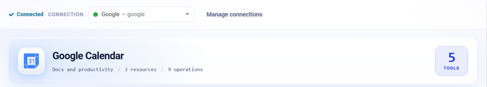
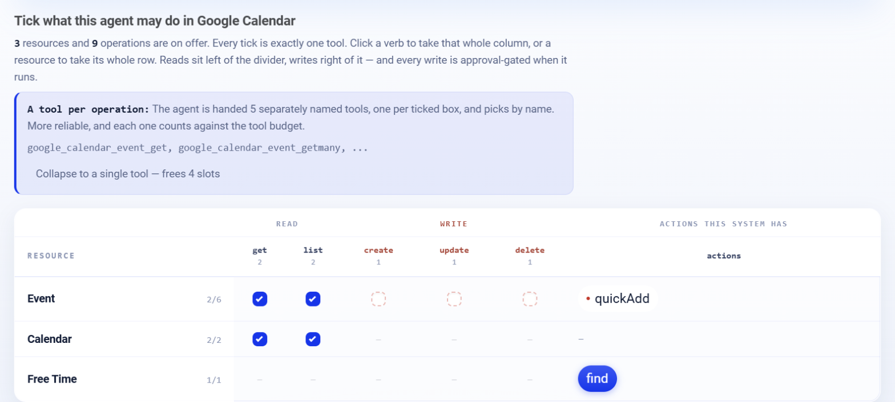

.. _connector-tools-google-calendar:

.. rst-class:: agentic-tutorial

Google Calendar Tools
=====================

.. raw:: html

   

     
     <dl class="tool-facts">
     
<dt>Connection</dt><dd>Google</dd>

     
<dt>Tools</dt><dd>9 across 3 resources</dd>

     
<dt>Reads / writes</dt><dd>5 / 4</dd>

     
<dt>Available as</dt><dd>Agent tool · App Action</dd>

     </dl>
   

.. container:: tutorial-intro

   Let an agent work with Google Calendar: list and read events, find busy times across calendars, and create, update, quick-add or delete events.

.. contents:: On this page
   :local:
   :depth: 1
   :class: tool-toc

Prerequisites
-------------

* **Connection:** A **Google** connection: a client ID, client secret and refresh token from a Google Cloud OAuth client. One Google connection serves Gmail, Calendar, Docs, Drive and Sheets; the scopes on its refresh token decide which of them it can reach.
* The **Google Calendar API** enabled in the Google Cloud project.
* A refresh token with ``https://www.googleapis.com/auth/calendar.readonly`` to read, or ``https://www.googleapis.com/auth/calendar`` to create and change events.

Add Google Calendar to an agent
-------------------------------

#. In Agent Studio, open the **Tools** group and click **Add tools**, or click **+ Tool** on an Agent Node on the canvas.
#. Choose **Google Calendar** under **Connectors**, or type ``calendar`` in the search box.
#. **Connect.** Choose your Google connection and click **Test connection**. The rest of the screen unlocks when it shows **Connected**.
#. **How the agent sees it.** Keep **A separate tool for each one**, so the agent picks each operation by name.
#. **Tick the operations.** The grid opens with the **Look things up** pack: reads only. Add each write the agent needs; every write waits for approval when it runs.
#. Click **Add to agent**. The ticked operations arrive as one Google Calendar node, joined to the Agent Node by a dashed tool link.

   Connected: the tested connection, the Google Calendar card with how many tools are ticked.

   What the agent may do in Google Calendar. Blue ticks are the **Look things up** pack; dashed boxes are writes, and a red dot marks an action that writes.

Tools
-----

Each ticked operation becomes one tool, named ``google_calendar_<resource>_<operation>``. **Read** tools run straight away. **Write** and **Delete** tools change data in Google Calendar, so each call waits for :doc:`human approval </agentic-ai-guide/safety-guardrails/human-in-the-loop>` before it takes effect. Click a tool to open its page with every parameter.

.. raw:: html

   <nav class="tool-jump" aria-label="Jump to a resource"><a href="#res-event">Event6</a><a href="#res-calendar">Calendar2</a><a href="#res-free_time">Free Time1</a></nav>

.. raw:: html

   

Event
~~~~~

.. raw:: html

   

     <a class="tool-op" href="google-calendar/event-get.html" target="_blank" rel="noopener">
       Get an eventRead
       Returns one event with its title, start and end, guests and their responses, location, description and Meet link.
     </a>
     <a class="tool-op" href="google-calendar/event-getmany.html" target="_blank" rel="noopener">
       List eventsRead
       Lists the events on a calendar, with repeating events expanded into single occurrences and sorted by start time by default.
     </a>
     <a class="tool-op" href="google-calendar/event-create.html" target="_blank" rel="noopener">
       Create an eventWrite
       Creates an event on a calendar and returns it, with its id, link and, when conferenceType asks for one, its Meet link.
     </a>
     <a class="tool-op" href="google-calendar/event-update.html" target="_blank" rel="noopener">
       Update an eventWrite
       Changes only the given fields of an existing event and returns the updated event.
     </a>
     <a class="tool-op" href="google-calendar/event-delete.html" target="_blank" rel="noopener">
       Delete an eventDelete
       Deletes an event from a calendar and returns an empty result.
     </a>
     <a class="tool-op" href="google-calendar/event-quickadd.html" target="_blank" rel="noopener">
       Quick add an eventWrite
       Creates an event from one sentence, the way Google Calendar&#x27;s quick-add box does, and returns the event it made.
     </a>
   

.. raw:: html

   

Calendar
~~~~~~~~

.. raw:: html

   

     <a class="tool-op" href="google-calendar/calendar-getmany.html" target="_blank" rel="noopener">
       List calendarsRead
       Lists every calendar the account can see, its own, shared ones and subscribed ones such as holidays, with each calendar&#x27;s id, name, time zone and access role.
     </a>
     <a class="tool-op" href="google-calendar/calendar-get.html" target="_blank" rel="noopener">
       Get a calendarRead
       Returns one calendar&#x27;s name, description and time zone.
     </a>
   

.. raw:: html

   

Free Time
~~~~~~~~~

.. raw:: html

   

     <a class="tool-op" href="google-calendar/free-time-find.html" target="_blank" rel="noopener">
       Find busy timesRead
       Returns the busy intervals of one or more calendars between timeMin and timeMax, so the free slots are the gaps between them.
     </a>
   

Use Google Calendar as an App Action
------------------------------------

The same 9 operations are also a fixed workflow step. Drop **App Action** on the canvas, pick **Google Calendar**, choose the action and fill in its details. It runs every time the flow reaches it, exactly as set; no model decides. Use it for the steps that must always happen, such as saving an approved result, and keep the agent tool for what the model should choose. See :doc:`Google Calendar App Actions </agentic-ai-guide/tools-integrations/app-action-apps/google-calendar>` for every action, its inputs and the trigger events.

Good to know
------------

* **List events** expands repeating events into single occurrences. Bound it with ``timeMin`` and ``timeMax``, or it starts from the calendar's earliest event.
* **Find busy times** returns busy intervals only; the free slots are the gaps.
* Guests in ``attendees`` are emailed an invitation when an event is created. On update and delete, ``sendUpdates`` decides whether they hear about it.
* **Get a calendar** with a blank ``calendarId`` returns the primary calendar, which is how the agent learns the account's time zone.

Example
-------

**Brief me on today.** Look things up pack only. Then give the Agent Node instructions like these:

.. code-block:: text

   List my events for today between 08:00 and 18:00 in my own time zone.
   For each meeting with an external guest, give the time, title and guest list.
   Do not create or change events.

Other common uses:

* Prepare a brief for each of today's customer meetings.
* Propose meeting times from the gaps in several people's calendars.
* Block focus time after a person approves the proposal.

Troubleshooting
---------------

**Times are an hour off.**
   Pass date-times with a zone offset, for example ``2026-10-12T09:00:00+05:30``, and tell the agent to read the calendar's time zone with **Get a calendar** first.

**Events from a shared calendar are missing.**
   Event tools default to the primary calendar. Use **List calendars** to find the calendar id and pass it as ``calendarId``.

**The agent does not call the tool, or picks the wrong one.**
   Name the tool in the instructions and untick operations that sound alike. See :ref:`making-tools-reliable`.

FAQ
---

**Does the agent see private event details?**
   It sees what the connected Google account can see, nothing more.

Related
-------

* :doc:`/agentic-ai-guide/tools-integrations/tools-connectors` - how tools work, choosing operations, and fixed settings
* :doc:`/agentic-ai-guide/tools-integrations/connector-tools/index` - every connector
* :doc:`/agentic-ai-guide/safety-guardrails/human-in-the-loop` - approving writes
* :doc:`/agentic-ai-guide/tools-integrations/app-actions` - the same operations as fixed workflow steps
