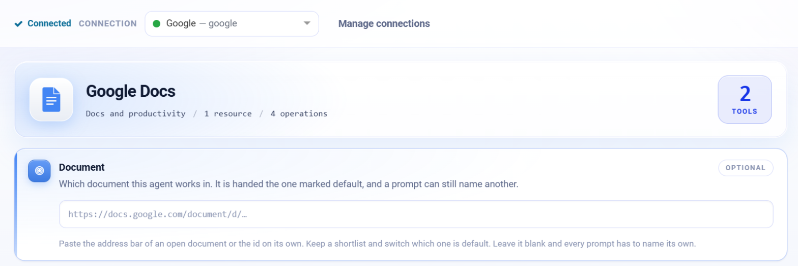
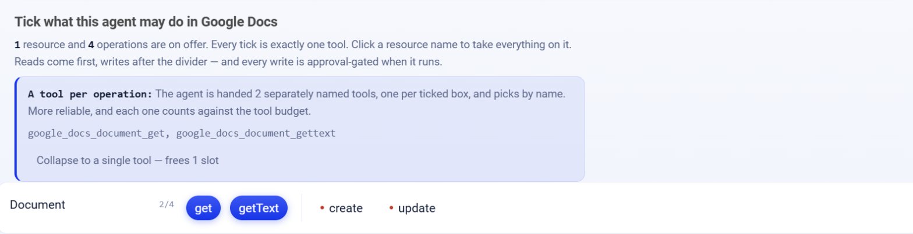

.. _connector-tools-google-docs:

.. rst-class:: agentic-tutorial

Google Docs Tools
=================

.. raw:: html

   

     
     <dl class="tool-facts">
     
<dt>Connection</dt><dd>Google</dd>

     
<dt>Tools</dt><dd>4 across 1 resource</dd>

     
<dt>Reads / writes</dt><dd>2 / 2</dd>

     
<dt>Available as</dt><dd>Agent tool · App Action</dd>

     </dl>
   

.. container:: tutorial-intro

   Let an agent read Google Docs as plain text, create documents and edit them through the Docs batchUpdate API, for example to write a meeting brief or replace placeholders in a template.

.. contents:: On this page
   :local:
   :depth: 1
   :class: tool-toc

Prerequisites
-------------

* **Connection:** A **Google** connection: a client ID, client secret and refresh token from a Google Cloud OAuth client. One Google connection serves Gmail, Calendar, Docs, Drive and Sheets; the scopes on its refresh token decide which of them it can reach.
* The **Google Docs API** enabled in the Google Cloud project.
* A refresh token with ``https://www.googleapis.com/auth/documents.readonly`` to read, or ``https://www.googleapis.com/auth/documents`` to create and edit.
* To let the agent find documents by name, add Google Drive tools (and the ``drive.metadata.readonly`` scope).

Add Google Docs to an agent
---------------------------

#. In Agent Studio, open the **Tools** group and click **Add tools**, or click **+ Tool** on an Agent Node on the canvas.
#. Choose **Google Docs** under **Connectors**, or type ``docs`` in the search box.
#. **Connect.** Choose your Google connection and click **Test connection**. The rest of the screen unlocks when it shows **Connected**.
#. **How the agent sees it.** Keep **A separate tool for each one**, so the agent picks each operation by name.
#. Optionally paste a default **Document** (its address or id). The agent is handed the one marked default; a prompt can still name another.
#. **Tick the operations.** The grid opens with the **Look things up** pack: reads only. Add each write the agent needs; every write waits for approval when it runs.
#. Click **Add to agent**. The ticked operations arrive as one Google Docs node, joined to the Agent Node by a dashed tool link.

   Connected: the tested connection, the Google Docs card with how many tools are ticked and the default Document box.

   What the agent may do in Google Docs. Blue ticks are the **Look things up** pack; dashed boxes are writes, and a red dot marks an action that writes.

Tools
-----

Each ticked operation becomes one tool, named ``google_docs_<resource>_<operation>``. **Read** tools run straight away. **Write** and **Delete** tools change data in Google Docs, so each call waits for :doc:`human approval </agentic-ai-guide/safety-guardrails/human-in-the-loop>` before it takes effect. Click a tool to open its page with every parameter.

.. raw:: html

   

Document
~~~~~~~~

.. raw:: html

   

     <a class="tool-op" href="google-docs/document-get.html" target="_blank" rel="noopener">
       Get a documentRead
       Returns a document&#x27;s full structure: title, revision id and body content with the start and end index of every paragraph, table and text run.
     </a>
     <a class="tool-op" href="google-docs/document-gettext.html" target="_blank" rel="noopener">
       Read a document as textRead
       Returns a document&#x27;s id, title and its whole text as one plain-text value, table cells included.
     </a>
     <a class="tool-op" href="google-docs/document-create.html" target="_blank" rel="noopener">
       Create a documentWrite
       Creates an empty document with the given title in the connection&#x27;s Google Drive and returns its documentId and link.
     </a>
     <a class="tool-op" href="google-docs/document-update.html" target="_blank" rel="noopener">
       Update a documentWrite
       Edits a document through the Docs batchUpdate API and returns the document id and its new revision.
     </a>
   

Use Google Docs as an App Action
--------------------------------

Google Docs also has 4 App Actions, fixed workflow steps for the same work. Drop **App Action** on the canvas, pick **Google Docs**, choose the action and fill in its details. It runs every time the flow reaches it, exactly as set; no model decides. Use it for the steps that must always happen, such as saving an approved result, and keep the agent tool for what the model should choose. See :doc:`Google Docs App Actions </agentic-ai-guide/tools-integrations/app-action-apps/google-docs>` for every action, its inputs and the trigger events.

Good to know
------------

* Use **Read a document as text** to read, quote or summarise. **Get a document** returns the full structure with indices and is only needed for positional edits.
* **Create a document** makes an empty document; add its text afterwards with **Update a document**.
* Set a default **Document** on the connector screen (see below). The agent is handed that document, and a prompt can still name another.

Example
-------

**Write a meeting brief.** Set a default Document; tick Read a document as text and Update a document. Then give the Agent Node instructions like these:

.. code-block:: text

   Read the current brief document as text.
   Append a new section headed with today's date that lists each agenda item
   and one open question per item. Do not change existing text.

Other common uses:

* Summarise a policy or a contract stored in Docs.
* Write a weekly status page into a shared document.
* Fill a template by replacing placeholder text.

Troubleshooting
---------------

**An edit lands in the wrong place.**
   Positional inserts need a current index. Tell the agent to append at the end, or to replace placeholder text, rather than counting characters.

***The caller does not have permission*.**
   The Google account behind the connection cannot open that document. Share it with that account.

**The agent does not call the tool, or picks the wrong one.**
   Name the tool in the instructions and untick operations that sound alike. See :ref:`making-tools-reliable`.

FAQ
---

**What is the Document box on the connector screen?**
   A shortlist of documents this agent works in. The one marked default is handed to the agent; leave it blank and every prompt has to name its own.

Related
-------

* :doc:`/agentic-ai-guide/tools-integrations/tools-connectors` - how tools work, choosing operations, and fixed settings
* :doc:`/agentic-ai-guide/tools-integrations/connector-tools/index` - every connector
* :doc:`/agentic-ai-guide/safety-guardrails/human-in-the-loop` - approving writes
* :doc:`/agentic-ai-guide/tools-integrations/app-actions` - the same operations as fixed workflow steps
