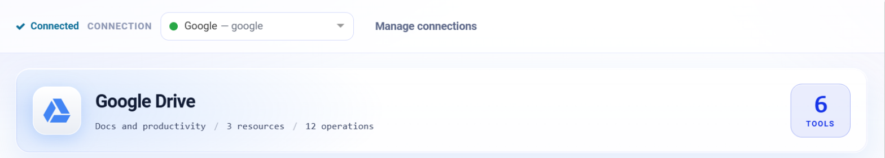
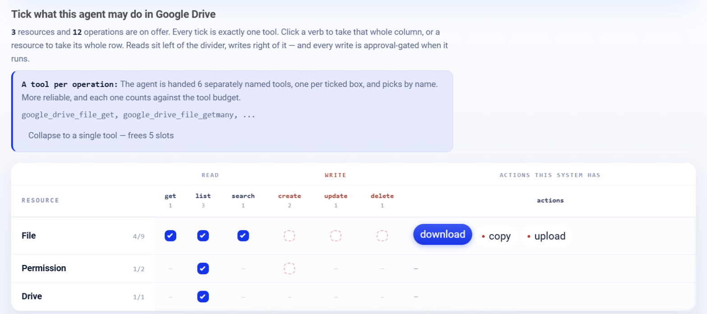

.. _connector-tools-google-drive:

.. rst-class:: agentic-tutorial

Google Drive Tools
==================

.. raw:: html

   

     
     <dl class="tool-facts">
     
<dt>Connection</dt><dd>Google</dd>

     
<dt>Tools</dt><dd>12 across 3 resources</dd>

     
<dt>Reads / writes</dt><dd>6 / 6</dd>

     
<dt>Available as</dt><dd>Agent tool · App Action</dd>

     </dl>
   

.. container:: tutorial-intro

   Let an agent find, read, organise and share files in Google Drive and shared drives: search with Drive queries, read text files, create folders, copy, upload, move and share.

.. contents:: On this page
   :local:
   :depth: 1
   :class: tool-toc

Prerequisites
-------------

* **Connection:** A **Google** connection: a client ID, client secret and refresh token from a Google Cloud OAuth client. One Google connection serves Gmail, Calendar, Docs, Drive and Sheets; the scopes on its refresh token decide which of them it can reach.
* The **Google Drive API** enabled in the Google Cloud project.
* A refresh token with ``https://www.googleapis.com/auth/drive.readonly`` to read, or ``https://www.googleapis.com/auth/drive`` to create, move, share or delete. Drive is the broadest scope of the five; grant write only when the agent needs it.

Add Google Drive to an agent
----------------------------

#. In Agent Studio, open the **Tools** group and click **Add tools**, or click **+ Tool** on an Agent Node on the canvas.
#. Choose **Google Drive** under **Connectors**, or type ``drive`` in the search box.
#. **Connect.** Choose your Google connection and click **Test connection**. The rest of the screen unlocks when it shows **Connected**.
#. **How the agent sees it.** Keep **A separate tool for each one**, so the agent picks each operation by name.
#. **Tick the operations.** The grid opens with the **Look things up** pack: reads only. Add each write the agent needs; every write waits for approval when it runs.
#. Click **Add to agent**. The ticked operations arrive as one Google Drive node, joined to the Agent Node by a dashed tool link.

   Connected: the tested connection, the Google Drive card with how many tools are ticked.

   What the agent may do in Google Drive. Blue ticks are the **Look things up** pack; dashed boxes are writes, and a red dot marks an action that writes.

Tools
-----

Each ticked operation becomes one tool, named ``google_drive_<resource>_<operation>``. **Read** tools run straight away. **Write** and **Delete** tools change data in Google Drive, so each call waits for :doc:`human approval </agentic-ai-guide/safety-guardrails/human-in-the-loop>` before it takes effect. Click a tool to open its page with every parameter.

.. raw:: html

   <nav class="tool-jump" aria-label="Jump to a resource"><a href="#res-file">File9</a><a href="#res-permission">Permission2</a><a href="#res-drive">Drive1</a></nav>

.. raw:: html

   

File
~~~~

.. raw:: html

   

     <a class="tool-op" href="google-drive/file-get.html" target="_blank" rel="noopener">
       Get a fileRead
       Returns one file&#x27;s or folder&#x27;s metadata: name, type, size, created and modified time, parent folders and web link.
     </a>
     <a class="tool-op" href="google-drive/file-getmany.html" target="_blank" rel="noopener">
       List filesRead
       Lists files and folders with their name, type, size, dates and web link.
     </a>
     <a class="tool-op" href="google-drive/file-search.html" target="_blank" rel="noopener">
       Search filesRead
       Finds files and folders that match a Drive query and returns their name, type, size, dates and web link.
     </a>
     <a class="tool-op" href="google-drive/file-download.html" target="_blank" rel="noopener">
       Download a fileRead
       Fetches a file&#x27;s content and returns it as text in a response column.
     </a>
     <a class="tool-op" href="google-drive/file-create.html" target="_blank" rel="noopener">
       Create a file or folderWrite
       Creates an empty file or a folder from metadata alone and returns its id, name and web link.
     </a>
     <a class="tool-op" href="google-drive/file-update.html" target="_blank" rel="noopener">
       Update a fileWrite
       Changes a file&#x27;s or folder&#x27;s metadata, such as renaming it, starring it, moving it to another folder or to the bin, and returns the updated file.
     </a>
     <a class="tool-op" href="google-drive/file-copy.html" target="_blank" rel="noopener">
       Copy a fileWrite
       Makes a copy of a file, optionally into another folder, and returns the new file&#x27;s id, name and web link.
     </a>
     <a class="tool-op" href="google-drive/file-delete.html" target="_blank" rel="noopener">
       Delete a file permanentlyDelete
       Permanently deletes a file or folder, skipping the bin; deleting a folder also deletes everything the account owns inside it.
     </a>
     <a class="tool-op" href="google-drive/file-upload.html" target="_blank" rel="noopener">
       Upload a fileWrite
       Uploads a file from the engine&#x27;s disk into Drive and returns the new file&#x27;s id, name and web link.
     </a>
   

.. raw:: html

   

Permission
~~~~~~~~~~

.. raw:: html

   

     <a class="tool-op" href="google-drive/permission-getmany.html" target="_blank" rel="noopener">
       List who has accessRead
       Lists the permissions on a file or folder: who has access (a user, group, domain or anyone with the link) and with which role.
     </a>
     <a class="tool-op" href="google-drive/permission-create.html" target="_blank" rel="noopener">
       Share a fileWrite
       Gives a user, a group, a whole domain or anyone with the link access to a file or folder with the given role, and returns the new permission.
     </a>
   

.. raw:: html

   

Drive
~~~~~

.. raw:: html

   

     <a class="tool-op" href="google-drive/drive-getmany.html" target="_blank" rel="noopener">
       List shared drivesRead
       Lists the shared drives the account is a member of, with each drive&#x27;s id and name.
     </a>
   

Use Google Drive as an App Action
---------------------------------

Google Drive also has 12 App Actions, fixed workflow steps for the same work. Drop **App Action** on the canvas, pick **Google Drive**, choose the action and fill in its details. It runs every time the flow reaches it, exactly as set; no model decides. Use it for the steps that must always happen, such as saving an approved result, and keep the agent tool for what the model should choose. See :doc:`Google Drive App Actions </agentic-ai-guide/tools-integrations/app-action-apps/google-drive>` for every action, its inputs and the trigger events.

Good to know
------------

* **Download a file** suits text files such as CSV, TXT or JSON. Google Docs, Sheets and Slides cannot be downloaded this way; use their own connectors.
* **Delete a file permanently** skips the bin. To bin a file instead, use **Update a file** with ``trashed`` true.
* **Share a file** emails the people it adds unless ``sendNotificationEmail`` is false.
* **Upload a file** reads from the engine's disk, for example a file an email attachment tool saved.

Example
-------

**Find a file.** Look things up pack only. Then give the Agent Node instructions like these:

.. code-block:: text

   Search Drive for spreadsheets named like "Q3 forecast" modified this month,
   excluding trashed files. Return the name, owner, modified time and link of each.

Other common uses:

* Find the latest version of a report by name and folder.
* File email attachments into a dated folder.
* Check who has access to a folder before sharing it.

Troubleshooting
---------------

**Search returns files from the bin.**
   Add ``trashed = false`` to the query, or tell the agent to.

**A shared drive is empty.**
   Pass the shared drive's id as ``driveId`` with ``corpora`` drive. **List shared drives** returns the ids.

**The agent does not call the tool, or picks the wrong one.**
   Name the tool in the instructions and untick operations that sound alike. See :ref:`making-tools-reliable`.

FAQ
---

**Can the agent read a PDF from Drive?**
   Not through **Download a file**, which returns text. Save the PDF with another tool and read it with the built-in **Document To Text** tool.

Related
-------

* :doc:`/agentic-ai-guide/tools-integrations/tools-connectors` - how tools work, choosing operations, and fixed settings
* :doc:`/agentic-ai-guide/tools-integrations/connector-tools/index` - every connector
* :doc:`/agentic-ai-guide/safety-guardrails/human-in-the-loop` - approving writes
* :doc:`/agentic-ai-guide/tools-integrations/app-actions` - the same operations as fixed workflow steps
