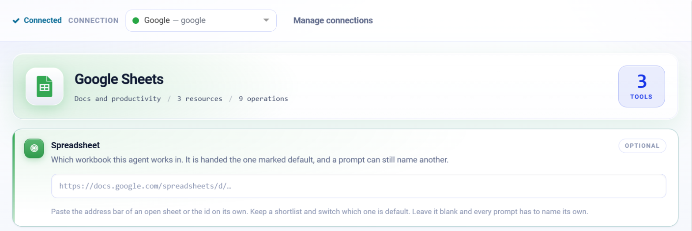
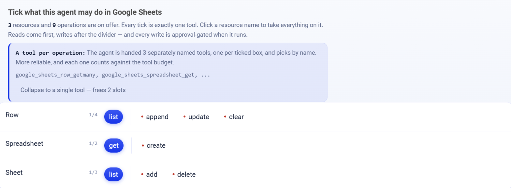

.. _connector-tools-google-sheets:

.. rst-class:: agentic-tutorial

Google Sheets Tools
===================

.. raw:: html

   

     
     <dl class="tool-facts">
     
<dt>Connection</dt><dd>Google</dd>

     
<dt>Tools</dt><dd>9 across 3 resources</dd>

     
<dt>Reads / writes</dt><dd>3 / 6</dd>

     
<dt>Available as</dt><dd>Agent tool · App Action</dd>

     </dl>
   

.. container:: tutorial-intro

   Let an agent read rows from a Google Sheet, append and update rows, clear ranges, and create spreadsheets and tabs.

.. contents:: On this page
   :local:
   :depth: 1
   :class: tool-toc

Prerequisites
-------------

* **Connection:** A **Google** connection: a client ID, client secret and refresh token from a Google Cloud OAuth client. One Google connection serves Gmail, Calendar, Docs, Drive and Sheets; the scopes on its refresh token decide which of them it can reach.
* The **Google Sheets API** enabled in the Google Cloud project.
* A refresh token with ``https://www.googleapis.com/auth/spreadsheets.readonly`` to read, or ``https://www.googleapis.com/auth/spreadsheets`` to write.

Add Google Sheets to an agent
-----------------------------

#. In Agent Studio, open the **Tools** group and click **Add tools**, or click **+ Tool** on an Agent Node on the canvas.
#. Choose **Google Sheets** under **Connectors**, or type ``sheets`` in the search box.
#. **Connect.** Choose your Google connection and click **Test connection**. The rest of the screen unlocks when it shows **Connected**.
#. **How the agent sees it.** Keep **A separate tool for each one**, so the agent picks each operation by name.
#. Optionally paste a default **Spreadsheet** (its address or id). The agent is handed the one marked default; a prompt can still name another.
#. **Tick the operations.** The grid opens with the **Look things up** pack: reads only. Add each write the agent needs; every write waits for approval when it runs.
#. Click **Add to agent**. The ticked operations arrive as one Google Sheets node, joined to the Agent Node by a dashed tool link.

   Connected: the tested connection, the Google Sheets card with how many tools are ticked and the default Spreadsheet box.

   What the agent may do in Google Sheets. Blue ticks are the **Look things up** pack; dashed boxes are writes, and a red dot marks an action that writes.

Tools
-----

Each ticked operation becomes one tool, named ``google_sheets_<resource>_<operation>``. **Read** tools run straight away. **Write** and **Delete** tools change data in Google Sheets, so each call waits for :doc:`human approval </agentic-ai-guide/safety-guardrails/human-in-the-loop>` before it takes effect. Click a tool to open its page with every parameter.

.. raw:: html

   <nav class="tool-jump" aria-label="Jump to a resource"><a href="#res-row">Row4</a><a href="#res-spreadsheet">Spreadsheet2</a><a href="#res-sheet">Sheet3</a></nav>

.. raw:: html

   

Row
~~~

.. raw:: html

   

     <a class="tool-op" href="google-sheets/row-getmany.html" target="_blank" rel="noopener">
       Read rowsRead
       Reads the cell values of a tab or A1 range and returns one row per sheet row.
     </a>
     <a class="tool-op" href="google-sheets/row-append.html" target="_blank" rel="noopener">
       Append rowsWrite
       Adds rows below the last row of the table in a tab and returns the range that was written.
     </a>
     <a class="tool-op" href="google-sheets/row-update.html" target="_blank" rel="noopener">
       Update rowsWrite
       Overwrites the cells of an exact range and returns the range and the number of cells updated.
     </a>
     <a class="tool-op" href="google-sheets/row-clear.html" target="_blank" rel="noopener">
       Clear a rangeDelete
       Empties the values in a range and returns the range that was cleared; formatting and the rows themselves stay.
     </a>
   

.. raw:: html

   

Spreadsheet
~~~~~~~~~~~

.. raw:: html

   

     <a class="tool-op" href="google-sheets/spreadsheet-get.html" target="_blank" rel="noopener">
       Get a spreadsheetRead
       Returns a spreadsheet&#x27;s metadata: title, locale, time zone, URL and each tab&#x27;s properties such as sheetId, title and grid size.
     </a>
     <a class="tool-op" href="google-sheets/spreadsheet-create.html" target="_blank" rel="noopener">
       Create a spreadsheetWrite
       Creates a new spreadsheet in the connection&#x27;s Google Drive and returns its spreadsheetId, URL and tabs.
     </a>
   

.. raw:: html

   

Sheet
~~~~~

.. raw:: html

   

     <a class="tool-op" href="google-sheets/sheet-getmany.html" target="_blank" rel="noopener">
       List tabsRead
       Lists the tabs of a spreadsheet with each tab&#x27;s sheetId, title, index and grid size.
     </a>
     <a class="tool-op" href="google-sheets/sheet-add.html" target="_blank" rel="noopener">
       Add a tabWrite
       Adds a new tab to an existing spreadsheet and returns its sheetId, title and index.
     </a>
     <a class="tool-op" href="google-sheets/sheet-delete.html" target="_blank" rel="noopener">
       Delete a tabDelete
       Deletes a tab and everything on it from a spreadsheet.
     </a>
   

Use Google Sheets as an App Action
----------------------------------

The same 9 operations are also a fixed workflow step. Drop **App Action** on the canvas, pick **Google Sheets**, choose the action and fill in its details. It runs every time the flow reaches it, exactly as set; no model decides. Use it for the steps that must always happen, such as saving an approved result, and keep the agent tool for what the model should choose. See :doc:`Google Sheets App Actions </agentic-ai-guide/tools-integrations/app-action-apps/google-sheets>` for every action, its inputs and the trigger events.

Good to know
------------

* Set a default **Spreadsheet** on the connector screen. The agent is handed the one marked default, and a prompt can still name another.
* With ``headerRow`` match, **Read rows** names columns after the first row and **Append rows** writes each value under the header of the same name.
* **Update rows** overwrites an exact range and does not match headers. Read the rows first to find the row number.
* **Delete a tab** takes the numeric ``sheetId`` from **List tabs**; only version history brings a deleted tab back.

Example
-------

**Log processed items.** Set a default Spreadsheet; tick Read rows and Append rows. Then give the Agent Node instructions like these:

.. code-block:: text

   Read the Log tab with headerRow match to see the columns.
   Append one row per processed invoice with file_name, amount and summary.
   Never update or clear existing rows.

Other common uses:

* Log every processed email or ticket as a new row.
* Answer questions from a tracking sheet.
* Keep a status column up to date after approval.

Troubleshooting
---------------

**Appended values land under the wrong columns.**
   Use ``headerRow`` match and make the keys of each row exactly match the header names, including case and spaces.

***Unable to parse range*.**
   Quote tab names with spaces: ``'Sales 2026'!A1:D50``.

**The agent does not call the tool, or picks the wrong one.**
   Name the tool in the instructions and untick operations that sound alike. See :ref:`making-tools-reliable`.

FAQ
---

**How is this different from the built-in Read Google Sheets tool?**
   The built-in tool reads a sheet into a table in one call. The connector gives the agent separate named tools to read, append, update and manage tabs.

Related
-------

* :doc:`/agentic-ai-guide/tools-integrations/tools-connectors` - how tools work, choosing operations, and fixed settings
* :doc:`/agentic-ai-guide/tools-integrations/connector-tools/index` - every connector
* :doc:`/agentic-ai-guide/safety-guardrails/human-in-the-loop` - approving writes
* :doc:`/agentic-ai-guide/tools-integrations/app-actions` - the same operations as fixed workflow steps
