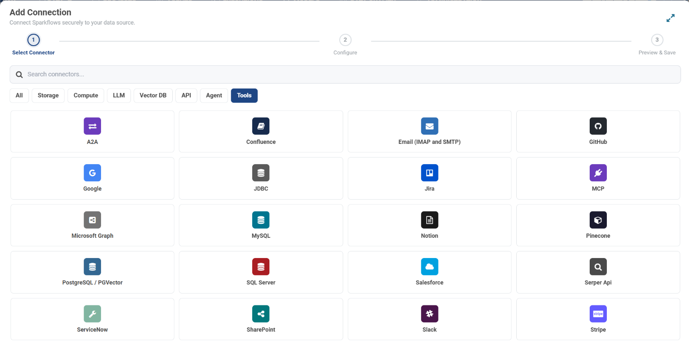

.. _connector-tools:

.. rst-class:: agentic-tutorial

Connector Tools
===============

.. container:: tutorial-intro

   Connector tools let an agent read from and act in the systems your business runs on. Each connector is one node on the canvas that expands into one named tool per operation you tick. 22 connectors and 418 operations are available today.

.. container:: tutorial-start

   **New to tools?** Read :doc:`/agentic-ai-guide/tools-integrations/tools-connectors` first. For tools that need no outside system, such as reading a CSV or calling a REST API, see :doc:`/agentic-ai-guide/tools-integrations/sparkflows-tools`.

.. figure:: ../../../_assets/agentic-ai-guide/tools/picker-connectors.png
   :alt: The Add a tool picker with the Connectors list
   :width: 100%

   Click **+ Tool** on an Agent Node, or **Add tools** in Agent Studio, to open the picker. Each tile shows the connector's resources and operations, and **connected** when a connection for it already exists.

.. contents:: On this page
   :local:
   :depth: 1
   :class: tool-toc

Choose a connector
------------------

Google Workspace
~~~~~~~~~~~~~~~~

.. raw:: html

   

     <article class="tutorial-card tool-card">
       
<h3><a href="gmail.html">Gmail</a></h3>

       
Search, read and label email, draft or send replies, and save attachments.

       
22 tools · 11 read, 11 write Google connection

     </article>
     <article class="tutorial-card tool-card">
       
<h3><a href="google-calendar.html">Google Calendar</a></h3>

       
List events, find busy times, and create or update events.

       
9 tools · 5 read, 4 write Google connection

     </article>
     <article class="tutorial-card tool-card">
       
<h3><a href="google-docs.html">Google Docs</a></h3>

       
Read documents as text, create them and edit their content.

       
4 tools · 2 read, 2 write Google connection

     </article>
     <article class="tutorial-card tool-card">
       
<h3><a href="google-drive.html">Google Drive</a></h3>

       
Search, read, upload, organise and share files and folders.

       
12 tools · 6 read, 6 write Google connection

     </article>
     <article class="tutorial-card tool-card">
       
<h3><a href="google-sheets.html">Google Sheets</a></h3>

       
Read rows, append and update them, and manage tabs.

       
9 tools · 3 read, 6 write Google connection

     </article>
   

Microsoft 365
~~~~~~~~~~~~~

.. raw:: html

   

     <article class="tutorial-card tool-card">
       
<h3><a href="outlook-mail.html">Outlook Mail</a></h3>

       
Search and read email, reply, forward, draft, move and flag.

       
18 tools · 8 read, 10 write Microsoft Graph connection

     </article>
     <article class="tutorial-card tool-card">
       
<h3><a href="outlook-calendar.html">Outlook Calendar</a></h3>

       
Read calendars, check free/busy, and manage meetings.

       
12 tools · 6 read, 6 write Microsoft Graph connection

     </article>
     <article class="tutorial-card tool-card">
       
<h3><a href="onedrive.html">OneDrive</a></h3>

       
Browse a OneDrive, read file text, upload, move and share.

       
11 tools · 5 read, 6 write Microsoft Graph connection

     </article>
     <article class="tutorial-card tool-card">
       
<h3><a href="sharepoint-online.html">SharePoint Online</a></h3>

       
Find sites, read and upload library files, and edit list items.

       
25 tools · 15 read, 10 write Microsoft Graph or SharePoint connection

     </article>
     <article class="tutorial-card tool-card">
       
<h3><a href="microsoft-teams.html">Microsoft Teams</a></h3>

       
Read teams, channels, posts and chats, and create meetings.

       
17 tools · 12 read, 5 write Microsoft Graph connection

     </article>
   

Messaging and email
~~~~~~~~~~~~~~~~~~~

.. raw:: html

   

     <article class="tutorial-card tool-card">
       
<h3><a href="slack.html">Slack</a></h3>

       
Read channels and threads, look people up, and post messages.

       
37 tools · 16 read, 21 write Slack connection · Bot Token

     </article>
     <article class="tutorial-card tool-card">
       
<h3><a href="email-imap-smtp.html">Email (IMAP and SMTP)</a></h3>

       
NewAgent tool only

       
Read, search, move and reply to email in any IMAP mailbox.

       
12 tools · 5 read, 7 write Email connection · host and password

     </article>
   

CRM and commerce
~~~~~~~~~~~~~~~~

.. raw:: html

   

     <article class="tutorial-card tool-card">
       
<h3><a href="salesforce.html">Salesforce</a></h3>

       
Look up and change accounts, contacts, leads, opportunities and cases.

       
79 tools · 35 read, 44 write Salesforce connection

     </article>
     <article class="tutorial-card tool-card">
       
<h3><a href="stripe.html">Stripe</a></h3>

       
NewAgent tool only

       
Look up customers, invoices, subscriptions, charges and the balance.

       
14 tools · 11 read, 3 write Stripe connection · Secret Key

     </article>
   

Developer and work tracking
~~~~~~~~~~~~~~~~~~~~~~~~~~~

.. raw:: html

   

     <article class="tutorial-card tool-card">
       
<h3><a href="github.html">GitHub</a></h3>

       
NewAgent tool only

       
Work with issues, pull requests, files, workflows and releases.

       
31 tools · 17 read, 14 write GitHub connection · Access Token

     </article>
     <article class="tutorial-card tool-card">
       
<h3><a href="jira-cloud.html">Jira Cloud</a></h3>

       
Search issues with JQL, create, update, transition and comment.

       
28 tools · 18 read, 10 write Jira connection

     </article>
     <article class="tutorial-card tool-card">
       
<h3><a href="notion.html">Notion</a></h3>

       
NewAgent tool only

       
Search pages and databases, query rows, add pages and content.

       
13 tools · 7 read, 6 write Notion connection · Integration Token

     </article>
   

Databases
~~~~~~~~~

.. raw:: html

   

     <article class="tutorial-card tool-card">
       
<h3><a href="mysql.html">MySQL</a></h3>

       
Read, filter and count rows, describe tables, and write rows.

       
11 tools · 6 read, 5 write MySQL connection

     </article>
     <article class="tutorial-card tool-card">
       
<h3><a href="postgresql.html">PostgreSQL</a></h3>

       
Read, filter and count rows, describe tables, and write rows.

       
11 tools · 6 read, 5 write PostgreSQL connection

     </article>
     <article class="tutorial-card tool-card">
       
<h3><a href="sql-server.html">SQL Server</a></h3>

       
Read, filter and count rows, describe tables, and write rows.

       
11 tools · 6 read, 5 write SQL Server connection

     </article>
     <article class="tutorial-card tool-card">
       
<h3><a href="sql-database.html">SQL Database</a></h3>

       
NewAgent tool only

       
Work with any SQL database: read and write rows, run SQL, manage tables.

       
18 tools · 8 read, 10 write Database connection

     </article>
   

Web
~~~

.. raw:: html

   

     <article class="tutorial-card tool-card">
       
<h3><a href="web-search.html">Web Search</a></h3>

       
Search the web and news, fetch pages, read feeds, call URLs.

       
14 tools · 10 read, 4 write Serper connection

     </article>
   

Connections at a glance
-----------------------

Every connector signs in with a saved connection. Create it once under **Administration → Global/Group Connections → Add Connection** and reuse it in every agent. Connections for tools are listed under the **Tools** category.

   **Add Connection → Tools** lists every connection type a tool can sign in with, including Slack, GitHub, Notion, Stripe and Email (IMAP and SMTP).

.. list-table::
   :header-rows: 1
   :widths: 20 38 42

   * - Connection
     - Used by
     - What it holds
   * - **Google**
     - :doc:`Gmail <gmail>`, :doc:`Google Calendar <google-calendar>`, :doc:`Google Docs <google-docs>`, :doc:`Google Drive <google-drive>`, :doc:`Google Sheets <google-sheets>`
     - Client ID, client secret and refresh token from a Google Cloud OAuth client. The scopes on the refresh token decide which apps it reaches.
   * - **Microsoft Graph**
     - :doc:`Outlook Mail <outlook-mail>`, :doc:`Outlook Calendar <outlook-calendar>`, :doc:`OneDrive <onedrive>`, :doc:`SharePoint Online <sharepoint-online>`, :doc:`Microsoft Teams <microsoft-teams>`
     - Tenant ID, client ID and client secret of an Entra ID app registration, with Graph application permissions granted by an admin.
   * - **SharePoint**
     - :doc:`SharePoint Online <sharepoint-online>`
     - An alternative to Microsoft Graph for SharePoint only.
   * - **Salesforce**
     - :doc:`Salesforce <salesforce>`
     - Your Salesforce org and user.
   * - **Jira**
     - :doc:`Jira Cloud <jira-cloud>`
     - Site URL, account email and API token.
   * - **Slack**
     - :doc:`Slack <slack>`
     - A **Bot Token** (``xoxb-``).
   * - **GitHub**
     - :doc:`GitHub <github>`
     - An **Access Token**: a classic or fine-grained personal access token.
   * - **Notion**
     - :doc:`Notion <notion>`
     - An **Integration Token**: an internal integration secret.
   * - **Stripe**
     - :doc:`Stripe <stripe>`
     - A **Secret Key** (``sk_``) or a restricted key (``rk_``).
   * - **Email (IMAP and SMTP)**
     - :doc:`Email (IMAP and SMTP) <email-imap-smtp>`
     - IMAP host, email address and password, plus an optional SMTP host.
   * - **Database (JDBC)**
     - :doc:`MySQL <mysql>`, :doc:`PostgreSQL <postgresql>`, :doc:`SQL Server <sql-server>`
     - JDBC URL, user and password.
   * - **Serper**
     - :doc:`Web Search <web-search>`
     - A Serper API key, used by the search tools only.

Slack, GitHub, Notion and Stripe connections hold one token and nothing else: each of these connectors calls its own fixed API host, so there is no URL or username to enter. **Test Connection** checks the token against that service before you save.

.. note::

   The other 17 connectors are also available as an :doc:`App Action </agentic-ai-guide/tools-integrations/app-actions>`: the same operations as a fixed workflow step that always runs exactly as set. GitHub, Notion, Stripe and Email (IMAP and SMTP) are offered as agent tools only; their App Action nodes are still marked **Coming soon**. Connectors that are not listed on this page are not available yet.

How a connector becomes tools
-----------------------------

#. **Connect.** Pick a connection and click **Test connection**. Nothing below unlocks until it passes, so a wrong token is caught before you tick anything.
#. **Choose the shape.** *A separate tool for each one* (recommended) hands the agent one named tool per operation. *One tool for everything* hands it a single tool that takes the resource and operation as arguments.
#. **Tick operations.** Reads sit left of the divider and writes right of it. Start from the **Look things up** pack and add only what the agent needs.
#. **Add to agent.** Everything you ticked arrives as one node on the canvas.

.. figure:: ../../../_assets/agentic-ai-guide/tools/connect-step.png
   :alt: Step 1 of a connector: Choose a connection, Test connection and Manage connections
   :width: 100%

   Step 1 on every connector. If no connection exists yet, **Manage connections** takes you to where it is created.

The full walkthrough, with packs and fixed settings, is in :doc:`/agentic-ai-guide/tools-integrations/tools-connectors`.

.. toctree::
   :hidden:

   Gmail <gmail>
   Google Calendar <google-calendar>
   Google Docs <google-docs>
   Google Drive <google-drive>
   Google Sheets <google-sheets>
   Outlook Mail <outlook-mail>
   Outlook Calendar <outlook-calendar>
   OneDrive <onedrive>
   SharePoint Online <sharepoint-online>
   Microsoft Teams <microsoft-teams>
   Slack <slack>
   Email (IMAP and SMTP) <email-imap-smtp>
   Salesforce <salesforce>
   Stripe <stripe>
   GitHub <github>
   Jira Cloud <jira-cloud>
   Notion <notion>
   MySQL <mysql>
   PostgreSQL <postgresql>
   SQL Server <sql-server>
   SQL Database <sql-database>
   Web Search <web-search>
