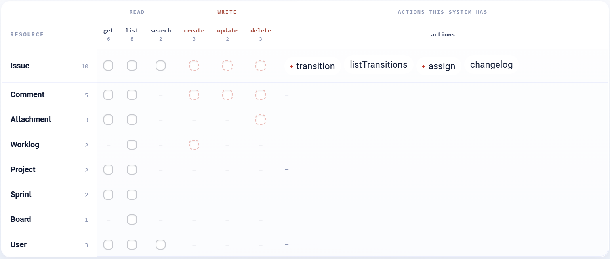

.. _connector-tools-jira-cloud:

.. rst-class:: agentic-tutorial

Jira Cloud Tools
================

.. raw:: html

   

     
     <dl class="tool-facts">
     
<dt>Connection</dt><dd>Jira</dd>

     
<dt>Tools</dt><dd>28 across 8 resources</dd>

     
<dt>Reads / writes</dt><dd>18 / 10</dd>

     
<dt>Available as</dt><dd>Agent tool · App Action</dd>

     </dl>
   

.. container:: tutorial-intro

   Let an agent search and read Jira issues with JQL, create and update issues, move them through their workflow, assign them, comment, log work, and read projects, boards, sprints and users.

.. contents:: On this page
   :local:
   :depth: 1
   :class: tool-toc

Prerequisites
-------------

* **Connection:** A **Jira** connection: the site URL (``https://your-site.atlassian.net``), the account's email and an API token from ``id.atlassian.com``.
* A Jira Cloud account with access to the projects the agent works in, and an API token for it.

Add Jira Cloud to an agent
--------------------------

#. In Agent Studio, open the **Tools** group and click **Add tools**, or click **+ Tool** on an Agent Node on the canvas.
#. Choose **Jira Cloud** under **Connectors**, or type ``jira`` in the search box.
#. **Connect.** Choose your Jira connection and click **Test connection**. The rest of the screen unlocks when it shows **Connected**.
#. **How the agent sees it.** Keep **A separate tool for each one**, so the agent picks each operation by name.
#. **Tick the operations.** The grid opens with the **Look things up** pack: reads only. Add each write the agent needs; every write waits for approval when it runs.
#. Click **Add to agent**. The ticked operations arrive as one Jira Cloud node, joined to the Agent Node by a dashed tool link.

   The Jira Cloud operations by resource. Reads come first and writes, marked with a red dot or a dashed box, after them. The grid unlocks once a connection passes **Test connection**.

Tools
-----

Each ticked operation becomes one tool, named ``jira_cloud_<resource>_<operation>``. **Read** tools run straight away. **Write** and **Delete** tools change data in Jira Cloud, so each call waits for :doc:`human approval </agentic-ai-guide/safety-guardrails/human-in-the-loop>` before it takes effect. Click a tool to open its page with every parameter.

.. raw:: html

   <nav class="tool-jump" aria-label="Jump to a resource"><a href="#res-issue">Issue10</a><a href="#res-comment">Comment5</a><a href="#res-attachment">Attachment3</a><a href="#res-worklog">Worklog2</a><a href="#res-project">Project2</a><a href="#res-sprint">Sprint2</a><a href="#res-board">Board1</a><a href="#res-user">User3</a></nav>

.. raw:: html

   

Issue
~~~~~

.. raw:: html

   

     <a class="tool-op" href="jira-cloud/issue-get.html" target="_blank" rel="noopener">
       Get an issueRead
       Fetches one issue by its key and returns its fields: summary, status, assignee, reporter, priority, labels, description, dates and custom fields.
     </a>
     <a class="tool-op" href="jira-cloud/issue-getmany.html" target="_blank" rel="noopener">
       List issuesRead
       Lists issues that match an optional JQL filter (without one, the most recently created first), following Jira&#x27;s paging up to the limit, with each issue&#x27;s key, summary, status, assignee, priority and other navigable fields.
     </a>
     <a class="tool-op" href="jira-cloud/issue-search.html" target="_blank" rel="noopener">
       Search issuesRead
       Finds issues with a JQL query and returns each match&#x27;s key, summary, status, assignee, priority and other navigable fields, following Jira&#x27;s paging up to the limit.
     </a>
     <a class="tool-op" href="jira-cloud/issue-create.html" target="_blank" rel="noopener">
       Create an issueWrite
       Creates an issue in a project and returns its id, key and URL. Values go in as plain text: the connector turns the project key, issue type, priority, assignee and parent into the objects Jira expects and the description into Jira&#x27;s rich-text format.
     </a>
     <a class="tool-op" href="jira-cloud/issue-update.html" target="_blank" rel="noopener">
       Update an issueWrite
       Changes fields on an existing issue; only the fields given change, and labels, components and fix versions replace the current lists.
     </a>
     <a class="tool-op" href="jira-cloud/issue-delete.html" target="_blank" rel="noopener">
       Delete an issueDelete
       Permanently deletes an issue; Jira refuses one that has sub-tasks unless deleteSubtasks is true.
     </a>
     <a class="tool-op" href="jira-cloud/issue-transition.html" target="_blank" rel="noopener">
       Change an issue&#x27;s statusWrite
       Moves an issue to another status, such as In Progress or Done, by performing one of its workflow&#x27;s transitions.
     </a>
     <a class="tool-op" href="jira-cloud/issue-listtransitions.html" target="_blank" rel="noopener">
       List an issue&#x27;s transitionsRead
       Lists the transitions the issue can take from its current status, each with its id, name and the status it leads to.
     </a>
     <a class="tool-op" href="jira-cloud/issue-assign.html" target="_blank" rel="noopener">
       Assign an issueWrite
       Assigns an issue to one person, or to the project&#x27;s default assignee with -1.
     </a>
     <a class="tool-op" href="jira-cloud/issue-changelog.html" target="_blank" rel="noopener">
       Get an issue&#x27;s historyRead
       Returns an issue&#x27;s change history, oldest first and following Jira&#x27;s paging up to the limit: who changed which field, when, and from which value to which.
     </a>
   

.. raw:: html

   

Comment
~~~~~~~

.. raw:: html

   

     <a class="tool-op" href="jira-cloud/comment-get.html" target="_blank" rel="noopener">
       Get a commentRead
       Fetches one comment on an issue by its id and returns its author, body (in Atlassian Document Format) and created and updated times.
     </a>
     <a class="tool-op" href="jira-cloud/comment-getmany.html" target="_blank" rel="noopener">
       List comments on an issueRead
       Lists the comments on an issue, oldest first unless ordered otherwise, each with its id, author, body (in Atlassian Document Format) and created and updated times.
     </a>
     <a class="tool-op" href="jira-cloud/comment-create.html" target="_blank" rel="noopener">
       Add a commentWrite
       Adds a comment to an issue and returns it with its id.
     </a>
     <a class="tool-op" href="jira-cloud/comment-update.html" target="_blank" rel="noopener">
       Edit a commentWrite
       Replaces the text of an existing comment and returns the updated comment.
     </a>
     <a class="tool-op" href="jira-cloud/comment-delete.html" target="_blank" rel="noopener">
       Delete a commentDelete
       Permanently deletes one comment from an issue.
     </a>
   

.. raw:: html

   

Attachment
~~~~~~~~~~

.. raw:: html

   

     <a class="tool-op" href="jira-cloud/attachment-get.html" target="_blank" rel="noopener">
       Get an attachment&#x27;s detailsRead
       Returns the details of one attachment: file name, size, MIME type, author, created time and the URL of its content; it does not download the file.
     </a>
     <a class="tool-op" href="jira-cloud/attachment-getmany.html" target="_blank" rel="noopener">
       List an issue&#x27;s attachmentsRead
       Lists the files attached to an issue, each with its id, file name, size, MIME type, author, created time and content URL. Use it to find the attachment id that Attachment get and Attachment delete need.
     </a>
     <a class="tool-op" href="jira-cloud/attachment-delete.html" target="_blank" rel="noopener">
       Delete an attachmentDelete
       Permanently deletes one attachment from its issue.
     </a>
   

.. raw:: html

   

Worklog
~~~~~~~

.. raw:: html

   

     <a class="tool-op" href="jira-cloud/worklog-getmany.html" target="_blank" rel="noopener">
       List an issue&#x27;s worklogsRead
       Lists the time logged on an issue, each entry with its id, author, time spent, start time and note.
     </a>
     <a class="tool-op" href="jira-cloud/worklog-create.html" target="_blank" rel="noopener">
       Log work on an issueWrite
       Logs time spent on an issue and returns the new worklog with its id.
     </a>
   

.. raw:: html

   

Project
~~~~~~~

.. raw:: html

   

     <a class="tool-op" href="jira-cloud/project-get.html" target="_blank" rel="noopener">
       Get a projectRead
       Fetches one project by its key or id and returns its name, type, lead, description, issue types and components.
     </a>
     <a class="tool-op" href="jira-cloud/project-getmany.html" target="_blank" rel="noopener">
       List projectsRead
       Lists the projects the connection can see, with key, name, type and id, following Jira&#x27;s paging up to the limit.
     </a>
   

.. raw:: html

   

Sprint
~~~~~~

.. raw:: html

   

     <a class="tool-op" href="jira-cloud/sprint-get.html" target="_blank" rel="noopener">
       Get a sprintRead
       Fetches one sprint by its id and returns its name, state (future, active or closed), goal, board and start, end and completion dates.
     </a>
     <a class="tool-op" href="jira-cloud/sprint-getmany.html" target="_blank" rel="noopener">
       List a board&#x27;s sprintsRead
       Lists the sprints of a Scrum board, each with its id, name, state, goal and dates, following Jira&#x27;s paging up to the limit.
     </a>
   

.. raw:: html

   

Board
~~~~~

.. raw:: html

   

     <a class="tool-op" href="jira-cloud/board-getmany.html" target="_blank" rel="noopener">
       List boardsRead
       Lists the Scrum and Kanban boards the connection can see, with each board&#x27;s id, name, type and project, following Jira&#x27;s paging up to the limit.
     </a>
   

.. raw:: html

   

User
~~~~

.. raw:: html

   

     <a class="tool-op" href="jira-cloud/user-get.html" target="_blank" rel="noopener">
       Get a userRead
       Fetches one user by Atlassian account id and returns the display name, email address (when the user&#x27;s privacy settings show it), active flag and time zone.
     </a>
     <a class="tool-op" href="jira-cloud/user-getmany.html" target="_blank" rel="noopener">
       List usersRead
       Lists every user of the site, including app and bot accounts, with account id, display name, account type and active flag, following Jira&#x27;s paging up to the limit.
     </a>
     <a class="tool-op" href="jira-cloud/user-search.html" target="_blank" rel="noopener">
       Find usersRead
       Finds users whose display name or email address starts with the given text and returns their account ids, display names and active flags.
     </a>
   

Use Jira Cloud as an App Action
-------------------------------

The same 28 operations are also a fixed workflow step. Drop **App Action** on the canvas, pick **Jira**, choose the action and fill in its details. It runs every time the flow reaches it, exactly as set; no model decides. Use it for the steps that must always happen, such as saving an approved result, and keep the agent tool for what the model should choose. See :doc:`Jira App Actions </agentic-ai-guide/tools-integrations/app-action-apps/jira-cloud>` for every action, its inputs and the trigger events.

Good to know
------------

* **Search issues** takes JQL, for example ``project = SUP AND status = Open ORDER BY created DESC``.
* To change status, call **List an issue's transitions** first: transition ids differ per workflow and per current status.
* **Assign an issue** takes an Atlassian account id; **Find users** turns a name or email into one.
* Descriptions and comments go in as plain text; the connector converts them to Jira's rich-text format.
* Prefer a transition to Done over **Delete an issue**, which cannot be undone.

Example
-------

**Stand-up summary.** Look things up pack only. Then give the Agent Node instructions like these:

.. code-block:: text

   Search for issues in project SUP updated in the last day.
   Group them by status and list key, summary and assignee.
   Do not change any issue.

Other common uses:

* Summarise open bugs for a stand-up.
* File an issue from an escalated support conversation after approval.
* Move issues to Done when a linked task completes.

Troubleshooting
---------------

***Field ... cannot be set* on create.**
   The field is not on that project's create screen. Check the project's issue type screen, or leave the field out.

**A transition fails.**
   The id is not valid from the issue's current status. Call **List an issue's transitions** on that issue first.

**User email is empty.**
   Jira hides email addresses unless the user's privacy settings show them.

**The agent does not call the tool, or picks the wrong one.**
   Name the tool in the instructions and untick operations that sound alike. See :ref:`making-tools-reliable`.

FAQ
---

**Does it support Jira Data Center?**
   This connector targets Jira Cloud.

Related
-------

* :doc:`/agentic-ai-guide/tools-integrations/tools-connectors` - how tools work, choosing operations, and fixed settings
* :doc:`/agentic-ai-guide/tools-integrations/connector-tools/index` - every connector
* :doc:`/agentic-ai-guide/safety-guardrails/human-in-the-loop` - approving writes
* :doc:`/agentic-ai-guide/tools-integrations/app-actions` - the same operations as fixed workflow steps
