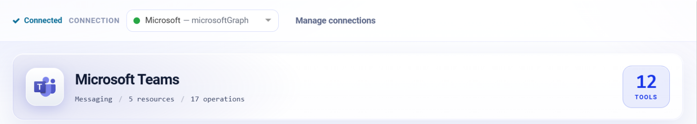
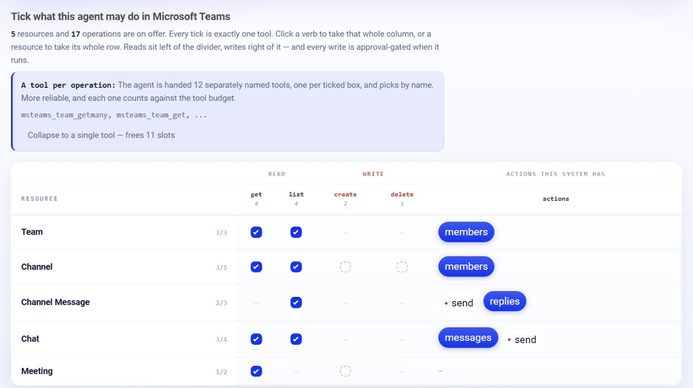

.. _connector-tools-microsoft-teams:

.. rst-class:: agentic-tutorial

Microsoft Teams Tools
=====================

.. raw:: html

   

     
     <dl class="tool-facts">
     
<dt>Connection</dt><dd>Microsoft Graph</dd>

     
<dt>Tools</dt><dd>17 across 5 resources</dd>

     
<dt>Reads / writes</dt><dd>12 / 5</dd>

     
<dt>Available as</dt><dd>Agent tool · App Action</dd>

     </dl>
   

.. container:: tutorial-intro

   Let an agent read Microsoft Teams: list teams, channels and members, read channel posts, replies and chats, and create channels and online meetings.

.. contents:: On this page
   :local:
   :depth: 1
   :class: tool-toc

Prerequisites
-------------

* **Connection:** A **Microsoft Graph** connection: an Entra ID app registration with its tenant ID, client ID and client secret, and the Microsoft Graph **application** permissions below granted with admin consent.
* ``Team.ReadBasic.All``, ``Channel.ReadBasic.All`` and ``TeamMember.Read.All`` to list teams, channels and members.
* ``ChannelMember.Read.All`` for channel members, ``ChannelMessage.Read.All`` for channel posts and ``Chat.Read.All`` for chats.
* ``Channel.Create`` and ``Channel.Delete.All`` to create and delete channels, and ``OnlineMeetings.ReadWrite.All`` for online meetings.
* Posting a channel or chat message needs a connection that signs in as a user (delegated access). With application credentials Graph refuses the call before anything is sent.

Add Microsoft Teams to an agent
-------------------------------

#. In Agent Studio, open the **Tools** group and click **Add tools**, or click **+ Tool** on an Agent Node on the canvas.
#. Choose **Microsoft Teams** under **Connectors**, or type ``teams`` in the search box.
#. **Connect.** Choose your Microsoft Graph connection and click **Test connection**. The rest of the screen unlocks when it shows **Connected**.
#. **How the agent sees it.** Keep **A separate tool for each one**, so the agent picks each operation by name.
#. **Tick the operations.** The grid opens with the **Look things up** pack: reads only. Add each write the agent needs; every write waits for approval when it runs.
#. Click **Add to agent**. The ticked operations arrive as one Microsoft Teams node, joined to the Agent Node by a dashed tool link.

   Connected: the tested connection, the Microsoft Teams card with how many tools are ticked.

   What the agent may do in Microsoft Teams. Blue ticks are the **Look things up** pack; dashed boxes are writes, and a red dot marks an action that writes.

Tools
-----

Each ticked operation becomes one tool, named ``msteams_<resource>_<operation>``. **Read** tools run straight away. **Write** and **Delete** tools change data in Microsoft Teams, so each call waits for :doc:`human approval </agentic-ai-guide/safety-guardrails/human-in-the-loop>` before it takes effect. Click a tool to open its page with every parameter.

.. raw:: html

   <nav class="tool-jump" aria-label="Jump to a resource"><a href="#res-team">Team3</a><a href="#res-channel">Channel5</a><a href="#res-channel_message">Channel Message3</a><a href="#res-chat">Chat4</a><a href="#res-meeting">Meeting2</a></nav>

.. raw:: html

   

Team
~~~~

.. raw:: html

   

     <a class="tool-op" href="microsoft-teams/team-getmany.html" target="_blank" rel="noopener">
       List teamsRead
       Lists the organisation&#x27;s teams (Microsoft 365 groups that have a team) with id, displayName, description, mail and visibility.
     </a>
     <a class="tool-op" href="microsoft-teams/team-get.html" target="_blank" rel="noopener">
       Get a teamRead
       Returns one team&#x27;s settings: displayName, description, visibility, isArchived, webUrl and its member, guest, messaging and fun settings.
     </a>
     <a class="tool-op" href="microsoft-teams/team-members.html" target="_blank" rel="noopener">
       List team membersRead
       Lists the members of a team with displayName, email, userId and roles (owner, or empty for a member).
     </a>
   

.. raw:: html

   

Channel
~~~~~~~

.. raw:: html

   

     <a class="tool-op" href="microsoft-teams/channel-getmany.html" target="_blank" rel="noopener">
       List channelsRead
       Lists the channels of a team with id, displayName, description, membershipType (standard, private or shared) and webUrl.
     </a>
     <a class="tool-op" href="microsoft-teams/channel-get.html" target="_blank" rel="noopener">
       Get a channelRead
       Returns one channel of a team: displayName, description, membershipType, email, webUrl and createdDateTime.
     </a>
     <a class="tool-op" href="microsoft-teams/channel-create.html" target="_blank" rel="noopener">
       Create a channelWrite
       Creates a channel in a team and returns it with its new id.
     </a>
     <a class="tool-op" href="microsoft-teams/channel-delete.html" target="_blank" rel="noopener">
       Delete a channelDelete
       Deletes a channel and its conversations from a team.
     </a>
     <a class="tool-op" href="microsoft-teams/channel-members.html" target="_blank" rel="noopener">
       List channel membersRead
       Lists the members of one channel with displayName, email, userId and roles.
     </a>
   

.. raw:: html

   

Channel Message
~~~~~~~~~~~~~~~

.. raw:: html

   

     <a class="tool-op" href="microsoft-teams/channel-message-getmany.html" target="_blank" rel="noopener">
       List channel messagesRead
       Lists the top-level posts of a channel with id, from, subject, body (HTML), createdDateTime and webUrl; replies are left out unless expand is replies.
     </a>
     <a class="tool-op" href="microsoft-teams/channel-message-send.html" target="_blank" rel="noopener">
       Post a channel messageWrite
       Posts a new message in a channel and returns it with its id and webUrl; the text is sent as HTML. Microsoft Graph posts only for a signed-in user, so the connection needs a user (delegated) access token; with app-only credentials the call is refused before anything is sent.
     </a>
     <a class="tool-op" href="microsoft-teams/channel-message-replies.html" target="_blank" rel="noopener">
       List replies to a postRead
       Lists the replies to one channel post with id, from, body (HTML) and createdDateTime.
     </a>
   

.. raw:: html

   

Chat
~~~~

.. raw:: html

   

     <a class="tool-op" href="microsoft-teams/chat-getmany.html" target="_blank" rel="noopener">
       List chatsRead
       Lists one-on-one, group and meeting chats with id, topic, chatType, createdDateTime and lastUpdatedDateTime.
     </a>
     <a class="tool-op" href="microsoft-teams/chat-get.html" target="_blank" rel="noopener">
       Get a chatRead
       Returns one chat: topic, chatType (oneOnOne, group or meeting), createdDateTime, lastUpdatedDateTime and webUrl.
     </a>
     <a class="tool-op" href="microsoft-teams/chat-messages.html" target="_blank" rel="noopener">
       List chat messagesRead
       Lists the messages of one chat, most recently changed first, with id, from, body (HTML) and createdDateTime.
     </a>
     <a class="tool-op" href="microsoft-teams/chat-send.html" target="_blank" rel="noopener">
       Send a chat messageWrite
       Sends a message in an existing chat and returns it with its id; the text is sent as HTML. Graph sends only for a signed-in user, so the connection needs a user (delegated) access token; with app-only credentials the call is refused before anything is sent.
     </a>
   

.. raw:: html

   

Meeting
~~~~~~~

.. raw:: html

   

     <a class="tool-op" href="microsoft-teams/meeting-create.html" target="_blank" rel="noopener">
       Create an online meetingWrite
       Creates a Teams online meeting on behalf of a user and returns its joinWebUrl, id, start and end.
     </a>
     <a class="tool-op" href="microsoft-teams/meeting-get.html" target="_blank" rel="noopener">
       Get an online meetingRead
       Returns one online meeting: subject, startDateTime, endDateTime, joinWebUrl, participants and dial-in details.
     </a>
   

Use Microsoft Teams as an App Action
------------------------------------

Microsoft Teams also has 17 App Actions, fixed workflow steps for the same work. Drop **App Action** on the canvas, pick **Microsoft Teams**, choose the action and fill in its details. It runs every time the flow reaches it, exactly as set; no model decides. Use it for the steps that must always happen, such as saving an approved result, and keep the agent tool for what the model should choose. See :doc:`Microsoft Teams App Actions </agentic-ai-guide/tools-integrations/app-action-apps/microsoft-teams>` for every action, its inputs and the trigger events.

Good to know
------------

* Channel ids look like ``19:...@thread.tacv2`` and come from **List channels**.
* **List channel messages** returns top-level posts; set ``expand`` to replies to get replies too.
* For app-only connections, **List chats** needs a ``user``.
* **Create an online meeting** returns a join link but does not put the meeting in anyone's calendar; an app-only connection also needs a Teams application access policy.

Example
-------

**Summarise a channel.** Look things up pack only. Then give the Agent Node instructions like these:

.. code-block:: text

   In the team "Launch", read the posts in the "General" channel from the last
   day, with replies. Summarise decisions and open questions as bullet points.

Other common uses:

* Summarise yesterday's discussion in a project channel.
* Find who is in a team before inviting them.
* Create a meeting link for a follow-up call.

Troubleshooting
---------------

**Posting a message is refused.**
   Graph posts messages only for a signed-in user. Use a delegated connection, or post with the :doc:`Slack <slack>` connector or an email tool instead.

**Reading channel messages returns 403.**
   Add ``ChannelMessage.Read.All`` and grant admin consent again.

**The agent does not call the tool, or picks the wrong one.**
   Name the tool in the instructions and untick operations that sound alike. See :ref:`making-tools-reliable`.

FAQ
---

**Why can the agent read but not post?**
   Application permissions cover reads; Microsoft Graph does not allow ordinary message posting with app-only credentials.

Related
-------

* :doc:`/agentic-ai-guide/tools-integrations/tools-connectors` - how tools work, choosing operations, and fixed settings
* :doc:`/agentic-ai-guide/tools-integrations/connector-tools/index` - every connector
* :doc:`/agentic-ai-guide/safety-guardrails/human-in-the-loop` - approving writes
* :doc:`/agentic-ai-guide/tools-integrations/app-actions` - the same operations as fixed workflow steps
