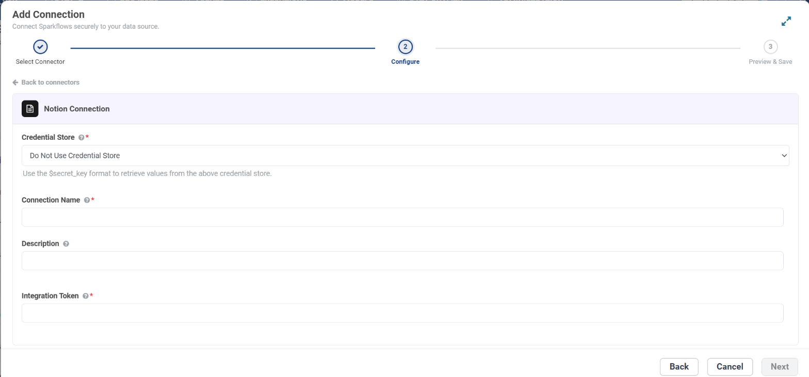

.. _connector-tools-notion:

.. rst-class:: agentic-tutorial

Notion Tools
============

.. raw:: html

   

     
     <dl class="tool-facts">
     
<dt>Connection</dt><dd>Notion · Integration Token</dd>

     
<dt>Tools</dt><dd>13 across 5 resources</dd>

     
<dt>Reads / writes</dt><dd>7 / 6</dd>

     
<dt>Available as</dt><dd>Agent tool only</dd>

     </dl>
     
New

   

.. container:: tutorial-intro

   Let an agent search and read Notion pages and databases, query database rows, add rows and pages, append content blocks, and update page properties.

.. container:: tutorial-start

   **Agent tool only.** Notion is available in the agent tool picker. It is not offered as an :doc:`App Action </agentic-ai-guide/tools-integrations/app-actions>` node yet, so a fixed workflow step cannot call it.

.. contents:: On this page
   :local:
   :depth: 1
   :class: tool-toc

Prerequisites
-------------

* **Connection:** A **Notion** connection that holds one **Integration Token**: an internal integration secret. Sparkflows calls ``api.notion.com``, so there is no URL or username to enter.
* A Notion workspace where you can create integrations.
* Each page or database the agent uses shared with the integration.

Set up the connection
---------------------

#. Open **notion.so/my-integrations** and create an **internal** integration for your workspace.
#. Under **Capabilities**, choose what it may do: read, update and insert content, and whether it may read user information (with or without email addresses).
#. Copy the **Internal Integration Secret**.
#. In Notion, share each page or database the agent works in with the integration: **••• → Connections → add your integration**. Child pages inherit access.
#. In Sparkflows, open **Administration → Global/Group Connections → Add Connection**, choose **Tools → Notion**, enter a **Connection Name**, paste the secret into **Integration Token**, click **Test Connection** and save.

   The **Configure** step for a Notion connection. To keep the secret in a credential store instead, pick it under **Credential Store** and enter ``$secret_key``.

.. tip::

   Grant only what the agent needs. The connection decides what Notion allows at all; the operations you tick decide what this agent may do with it.

Add Notion to an agent
----------------------

#. In Agent Studio, open the **Tools** group and click **Add tools**, or click **+ Tool** on an Agent Node on the canvas.
#. Choose **Notion** under **Connectors**, or type ``notion`` in the search box.
#. **Connect.** Choose your Notion connection and click **Test connection**. The rest of the screen unlocks when it shows **Connected**.
#. **How the agent sees it.** Keep **A separate tool for each one**, so the agent picks each operation by name.
#. **Tick the operations.** The grid opens with the **Look things up** pack: reads only. Add each write the agent needs; every write waits for approval when it runs.
#. Click **Add to agent**. The ticked operations arrive as one Notion node, joined to the Agent Node by a dashed tool link.

Tools
-----

Each ticked operation becomes one tool, named ``notion_<resource>_<operation>``. **Read** tools run straight away. **Write** and **Delete** tools change data in Notion, so each call waits for :doc:`human approval </agentic-ai-guide/safety-guardrails/human-in-the-loop>` before it takes effect. Click a tool to open its page with every parameter.

.. raw:: html

   <nav class="tool-jump" aria-label="Jump to a resource"><a href="#res-page">Page3</a><a href="#res-database">Database4</a><a href="#res-block">Block3</a><a href="#res-search">Search1</a><a href="#res-user">User2</a></nav>

.. raw:: html

   

Page
~~~~

.. raw:: html

   

     <a class="tool-op" href="notion/page-get.html" target="_blank" rel="noopener">
       Get a pageRead
       Returns one page&#x27;s property values, parent, URL and created and last edited times.
     </a>
     <a class="tool-op" href="notion/page-create.html" target="_blank" rel="noopener">
       Create a pageWrite
       Creates a page as a row of a database or under another page, with its property values and optional content blocks, and returns it with its id and URL. Database get shows the property names and types a database row takes.
     </a>
     <a class="tool-op" href="notion/page-update.html" target="_blank" rel="noopener">
       Update page propertiesWrite
       Changes a page&#x27;s property values, or moves the page to the trash or back, and returns the updated page.
     </a>
   

.. raw:: html

   

Database
~~~~~~~~

.. raw:: html

   

     <a class="tool-op" href="notion/database-get.html" target="_blank" rel="noopener">
       Get a databaseRead
       Returns a database&#x27;s title, parent and property schema: each property&#x27;s name and type and, for select properties, their options.
     </a>
     <a class="tool-op" href="notion/database-query.html" target="_blank" rel="noopener">
       Query a databaseRead
       Returns the rows (pages) of a database that match a filter, in the order given, each with its id, URL, times and property values, following Notion&#x27;s pages up to the limit.
     </a>
     <a class="tool-op" href="notion/database-create.html" target="_blank" rel="noopener">
       Create a databaseWrite
       Creates a database under a page with the columns given and returns it with its id.
     </a>
     <a class="tool-op" href="notion/database-update.html" target="_blank" rel="noopener">
       Update a databaseWrite
       Changes a database&#x27;s title, description or columns and returns the updated database.
     </a>
   

.. raw:: html

   

Block
~~~~~

.. raw:: html

   

     <a class="tool-op" href="notion/block-getmany.html" target="_blank" rel="noopener">
       List a page&#x27;s content blocksRead
       Lists the content blocks directly inside a page or block (paragraphs, headings, lists, to-dos and so on), each with its type, text and whether it has children.
     </a>
     <a class="tool-op" href="notion/block-append.html" target="_blank" rel="noopener">
       Append content to a pageWrite
       Adds content blocks at the end of a page or block, or after a given child block, and returns the new blocks.
     </a>
     <a class="tool-op" href="notion/block-delete.html" target="_blank" rel="noopener">
       Delete a blockDelete
       Moves a block to the trash; given a page id, it moves the whole page to the trash.
     </a>
   

.. raw:: html

   

Search
~~~~~~

.. raw:: html

   

     <a class="tool-op" href="notion/search-run.html" target="_blank" rel="noopener">
       Search pages and databasesRead
       Finds the pages and databases shared with the integration whose titles match words, and returns them with ids, URLs and last edited times, following Notion&#x27;s pages up to the limit.
     </a>
   

.. raw:: html

   

User
~~~~

.. raw:: html

   

     <a class="tool-op" href="notion/user-getmany.html" target="_blank" rel="noopener">
       List usersRead
       Lists the people and bots in the workspace with their ids, names, types and, when the integration may read them, email addresses.
     </a>
     <a class="tool-op" href="notion/user-get.html" target="_blank" rel="noopener">
       Get a userRead
       Returns one person or bot by id with their name, type, avatar and, when the integration may read it, email address.
     </a>
   

Good to know
------------

* The integration sees only what is shared with it. **Search pages and databases** returns nothing else.
* Call **Get a database** before **Query a database** or **Create a page** so the agent uses the exact property names and types.
* Page content is a list of blocks: read it with **List a page's content blocks** and add to it with **Append content to a page** (up to 100 blocks a call).
* **Delete a block** moves the block, or a whole page, to the trash; **Update page properties** with ``archived`` false brings a page back.

Example
-------

**Add tracker rows.** Tick Get a database, Query a database and Create a page. Then give the Agent Node instructions like these:

.. code-block:: text

   Get the Requests database to learn its properties.
   Query it for a row with the same title first; if none exists, create a page
   in it with Title, Requester and Status = New. Never edit existing rows.

Other common uses:

* Answer questions from a team wiki.
* Add a row to a tracker database for each new request.
* Append meeting notes to a project page.

Troubleshooting
---------------

***Could not find database* or *object_not_found*.**
   The page or database is not shared with the integration. Add the integration under **••• → Connections** in Notion.

***Notion rejected the token (HTTP 401)*.**
   The secret is wrong or was regenerated. Copy it again from the integration page.

**A property value is rejected.**
   Property names and types must match the database exactly. Have the agent call **Get a database** first.

**The agent does not call the tool, or picks the wrong one.**
   Name the tool in the instructions and untick operations that sound alike. See :ref:`making-tools-reliable`.

FAQ
---

**Is it available as an App Action?**
   Not yet. Notion is offered as an agent tool; its App Action is still marked Coming soon.

**Why are user emails empty?**
   The integration was not given the capability to read user email addresses.

Related
-------

* :doc:`/agentic-ai-guide/tools-integrations/tools-connectors` - how tools work, choosing operations, and fixed settings
* :doc:`/agentic-ai-guide/tools-integrations/connector-tools/index` - every connector
* :doc:`/agentic-ai-guide/safety-guardrails/human-in-the-loop` - approving writes
