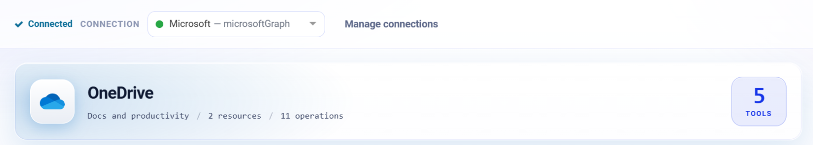
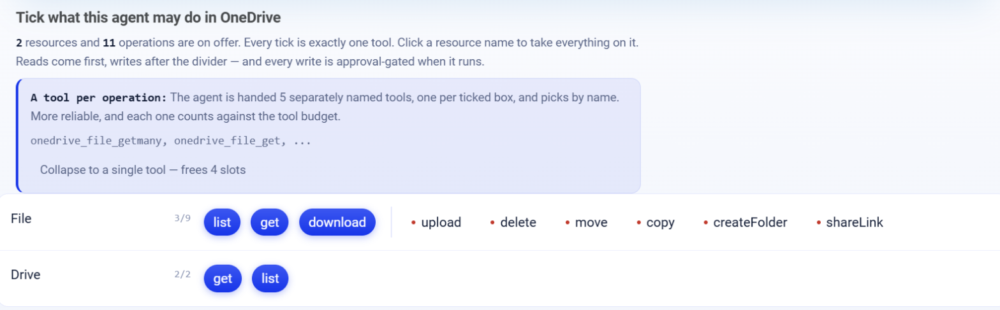

.. _connector-tools-onedrive:

.. rst-class:: agentic-tutorial

OneDrive Tools
==============

.. raw:: html

   

     
     <dl class="tool-facts">
     
<dt>Connection</dt><dd>Microsoft Graph</dd>

     
<dt>Tools</dt><dd>11 across 2 resources</dd>

     
<dt>Reads / writes</dt><dd>5 / 6</dd>

     
<dt>Available as</dt><dd>Agent tool · App Action</dd>

     </dl>
   

.. container:: tutorial-intro

   Let an agent browse a user's OneDrive, read the text of PDFs, Word and Excel files, upload files, organise folders and create sharing links.

.. contents:: On this page
   :local:
   :depth: 1
   :class: tool-toc

Prerequisites
-------------

* **Connection:** A **Microsoft Graph** connection: an Entra ID app registration with its tenant ID, client ID and client secret, and the Microsoft Graph **application** permissions below granted with admin consent.
* ``Files.Read.All`` to read and ``Files.ReadWrite.All`` to upload, move, copy, delete or share.
* Every file tool takes a ``user`` (the OneDrive owner's address or id). Fix it in **Fixed settings** to keep the agent in one person's drive.

Add OneDrive to an agent
------------------------

#. In Agent Studio, open the **Tools** group and click **Add tools**, or click **+ Tool** on an Agent Node on the canvas.
#. Choose **OneDrive** under **Connectors**, or type ``onedrive`` in the search box.
#. **Connect.** Choose your Microsoft Graph connection and click **Test connection**. The rest of the screen unlocks when it shows **Connected**.
#. **How the agent sees it.** Keep **A separate tool for each one**, so the agent picks each operation by name.
#. **Tick the operations.** The grid opens with the **Look things up** pack: reads only. Add each write the agent needs; every write waits for approval when it runs.
#. Click **Add to agent**. The ticked operations arrive as one OneDrive node, joined to the Agent Node by a dashed tool link.

   Connected: the tested connection, the OneDrive card with how many tools are ticked.

   What the agent may do in OneDrive. Blue ticks are the **Look things up** pack; dashed boxes are writes, and a red dot marks an action that writes.

Tools
-----

Each ticked operation becomes one tool, named ``onedrive_<resource>_<operation>``. **Read** tools run straight away. **Write** and **Delete** tools change data in OneDrive, so each call waits for :doc:`human approval </agentic-ai-guide/safety-guardrails/human-in-the-loop>` before it takes effect. Click a tool to open its page with every parameter.

.. raw:: html

   

File
~~~~

.. raw:: html

   

     <a class="tool-op" href="onedrive/file-getmany.html" target="_blank" rel="noopener">
       List files in a folderRead
       Lists the files and folders directly inside one folder of a user&#x27;s OneDrive, each with id, name, type, size, web address and who last changed it and when.
     </a>
     <a class="tool-op" href="onedrive/file-get.html" target="_blank" rel="noopener">
       Get a file or folderRead
       Returns one file or folder by its item id with its type, size, path, web address and who last changed it and when.
     </a>
     <a class="tool-op" href="onedrive/file-download.html" target="_blank" rel="noopener">
       Download a file and read its textRead
       Saves one file to the engine&#x27;s disk and returns its details with the saved path and its text: the words of a PDF, Word, Excel, text or CSV file, with text_status ok, password_protected, no_text (a scan) or unsupported.
     </a>
     <a class="tool-op" href="onedrive/file-upload.html" target="_blank" rel="noopener">
       Upload a fileWrite
       Uploads a file from the engine&#x27;s disk into a folder of a user&#x27;s OneDrive and returns the stored file; a file of the same name there is replaced.
     </a>
     <a class="tool-op" href="onedrive/file-delete.html" target="_blank" rel="noopener">
       Delete a file or folderDelete
       Deletes a file, or a folder with everything in it, moving it to the OneDrive recycle bin.
     </a>
     <a class="tool-op" href="onedrive/file-move.html" target="_blank" rel="noopener">
       Move or rename a fileWrite
       Moves a file or folder into another folder, renames it, or both, and returns it.
     </a>
     <a class="tool-op" href="onedrive/file-copy.html" target="_blank" rel="noopener">
       Copy a fileWrite
       Copies a file or folder into another folder, optionally under a new name.
     </a>
     <a class="tool-op" href="onedrive/file-createfolder.html" target="_blank" rel="noopener">
       Create a folderWrite
       Creates a folder in a user&#x27;s OneDrive, at the top or inside another folder, and returns it with its id.
     </a>
     <a class="tool-op" href="onedrive/file-sharelink.html" target="_blank" rel="noopener">
       Create a sharing linkWrite
       Creates a sharing link to a file or folder and returns the link with its web address, type and scope.
     </a>
   

.. raw:: html

   

Drive
~~~~~

.. raw:: html

   

     <a class="tool-op" href="onedrive/drive-get.html" target="_blank" rel="noopener">
       Get a user&#x27;s OneDriveRead
       Returns a user&#x27;s OneDrive with its id, owner, web address and storage quota (total, used and remaining).
     </a>
     <a class="tool-op" href="onedrive/drive-getmany.html" target="_blank" rel="noopener">
       List drivesRead
       Lists a user&#x27;s drives with their ids, names, types and owners.
     </a>
   

Use OneDrive as an App Action
-----------------------------

OneDrive also has 11 App Actions, fixed workflow steps for the same work. Drop **App Action** on the canvas, pick **OneDrive**, choose the action and fill in its details. It runs every time the flow reaches it, exactly as set; no model decides. Use it for the steps that must always happen, such as saving an approved result, and keep the agent tool for what the model should choose. See :doc:`OneDrive App Actions </agentic-ai-guide/tools-integrations/app-action-apps/onedrive>` for every action, its inputs and the trigger events.

Good to know
------------

* **Download a file and read its text** saves the file to the engine's disk and returns its words, with ``text_status`` ok, password_protected, no_text (a scan) or unsupported.
* **Upload a file** replaces a file of the same name and supports files up to 250 MB.
* **Create a sharing link** changes who can open the item; keep it approval-gated.
* **Copy a file** runs in the background, so the new id is not returned; list the destination afterwards.

Example
-------

**Summarise a folder.** Fix user = finance@contoso.com; Look things up pack. Then give the Agent Node instructions like these:

.. code-block:: text

   List the files in the folder "Month-end".
   Read the text of each PDF or Word file and give a two-line summary of each.

Other common uses:

* Summarise the documents in a project folder.
* File generated reports into a dated folder.
* Find a contract by name and read its text.

Troubleshooting
---------------

***itemNotFound*.**
   Item ids are per drive. Make sure ``user`` is the drive owner, and get ids from **List files in a folder** rather than from a URL.

**``text_status`` is no_text.**
   The file is a scan without a text layer. Run OCR first, for example with the built-in **Document To Text** tool.

**The agent does not call the tool, or picks the wrong one.**
   Name the tool in the instructions and untick operations that sound alike. See :ref:`making-tools-reliable`.

FAQ
---

**Does delete remove files for good?**
   No. **Delete a file or folder** moves the item to the OneDrive recycle bin.

Related
-------

* :doc:`/agentic-ai-guide/tools-integrations/tools-connectors` - how tools work, choosing operations, and fixed settings
* :doc:`/agentic-ai-guide/tools-integrations/connector-tools/index` - every connector
* :doc:`/agentic-ai-guide/safety-guardrails/human-in-the-loop` - approving writes
* :doc:`/agentic-ai-guide/tools-integrations/app-actions` - the same operations as fixed workflow steps
