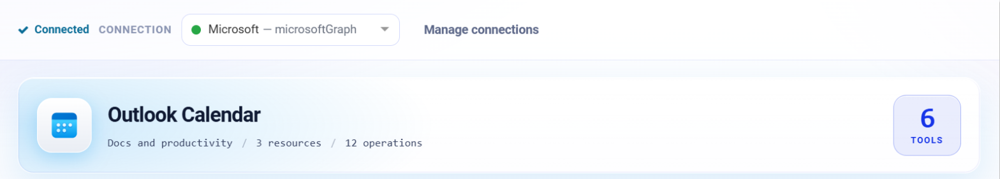
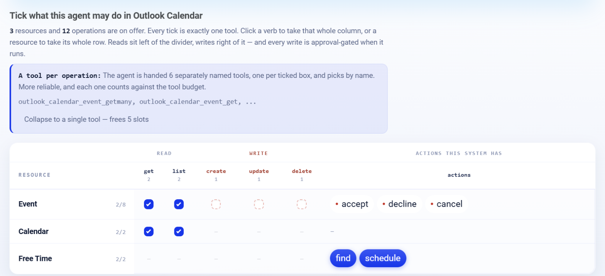

.. _connector-tools-outlook-calendar:

.. rst-class:: agentic-tutorial

Outlook Calendar Tools
======================

.. raw:: html

   

     
     <dl class="tool-facts">
     
<dt>Connection</dt><dd>Microsoft Graph</dd>

     
<dt>Tools</dt><dd>12 across 3 resources</dd>

     
<dt>Reads / writes</dt><dd>6 / 6</dd>

     
<dt>Available as</dt><dd>Agent tool · App Action</dd>

     </dl>
   

.. container:: tutorial-intro

   Let an agent read and manage Outlook calendars: list events in a period, check free/busy schedules, suggest meeting times, and create, update, accept, decline or cancel meetings.

.. contents:: On this page
   :local:
   :depth: 1
   :class: tool-toc

Prerequisites
-------------

* **Connection:** A **Microsoft Graph** connection: an Entra ID app registration with its tenant ID, client ID and client secret, and the Microsoft Graph **application** permissions below granted with admin consent.
* ``Calendars.Read`` to read and ``Calendars.ReadWrite`` to create, update, accept, decline or cancel.
* Every tool takes a ``mailbox``; event tools always work on that mailbox's default calendar.

Add Outlook Calendar to an agent
--------------------------------

#. In Agent Studio, open the **Tools** group and click **Add tools**, or click **+ Tool** on an Agent Node on the canvas.
#. Choose **Outlook Calendar** under **Connectors**, or type ``outlook calendar`` in the search box.
#. **Connect.** Choose your Microsoft Graph connection and click **Test connection**. The rest of the screen unlocks when it shows **Connected**.
#. **How the agent sees it.** Keep **A separate tool for each one**, so the agent picks each operation by name.
#. **Tick the operations.** The grid opens with the **Look things up** pack: reads only. Add each write the agent needs; every write waits for approval when it runs.
#. Click **Add to agent**. The ticked operations arrive as one Outlook Calendar node, joined to the Agent Node by a dashed tool link.

   Connected: the tested connection, the Outlook Calendar card with how many tools are ticked.

   What the agent may do in Outlook Calendar. Blue ticks are the **Look things up** pack; dashed boxes are writes, and a red dot marks an action that writes.

Tools
-----

Each ticked operation becomes one tool, named ``outlook_calendar_<resource>_<operation>``. **Read** tools run straight away. **Write** and **Delete** tools change data in Outlook Calendar, so each call waits for :doc:`human approval </agentic-ai-guide/safety-guardrails/human-in-the-loop>` before it takes effect. Click a tool to open its page with every parameter.

.. raw:: html

   <nav class="tool-jump" aria-label="Jump to a resource"><a href="#res-event">Event8</a><a href="#res-calendar">Calendar2</a><a href="#res-free_time">Free Time2</a></nav>

.. raw:: html

   

Event
~~~~~

.. raw:: html

   

     <a class="tool-op" href="outlook-calendar/event-getmany.html" target="_blank" rel="noopener">
       List eventsRead
       Lists events in the mailbox&#x27;s default calendar with subject, start and end, location, organizer, attendees, online meeting link and status.
     </a>
     <a class="tool-op" href="outlook-calendar/event-get.html" target="_blank" rel="noopener">
       Get an eventRead
       Returns one event by its id with its times, location, organizer, attendees, online meeting link and status.
     </a>
     <a class="tool-op" href="outlook-calendar/event-create.html" target="_blank" rel="noopener">
       Create an eventWrite
       Creates an event in the mailbox&#x27;s default calendar, sends invitations to any attendees, and returns the event with its id.
     </a>
     <a class="tool-op" href="outlook-calendar/event-update.html" target="_blank" rel="noopener">
       Update an eventWrite
       Changes an existing event&#x27;s title, times, location, description or attendees and returns the updated event.
     </a>
     <a class="tool-op" href="outlook-calendar/event-delete.html" target="_blank" rel="noopener">
       Delete an eventDelete
       Deletes an event from the calendar; when the mailbox organizes the meeting, the attendees receive a cancellation.
     </a>
     <a class="tool-op" href="outlook-calendar/event-accept.html" target="_blank" rel="noopener">
       Accept a meeting invitationWrite
       Accepts a meeting invitation in the mailbox&#x27;s calendar, optionally with a note to the organizer.
     </a>
     <a class="tool-op" href="outlook-calendar/event-decline.html" target="_blank" rel="noopener">
       Decline a meeting invitationWrite
       Declines a meeting invitation, optionally with a note to the organizer, and takes the meeting off the calendar.
     </a>
     <a class="tool-op" href="outlook-calendar/event-cancel.html" target="_blank" rel="noopener">
       Cancel a meetingDelete
       Cancels a meeting the mailbox organizes and sends every attendee a cancellation carrying the comment.
     </a>
   

.. raw:: html

   

Calendar
~~~~~~~~

.. raw:: html

   

     <a class="tool-op" href="outlook-calendar/calendar-getmany.html" target="_blank" rel="noopener">
       List calendarsRead
       Lists the calendars of a mailbox with their ids, names, colours, owners and which one is the default.
     </a>
     <a class="tool-op" href="outlook-calendar/calendar-get.html" target="_blank" rel="noopener">
       Get a calendarRead
       Returns one calendar by its id with its name, colour, owner and edit and sharing rights.
     </a>
   

.. raw:: html

   

Free Time
~~~~~~~~~

.. raw:: html

   

     <a class="tool-op" href="outlook-calendar/free-time-find.html" target="_blank" rel="noopener">
       Find meeting timesRead
       Suggests meeting times when the organizer and the attendees are free, one row per suggestion with its time, a confidence score and who is available; when nothing fits, one row gives Graph&#x27;s emptySuggestionsReason.
     </a>
     <a class="tool-op" href="outlook-calendar/free-time-schedule.html" target="_blank" rel="noopener">
       Get free/busy schedulesRead
       Returns the free/busy schedule of people or rooms over a period, one row per address: an availability view with one digit per slot (0 free, 1 tentative, 2 busy, 3 out of office, 4 working elsewhere) and the busy items.
     </a>
   

Use Outlook Calendar as an App Action
-------------------------------------

Outlook Calendar also has 12 App Actions, fixed workflow steps for the same work. Drop **App Action** on the canvas, pick **Outlook Calendar**, choose the action and fill in its details. It runs every time the flow reaches it, exactly as set; no model decides. Use it for the steps that must always happen, such as saving an approved result, and keep the agent tool for what the model should choose. See :doc:`Outlook Calendar App Actions </agentic-ai-guide/tools-integrations/app-action-apps/outlook-calendar>` for every action, its inputs and the trigger events.

Good to know
------------

* Give ``startDateTime`` and ``endDateTime`` to **List events** to get each occurrence of a repeating meeting in that period.
* **Get free/busy schedules** returns one digit per slot: 0 free, 1 tentative, 2 busy, 3 out of office, 4 working elsewhere.
* **Cancel a meeting** works only for the organizer and notifies every attendee; an attendee uses **Decline a meeting invitation**.
* Microsoft Graph serves **Find meeting times** only to a connection that signs in as a user (delegated access).

Example
-------

**Check availability.** Look things up pack only. Then give the Agent Node instructions like these:

.. code-block:: text

   Get the free/busy schedules of anna@contoso.com and raj@contoso.com
   for tomorrow 09:00 to 17:00. List the 30-minute slots where both are free.

Other common uses:

* Summarise tomorrow's meetings for a manager.
* Check room or colleague availability before booking.
* Accept or decline invitations that match a rule, after approval.

Troubleshooting
---------------

***Find meeting times* is refused.**
   Graph serves it only to delegated (signed-in user) connections. Use **Get free/busy schedules** with application permissions instead.

**Invitations go out unexpectedly.**
   Creating an event with attendees sends invitations. Keep **Create an event** behind its approval step and review the attendee list there.

**The agent does not call the tool, or picks the wrong one.**
   Name the tool in the instructions and untick operations that sound alike. See :ref:`making-tools-reliable`.

FAQ
---

**Can it read calendars other than the default?**
   **List calendars** and **Get a calendar** read any of the mailbox's calendars; the event tools use the default calendar.

Related
-------

* :doc:`/agentic-ai-guide/tools-integrations/tools-connectors` - how tools work, choosing operations, and fixed settings
* :doc:`/agentic-ai-guide/tools-integrations/connector-tools/index` - every connector
* :doc:`/agentic-ai-guide/safety-guardrails/human-in-the-loop` - approving writes
* :doc:`/agentic-ai-guide/tools-integrations/app-actions` - the same operations as fixed workflow steps
