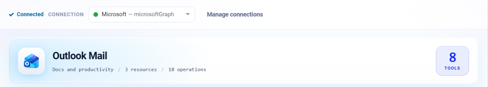
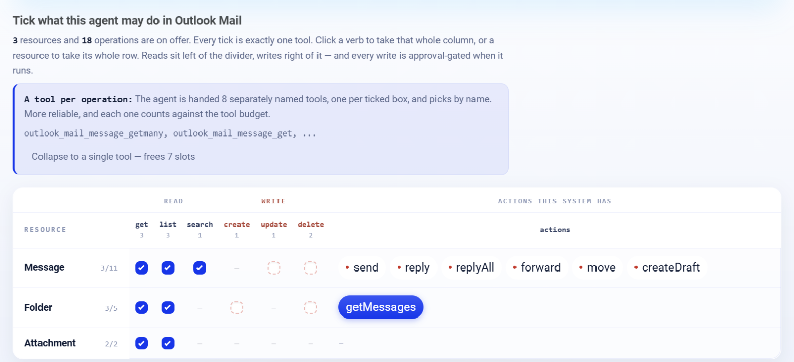

.. _connector-tools-outlook-mail:

.. rst-class:: agentic-tutorial

Outlook Mail Tools
==================

.. raw:: html

   

     
     <dl class="tool-facts">
     
<dt>Connection</dt><dd>Microsoft Graph</dd>

     
<dt>Tools</dt><dd>18 across 3 resources</dd>

     
<dt>Reads / writes</dt><dd>8 / 10</dd>

     
<dt>Available as</dt><dd>Agent tool · App Action</dd>

     </dl>
   

.. container:: tutorial-intro

   Let an agent work with Microsoft 365 mailboxes: list, search and read email, reply, reply all, forward, draft, move and flag messages, and read or save attachments.

.. contents:: On this page
   :local:
   :depth: 1
   :class: tool-toc

Prerequisites
-------------

* **Connection:** A **Microsoft Graph** connection: an Entra ID app registration with its tenant ID, client ID and client secret, and the Microsoft Graph **application** permissions below granted with admin consent.
* ``Mail.Read`` to read and ``Mail.ReadWrite`` to draft, move, flag or delete; ``Mail.Send`` to send, reply and forward.
* Every tool takes a ``mailbox`` (a user's address). With application permissions the app can reach any mailbox in the tenant unless an Exchange application access policy limits it; fix ``mailbox`` in **Fixed settings** to keep the agent on one.

Add Outlook Mail to an agent
----------------------------

#. In Agent Studio, open the **Tools** group and click **Add tools**, or click **+ Tool** on an Agent Node on the canvas.
#. Choose **Outlook Mail** under **Connectors**, or type ``outlook`` in the search box.
#. **Connect.** Choose your Microsoft Graph connection and click **Test connection**. The rest of the screen unlocks when it shows **Connected**.
#. **How the agent sees it.** Keep **A separate tool for each one**, so the agent picks each operation by name.
#. **Tick the operations.** The grid opens with the **Look things up** pack: reads only. Add each write the agent needs; every write waits for approval when it runs.
#. Click **Add to agent**. The ticked operations arrive as one Outlook Mail node, joined to the Agent Node by a dashed tool link.

   Connected: the tested connection, the Outlook Mail card with how many tools are ticked.

   What the agent may do in Outlook Mail. Blue ticks are the **Look things up** pack; dashed boxes are writes, and a red dot marks an action that writes.

Tools
-----

Each ticked operation becomes one tool, named ``outlook_mail_<resource>_<operation>``. **Read** tools run straight away. **Write** and **Delete** tools change data in Outlook Mail, so each call waits for :doc:`human approval </agentic-ai-guide/safety-guardrails/human-in-the-loop>` before it takes effect. Click a tool to open its page with every parameter.

.. raw:: html

   <nav class="tool-jump" aria-label="Jump to a resource"><a href="#res-message">Message11</a><a href="#res-folder">Folder5</a><a href="#res-attachment">Attachment2</a></nav>

.. raw:: html

   

Message
~~~~~~~

.. raw:: html

   

     <a class="tool-op" href="outlook-mail/message-getmany.html" target="_blank" rel="noopener">
       List emailsRead
       Lists the emails in a mailbox or in one of its folders, with sender, recipients, subject, dates, read state and the body as plain text cut at 6000 characters.
     </a>
     <a class="tool-op" href="outlook-mail/message-get.html" target="_blank" rel="noopener">
       Get an emailRead
       Returns one email by its id, with sender, recipients, subject, dates, flags and the body as plain text cut at 6000 characters.
     </a>
     <a class="tool-op" href="outlook-mail/message-search.html" target="_blank" rel="noopener">
       Search emailsRead
       Finds emails with Outlook&#x27;s search over sender, recipients, subject, body and attachment names, and returns them in the same columns as Message getMany.
     </a>
     <a class="tool-op" href="outlook-mail/message-send.html" target="_blank" rel="noopener">
       Send an emailWrite
       Sends a new email from the mailbox and keeps a copy in its Sent Items.
     </a>
     <a class="tool-op" href="outlook-mail/message-reply.html" target="_blank" rel="noopener">
       Reply to an emailWrite
       Replies to the sender of an email in the same conversation, with the reply text above the quoted original.
     </a>
     <a class="tool-op" href="outlook-mail/message-replyall.html" target="_blank" rel="noopener">
       Reply to everyone on an emailWrite
       Replies to the sender and every other recipient of an email in the same conversation, with the reply text above the quoted original.
     </a>
     <a class="tool-op" href="outlook-mail/message-forward.html" target="_blank" rel="noopener">
       Forward an emailWrite
       Forwards an email, attachments included, to other people with an optional note above it.
     </a>
     <a class="tool-op" href="outlook-mail/message-update.html" target="_blank" rel="noopener">
       Update an emailWrite
       Changes an email&#x27;s read state, importance, categories or follow-up flag and returns the updated email.
     </a>
     <a class="tool-op" href="outlook-mail/message-move.html" target="_blank" rel="noopener">
       Move an email to a folderWrite
       Moves an email to another folder and returns it; the moved email has a new id.
     </a>
     <a class="tool-op" href="outlook-mail/message-delete.html" target="_blank" rel="noopener">
       Delete an emailDelete
       Deletes an email; Outlook moves it to the mailbox&#x27;s Deleted Items folder.
     </a>
     <a class="tool-op" href="outlook-mail/message-createdraft.html" target="_blank" rel="noopener">
       Create a draft emailWrite
       Saves a new email in the mailbox&#x27;s Drafts folder without sending it, and returns the draft with its id.
     </a>
   

.. raw:: html

   

Folder
~~~~~~

.. raw:: html

   

     <a class="tool-op" href="outlook-mail/folder-getmany.html" target="_blank" rel="noopener">
       List mail foldersRead
       Lists the top-level mail folders of a mailbox with their ids, names and unread and total counts; child folders are not included.
     </a>
     <a class="tool-op" href="outlook-mail/folder-get.html" target="_blank" rel="noopener">
       Get a mail folderRead
       Returns one mail folder with its id, name, parent and unread, total and child folder counts.
     </a>
     <a class="tool-op" href="outlook-mail/folder-getmessages.html" target="_blank" rel="noopener">
       List the emails in a folderRead
       Lists the emails inside one mail folder, named by a well-known name or its id, as Microsoft Graph returns them: subject, sender, recipients, dates, read state and a preview.
     </a>
     <a class="tool-op" href="outlook-mail/folder-create.html" target="_blank" rel="noopener">
       Create a mail folderWrite
       Creates a mail folder at the top level of the mailbox and returns it with its id.
     </a>
     <a class="tool-op" href="outlook-mail/folder-delete.html" target="_blank" rel="noopener">
       Delete a mail folderDelete
       Deletes a mail folder together with the emails in it.
     </a>
   

.. raw:: html

   

Attachment
~~~~~~~~~~

.. raw:: html

   

     <a class="tool-op" href="outlook-mail/attachment-getmany.html" target="_blank" rel="noopener">
       Read email attachmentsRead
       Saves the attachments of one or more emails to the engine&#x27;s disk and returns one row per file: the email it came in, the file name, type and size, the saved path, and with extractText the file&#x27;s text, text_status and text_source.
     </a>
     <a class="tool-op" href="outlook-mail/attachment-get.html" target="_blank" rel="noopener">
       Read one email attachmentRead
       Saves one attachment to the engine&#x27;s disk and returns it as one row with its email, name, type, size, saved path and, with extractText, its text, text_status and text_source, read the same way Attachment getMany reads them.
     </a>
   

Use Outlook Mail as an App Action
---------------------------------

Outlook Mail also has 19 App Actions, fixed workflow steps for the same work. Drop **App Action** on the canvas, pick **Outlook Mail**, choose the action and fill in its details. It runs every time the flow reaches it, exactly as set; no model decides. Use it for the steps that must always happen, such as saving an approved result, and keep the agent tool for what the model should choose. See :doc:`Outlook Mail App Actions </agentic-ai-guide/tools-integrations/app-action-apps/outlook-mail>` for every action, its inputs and the trigger events.

Good to know
------------

* Bodies come back as plain text cut at 6,000 characters.
* **Search emails** uses Outlook search over sender, recipients, subject, body and attachment names; **List emails** takes an OData filter for exact dates, read state or sender.
* **Create a draft email** leaves the email in Drafts for a person to send; no tool here sends a saved draft.
* **Delete an email** moves it to Deleted Items. A moved email gets a new id.

Example
-------

**Triage a shared mailbox.** Fix mailbox = support@contoso.com; tick reads, Update an email and Create a draft email. Then give the Agent Node instructions like these:

.. code-block:: text

   List unread emails in the Inbox from the last 24 hours.
   For each, decide billing, technical or other and mark it with that category.
   Create a draft reply for billing emails only. Never send.

Other common uses:

* Triage a shared support mailbox into categories.
* Draft replies for a person to review in Outlook.
* Save invoice attachments for downstream processing.

Troubleshooting
---------------

***Access is denied* or HTTP 403.**
   The app registration lacks the Graph permission for that tool, or admin consent was not granted after adding it.

***The mailbox is either inactive, soft-deleted, or is hosted on-premise*.**
   The ``mailbox`` address has no Exchange Online mailbox. Use the user's primary SMTP address.

**The agent does not call the tool, or picks the wrong one.**
   Name the tool in the instructions and untick operations that sound alike. See :ref:`making-tools-reliable`.

FAQ
---

**Can I use an IMAP mailbox instead?**
   Yes, with the :doc:`Email (IMAP and SMTP) <email-imap-smtp>` connector. For Microsoft 365 mailboxes, Outlook Mail is the better fit.

Related
-------

* :doc:`/agentic-ai-guide/tools-integrations/tools-connectors` - how tools work, choosing operations, and fixed settings
* :doc:`/agentic-ai-guide/tools-integrations/connector-tools/index` - every connector
* :doc:`/agentic-ai-guide/safety-guardrails/human-in-the-loop` - approving writes
* :doc:`/agentic-ai-guide/tools-integrations/app-actions` - the same operations as fixed workflow steps
