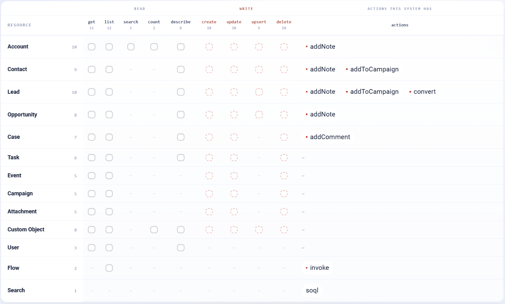

.. _connector-tools-salesforce:

.. rst-class:: agentic-tutorial

Salesforce Tools
================

.. raw:: html

   

     
     <dl class="tool-facts">
     
<dt>Connection</dt><dd>Salesforce</dd>

     
<dt>Tools</dt><dd>79 across 13 resources</dd>

     
<dt>Reads / writes</dt><dd>35 / 44</dd>

     
<dt>Available as</dt><dd>Agent tool · App Action</dd>

     </dl>
   

.. container:: tutorial-intro

   Let an agent work with Salesforce CRM: look up and change accounts, contacts, leads, opportunities, cases, tasks, events and campaigns, add notes and comments, convert leads, run SOQL and invoke flows. Custom objects are covered too.

.. contents:: On this page
   :local:
   :depth: 1
   :class: tool-toc

Prerequisites
-------------

* **Connection:** A **Salesforce** connection to your org. The agent can see and change only what that Salesforce user can.
* A Salesforce user with **API Enabled**, and object and field access for everything the agent reads or writes.
* A saved Salesforce connection that passes **Test Connection**.

Add Salesforce to an agent
--------------------------

#. In Agent Studio, open the **Tools** group and click **Add tools**, or click **+ Tool** on an Agent Node on the canvas.
#. Choose **Salesforce** under **Connectors**, or type ``salesforce`` in the search box.
#. **Connect.** Choose your Salesforce connection and click **Test connection**. The rest of the screen unlocks when it shows **Connected**.
#. **How the agent sees it.** Keep **A separate tool for each one**, so the agent picks each operation by name.
#. **Tick the operations.** The grid opens with the **Look things up** pack: reads only. Add each write the agent needs; every write waits for approval when it runs.
#. Click **Add to agent**. The ticked operations arrive as one Salesforce node, joined to the Agent Node by a dashed tool link.

   The Salesforce operations by resource. Reads come first and writes, marked with a red dot or a dashed box, after them. The grid unlocks once a connection passes **Test connection**.

Tools
-----

Each ticked operation becomes one tool, named ``salesforce_<resource>_<operation>``. **Read** tools run straight away. **Write** and **Delete** tools change data in Salesforce, so each call waits for :doc:`human approval </agentic-ai-guide/safety-guardrails/human-in-the-loop>` before it takes effect. Click a tool to open its page with every parameter.

.. raw:: html

   <nav class="tool-jump" aria-label="Jump to a resource"><a href="#res-account">Account10</a><a href="#res-contact">Contact9</a><a href="#res-lead">Lead10</a><a href="#res-opportunity">Opportunity8</a><a href="#res-case">Case7</a><a href="#res-task">Task6</a><a href="#res-event">Event5</a><a href="#res-campaign">Campaign5</a><a href="#res-attachment">Attachment5</a><a href="#res-custom_object">Custom Object8</a><a href="#res-user">User3</a><a href="#res-flow">Flow2</a><a href="#res-search">Search1</a></nav>

.. raw:: html

   

Account
~~~~~~~

.. raw:: html

   

     <a class="tool-op" href="salesforce/account-get.html" target="_blank" rel="noopener">
       Get an accountRead
       Fetches one account by its Salesforce Id and returns all of its fields, custom fields included.
     </a>
     <a class="tool-op" href="salesforce/account-getmany.html" target="_blank" rel="noopener">
       List accountsRead
       Queries accounts with an optional SOQL condition and returns up to limit rows.
     </a>
     <a class="tool-op" href="salesforce/account-create.html" target="_blank" rel="noopener">
       Create an accountWrite
       Creates an account (a company or organisation) from the given fields and returns its new Id.
     </a>
     <a class="tool-op" href="salesforce/account-update.html" target="_blank" rel="noopener">
       Update an accountWrite
       Changes the given fields on an existing account and leaves the others as they are; returns the account&#x27;s Id.
     </a>
     <a class="tool-op" href="salesforce/account-upsert.html" target="_blank" rel="noopener">
       Create or update an account by external idWrite
       Creates an account, or updates the one whose external id field already holds the same value, so a repeated sync never makes duplicates; returns the external id.
     </a>
     <a class="tool-op" href="salesforce/account-delete.html" target="_blank" rel="noopener">
       Delete an accountDelete
       Deletes one account by its Salesforce Id and returns that Id.
     </a>
     <a class="tool-op" href="salesforce/account-search.html" target="_blank" rel="noopener">
       Search accountsRead
       Finds accounts that match a SOQL condition and returns up to limit rows with the chosen fields.
     </a>
     <a class="tool-op" href="salesforce/account-describe.html" target="_blank" rel="noopener">
       Describe account fieldsRead
       Lists every field on the Account object, one row per field with its API name, label, type, length and whether it can be blank or updated.
     </a>
     <a class="tool-op" href="salesforce/account-count.html" target="_blank" rel="noopener">
       Count accountsRead
       Counts the accounts that match a SOQL condition and returns one row with the total, without fetching the records.
     </a>
     <a class="tool-op" href="salesforce/account-addnote.html" target="_blank" rel="noopener">
       Add a note to an accountWrite
       Attaches a note (a classic Salesforce Note with a title and body) to the account and returns the note&#x27;s Id.
     </a>
   

.. raw:: html

   

Contact
~~~~~~~

.. raw:: html

   

     <a class="tool-op" href="salesforce/contact-get.html" target="_blank" rel="noopener">
       Get a contactRead
       Fetches one contact by its Salesforce Id and returns all of its fields, custom fields included.
     </a>
     <a class="tool-op" href="salesforce/contact-getmany.html" target="_blank" rel="noopener">
       List contactsRead
       Queries contacts with an optional SOQL condition and returns up to limit rows.
     </a>
     <a class="tool-op" href="salesforce/contact-create.html" target="_blank" rel="noopener">
       Create a contactWrite
       Creates a contact (a person, usually at an account) from the given fields and returns its new Id.
     </a>
     <a class="tool-op" href="salesforce/contact-update.html" target="_blank" rel="noopener">
       Update a contactWrite
       Changes the given fields on an existing contact and leaves the others as they are; returns the contact&#x27;s Id.
     </a>
     <a class="tool-op" href="salesforce/contact-upsert.html" target="_blank" rel="noopener">
       Create or update a contact by external idWrite
       Creates a contact, or updates the one whose external id field already holds the same value, so a repeated sync never makes duplicates; returns the external id.
     </a>
     <a class="tool-op" href="salesforce/contact-delete.html" target="_blank" rel="noopener">
       Delete a contactDelete
       Deletes one contact by its Salesforce Id and returns that Id.
     </a>
     <a class="tool-op" href="salesforce/contact-describe.html" target="_blank" rel="noopener">
       Describe contact fieldsRead
       Lists every field on the Contact object, one row per field with its API name, label, type, length and whether it can be blank or updated.
     </a>
     <a class="tool-op" href="salesforce/contact-addnote.html" target="_blank" rel="noopener">
       Add a note to a contactWrite
       Attaches a note (a classic Salesforce Note with a title and body) to the contact and returns the note&#x27;s Id.
     </a>
     <a class="tool-op" href="salesforce/contact-addtocampaign.html" target="_blank" rel="noopener">
       Add a contact to a campaignWrite
       Adds the contact to a campaign as a campaign member and returns the member&#x27;s Id.
     </a>
   

.. raw:: html

   

Lead
~~~~

.. raw:: html

   

     <a class="tool-op" href="salesforce/lead-get.html" target="_blank" rel="noopener">
       Get a leadRead
       Fetches one lead by its Salesforce Id and returns all of its fields, custom fields included.
     </a>
     <a class="tool-op" href="salesforce/lead-getmany.html" target="_blank" rel="noopener">
       List leadsRead
       Queries leads with an optional SOQL condition and returns up to limit rows.
     </a>
     <a class="tool-op" href="salesforce/lead-create.html" target="_blank" rel="noopener">
       Create a leadWrite
       Creates a lead (a prospect not yet qualified) from the given fields and returns its new Id.
     </a>
     <a class="tool-op" href="salesforce/lead-update.html" target="_blank" rel="noopener">
       Update a leadWrite
       Changes the given fields on an existing lead and leaves the others as they are; returns the lead&#x27;s Id.
     </a>
     <a class="tool-op" href="salesforce/lead-upsert.html" target="_blank" rel="noopener">
       Create or update a lead by external idWrite
       Creates a lead, or updates the one whose external id field already holds the same value, so a repeated sync never makes duplicates; returns the external id.
     </a>
     <a class="tool-op" href="salesforce/lead-delete.html" target="_blank" rel="noopener">
       Delete a leadDelete
       Deletes one lead by its Salesforce Id and returns that Id.
     </a>
     <a class="tool-op" href="salesforce/lead-describe.html" target="_blank" rel="noopener">
       Describe lead fieldsRead
       Lists every field on the Lead object, one row per field with its API name, label, type, length and whether it can be blank or updated.
     </a>
     <a class="tool-op" href="salesforce/lead-addnote.html" target="_blank" rel="noopener">
       Add a note to a leadWrite
       Attaches a note (a classic Salesforce Note with a title and body) to the lead and returns the note&#x27;s Id.
     </a>
     <a class="tool-op" href="salesforce/lead-addtocampaign.html" target="_blank" rel="noopener">
       Add a lead to a campaignWrite
       Adds the lead to a campaign as a campaign member and returns the member&#x27;s Id.
     </a>
     <a class="tool-op" href="salesforce/lead-convert.html" target="_blank" rel="noopener">
       Convert a leadWrite
       Converts a lead into an account and a contact, plus an opportunity unless doNotCreateOpportunity is true, and returns Salesforce&#x27;s answer.
     </a>
   

.. raw:: html

   

Opportunity
~~~~~~~~~~~

.. raw:: html

   

     <a class="tool-op" href="salesforce/opportunity-get.html" target="_blank" rel="noopener">
       Get an opportunityRead
       Fetches one opportunity by its Salesforce Id and returns all of its fields, custom fields included.
     </a>
     <a class="tool-op" href="salesforce/opportunity-getmany.html" target="_blank" rel="noopener">
       List opportunitiesRead
       Queries opportunities with an optional SOQL condition and returns up to limit rows.
     </a>
     <a class="tool-op" href="salesforce/opportunity-create.html" target="_blank" rel="noopener">
       Create an opportunityWrite
       Creates an opportunity (a deal in progress) from the given fields and returns its new Id.
     </a>
     <a class="tool-op" href="salesforce/opportunity-update.html" target="_blank" rel="noopener">
       Update an opportunityWrite
       Changes the given fields on an existing opportunity and leaves the others as they are; returns the opportunity&#x27;s Id.
     </a>
     <a class="tool-op" href="salesforce/opportunity-upsert.html" target="_blank" rel="noopener">
       Create or update an opportunity by external idWrite
       Creates an opportunity, or updates the one whose external id field already holds the same value, so a repeated sync never makes duplicates; returns the external id.
     </a>
     <a class="tool-op" href="salesforce/opportunity-delete.html" target="_blank" rel="noopener">
       Delete an opportunityDelete
       Deletes one opportunity by its Salesforce Id and returns that Id.
     </a>
     <a class="tool-op" href="salesforce/opportunity-describe.html" target="_blank" rel="noopener">
       Describe opportunity fieldsRead
       Lists every field on the Opportunity object, one row per field with its API name, label, type, length and whether it can be blank or updated.
     </a>
     <a class="tool-op" href="salesforce/opportunity-addnote.html" target="_blank" rel="noopener">
       Add a note to an opportunityWrite
       Attaches a note (a classic Salesforce Note with a title and body) to the opportunity and returns the note&#x27;s Id.
     </a>
   

.. raw:: html

   

Case
~~~~

.. raw:: html

   

     <a class="tool-op" href="salesforce/case-get.html" target="_blank" rel="noopener">
       Get a caseRead
       Fetches one case by its Salesforce Id and returns all of its fields, custom fields included.
     </a>
     <a class="tool-op" href="salesforce/case-getmany.html" target="_blank" rel="noopener">
       List casesRead
       Queries cases with an optional SOQL condition and returns up to limit rows.
     </a>
     <a class="tool-op" href="salesforce/case-create.html" target="_blank" rel="noopener">
       Create a caseWrite
       Creates a case (a customer issue or support request) from the given fields and returns its new Id.
     </a>
     <a class="tool-op" href="salesforce/case-update.html" target="_blank" rel="noopener">
       Update a caseWrite
       Changes the given fields on an existing case and leaves the others as they are; returns the case&#x27;s Id.
     </a>
     <a class="tool-op" href="salesforce/case-delete.html" target="_blank" rel="noopener">
       Delete a caseDelete
       Deletes one case by its Salesforce Id and returns that Id.
     </a>
     <a class="tool-op" href="salesforce/case-describe.html" target="_blank" rel="noopener">
       Describe case fieldsRead
       Lists every field on the Case object, one row per field with its API name, label, type, length and whether it can be blank or updated.
     </a>
     <a class="tool-op" href="salesforce/case-addcomment.html" target="_blank" rel="noopener">
       Add a case commentWrite
       Adds a comment to the case&#x27;s Case Comments and returns the comment&#x27;s Id.
     </a>
   

.. raw:: html

   

Task
~~~~

.. raw:: html

   

     <a class="tool-op" href="salesforce/task-get.html" target="_blank" rel="noopener">
       Get a taskRead
       Fetches one task by its Salesforce Id and returns all of its fields, custom fields included.
     </a>
     <a class="tool-op" href="salesforce/task-getmany.html" target="_blank" rel="noopener">
       List tasksRead
       Queries tasks with an optional SOQL condition and returns up to limit rows.
     </a>
     <a class="tool-op" href="salesforce/task-create.html" target="_blank" rel="noopener">
       Create a taskWrite
       Creates a task (a to-do or a logged activity) from the given fields and returns its new Id.
     </a>
     <a class="tool-op" href="salesforce/task-update.html" target="_blank" rel="noopener">
       Update a taskWrite
       Changes the given fields on an existing task and leaves the others as they are; returns the task&#x27;s Id.
     </a>
     <a class="tool-op" href="salesforce/task-delete.html" target="_blank" rel="noopener">
       Delete a taskDelete
       Deletes one task by its Salesforce Id and returns that Id.
     </a>
     <a class="tool-op" href="salesforce/task-describe.html" target="_blank" rel="noopener">
       Describe task fieldsRead
       Lists every field on the Task object, one row per field with its API name, label, type, length and whether it can be blank or updated.
     </a>
   

.. raw:: html

   

Event
~~~~~

.. raw:: html

   

     <a class="tool-op" href="salesforce/event-get.html" target="_blank" rel="noopener">
       Get an eventRead
       Fetches one event by its Salesforce Id and returns all of its fields, custom fields included.
     </a>
     <a class="tool-op" href="salesforce/event-getmany.html" target="_blank" rel="noopener">
       List eventsRead
       Queries events with an optional SOQL condition and returns up to limit rows.
     </a>
     <a class="tool-op" href="salesforce/event-create.html" target="_blank" rel="noopener">
       Create an eventWrite
       Creates an event (a meeting on the Salesforce calendar) from the given fields and returns its new Id.
     </a>
     <a class="tool-op" href="salesforce/event-update.html" target="_blank" rel="noopener">
       Update an eventWrite
       Changes the given fields on an existing event and leaves the others as they are; returns the event&#x27;s Id.
     </a>
     <a class="tool-op" href="salesforce/event-delete.html" target="_blank" rel="noopener">
       Delete an eventDelete
       Deletes one event by its Salesforce Id and returns that Id.
     </a>
   

.. raw:: html

   

Campaign
~~~~~~~~

.. raw:: html

   

     <a class="tool-op" href="salesforce/campaign-get.html" target="_blank" rel="noopener">
       Get a campaignRead
       Fetches one campaign by its Salesforce Id and returns all of its fields, custom fields included.
     </a>
     <a class="tool-op" href="salesforce/campaign-getmany.html" target="_blank" rel="noopener">
       List campaignsRead
       Queries campaigns with an optional SOQL condition and returns up to limit rows.
     </a>
     <a class="tool-op" href="salesforce/campaign-create.html" target="_blank" rel="noopener">
       Create a campaignWrite
       Creates a campaign (a marketing initiative) from the given fields and returns its new Id.
     </a>
     <a class="tool-op" href="salesforce/campaign-update.html" target="_blank" rel="noopener">
       Update a campaignWrite
       Changes the given fields on an existing campaign and leaves the others as they are; returns the campaign&#x27;s Id.
     </a>
     <a class="tool-op" href="salesforce/campaign-delete.html" target="_blank" rel="noopener">
       Delete a campaignDelete
       Deletes one campaign by its Salesforce Id and returns that Id.
     </a>
   

.. raw:: html

   

Attachment
~~~~~~~~~~

.. raw:: html

   

     <a class="tool-op" href="salesforce/attachment-get.html" target="_blank" rel="noopener">
       Get an attachmentRead
       Fetches one attachment by its Salesforce Id and returns all of its fields, custom fields included.
     </a>
     <a class="tool-op" href="salesforce/attachment-getmany.html" target="_blank" rel="noopener">
       List attachmentsRead
       Queries attachments with an optional SOQL condition and returns up to limit rows.
     </a>
     <a class="tool-op" href="salesforce/attachment-create.html" target="_blank" rel="noopener">
       Create an attachmentWrite
       Creates an attachment (a file on a record) from the given fields and returns its new Id.
     </a>
     <a class="tool-op" href="salesforce/attachment-update.html" target="_blank" rel="noopener">
       Update an attachmentWrite
       Changes the given fields on an existing attachment and leaves the others as they are; returns the attachment&#x27;s Id.
     </a>
     <a class="tool-op" href="salesforce/attachment-delete.html" target="_blank" rel="noopener">
       Delete an attachmentDelete
       Deletes one attachment by its Salesforce Id and returns that Id.
     </a>
   

.. raw:: html

   

Custom Object
~~~~~~~~~~~~~

.. raw:: html

   

     <a class="tool-op" href="salesforce/custom-object-get.html" target="_blank" rel="noopener">
       Get a custom object recordRead
       Fetches one record of the custom object by its Salesforce Id and returns all of its fields.
     </a>
     <a class="tool-op" href="salesforce/custom-object-getmany.html" target="_blank" rel="noopener">
       List custom object recordsRead
       Queries records of the custom object with an optional SOQL condition and returns up to limit rows.
     </a>
     <a class="tool-op" href="salesforce/custom-object-create.html" target="_blank" rel="noopener">
       Create a custom object recordWrite
       Creates a record of the custom object from the given fields and returns its new Id.
     </a>
     <a class="tool-op" href="salesforce/custom-object-update.html" target="_blank" rel="noopener">
       Update a custom object recordWrite
       Changes the given fields on an existing record of the custom object and leaves the others as they are; returns the record&#x27;s Id.
     </a>
     <a class="tool-op" href="salesforce/custom-object-upsert.html" target="_blank" rel="noopener">
       Create or update a custom object record by external idWrite
       Creates a record of the custom object, or updates the one whose external id field already holds the same value, so a repeated sync never makes duplicates; returns the external id.
     </a>
     <a class="tool-op" href="salesforce/custom-object-delete.html" target="_blank" rel="noopener">
       Delete a custom object recordDelete
       Deletes one record of the custom object by its Salesforce Id and returns that Id.
     </a>
     <a class="tool-op" href="salesforce/custom-object-describe.html" target="_blank" rel="noopener">
       Describe custom object fieldsRead
       Lists every field on the custom object named in objectApiName, one row per field with its API name, label, type, length and whether it can be blank or updated.
     </a>
     <a class="tool-op" href="salesforce/custom-object-count.html" target="_blank" rel="noopener">
       Count custom object recordsRead
       Counts the records of the custom object that match a SOQL condition and returns one row with the total, without fetching them.
     </a>
   

.. raw:: html

   

User
~~~~

.. raw:: html

   

     <a class="tool-op" href="salesforce/user-get.html" target="_blank" rel="noopener">
       Get a userRead
       Fetches one Salesforce user by Id and returns all of their fields, such as name, email, username, profile and whether they are active.
     </a>
     <a class="tool-op" href="salesforce/user-getmany.html" target="_blank" rel="noopener">
       List usersRead
       Queries users with an optional SOQL condition and returns up to limit rows.
     </a>
     <a class="tool-op" href="salesforce/user-describe.html" target="_blank" rel="noopener">
       Describe user fieldsRead
       Lists every field on the User object, one row per field with its API name, label, type, length and whether it can be blank or updated.
     </a>
   

.. raw:: html

   

Flow
~~~~

.. raw:: html

   

     <a class="tool-op" href="salesforce/flow-getmany.html" target="_blank" rel="noopener">
       List flowsRead
       Lists the active autolaunched flows that can be run through the API, one row per flow with its API name and label.
     </a>
     <a class="tool-op" href="salesforce/flow-invoke.html" target="_blank" rel="noopener">
       Run a flowWrite
       Runs an active autolaunched flow by its API name with the given input variables and returns the flow&#x27;s response, output variables included.
     </a>
   

.. raw:: html

   

Search
~~~~~~

.. raw:: html

   

     <a class="tool-op" href="salesforce/search-soql.html" target="_blank" rel="noopener">
       Run a SOQL queryRead
       Runs any SOQL statement and returns every matching row, following Salesforce&#x27;s paging, with relationship fields nested.
     </a>
   

Use Salesforce as an App Action
-------------------------------

Salesforce also has 79 App Actions, fixed workflow steps for the same work. Drop **App Action** on the canvas, pick **Salesforce**, choose the action and fill in its details. It runs every time the flow reaches it, exactly as set; no model decides. Use it for the steps that must always happen, such as saving an approved result, and keep the agent tool for what the model should choose. See :doc:`Salesforce App Actions </agentic-ai-guide/tools-integrations/app-action-apps/salesforce>` for every action, its inputs and the trigger events.

Good to know
------------

* **describe** returns an object's fields and their types. Tick it so the agent uses real field names instead of guessing.
* **upsert** matches on an external id field, so a sync can run twice without creating duplicates.
* **Run a SOQL query** covers joins, subqueries and GROUP BY. Put a ``LIMIT`` in the statement, because nothing else caps it.
* Custom objects are named by their API name, which ends in ``__c``.

Example
-------

**Account brief.** Look things up pack only. Then give the Agent Node instructions like these:

.. code-block:: text

   Find the account named in the request. List its open opportunities with stage
   and amount, and its cases opened in the last 30 days.
   Summarise in five bullets. Do not create or update records.

Other common uses:

* Brief an account manager on an account: open opportunities, cases and recent activity.
* Create leads from inbound email after a person approves them.
* Add a note to a case from a support conversation.

Troubleshooting
---------------

***INVALID_FIELD* or *No such column*.**
   The agent guessed a field name. Tick **describe** and tell it to describe the object first.

**A record is not found though it exists.**
   The connected user cannot see it. Check sharing rules and the user's profile.

**Duplicates appear on re-runs.**
   Use **upsert** with an external id instead of **create**.

**The agent does not call the tool, or picks the wrong one.**
   Name the tool in the instructions and untick operations that sound alike. See :ref:`making-tools-reliable`.

FAQ
---

**Is this the same as the built-in Read From Salesforce tool?**
   No. The built-in tool reads one object into a table. The connector gives the agent one named tool per operation across 13 resources.

Related
-------

* :doc:`/agentic-ai-guide/tools-integrations/tools-connectors` - how tools work, choosing operations, and fixed settings
* :doc:`/agentic-ai-guide/tools-integrations/connector-tools/index` - every connector
* :doc:`/agentic-ai-guide/safety-guardrails/human-in-the-loop` - approving writes
* :doc:`/agentic-ai-guide/tools-integrations/app-actions` - the same operations as fixed workflow steps
