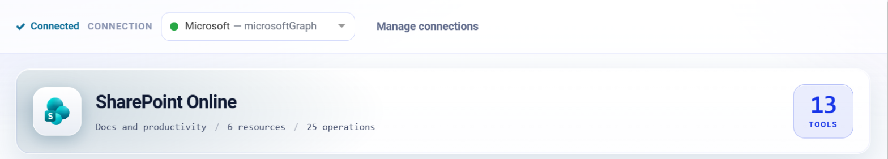
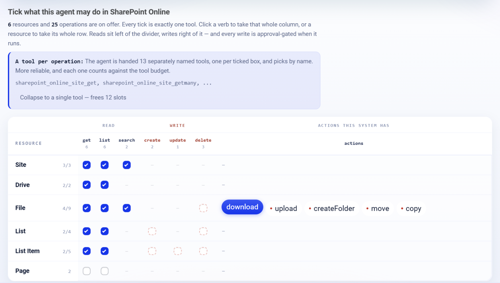

.. _connector-tools-sharepoint-online:

.. rst-class:: agentic-tutorial

SharePoint Online Tools
=======================

.. raw:: html

   

     
     <dl class="tool-facts">
     
<dt>Connection</dt><dd>Microsoft Graph or SharePoint</dd>

     
<dt>Tools</dt><dd>25 across 6 resources</dd>

     
<dt>Reads / writes</dt><dd>15 / 10</dd>

     
<dt>Available as</dt><dd>Agent tool · App Action</dd>

     </dl>
   

.. container:: tutorial-intro

   Let an agent find SharePoint sites, browse document libraries, read and upload files, and read and write list items.

.. contents:: On this page
   :local:
   :depth: 1
   :class: tool-toc

Prerequisites
-------------

* **Connection:** A **Microsoft Graph** connection (an Entra ID app registration with tenant ID, client ID and client secret), or a **SharePoint** connection. Grant the Microsoft Graph application permissions below with admin consent.
* ``Sites.Read.All`` to read sites, libraries, files and lists; ``Sites.ReadWrite.All`` to upload, move, create folders and change list items.
* To limit the app to chosen sites, use ``Sites.Selected`` and grant it each site.

Add SharePoint Online to an agent
---------------------------------

#. In Agent Studio, open the **Tools** group and click **Add tools**, or click **+ Tool** on an Agent Node on the canvas.
#. Choose **SharePoint Online** under **Connectors**, or type ``sharepoint`` in the search box.
#. **Connect.** Choose your Microsoft Graph or SharePoint connection and click **Test connection**. The rest of the screen unlocks when it shows **Connected**.
#. **How the agent sees it.** Keep **A separate tool for each one**, so the agent picks each operation by name.
#. **Tick the operations.** The grid opens with the **Look things up** pack: reads only. Add each write the agent needs; every write waits for approval when it runs.
#. Click **Add to agent**. The ticked operations arrive as one SharePoint Online node, joined to the Agent Node by a dashed tool link.

   Connected: the tested connection, the SharePoint Online card with how many tools are ticked.

   What the agent may do in SharePoint Online. Blue ticks are the **Look things up** pack; dashed boxes are writes, and a red dot marks an action that writes.

Tools
-----

Each ticked operation becomes one tool, named ``sharepoint_online_<resource>_<operation>``. **Read** tools run straight away. **Write** and **Delete** tools change data in SharePoint Online, so each call waits for :doc:`human approval </agentic-ai-guide/safety-guardrails/human-in-the-loop>` before it takes effect. Click a tool to open its page with every parameter.

.. raw:: html

   <nav class="tool-jump" aria-label="Jump to a resource"><a href="#res-site">Site3</a><a href="#res-drive">Drive2</a><a href="#res-file">File9</a><a href="#res-list">List4</a><a href="#res-list_item">List Item5</a><a href="#res-page">Page2</a></nav>

.. raw:: html

   

Site
~~~~

.. raw:: html

   

     <a class="tool-op" href="sharepoint-online/site-get.html" target="_blank" rel="noopener">
       Get a siteRead
       Returns one site with its id, name, title, description and web address.
     </a>
     <a class="tool-op" href="sharepoint-online/site-getmany.html" target="_blank" rel="noopener">
       List sitesRead
       Lists the SharePoint sites of the organization with their ids, names and web addresses.
     </a>
     <a class="tool-op" href="sharepoint-online/site-search.html" target="_blank" rel="noopener">
       Search sitesRead
       Finds sites whose name or description matches keywords and returns their ids, names and web addresses.
     </a>
   

.. raw:: html

   

Drive
~~~~~

.. raw:: html

   

     <a class="tool-op" href="sharepoint-online/drive-getmany.html" target="_blank" rel="noopener">
       List document librariesRead
       Lists the document libraries of a site with their ids, names and web addresses.
     </a>
     <a class="tool-op" href="sharepoint-online/drive-get.html" target="_blank" rel="noopener">
       Get a document libraryRead
       Returns one document library by its id with its name, owner, storage quota and web address.
     </a>
   

.. raw:: html

   

File
~~~~

.. raw:: html

   

     <a class="tool-op" href="sharepoint-online/file-getmany.html" target="_blank" rel="noopener">
       List files in a folderRead
       Lists the files and folders directly inside one folder of the site&#x27;s default document library, each with id, name, type, path, size, web address and who last changed it and when.
     </a>
     <a class="tool-op" href="sharepoint-online/file-get.html" target="_blank" rel="noopener">
       Get a file or folderRead
       Returns one file or folder, by path or id, with its id, type, size, web address and who last changed it and when.
     </a>
     <a class="tool-op" href="sharepoint-online/file-search.html" target="_blank" rel="noopener">
       Search filesRead
       Finds files and folders in the site&#x27;s default document library whose names or contents match words, and returns them in the same columns as File getMany.
     </a>
     <a class="tool-op" href="sharepoint-online/file-download.html" target="_blank" rel="noopener">
       Download a file and read its textRead
       Saves one file to the engine&#x27;s disk and returns its details with the saved path and its text: the words of a PDF, Word, Excel, text or CSV file, with text_status ok, password_protected, no_text (a scan) or unsupported.
     </a>
     <a class="tool-op" href="sharepoint-online/file-upload.html" target="_blank" rel="noopener">
       Upload a fileWrite
       Uploads a file from the engine&#x27;s disk into a folder of the site&#x27;s default document library and returns the stored file; a file of the same name there is replaced.
     </a>
     <a class="tool-op" href="sharepoint-online/file-createfolder.html" target="_blank" rel="noopener">
       Create a folderWrite
       Creates a folder in the site&#x27;s default document library and returns it with its id.
     </a>
     <a class="tool-op" href="sharepoint-online/file-delete.html" target="_blank" rel="noopener">
       Delete a file or folderDelete
       Deletes a file, or a folder with everything in it, moving it to the site&#x27;s recycle bin.
     </a>
     <a class="tool-op" href="sharepoint-online/file-move.html" target="_blank" rel="noopener">
       Move or rename a fileWrite
       Moves a file or folder into another folder of the same library, renames it, or both, and returns it.
     </a>
     <a class="tool-op" href="sharepoint-online/file-copy.html" target="_blank" rel="noopener">
       Copy a fileWrite
       Copies a file or folder into another folder, optionally under a new name.
     </a>
   

.. raw:: html

   

List
~~~~

.. raw:: html

   

     <a class="tool-op" href="sharepoint-online/list-getmany.html" target="_blank" rel="noopener">
       List the site&#x27;s listsRead
       Lists the lists and libraries of a site with their ids, names and web addresses.
     </a>
     <a class="tool-op" href="sharepoint-online/list-get.html" target="_blank" rel="noopener">
       Get a listRead
       Returns one list, by name or id, with its display name, template and web address, plus its column definitions when expand is columns.
     </a>
     <a class="tool-op" href="sharepoint-online/list-create.html" target="_blank" rel="noopener">
       Create a listWrite
       Creates a list on the site with a Title column plus any text columns named, and returns it with its id.
     </a>
     <a class="tool-op" href="sharepoint-online/list-delete.html" target="_blank" rel="noopener">
       Delete a listDelete
       Deletes a list together with all its items, moving it to the site&#x27;s recycle bin.
     </a>
   

.. raw:: html

   

List Item
~~~~~~~~~

.. raw:: html

   

     <a class="tool-op" href="sharepoint-online/list-item-getmany.html" target="_blank" rel="noopener">
       List items in a listRead
       Lists the items of a list, each as one row with its id, dates, author and every column of the list.
     </a>
     <a class="tool-op" href="sharepoint-online/list-item-get.html" target="_blank" rel="noopener">
       Get a list itemRead
       Returns one list item by its id with its dates, author and every column.
     </a>
     <a class="tool-op" href="sharepoint-online/list-item-create.html" target="_blank" rel="noopener">
       Create a list itemWrite
       Adds an item to a list and returns it with its id and columns.
     </a>
     <a class="tool-op" href="sharepoint-online/list-item-update.html" target="_blank" rel="noopener">
       Update a list itemWrite
       Changes columns of an existing list item and returns its columns; columns not named keep their values.
     </a>
     <a class="tool-op" href="sharepoint-online/list-item-delete.html" target="_blank" rel="noopener">
       Delete a list itemDelete
       Deletes an item from a list, moving it to the site&#x27;s recycle bin.
     </a>
   

.. raw:: html

   

Page
~~~~

.. raw:: html

   

     <a class="tool-op" href="sharepoint-online/page-getmany.html" target="_blank" rel="noopener">
       List site pagesRead
       Lists the pages of a site with their ids, names, titles, web addresses and dates.
     </a>
     <a class="tool-op" href="sharepoint-online/page-get.html" target="_blank" rel="noopener">
       Get a site pageRead
       Returns one site page by its id with its name, title, layout, web address and dates.
     </a>
   

Use SharePoint Online as an App Action
--------------------------------------

The same 25 operations are also a fixed workflow step. Drop **App Action** on the canvas, pick **SharePoint**, choose the action and fill in its details. It runs every time the flow reaches it, exactly as set; no model decides. Use it for the steps that must always happen, such as saving an approved result, and keep the agent tool for what the model should choose. See :doc:`SharePoint App Actions </agentic-ai-guide/tools-integrations/app-action-apps/sharepoint-online>` for every action, its inputs and the trigger events.

Good to know
------------

* Find a site with **Search sites** and pass its id to the library, file and list tools.
* **Download a file and read its text** saves the file to the engine's disk and returns its words.
* List items use the list's internal column names, which **Get a list** returns with ``expand`` columns.

Example
-------

**Read a policy library.** Look things up pack only. Then give the Agent Node instructions like these:

.. code-block:: text

   Find the site named "HR Policies". In its Documents library, list the files
   changed this quarter and summarise each policy in two lines.

Other common uses:

* Answer questions from documents in a team site.
* Publish a generated report to a library folder after approval.
* Update a status column in a SharePoint list.

Troubleshooting
---------------

***Access denied* on one site only.**
   With ``Sites.Selected``, each site has to be granted to the app separately.

**A list update changes nothing.**
   Use the internal column name (for example ``Status0``), not the display name.

**The agent does not call the tool, or picks the wrong one.**
   Name the tool in the instructions and untick operations that sound alike. See :ref:`making-tools-reliable`.

FAQ
---

**Microsoft Graph or SharePoint connection?**
   Either works. Use Microsoft Graph when the same app also serves Outlook, OneDrive or Teams.

Related
-------

* :doc:`/agentic-ai-guide/tools-integrations/tools-connectors` - how tools work, choosing operations, and fixed settings
* :doc:`/agentic-ai-guide/tools-integrations/connector-tools/index` - every connector
* :doc:`/agentic-ai-guide/safety-guardrails/human-in-the-loop` - approving writes
* :doc:`/agentic-ai-guide/tools-integrations/app-actions` - the same operations as fixed workflow steps
