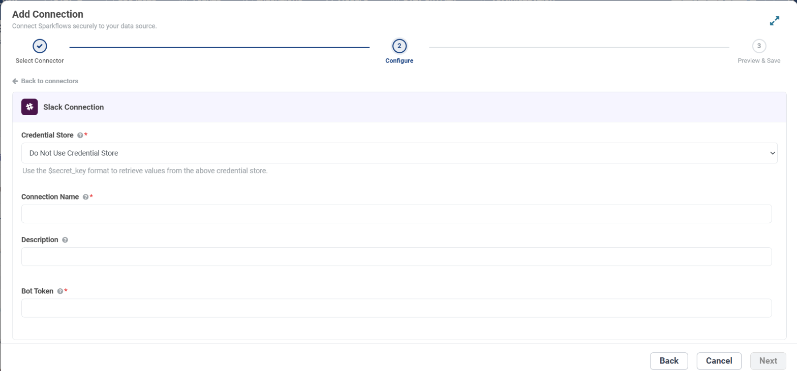
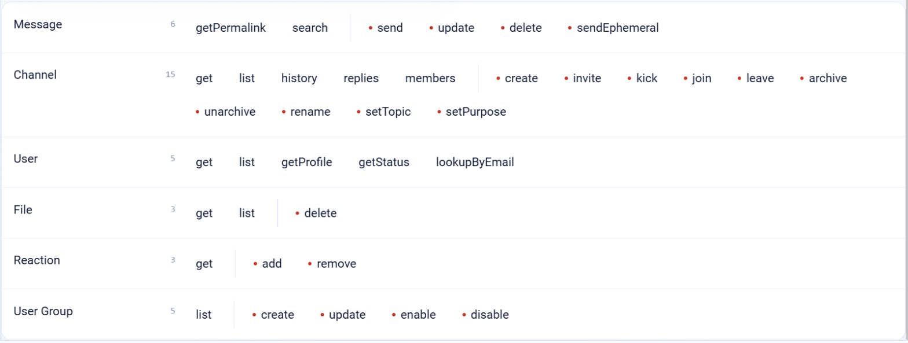

.. _connector-tools-slack:

.. rst-class:: agentic-tutorial

Slack Tools
===========

.. raw:: html

   

     
     <dl class="tool-facts">
     
<dt>Connection</dt><dd>Slack · Bot Token</dd>

     
<dt>Tools</dt><dd>37 across 6 resources</dd>

     
<dt>Reads / writes</dt><dd>16 / 21</dd>

     
<dt>Available as</dt><dd>Agent tool · App Action</dd>

     </dl>
   

.. container:: tutorial-intro

   Let an agent read channels and threads, look people up, and post, update or react to messages in Slack, and manage channels and user groups.

.. contents:: On this page
   :local:
   :depth: 1
   :class: tool-toc

Prerequisites
-------------

* **Connection:** A **Slack** connection that holds one **Bot Token** (``xoxb-``). Sparkflows calls Slack's own API, so there is no URL or username to enter.
* A Slack app installed in the workspace, with its Bot User OAuth Token.
* The bot scopes for the operations you tick. Slack refuses a call whose scope is missing with ``missing_scope``.
* The app invited to each channel it reads or posts in, private channels included.

Set up the connection
---------------------

#. In Slack, open your app at **api.slack.com/apps** (or create one) and go to **OAuth & Permissions**.
#. Under **Bot Token Scopes**, add the scopes for the operations the agent will run (see the table below), then **Install to Workspace**.
#. Copy the **Bot User OAuth Token**. It starts with ``xoxb-``.
#. In Sparkflows, open **Administration → Global/Group Connections → Add Connection**, choose **Tools → Slack**, enter a **Connection Name**, paste the token into **Bot Token**, click **Test Connection** and save.
#. In Slack, invite the app to every channel it reads or posts in: ``/invite @your-app``.

.. list-table:: What each group of tools needs
   :header-rows: 1
   :widths: 55 45

   * - Tools
     - Bot token scope
   * - Post, update and delete messages; ephemeral messages
     - ``chat:write``
   * - Get and list channels
     - ``channels:read``, ``groups:read``
   * - Channel history and thread replies
     - ``channels:history``, ``groups:history``
   * - Create, rename, archive, invite, kick, set topic or purpose
     - ``channels:manage``, ``groups:write``
   * - Join a public channel
     - ``channels:join``
   * - Get and list users; status
     - ``users:read``
   * - Find a user by email
     - ``users:read.email``
   * - User profile
     - ``users.profile:read``
   * - Files
     - ``files:read``, ``files:write``
   * - Reactions
     - ``reactions:read``, ``reactions:write``
   * - User groups
     - ``usergroups:read``, ``usergroups:write``

   The **Configure** step for a Slack connection. To keep the secret in a credential store instead, pick it under **Credential Store** and enter ``$secret_key``.

.. tip::

   Grant only what the agent needs. The connection decides what Slack allows at all; the operations you tick decide what this agent may do with it.

Add Slack to an agent
---------------------

#. In Agent Studio, open the **Tools** group and click **Add tools**, or click **+ Tool** on an Agent Node on the canvas.
#. Choose **Slack** under **Connectors**, or type ``slack`` in the search box.
#. **Connect.** Choose your Slack connection and click **Test connection**. The rest of the screen unlocks when it shows **Connected**.
#. **How the agent sees it.** Keep **A separate tool for each one**, so the agent picks each operation by name.
#. **Tick the operations.** The grid opens with the **Look things up** pack: reads only. Add each write the agent needs; every write waits for approval when it runs.
#. Click **Add to agent**. The ticked operations arrive as one Slack node, joined to the Agent Node by a dashed tool link.

   The Slack operations by resource. Reads come first and writes, marked with a red dot or a dashed box, after them. The grid unlocks once a connection passes **Test connection**.

Tools
-----

Each ticked operation becomes one tool, named ``slack_<resource>_<operation>``. **Read** tools run straight away. **Write** and **Delete** tools change data in Slack, so each call waits for :doc:`human approval </agentic-ai-guide/safety-guardrails/human-in-the-loop>` before it takes effect. Click a tool to open its page with every parameter.

.. raw:: html

   <nav class="tool-jump" aria-label="Jump to a resource"><a href="#res-message">Message6</a><a href="#res-channel">Channel15</a><a href="#res-user">User5</a><a href="#res-file">File3</a><a href="#res-reaction">Reaction3</a><a href="#res-user_group">User Group5</a></nav>

.. raw:: html

   

Message
~~~~~~~

.. raw:: html

   

     <a class="tool-op" href="slack/message-send.html" target="_blank" rel="noopener">
       Send a messageWrite
       Posts a message to a channel, a private channel or a person&#x27;s direct message with the app, and returns the posted message with its ts, the id later operations use.
     </a>
     <a class="tool-op" href="slack/message-update.html" target="_blank" rel="noopener">
       Update a messageWrite
       Changes the text of a message the app posted earlier and returns the updated message.
     </a>
     <a class="tool-op" href="slack/message-delete.html" target="_blank" rel="noopener">
       Delete a messageDelete
       Deletes a message from a channel.
     </a>
     <a class="tool-op" href="slack/message-sendephemeral.html" target="_blank" rel="noopener">
       Send an ephemeral messageWrite
       Shows a message to one member of a channel only; nobody else sees it and Slack does not keep it.
     </a>
     <a class="tool-op" href="slack/message-getpermalink.html" target="_blank" rel="noopener">
       Get a message linkRead
       Returns the permanent link (permalink) to one message, for sharing or citing it outside Slack.
     </a>
     <a class="tool-op" href="slack/message-search.html" target="_blank" rel="noopener">
       Search messagesRead
       Searches messages across the workspace with Slack&#x27;s search syntax and returns the matches, best first, with text, user, username, channel, ts and permalink.
     </a>
   

.. raw:: html

   

Channel
~~~~~~~

.. raw:: html

   

     <a class="tool-op" href="slack/channel-get.html" target="_blank" rel="noopener">
       Get a channelRead
       Returns one channel&#x27;s details: name, topic, purpose, created, creator, is_private, is_archived and, when asked, num_members.
     </a>
     <a class="tool-op" href="slack/channel-getmany.html" target="_blank" rel="noopener">
       List channelsRead
       Lists the workspace&#x27;s channels with id, name, is_private, is_archived, topic, purpose and num_members.
     </a>
     <a class="tool-op" href="slack/channel-history.html" target="_blank" rel="noopener">
       Read channel historyRead
       Returns the messages of one channel, newest first, each with ts, user, text, thread_ts and reply_count; thread replies are not included.
     </a>
     <a class="tool-op" href="slack/channel-replies.html" target="_blank" rel="noopener">
       Read thread repliesRead
       Returns one thread: the parent message followed by its replies, oldest first, each with ts, user and text.
     </a>
     <a class="tool-op" href="slack/channel-members.html" target="_blank" rel="noopener">
       List channel membersRead
       Lists the members of one channel, one row per member with the user ID in id.
     </a>
     <a class="tool-op" href="slack/channel-create.html" target="_blank" rel="noopener">
       Create a channelWrite
       Creates a public or private channel and returns it with its new ID; the app becomes its first member.
     </a>
     <a class="tool-op" href="slack/channel-invite.html" target="_blank" rel="noopener">
       Invite members to a channelWrite
       Adds up to 1,000 members to a channel and returns the channel.
     </a>
     <a class="tool-op" href="slack/channel-kick.html" target="_blank" rel="noopener">
       Remove a member from a channelDelete
       Removes one member from a channel.
     </a>
     <a class="tool-op" href="slack/channel-join.html" target="_blank" rel="noopener">
       Join a channelWrite
       Adds the app to a public channel so it can read and post there, and returns the channel.
     </a>
     <a class="tool-op" href="slack/channel-leave.html" target="_blank" rel="noopener">
       Leave a channelDelete
       Removes the app from a channel, so it stops reading and posting there.
     </a>
     <a class="tool-op" href="slack/channel-archive.html" target="_blank" rel="noopener">
       Archive a channelDelete
       Archives a channel: it becomes read-only and leaves the channel list, while its history is kept.
     </a>
     <a class="tool-op" href="slack/channel-unarchive.html" target="_blank" rel="noopener">
       Unarchive a channelWrite
       Reopens an archived channel so members can post in it again.
     </a>
     <a class="tool-op" href="slack/channel-rename.html" target="_blank" rel="noopener">
       Rename a channelWrite
       Renames a channel and returns it with the new name.
     </a>
     <a class="tool-op" href="slack/channel-settopic.html" target="_blank" rel="noopener">
       Set a channel topicWrite
       Sets the topic shown in the channel header and returns the channel.
     </a>
     <a class="tool-op" href="slack/channel-setpurpose.html" target="_blank" rel="noopener">
       Set a channel purposeWrite
       Sets the channel&#x27;s description (purpose) and returns the channel.
     </a>
   

.. raw:: html

   

User
~~~~

.. raw:: html

   

     <a class="tool-op" href="slack/user-get.html" target="_blank" rel="noopener">
       Get a userRead
       Returns one member&#x27;s account: id, name, real_name, profile (display name, email, title, phone), tz, is_admin, is_bot and deleted.
     </a>
     <a class="tool-op" href="slack/user-getmany.html" target="_blank" rel="noopener">
       List usersRead
       Lists the workspace&#x27;s members, bots and deactivated accounts included (deleted is true), with id, name, real_name, profile and tz.
     </a>
     <a class="tool-op" href="slack/user-getprofile.html" target="_blank" rel="noopener">
       Get a user&#x27;s profileRead
       Returns a member&#x27;s profile: display_name, real_name, email, phone, title, status_text and status_emoji.
     </a>
     <a class="tool-op" href="slack/user-getstatus.html" target="_blank" rel="noopener">
       Get a user&#x27;s presenceRead
       Returns whether a member is active or away (presence) and, for the token&#x27;s own user, online and auto_away details.
     </a>
     <a class="tool-op" href="slack/user-lookupbyemail.html" target="_blank" rel="noopener">
       Find a user by emailRead
       Finds the member who uses an email address and returns their account with id, name, real_name and profile.
     </a>
   

.. raw:: html

   

File
~~~~

.. raw:: html

   

     <a class="tool-op" href="slack/file-get.html" target="_blank" rel="noopener">
       Get a fileRead
       Returns one file&#x27;s details: name, title, filetype, size, user, created, permalink and the channels it was shared in.
     </a>
     <a class="tool-op" href="slack/file-getmany.html" target="_blank" rel="noopener">
       List filesRead
       Lists files shared in the workspace, newest first, with id, name, title, filetype, size, user, created and permalink; filter by channel, user, type or time.
     </a>
     <a class="tool-op" href="slack/file-delete.html" target="_blank" rel="noopener">
       Delete a fileDelete
       Deletes a file from Slack for everyone.
     </a>
   

.. raw:: html

   

Reaction
~~~~~~~~

.. raw:: html

   

     <a class="tool-op" href="slack/reaction-add.html" target="_blank" rel="noopener">
       Add a reactionWrite
       Adds an emoji reaction to a message as the app, for example to acknowledge it.
     </a>
     <a class="tool-op" href="slack/reaction-get.html" target="_blank" rel="noopener">
       Get a message&#x27;s reactionsRead
       Returns one message with its reactions: each emoji name, its count and the users who added it.
     </a>
     <a class="tool-op" href="slack/reaction-remove.html" target="_blank" rel="noopener">
       Remove a reactionDelete
       Removes a reaction the app added to a message.
     </a>
   

.. raw:: html

   

User Group
~~~~~~~~~~

.. raw:: html

   

     <a class="tool-op" href="slack/user-group-getmany.html" target="_blank" rel="noopener">
       List user groupsRead
       Lists the workspace&#x27;s user groups (the @handles that mention a team) with id, name, handle, description and, when asked, their user count and member IDs.
     </a>
     <a class="tool-op" href="slack/user-group-create.html" target="_blank" rel="noopener">
       Create a user groupWrite
       Creates a user group, an @handle that mentions several people at once, and returns it with its ID (S0123ABC).
     </a>
     <a class="tool-op" href="slack/user-group-update.html" target="_blank" rel="noopener">
       Update a user groupWrite
       Changes a user group&#x27;s name, handle, description or default channels and returns the group.
     </a>
     <a class="tool-op" href="slack/user-group-enable.html" target="_blank" rel="noopener">
       Enable a user groupWrite
       Re-enables a disabled user group so its @handle works again, and returns the group.
     </a>
     <a class="tool-op" href="slack/user-group-disable.html" target="_blank" rel="noopener">
       Disable a user groupDelete
       Disables a user group: its @handle stops notifying anyone, while the group and its settings are kept.
     </a>
   

Use Slack as an App Action
--------------------------

The same 37 operations are also a fixed workflow step. Drop **App Action** on the canvas, pick **Slack**, choose the action and fill in its details. It runs every time the flow reaches it, exactly as set; no model decides. Use it for the steps that must always happen, such as saving an approved result, and keep the agent tool for what the model should choose. See :doc:`Slack App Actions </agentic-ai-guide/tools-integrations/app-action-apps/slack>` for every action, its inputs and the trigger events.

Good to know
------------

* **Search messages** needs a *user* token (``xoxp-``); a bot token is refused with ``not_allowed_token_type``. Read one channel with **Channel history** instead.
* Channel tools take a channel id such as ``C0123ABC``; **List channels** finds it from the name. **Send a message** also accepts ``#general`` or a user id for a direct message.
* Message text uses Slack mrkdwn; set ``threadTs`` to reply in a thread.
* **Send an ephemeral message** is seen by one member only and is not kept by Slack.

Example
-------

**Post a digest.** Fix channel = C0123ABC on Send a message. Then give the Agent Node instructions like these:

.. code-block:: text

   Read the last 24 hours of history in the #support-escalations channel.
   Summarise open issues in at most five bullets with the people involved.
   Post the summary to the digest channel as one message.

Other common uses:

* Post a daily digest to a team channel.
* Summarise a support thread and reply in it after approval.
* Look a person up by email and send them a direct message.

Troubleshooting
---------------

***Slack rejected the token: invalid_auth*.**
   The token is wrong, revoked or from another workspace. Copy the Bot User OAuth Token again and update the connection.

**``not_in_channel`` or ``channel_not_found``.**
   Invite the app to the channel, and pass the channel id rather than its name for channel tools.

**``missing_scope``.**
   Add the scope from the table above, reinstall the app, and paste the new token if Slack issued one.

**The agent does not call the tool, or picks the wrong one.**
   Name the tool in the instructions and untick operations that sound alike. See :ref:`making-tools-reliable`.

FAQ
---

**Does the message show who sent it?**
   It is posted as the Slack app's bot user, with the app's name and icon.

**Can I use one connection for several workspaces?**
   No. A bot token belongs to one workspace; create one connection per workspace.

Related
-------

* :doc:`/agentic-ai-guide/tools-integrations/tools-connectors` - how tools work, choosing operations, and fixed settings
* :doc:`/agentic-ai-guide/tools-integrations/connector-tools/index` - every connector
* :doc:`/agentic-ai-guide/safety-guardrails/human-in-the-loop` - approving writes
* :doc:`/agentic-ai-guide/tools-integrations/app-actions` - the same operations as fixed workflow steps
