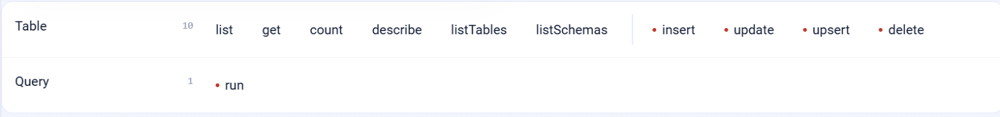

.. _connector-tools-sql-server:

.. rst-class:: agentic-tutorial

SQL Server Tools
================

.. raw:: html

   

     
     <dl class="tool-facts">
     
<dt>Connection</dt><dd>SQL Server</dd>

     
<dt>Tools</dt><dd>11 across 2 resources</dd>

     
<dt>Reads / writes</dt><dd>6 / 5</dd>

     
<dt>Available as</dt><dd>Agent tool · App Action</dd>

     </dl>
   

.. container:: tutorial-intro

   Let an agent read and change rows in a SQL Server database: browse and filter tables, fetch one row by key, count, describe a table before using it, and insert, update, upsert or delete rows. A **Run a SQL statement** tool covers joins and anything else the table tools cannot express.

.. contents:: On this page
   :local:
   :depth: 1
   :class: tool-toc

Prerequisites
-------------

* **Connection:** A database connection for SQL Server: JDBC URL, user and password. The picker lists every connection in the project, so choose the one that points at this database.
* A SQL Server database the Sparkflows server can reach (default port 1433).
* A database user with ``SELECT`` on the tables the agent reads. Grant ``INSERT``, ``UPDATE`` or ``DELETE`` only on the tables it may change.
* A saved connection that passes **Test Connection**. See :doc:`/agentic-ai-guide/quick-start/model-connections`.

Add SQL Server to an agent
--------------------------

#. In Agent Studio, open the **Tools** group and click **Add tools**, or click **+ Tool** on an Agent Node on the canvas.
#. Choose **SQL Server** under **Connectors**, or type ``sql server`` in the search box.
#. **Connect.** Choose your SQL Server connection and click **Test connection**. The rest of the screen unlocks when it shows **Connected**.
#. **How the agent sees it.** Keep **A separate tool for each one**, so the agent picks each operation by name.
#. **Tick the operations.** The grid opens with the **Look things up** pack: reads only. Add each write the agent needs; every write waits for approval when it runs.
#. Click **Add to agent**. The ticked operations arrive as one SQL Server node, joined to the Agent Node by a dashed tool link.

   The SQL Server operations by resource. Reads come first and writes, marked with a red dot or a dashed box, after them. The grid unlocks once a connection passes **Test connection**.

Tools
-----

Each ticked operation becomes one tool, named ``sqlserver_<resource>_<operation>``. **Read** tools run straight away. **Write** and **Delete** tools change data in SQL Server, so each call waits for :doc:`human approval </agentic-ai-guide/safety-guardrails/human-in-the-loop>` before it takes effect. Click a tool to open its page with every parameter.

.. raw:: html

   

Table
~~~~~

.. raw:: html

   

     <a class="tool-op" href="sql-server/table-getmany.html" target="_blank" rel="noopener">
       List rowsRead
       Reads rows from one table, with an optional where filter, sort order and column list, and returns at most limit rows; the limit is part of the SQL (TOP), so a large table is never read whole.
     </a>
     <a class="tool-op" href="sql-server/table-get.html" target="_blank" rel="noopener">
       Get a row by keyRead
       Reads the one row whose key column equals the given value and returns all its columns, or no row when none matches.
     </a>
     <a class="tool-op" href="sql-server/table-count.html" target="_blank" rel="noopener">
       Count rowsRead
       Counts the rows of a table, or only those matching where, and returns the number as row_count.
     </a>
     <a class="tool-op" href="sql-server/table-describe.html" target="_blank" rel="noopener">
       Describe a tableRead
       Returns each column of a table with its name, type, nullable flag and default.
     </a>
     <a class="tool-op" href="sql-server/table-insert.html" target="_blank" rel="noopener">
       Insert a rowWrite
       Adds one row to a table and returns how many rows were written.
     </a>
     <a class="tool-op" href="sql-server/table-update.html" target="_blank" rel="noopener">
       Update a row by keyWrite
       Sets the columns given in row on the rows whose key column equals the key value inside row, and returns how many rows changed.
     </a>
     <a class="tool-op" href="sql-server/table-upsert.html" target="_blank" rel="noopener">
       Insert or update a rowWrite
       Updates the rows whose key column matches the key value inside row, or inserts row when none matches, and returns how many rows were updated and inserted.
     </a>
     <a class="tool-op" href="sql-server/table-delete.html" target="_blank" rel="noopener">
       Delete rowsDelete
       Deletes the row whose key column equals keyValue, or every row matching where when no key value is given, and returns how many rows were deleted.
     </a>
     <a class="tool-op" href="sql-server/table-listtables.html" target="_blank" rel="noopener">
       List tablesRead
       Lists the tables in one schema, one row per table with its schema and name.
     </a>
     <a class="tool-op" href="sql-server/table-listschemas.html" target="_blank" rel="noopener">
       List schemasRead
       Lists the schemas in the database, one row each, such as dbo and the built-in ones.
     </a>
   

.. raw:: html

   

Query
~~~~~

.. raw:: html

   

     <a class="tool-op" href="sql-server/query-run.html" target="_blank" rel="noopener">
       Run a SQL statementWrite
       Runs one SQL Server statement and commits it: a SELECT or WITH query returns its rows up to limit, and any other statement returns rowsAffected.
     </a>
   

Use SQL Server as an App Action
-------------------------------

SQL Server also has 11 App Actions, fixed workflow steps for the same work. Drop **App Action** on the canvas, pick **SQL Server**, choose the action and fill in its details. It runs every time the flow reaches it, exactly as set; no model decides. Use it for the steps that must always happen, such as saving an approved result, and keep the agent tool for what the model should choose. See :doc:`SQL Server App Actions </agentic-ai-guide/tools-integrations/app-action-apps/sql-server>` for every action, its inputs and the trigger events.

Good to know
------------

* **List rows** builds the limit into the SQL itself, so a large table is never read whole.
* **Delete rows** refuses to run without a key value or a ``where`` filter, so a whole table cannot be emptied by accident.
* **Run a SQL statement** commits whatever it runs, reads and writes alike, so it is approval-gated as a write. Leave it unticked unless the table tools are not enough.
* Fix ``table`` (and ``schema``) on the tools in **Fixed settings** to keep the agent on one table.

Example
-------

**Look up an order.** Fix table = dbo.orders on every tool. Then give the Agent Node instructions like these:

.. code-block:: text

   You answer questions about customer orders.
   Before any query, describe the dbo.orders table so you use real column names.
   Find orders with List rows and a where filter; never run free SQL.
   Answer with the order id, status and total. If nothing matches, say so.

Other common uses:

* Answer questions about orders, tickets or customers from a reporting table.
* Look a record up by key before drafting a reply or a summary.
* Save an agent's classification back to a results table after approval.

Troubleshooting
---------------

**The grid stays locked after Test connection.**
   The connection could not log in or reach the server. Open the connection under **Administration → Global/Group Connections**, check the JDBC URL, user and password, and test it there first. The Sparkflows server must be able to reach the database host and port.

**The agent guesses column names and the query fails.**
   Tick **describe** and **listTables** and tell the agent to call them before reading or writing: *"Describe a table before you query it. Never guess column names."*

**A write was refused or did nothing.**
   Writes need the database user to hold INSERT, UPDATE or DELETE on that table, and every write waits for approval when it runs. An update or upsert needs the key column inside ``row``.

**The agent does not call the tool, or picks the wrong one.**
   Name the tool in the instructions and untick operations that sound alike. See :ref:`making-tools-reliable`.

FAQ
---

**Can I use a generic JDBC connection?**
   Yes, as long as it points at a SQL Server database. The connector issues SQL Server SQL, so a connection to a different engine will fail on the first query.

**Is a read-only agent really read-only?**
   Yes if you tick only the Read column. **Run a SQL statement** counts as a write because it can run any statement, so it is never part of a read pack.

Related
-------

* :doc:`/agentic-ai-guide/tools-integrations/tools-connectors` - how tools work, choosing operations, and fixed settings
* :doc:`/agentic-ai-guide/tools-integrations/connector-tools/index` - every connector
* :doc:`/agentic-ai-guide/safety-guardrails/human-in-the-loop` - approving writes
* :doc:`/agentic-ai-guide/tools-integrations/app-actions` - the same operations as fixed workflow steps
