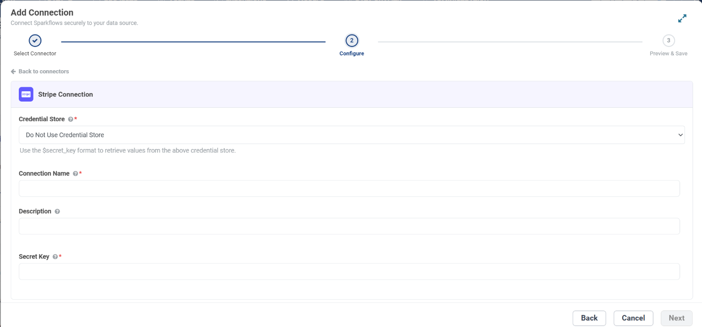

.. _connector-tools-stripe:

.. rst-class:: agentic-tutorial

Stripe Tools
============

.. raw:: html

   

     
     <dl class="tool-facts">
     
<dt>Connection</dt><dd>Stripe · Secret Key</dd>

     
<dt>Tools</dt><dd>14 across 6 resources</dd>

     
<dt>Reads / writes</dt><dd>11 / 3</dd>

     
<dt>Available as</dt><dd>Agent tool only</dd>

     </dl>
     
New

   

.. container:: tutorial-intro

   Let an agent answer billing questions from Stripe: look up customers, invoices, subscriptions, charges, products and the balance, create or update customers, and cancel a subscription when that is approved.

.. container:: tutorial-start

   **Agent tool only.** Stripe is available in the agent tool picker. It is not offered as an :doc:`App Action </agentic-ai-guide/tools-integrations/app-actions>` node yet, so a fixed workflow step cannot call it.

.. contents:: On this page
   :local:
   :depth: 1
   :class: tool-toc

Prerequisites
-------------

* **Connection:** A **Stripe** connection that holds one **Secret Key**. Restricted keys work too. Sparkflows calls ``api.stripe.com``, so there is no URL or username to enter.
* A Stripe account and a secret or restricted key. Use a ``sk_test_`` or ``rk_test_`` key while you build; it sees only test-mode data.

Set up the connection
---------------------

#. In the Stripe Dashboard, open **Developers → API keys**.
#. Create a **restricted key** (``rk_``) with only the permissions below, or copy the secret key (``sk_live_`` or ``sk_test_``).
#. In Sparkflows, open **Administration → Global/Group Connections → Add Connection**, choose **Tools → Stripe**, enter a **Connection Name**, paste the key into **Secret Key**, click **Test Connection** and save.

.. list-table:: What each group of tools needs
   :header-rows: 1
   :widths: 55 45

   * - Tools
     - Restricted key permission
   * - Get, list, create and update customers
     - Customers: Read, or Write to create and update
   * - Get and list invoices
     - Invoices: Read
   * - Get, list and cancel subscriptions
     - Subscriptions: Read, or Write to cancel
   * - Get and list charges
     - Charges: Read
   * - List products
     - Products: Read
   * - Account balance and balance transactions
     - Balance: Read

   The **Configure** step for a Stripe connection. To keep the secret in a credential store instead, pick it under **Credential Store** and enter ``$secret_key``.

.. tip::

   Grant only what the agent needs. The connection decides what Stripe allows at all; the operations you tick decide what this agent may do with it.

Add Stripe to an agent
----------------------

#. In Agent Studio, open the **Tools** group and click **Add tools**, or click **+ Tool** on an Agent Node on the canvas.
#. Choose **Stripe** under **Connectors**, or type ``stripe`` in the search box.
#. **Connect.** Choose your Stripe connection and click **Test connection**. The rest of the screen unlocks when it shows **Connected**.
#. **How the agent sees it.** Keep **A separate tool for each one**, so the agent picks each operation by name.
#. **Tick the operations.** The grid opens with the **Look things up** pack: reads only. Add each write the agent needs; every write waits for approval when it runs.
#. Click **Add to agent**. The ticked operations arrive as one Stripe node, joined to the Agent Node by a dashed tool link.

Tools
-----

Each ticked operation becomes one tool, named ``stripe_<resource>_<operation>``. **Read** tools run straight away. **Write** and **Delete** tools change data in Stripe, so each call waits for :doc:`human approval </agentic-ai-guide/safety-guardrails/human-in-the-loop>` before it takes effect. Click a tool to open its page with every parameter.

.. raw:: html

   <nav class="tool-jump" aria-label="Jump to a resource"><a href="#res-customer">Customer4</a><a href="#res-invoice">Invoice2</a><a href="#res-subscription">Subscription3</a><a href="#res-charge">Charge2</a><a href="#res-product">Product1</a><a href="#res-balance">Balance2</a></nav>

.. raw:: html

   

Customer
~~~~~~~~

.. raw:: html

   

     <a class="tool-op" href="stripe/customer-get.html" target="_blank" rel="noopener">
       Get a customerRead
       Fetches one Stripe customer by id and returns its email, name, phone, address, description, balance, currency and metadata.
     </a>
     <a class="tool-op" href="stripe/customer-getmany.html" target="_blank" rel="noopener">
       List customersRead
       Lists customers, newest first, up to 100 in one call.
     </a>
     <a class="tool-op" href="stripe/customer-create.html" target="_blank" rel="noopener">
       Create a customerWrite
       Creates a Stripe customer and returns it with its new id (cus_...).
     </a>
     <a class="tool-op" href="stripe/customer-update.html" target="_blank" rel="noopener">
       Update a customerWrite
       Changes fields on an existing Stripe customer and returns the updated customer; fields left out stay as they are.
     </a>
   

.. raw:: html

   

Invoice
~~~~~~~

.. raw:: html

   

     <a class="tool-op" href="stripe/invoice-get.html" target="_blank" rel="noopener">
       Get an invoiceRead
       Fetches one invoice by id and returns its number, status, customer, amount_due, amount_paid and amount_remaining (in the currency&#x27;s smallest unit, such as cents), due_date, hosted_invoice_url and lines.
     </a>
     <a class="tool-op" href="stripe/invoice-getmany.html" target="_blank" rel="noopener">
       List invoicesRead
       Lists invoices, newest first, from one Stripe page of up to 100.
     </a>
   

.. raw:: html

   

Subscription
~~~~~~~~~~~~

.. raw:: html

   

     <a class="tool-op" href="stripe/subscription-get.html" target="_blank" rel="noopener">
       Get a subscriptionRead
       Fetches one subscription by id and returns its status, customer, items with their prices, billing period, trial dates, cancel_at_period_end and metadata.
     </a>
     <a class="tool-op" href="stripe/subscription-getmany.html" target="_blank" rel="noopener">
       List subscriptionsRead
       Lists subscriptions, newest first, from one Stripe page of up to 100; canceled subscriptions are left out unless status asks for them.
     </a>
     <a class="tool-op" href="stripe/subscription-cancel.html" target="_blank" rel="noopener">
       Cancel a subscriptionDelete
       Cancels a subscription immediately and returns it with status canceled; billing stops and the subscription cannot be reactivated.
     </a>
   

.. raw:: html

   

Charge
~~~~~~

.. raw:: html

   

     <a class="tool-op" href="stripe/charge-get.html" target="_blank" rel="noopener">
       Get a chargeRead
       Fetches one charge by id and returns its amount and amount_refunded (in the currency&#x27;s smallest unit), currency, status, paid, refunded, customer, payment method details, receipt_url and any failure_message.
     </a>
     <a class="tool-op" href="stripe/charge-getmany.html" target="_blank" rel="noopener">
       List chargesRead
       Lists charges, newest first, from one Stripe page of up to 100, including failed and refunded ones.
     </a>
   

.. raw:: html

   

Product
~~~~~~~

.. raw:: html

   

     <a class="tool-op" href="stripe/product-getmany.html" target="_blank" rel="noopener">
       List productsRead
       Lists products in the Stripe catalog, newest first, from one Stripe page of up to 100.
     </a>
   

.. raw:: html

   

Balance
~~~~~~~

.. raw:: html

   

     <a class="tool-op" href="stripe/balance-get.html" target="_blank" rel="noopener">
       Get the account balanceRead
       Returns the account&#x27;s current balance: the available and pending amounts per currency, in the currency&#x27;s smallest unit.
     </a>
     <a class="tool-op" href="stripe/balance-getmany.html" target="_blank" rel="noopener">
       List balance transactionsRead
       Lists balance transactions, the entries behind every change to the balance (charges, refunds, fees, payouts and adjustments), newest first, from one Stripe page of up to 100.
     </a>
   

Good to know
------------

* No Stripe tool creates a charge, a refund or a payout, so an agent cannot move money.
* Amounts are in the currency's smallest unit: ``amount_due`` 12500 is 125.00 USD. Tell the agent so in its instructions.
* Times such as ``created`` are Unix seconds.
* **Cancel a subscription** cancels immediately and cannot be undone. Keep it behind its approval step, or leave it unticked.
* **Test Connection** reads the balance. A restricted key without the Balance permission still passes, because Stripe only answers 403 to a key it has authenticated.

Example
-------

**Billing questions.** Restricted key with read permissions; Look things up pack. Then give the Agent Node instructions like these:

.. code-block:: text

   Find the customer by the email in the request.
   List their open invoices and report each number, due date and amount due.
   Amounts are in cents: divide by 100. Never change anything in Stripe.

Other common uses:

* Answer "how much does this customer owe?" from open invoices.
* Check why a payment failed from the charge's failure message.
* Correct a customer's billing email after approval.

Troubleshooting
---------------

***Stripe rejected the token (HTTP 401)*.**
   The key is wrong or was rolled. Copy it again from **Developers → API keys**.

**A tool answers HTTP 403.**
   The restricted key lacks the permission for that resource. Add it in the Stripe Dashboard; the key value stays the same.

**Customers you can see in Stripe are missing.**
   The key is in the other mode. Test keys see only test-mode data, live keys only live data.

**The agent does not call the tool, or picks the wrong one.**
   Name the tool in the instructions and untick operations that sound alike. See :ref:`making-tools-reliable`.

FAQ
---

**Is it available as an App Action?**
   Not yet. Stripe is offered as an agent tool; its App Action is still marked Coming soon.

**Can the agent refund a payment?**
   No. There is no refund, charge or payout tool.

Related
-------

* :doc:`/agentic-ai-guide/tools-integrations/tools-connectors` - how tools work, choosing operations, and fixed settings
* :doc:`/agentic-ai-guide/tools-integrations/connector-tools/index` - every connector
* :doc:`/agentic-ai-guide/safety-guardrails/human-in-the-loop` - approving writes
