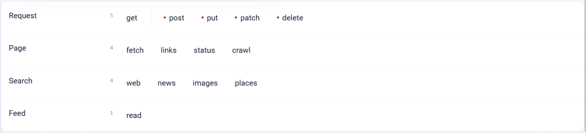

.. _connector-tools-web-search:

.. rst-class:: agentic-tutorial

Web Search Tools
================

.. raw:: html

   

     
     <dl class="tool-facts">
     
<dt>Connection</dt><dd>Serper (searches only)</dd>

     
<dt>Tools</dt><dd>14 across 4 resources</dd>

     
<dt>Reads / writes</dt><dd>10 / 4</dd>

     
<dt>Available as</dt><dd>Agent tool · App Action</dd>

     </dl>
   

.. container:: tutorial-intro

   Let an agent search the web, news, images and places, fetch pages and their links, read RSS and Atom feeds, and call HTTP endpoints.

.. contents:: On this page
   :local:
   :depth: 1
   :class: tool-toc

Prerequisites
-------------

* **Connection:** A **Serper** connection that holds a Serper API key, for the four search tools only. Page, feed and request tools go straight to the address and need no connection.
* For search: a Serper API key in a **Serper** connection.
* For pages, feeds and requests: the address must be reachable from the Sparkflows server.

Add Web Search to an agent
--------------------------

#. In Agent Studio, open the **Tools** group and click **Add tools**, or click **+ Tool** on an Agent Node on the canvas.
#. Choose **Web Search** under **Connectors**, or type ``web`` in the search box.
#. **Connect.** Choose a Serper connection for the search tools and click **Test connection**. Page, feed and request tools work without one.
#. **How the agent sees it.** Keep **A separate tool for each one**, so the agent picks each operation by name.
#. **Tick the operations.** The grid opens with the **Look things up** pack: reads only. Add each write the agent needs; every write waits for approval when it runs.
#. Click **Add to agent**. The ticked operations arrive as one Web Search node, joined to the Agent Node by a dashed tool link.

   The Web Search operations by resource. Reads come first and writes, marked with a red dot or a dashed box, after them. The grid unlocks once a connection passes **Test connection**.

Tools
-----

Each ticked operation becomes one tool, named ``web_tools_<resource>_<operation>``. **Read** tools run straight away. **Write** and **Delete** tools change data in Web Search, so each call waits for :doc:`human approval </agentic-ai-guide/safety-guardrails/human-in-the-loop>` before it takes effect. Click a tool to open its page with every parameter.

.. raw:: html

   <nav class="tool-jump" aria-label="Jump to a resource"><a href="#res-request">Request5</a><a href="#res-page">Page4</a><a href="#res-search">Search4</a><a href="#res-feed">Feed1</a></nav>

.. raw:: html

   

Request
~~~~~~~

.. raw:: html

   

     <a class="tool-op" href="web-search/request-get.html" target="_blank" rel="noopener">
       Send a GET requestRead
       Sends an HTTP GET to a URL and returns the HTTP status (status and httpStatus), content type, size and the response as JSON text (json) or as text (body), cut to maxChars.
     </a>
     <a class="tool-op" href="web-search/request-post.html" target="_blank" rel="noopener">
       Send a POST requestWrite
       Sends an HTTP POST with a JSON body to a URL and returns the response as JSON text (json) or as text (body).
     </a>
     <a class="tool-op" href="web-search/request-put.html" target="_blank" rel="noopener">
       Send a PUT requestWrite
       Sends an HTTP PUT with a JSON body to a URL, usually to replace a resource, and returns the response as JSON text (json) or as text (body).
     </a>
     <a class="tool-op" href="web-search/request-patch.html" target="_blank" rel="noopener">
       Send a PATCH requestWrite
       Sends an HTTP PATCH with a JSON body to a URL, usually to change part of a resource, and returns the response as JSON text (json) or as text (body).
     </a>
     <a class="tool-op" href="web-search/request-delete.html" target="_blank" rel="noopener">
       Send a DELETE requestDelete
       Sends an HTTP DELETE to a URL and returns the response as JSON text (json) or as text (body).
     </a>
   

.. raw:: html

   

Page
~~~~

.. raw:: html

   

     <a class="tool-op" href="web-search/page-fetch.html" target="_blank" rel="noopener">
       Fetch a web pageRead
       Downloads a web page and returns its title and readable text with scripts and styles removed, cut to maxChars, or the raw HTML when stripTags is false.
     </a>
     <a class="tool-op" href="web-search/page-links.html" target="_blank" rel="noopener">
       List the links on a pageRead
       Fetches a page and returns the unique links in it as absolute URLs with their host, capped at limit; by default only links to the page&#x27;s own host.
     </a>
     <a class="tool-op" href="web-search/page-status.html" target="_blank" rel="noopener">
       Check a URLRead
       Sends a HEAD request, following redirects, and returns the HTTP status and the final URL after them.
     </a>
     <a class="tool-op" href="web-search/page-crawl.html" target="_blank" rel="noopener">
       Crawl a siteRead
       Starts at a URL and follows links breadth-first, returning one row per page visited with its URL, title and the first 4,000 characters of its text, up to limit pages.
     </a>
   

.. raw:: html

   

Search
~~~~~~

.. raw:: html

   

     <a class="tool-op" href="web-search/search-web.html" target="_blank" rel="noopener">
       Search the webRead
       Searches Google through Serper and returns the organic results with title, link, snippet and position.
     </a>
     <a class="tool-op" href="web-search/search-news.html" target="_blank" rel="noopener">
       Search the newsRead
       Searches Google News through Serper and returns articles with title, link, snippet, date and source.
     </a>
     <a class="tool-op" href="web-search/search-images.html" target="_blank" rel="noopener">
       Search imagesRead
       Searches Google Images through Serper and returns images with title, imageUrl, the page link and source.
     </a>
     <a class="tool-op" href="web-search/search-places.html" target="_blank" rel="noopener">
       Search placesRead
       Searches Google Maps through Serper and returns places with title, address, rating, category, phone number and website.
     </a>
   

.. raw:: html

   

Feed
~~~~

.. raw:: html

   

     <a class="tool-op" href="web-search/feed-read.html" target="_blank" rel="noopener">
       Read a feedRead
       Downloads an RSS or Atom feed and returns its entries with title, link, published date and summary, capped at limit.
     </a>
   

Use Web Search as an App Action
-------------------------------

The same 14 operations are also a fixed workflow step. Drop **App Action** on the canvas, pick **Web Search**, choose the action and fill in its details. It runs every time the flow reaches it, exactly as set; no model decides. Use it for the steps that must always happen, such as saving an approved result, and keep the agent tool for what the model should choose. See :doc:`Web Search App Actions </agentic-ai-guide/tools-integrations/app-action-apps/web-search>` for every action, its inputs and the trigger events.

Good to know
------------

* Search results are titles, links and snippets. Fetch a result's page to read it.
* Request tools return the HTTP status and the response as JSON or text; a 4xx or 5xx answer reads as failed. POST, PUT, PATCH and DELETE are approval-gated writes.
* For a fixed API with known parameters, the built-in **REST API Client** tool lets you template the URL and headers once.

Example
-------

**Company research.** Look things up pack. Then give the Agent Node instructions like these:

.. code-block:: text

   Search the web and news for the company in the request.
   Fetch the two most relevant pages and summarise what the company does,
   recent news and the source links.

Other common uses:

* Research a company before a sales call.
* Monitor news about a product or competitor.
* Read a public status page or feed.

Troubleshooting
---------------

**Searches fail but page fetches work.**
   Only searches use the connection. Check the Serper API key and its remaining credits.

**A page fetch returns little text.**
   The page renders in the browser with JavaScript. Try the site's feed or API, or a different page.

**The agent does not call the tool, or picks the wrong one.**
   Name the tool in the instructions and untick operations that sound alike. See :ref:`making-tools-reliable`.

FAQ
---

**How is this different from the built-in SerperAI Search and Web Scraper tools?**
   The connector bundles search, page, feed and request operations into one node with one named tool each.

Related
-------

* :doc:`/agentic-ai-guide/tools-integrations/tools-connectors` - how tools work, choosing operations, and fixed settings
* :doc:`/agentic-ai-guide/tools-integrations/connector-tools/index` - every connector
* :doc:`/agentic-ai-guide/safety-guardrails/human-in-the-loop` - approving writes
* :doc:`/agentic-ai-guide/tools-integrations/app-actions` - the same operations as fixed workflow steps
