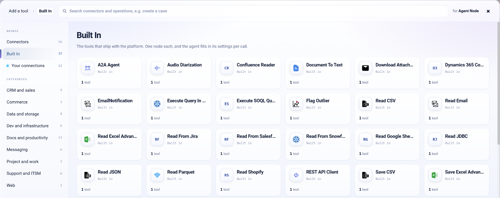

.. _sparkflows-tools:

.. rst-class:: agentic-tutorial

Sparkflows Tools
================

.. raw:: html

   

     
     <dl class="tool-facts">
       
<dt>Tools</dt><dd>37 built in</dd>

       
<dt>Shape</dt><dd>One node, one tool</dd>

       
<dt>Settings</dt><dd>Agent decides or fixed</dd>

       
<dt>Where</dt><dd>Add a tool → Built In</dd>

     </dl>
   

.. container:: tutorial-intro

   Sparkflows tools ship with the platform. Each one is a single node that the agent calls as one tool: read or save a file, query a database, call a REST API, scrape a page, turn a document into text, profile a table, or hand a task to another agent. Many need no outside system at all.

.. contents:: On this page
   :local:
   :depth: 1
   :class: tool-toc

Sparkflows tools or connector tools?
------------------------------------

.. list-table::
   :header-rows: 1
   :widths: 26 37 37

   * -
     - Sparkflows tools
     - :doc:`Connector tools <connector-tools/index>`
   * - **What one node gives the agent**
     - One tool, such as ``read_csv``.
     - One tool per operation you tick, such as ``slack_message_send``.
   * - **Settings**
     - The node's own settings: a path, a table, a URL. Either the agent fills them per call or you fix them.
     - Each operation's parameters. Any of them can be fixed per tool.
   * - **Best for**
     - Files, SQL tables, documents, HTTP calls, analysis, and reading one system in one step.
     - Working inside a business app: look up, create, update and act on its records.
   * - **Writes**
     - Save and write tools change files, tables or records. Where a person must check first, put a Human Approval step in front.
     - Write operations are approval-gated automatically.

Several systems have both, for example **Read From Salesforce** here and the :doc:`Salesforce connector <connector-tools/salesforce>`. Use the built-in tool to pull one object into a table; use the connector when the agent has to work with records.

Add a Sparkflows tool
---------------------

#. Click **+ Tool** on an Agent Node, or **Add tools** in Agent Studio, and choose **Built In** in the left rail.
#. Click the tool. Sparkflows asks who fills in its settings: **Agent decides** (recommended) or **Fixed settings**.
#. Open the tool on the canvas to set anything that must not vary, such as a file path, a connection or a table.
#. Give the tool a clear description. When an agent has two tools of the same type, the description is the only way the model can tell them apart.

   The **Built In** list. Each tile is one tool.

.. figure:: ../../_assets/agentic-ai-guide/tools/agent-decides-popup.png
   :alt: Prompt asking whether the agent decides the tool settings or you fix them
   :width: 294px

   **Agent decides** lets the agent fill the settings from each request and call the tool more than once. **Fixed settings** hands it exactly what you enter.

All Sparkflows tools
--------------------

The **Name the model sees** column is the tool name in the run log. A connection, where listed, is chosen in the tool's own settings.

Files
~~~~~

.. list-table::
   :header-rows: 1
   :widths: 24 20 40 16
   :class: tool-table

   * - Tool
     - Name the model sees
     - What it does
     - Connection
   * - **Read CSV**
     - ``read_csv``
     - Read a CSV file (or a directory of CSV files) into a table. Pass path as the file or directory location.
     - None
   * - **Read JSON**
     - ``read_json``
     - Read a JSON file into a table. Pass path as the file location; set multiLine to true only when each record spans several lines.
     - None
   * - **Read Parquet**
     - ``read_parquet``
     - Read a Parquet file or directory into a table. Pass path as the location.
     - None
   * - **Read Excel Advanced**
     - ``read_excel``
     - Read an Excel workbook into a table. Pass path as the .xlsx location. Optionally pass selectedSheets as a comma-separated list of sheet names, or readAllSheets=true for every sheet.
     - None
   * - **Read Google Sheets**
     - ``read_google_sheets``
     - Read a Google Sheet into a table. Pass spreadsheetUrl (the full share link) or spreadsheetId, and optionally selectedSheets and cellRange such as A1:D100.
     - Google credentials on the tool
   * - **Save CSV**
     - ``save_csv``
     - Write the incoming table to a CSV file. Pass path as the destination; saveMode may be overwrite, append or errorifexists.
     - None
   * - **Save JSON**
     - ``save_json``
     - Write the incoming table to a JSON file. Pass path as the destination; saveMode may be overwrite, append or errorifexists.
     - None
   * - **Save Parquet**
     - ``save_parquet``
     - Write the incoming table to a Parquet file. Pass path as the destination; saveMode may be overwrite, append or errorifexists.
     - None
   * - **Save Excel Advanced**
     - ``save_excel``
     - Write the incoming table to an Excel workbook. Pass path as the .xlsx destination and sheetName for the sheet to write.
     - None

Databases and warehouses
~~~~~~~~~~~~~~~~~~~~~~~~

.. list-table::
   :header-rows: 1
   :widths: 24 20 40 16
   :class: tool-table

   * - Tool
     - Name the model sees
     - What it does
     - Connection
   * - **Read JDBC**
     - ``read_database_table``
     - Read a whole table from the configured SQL database over JDBC. Pass jdbctable as the table name, optionally schema-qualified. The connection is already configured - do not pass credentials. Returns the rows read. To run a query instead of reading a whole table, use a query tool.
     - Database
   * - **Save JDBC**
     - ``save_database_table``
     - Write the incoming table to a table in the configured SQL database over JDBC. Pass jdbctable as the target table and saveMode as overwrite or append. The connection is already configured.
     - Database
   * - **Read From Snowflake**
     - ``read_snowflake_table``
     - Read a whole Snowflake table or view into a table. Pass dbtable as the table or view name. Use query\_snowflake instead when you need to filter or aggregate.
     - Snowflake
   * - **Execute Query In Snowflake**
     - ``query_snowflake``
     - Run a read-only SQL query against Snowflake and return the result rows. Pass query as the full SQL text. The warehouse, database and credentials are already configured - pass only the SQL.
     - Snowflake
   * - **Write To Snowflake**
     - ``save_snowflake_table``
     - Write the incoming table to a Snowflake table. Pass dbtable as the target table and saveMode as overwrite or append. The warehouse, database, schema and credentials are already configured - do not pass them.
     - Snowflake

Business applications
~~~~~~~~~~~~~~~~~~~~~

.. list-table::
   :header-rows: 1
   :widths: 24 20 40 16
   :class: tool-table

   * - Tool
     - Name the model sees
     - What it does
     - Connection
   * - **Read From Salesforce**
     - ``read_salesforce_object``
     - Read records of one Salesforce object. Pass sfObject as the API name (for example Account, Contact, MyObject\_\_c) and sfFields as a comma-separated field list, or \* for all fields.
     - Salesforce
   * - **Execute SOQL Query In Salesforce**
     - ``query_salesforce``
     - Run a SOQL query against Salesforce and return the result rows. Pass soqlQuery as the full SOQL text, for example 'SELECT Id, Name FROM Account WHERE CreatedDate = LAST\_N\_DAYS:7'.
     - Salesforce
   * - **Write To Salesforce**
     - ``save_salesforce_object``
     - Write the incoming rows to a Salesforce object. Pass sfObject as the API name and operationMode as insert, update or upsert.
     - Salesforce
   * - **Read From Jira**
     - ``read_jira_issues``
     - Search Jira and return the matching issues as rows. Pass jql as a JQL query (for example 'status = Open ORDER BY created DESC'), or project as a project key to read one project. fields is a comma-separated column list; maxResults caps how many issues come back.
     - Jira
   * - **Dynamics 365 Connector**
     - ``read_dynamics365_entity``
     - Read records of one Dynamics 365 entity. Pass selectColumns as a comma-separated column list and filterQuery as an OData filter such as "statuscode eq 1".
     - Dynamics 365
   * - **Write to Dynamics 365**
     - ``save_dynamics365_entity``
     - Write the incoming rows to a Dynamics 365 entity. Pass entityName as the target entity.
     - Dynamics 365
   * - **Read Shopify**
     - ``read_shopify``
     - Read records from the Shopify store. Pass resource as one of orders, products or customers, filterCondition as an optional filter, and pageSize to cap the page size.
     - Shopify
   * - **Save Shopify Resource**
     - ``save_shopify``
     - Write the incoming rows to Shopify. Pass resource as one of orders, products or customers.
     - Shopify
   * - **Service Now Data Extraction**
     - ``read_servicenow``
     - Read records from the ServiceNow table this tool is configured for and return them as rows. Takes no arguments - the table and credentials come from the saved connection.
     - ServiceNow
   * - **Sharepoint Data Extraction**
     - ``read_sharepoint``
     - Read documents from SharePoint. Pass start\_time and end\_time as an ISO date range to limit which documents are read by modified date. Returns one row per document.
     - SharePoint
   * - **Confluence Reader**
     - ``read_confluence``
     - Read pages from the Confluence space this tool is configured for and return one row per page with its text. Takes no arguments - the space and credentials come from the saved connection.
     - Confluence

Email
~~~~~

.. list-table::
   :header-rows: 1
   :widths: 24 20 40 16
   :class: tool-table

   * - Tool
     - Name the model sees
     - What it does
     - Connection
   * - **Read Email**
     - ``read_email``
     - Read messages from the configured mailbox. Pass folder (for example INBOX), subjectFilter and senderFilter to narrow the search, and maxEmails to cap how many come back. Returns one row per message.
     - Microsoft Graph
   * - **Download Attachments From Email**
     - ``download_email_attachments``
     - Download attachments from the configured mailbox to a folder. Pass attachmentsDir as the destination folder, fileTypes as the extensions to keep (for example pdf, docx), and subjectFilter to narrow which messages are read. Returns one row per saved file.
     - Mail
   * - **EmailNotification**
     - ``send_email``
     - Send an email. Pass emailAddress as one or more comma-separated recipients, subject as the subject line, and content as the message body. Writes the body from what you pass - it needs no table data.
     - None

Web and APIs
~~~~~~~~~~~~

.. list-table::
   :header-rows: 1
   :widths: 24 20 40 16
   :class: tool-table

   * - Tool
     - Name the model sees
     - What it does
     - Connection
   * - **REST API Client**
     - ``call_rest_api``
     - Call an HTTP endpoint and return its response. Anything left as {placeholder} in the URL becomes an argument the agent fills per call.
     - None
   * - **Web Scraper**
     - ``scrape_webpage``
     - Fetch a webpage and return its text. Pass site as the full URL. limit caps how many linked pages are followed when recursive scraping is on. Use this for a URL you already have; use web\_search to find one first.
     - None
   * - **SerperAI Search**
     - ``web_search``
     - Search the public web and return the top results with titles, links and snippets. Pass query as the search terms. Use scrape\_webpage afterwards to read the full text of a result.
     - Serper

Documents and media
~~~~~~~~~~~~~~~~~~~

.. list-table::
   :header-rows: 1
   :widths: 24 20 40 16
   :class: tool-table

   * - Tool
     - Name the model sees
     - What it does
     - Connection
   * - **Document To Text**
     - ``extract_document_text``
     - Extract plain text from documents (PDF, DOCX, PPTX and similar). Pass filePath as a file or folder location, fileType to restrict the extensions read, and recursive=true to walk subfolders. Returns the extracted text.
     - None
   * - **Audio Diarization**
     - ``transcribe_audio``
     - Transcribe an audio file to text, optionally labelling who spoke when. Pass audioFilePath as the audio location; set diarization=true and numSpeakers to separate speakers. Returns the transcript.
     - LLM
   * - **Video Summarization**
     - ``summarize_video``
     - Summarise a video's spoken content. Pass videoFilePath as the video location, summaryLength for how long the summary should be, and language for the spoken language. Returns the summary text.
     - LLM

Analysis
~~~~~~~~

.. list-table::
   :header-rows: 1
   :widths: 24 20 40 16
   :class: tool-table

   * - Tool
     - Name the model sees
     - What it does
     - Connection
   * - **Summary Statistics**
     - ``summary_statistics``
     - Profile numeric columns of a table: count, mean, min, max, stddev, variance, 25/50/75 percentiles, distinct count and null count, one row per column. Pass colNames as the list of numeric columns to profile.
     - None
   * - **Flag Outlier**
     - ``flag_outliers``
     - Flag outliers in one numeric column using the Box-and-Whisker (IQR) rule, adding a <column>\_outlier column of YES / NO to every row. Pass inputCol as the column to test; lowerQuantile and upperQuantile default to 0.25 and 0.75.
     - None

Other agents
~~~~~~~~~~~~

.. list-table::
   :header-rows: 1
   :widths: 24 20 40 16
   :class: tool-table

   * - Tool
     - Name the model sees
     - What it does
     - Connection
   * - **A2A Agent**
     - ``ask_remote_agent``
     - Hand a task to an agent running elsewhere and return its answer. State the task in full - the remote agent cannot see this conversation.
     - A2A

Tips for the most used tools
----------------------------

**REST API Client**
   The escape hatch for any system with an HTTP API and no connector. Anything left as ``{placeholder}`` in the URL becomes an argument the agent fills per call, so ``https://api.example.com/orders/{orderId}`` gives the agent an ``orderId`` argument and nothing else. Keep headers and secrets in the tool settings, never in the prompt.

**SerperAI Search and Web Scraper**
   A natural pair: ``web_search`` finds pages, ``scrape_webpage`` reads one. Tell the agent to search first and scrape only the results it needs.

**Read CSV, Read JSON, Read Parquet and Read Excel Advanced**
   Fix the path when the file never changes. When an agent reads several files of the same type, give each tool its own description, for example *Reads the monthly sales report*. See :ref:`how-the-agent-knows-what-its-tools-are`.

**Document To Text**
   Turns PDFs, Word, PowerPoint and similar files into text the model can read. Point it at a folder with ``recursive`` true to read everything inside.

**Save CSV, Save JDBC and the other save tools**
   They change files and tables. For anything a person should check first, put a :doc:`Human Approval </agentic-ai-guide/safety-guardrails/human-in-the-loop>` step in front.

**A2A Agent**
   Hands a task to an agent running elsewhere over the Agent-to-Agent protocol. State the task in full; the remote agent cannot see this conversation.

Related
-------

* :doc:`/agentic-ai-guide/tools-integrations/tools-connectors` - how tools work
* :doc:`/agentic-ai-guide/tools-integrations/connector-tools/index` - tools for business apps
* :doc:`/agentic-ai-guide/tools-integrations/workflows-as-tools` - a saved workflow as a tool
* :doc:`/agentic-ai-guide/tools-integrations/mcp-servers` - tools from an MCP server
