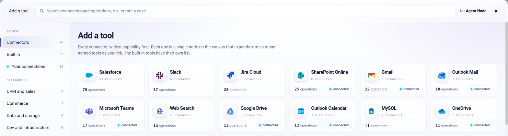
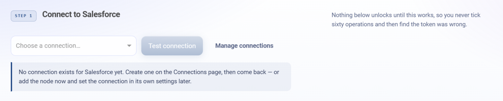
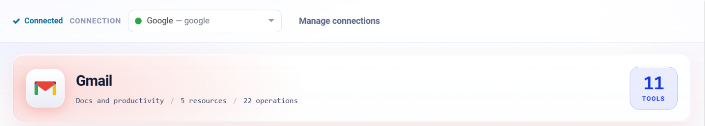
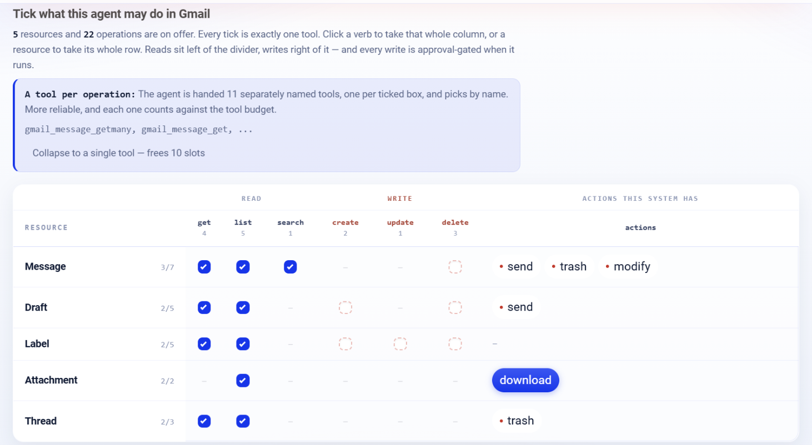
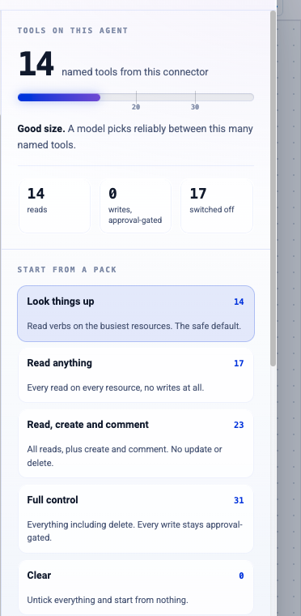
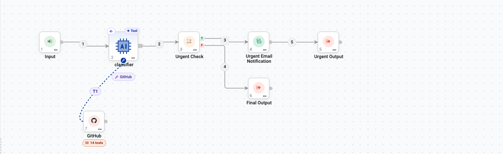
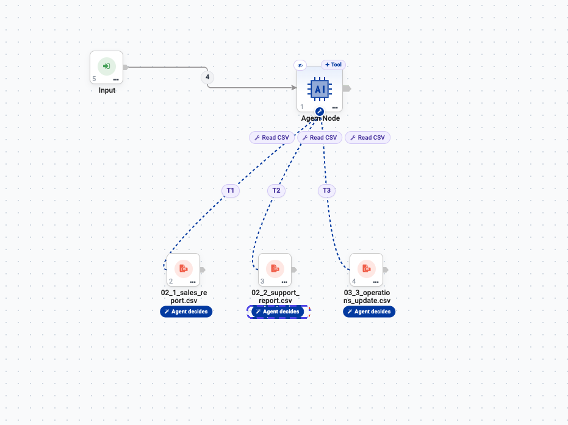
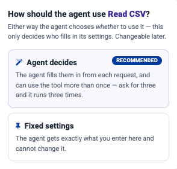
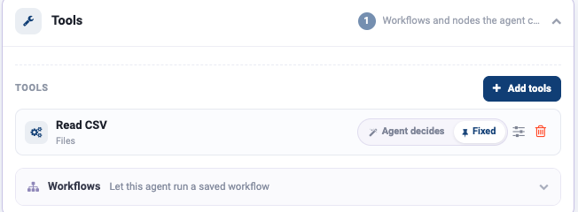

.. rst-class:: agentic-tutorial

Tools Overview
==============

.. container:: tutorial-intro

   Tools are what separate an agent that talks from an agent that works. A tool is
   something the **model decides** to use: read a file, look up a record, post a
   message. When a step must always happen exactly as set, use a fixed
   :doc:`App Action </agentic-ai-guide/tools-integrations/app-actions>` instead.

.. raw:: html

   

     <article class="tutorial-card tool-card">
       
<h3><a href="sparkflows-tools.html">Sparkflows tools</a></h3>

       
37 tools that ship with the platform: read and save files, query databases, call REST APIs, scrape pages, turn documents into text, profile data.

       
Built In · one node, one tool

     </article>
     <article class="tutorial-card tool-card">
       
<h3><a href="connector-tools/index.html">Connector tools</a></h3>

       
21 connectors, from Gmail, Slack and Salesforce to GitHub, Notion, Stripe and databases. Each one expands into a named tool per operation you tick.

       
Connectors · one node, many tools

     </article>
   

This page explains how tools work in Sparkflows: where they come from, how a
connector becomes tools, how to choose operations without handing an agent more
power than it needs, and how to make the model use them reliably.

.. contents:: On this page
   :local:
   :depth: 1
   :class: tool-toc

.. _tool-sources:

Where tools come from
---------------------

Click **Add tools** in the Tools group of Agent Studio, or **+ Tool** on any
Agent Node on the canvas. The picker opens on the connectors; the left rail
switches between the sources.

   The **Add a tool** picker. Each tile shows how many resources and operations
   a connector has, and **connected** when a connection for it already exists.

.. list-table::
   :header-rows: 1
   :widths: 24 46 30

   * - Source
     - What it is
     - Reference
   * - **Built In**
     - Tools that ship with the platform. One node is one tool, such as
       ``read_csv`` or ``call_rest_api``.
     - :doc:`sparkflows-tools`
   * - **Connectors**
     - Business apps: Google Workspace, Microsoft 365, Slack, Salesforce,
       Jira, GitHub, Notion, Stripe, databases and the web. One node expands
       into one tool per operation you tick.
     - :doc:`connector-tools/index`
   * - **Your connections**
     - The same catalogue, filtered to what already has a connection in your
       workspace.
     -
   * - **Workflows**
     - A saved workflow, run as one tool.
     - :doc:`workflows-as-tools`
   * - **MCP Servers**
     - Tools served by a Model Context Protocol server.
     - :doc:`mcp-servers`

Below the sources, **Categories** filters the catalogue by domain: CRM and
sales, Commerce, Data and storage, Dev and infrastructure, Docs and
productivity, Messaging, Project and work, Support and ITSM, and Web. The
search box matches operations as well as names, so ``create a case`` finds the
connector that can.

.. note::

   Tiles marked **Coming soon** are greyed out and cannot be added. They are
   left out of this guide until they are available. GitHub, Notion, Stripe and
   Email (IMAP and SMTP) are available as agent tools only; their App Action
   nodes are still marked Coming soon.

Read, write and delete tools
----------------------------

Every connector operation is one of three kinds, and the kind decides what
happens when the agent calls it.

.. list-table::
   :header-rows: 1
   :widths: 16 84

   * - Kind
     - What happens
   * - **Read**
     - Runs straight away and returns rows: ``get``, ``list``, ``search``,
       ``count``, ``describe`` and read-only actions such as ``history``.
   * - **Write**
     - Changes data in the other system: ``create``, ``update``, ``upsert``,
       ``send`` and actions such as ``transition`` or ``merge``. The call
       waits for :doc:`human approval </agentic-ai-guide/safety-guardrails/human-in-the-loop>`
       before it takes effect.
   * - **Delete**
     - Removes or cancels something. Approval-gated like a write, and often
       impossible to undo.

The model is told which tools are approval-gated, so it does not treat a
pending write as done.

Adding a connector tool
-----------------------

Click a connector tile, or search for an operation directly. The connector
opens on one screen in three steps.

**Step 1 - Connect.** Choose the connection that holds the credentials, then
click **Test connection**. Nothing below unlocks until the test passes, which
is deliberate: it stops you ticking sixty operations and only then discovering
the token was wrong. **Manage connections** takes you to where credentials are
created - see :doc:`/agentic-ai-guide/quick-start/model-connections`.

   Step 1 before a connection exists. The note says where to create one.

**Step 2 - How should the agent see it?** This decides the *shape* of what the
model is handed, and it matters more than it looks.

.. list-table::
   :header-rows: 1
   :widths: 28 72

   * - Option
     - What the agent sees
   * - **A separate tool for each one** *(recommended)*
     - One named tool per ticked operation. The agent picks by name, so it
       cannot aim the wrong operation at the wrong record, and each write is
       approval-gated on its own.
   * - **One tool for everything**
     - A single tool; the agent has to name the resource and the operation
       itself from a description. Cheaper on the tool budget, easier to get
       wrong. Worth it only when one agent carries so many operations that the
       count is climbing.

.. tip::

   Start with **a separate tool for each one**. Switch to the single-tool shape
   only if you actually hit a tool-count problem - the failure mode it
   introduces (the model naming the wrong resource or operation) is much harder
   to spot than a long tool list.

**Step 3 - Tick the operations.** The grid has one row per resource and groups
the columns by what they do:

.. list-table::
   :header-rows: 1
   :widths: 22 78

   * - Column group
     - Contains
   * - **READ**
     - ``get``, ``list``, ``search``, ``count``, ``describe``
   * - **WRITE**
     - ``create``, ``update``, ``upsert``, ``delete``
   * - **Actions this system has**
     - Operations peculiar to that system - ``transition``, ``assign``,
       ``changelog`` for Jira; ``send``, ``trash``, ``download`` for Gmail. A red
       dot marks an action that writes.

Connecting opens the grid with a sensible pack already ticked. Review it rather
than accepting it: the default is a reasonable starting point, not a decision
about what your agent should be allowed to do.

Finally, click **Add to agent**. Everything you ticked from one connector
collapses into **one node** on the canvas - ticking twelve Salesforce operations
does not give you twelve boxes.

Worked example: giving an agent Gmail
-------------------------------------

Here is the whole thing end to end on one real connector: an agent that drafts
replies to support email, allowed to read the mailbox.

**1. Find it.** On the Agent Node, click **+ Tool** and pick the **Gmail**
tile - or type ``gmail`` in the search box. The tile tells you what you are
getting before you click: **5 resources**, **22 operations**, and that a
connection already exists.

**2. Connect and test.** Choose the Google connection and click **Test
connection**. Nothing below unlocks until it shows **Connected**, so a wrong
token is caught here rather than at run time.

   Connected. The badge counts the tools ticked so far: 11, all reads.

**3. Tick what the agent may do.** One tick is exactly one tool. Reads sit left
of the divider, writes right of it, and Gmail's own actions - ``send``,
``trash``, ``modify``, ``download`` - sit on the right. Click a verb to take its
whole column, or a resource to take its whole row.

   The **Look things up** pack: reads on every resource, no writes.

You do not have to tick them one by one. **Start from a pack** on the right
applies a sensible set in one click, and the counter above it tells you whether
the agent is still a size a model can choose from reliably.

.. list-table::
   :header-rows: 1
   :widths: 30 70

   * - Pack
     - What it allows
   * - **Look things up**
     - Read verbs on the busiest resources. The safe default.
   * - **Read anything**
     - Every read on every resource, no writes at all.
   * - **Read, create and comment**
     - All reads, plus create and comment. No update or delete.
   * - **Full control**
     - Everything including delete. Every write stays approval-gated.
   * - **Clear**
     - Untick everything and start from nothing.

   The counter and packs, here for GitHub. The numbers change per connector.

For the support agent, start from **Look things up** and add **Draft create**,
so the agent can prepare a reply for a person to send.

.. tip::

   Start at **Look things up** and add only what the agent turns out to need.
   It is far easier to grant one more operation later than to work out which of
   twenty-two caused a surprise.

**4. Add it.** Click **Add to agent**. All the ticked tools arrive as **one
node** on the canvas, joined to the Agent Node by a dashed tool link (**T1**).
The badge shows how many tools it carries. Click that node at any time to
change what the agent may do; the grid reopens exactly as you left it.

   One connector, one node: a GitHub node carrying 14 tools, joined to the
   Agent Node by **T1**.

The same steps apply to every connector. Each one has its own page with the
connection it needs and every tool it offers - see
:doc:`connector-tools/index`.

Choosing operations: the rule that matters
------------------------------------------

.. important::

   **Tick the fewest operations that let the agent finish its job.**

   Every ticked operation is a real action on a real system. An agent that can
   only ``get`` an issue cannot close the wrong ticket, no matter how confused it
   gets. An agent given every Jira operation, delete included, can.

A practical way to decide:

.. list-table::
   :header-rows: 1
   :widths: 30 70

   * - Ask
     - Then
   * - Does the agent need to *read* this?
     - Tick the read operation.
   * - Does it need to *write*?
     - Tick it only if a person cannot reasonably do that step, and consider
       putting a :doc:`Human Approval </agentic-ai-guide/safety-guardrails/human-in-the-loop>` gate
       in front of it.
   * - Does it need *delete*?
     - Almost never. Leave it unticked.

.. _how-the-agent-knows-what-its-tools-are:

How the agent knows what its tools are
--------------------------------------

This is the part that is easy to miss, and it explains most "why didn't it use
the tool?" problems.

The model never sees your canvas. At run time it is handed a **list of tool
names with a one-line description each**, and it picks by reading those
descriptions. Nothing else about the tool is visible to it.

   The shipped **Document Summarization Agent**. One Agent Node, three
   ``Read CSV`` tools - a sales report, a support report and an operations
   update - joined by the dashed tool edges ``T1``, ``T2`` and ``T3``.

Three tools of the *same type* is exactly the case that goes wrong. To the
model they are three entries called "Read CSV", and it has no way to tell which
is which unless the descriptions say so. So:

.. list-table::
   :header-rows: 1
   :widths: 46 54

   * - Write a description like
     - Not
   * - ``Reads the monthly sales report CSV``
     - ``Read CSV``
   * - ``Reads the support ticket export``
     - ``Reads a CSV file``
   * - ``Reads the weekly operations update``
     - ``CSV reader tool``

Then name the tools in the agent's Instructions so the intent is unambiguous:

.. code-block:: text

   You produce a weekly digest from three reports.
   Read all three before writing anything:
   - the sales report
   - the support report
   - the operations update
   Summarise each in two lines, then give one combined outlook.

Connector tools already come with a description written for the model, such as
*Posts a message to a channel ... and returns the posted message with its ts*.
Each connector page lists them.

.. tip::

   If an agent keeps picking the wrong tool, fix the **description** before you
   touch the prompt. The description is what the model is choosing from; the
   prompt only nudges it.

.. _who-fills-in-each-argument:

Who fills in each argument
--------------------------

When you add a tool, Sparkflows asks one question - and it is worth
understanding, because it is the difference between an agent that adapts and
an agent that cannot go off-script.

.. list-table::
   :header-rows: 1
   :widths: 24 76

   * - Choice
     - What it means
   * - **Agent decides** *(recommended)*
     - The agent fills the settings in from each request, and can use the tool
       **more than once** - ask for three and it runs three times.
   * - **Fixed settings**
     - The agent gets exactly what you enter and cannot change it.

Either way the agent still chooses **whether** to use the tool; this only
decides who fills in its settings. You can change it later - the tool shows
both options as a toggle once it is attached. On a connector, the same choice
is made per parameter of each tool: fix ``repository`` on the GitHub tools, and
the agent can no longer pick another one.

   An attached tool. The toggle on the right switches between the two modes.

.. list-table::
   :header-rows: 1
   :widths: 45 55

   * - Use **Fixed settings** for
     - Use **Agent decides** for
   * - The repository, account or tenant to act on
     - The record being worked on
   * - A fixed label, queue, folder or reviewer
     - The text of a message or comment
   * - Anything that must never vary
     - Anything that depends on the request

.. important::

   Fixing a value is a real safety control. An agent that can only comment on
   **one** repository - because you fixed the owner and repo - cannot wander
   into another, however confused it gets. Combine that with ticking few
   operations and most of your risk is gone before you write a single
   guardrail.

.. _making-tools-reliable:

Making tools reliable
---------------------

Three failure modes account for most tool problems.

**The agent does not call the tool.**
   Usually the instructions never told it to. Add an explicit line: *"Always
   fetch the record before answering. Never answer from memory."*

**The agent calls it with missing arguments.**
   Name the required arguments in the instructions, and add a retry rule:
   *"If a tool call fails because an argument is missing, call it again with all
   required arguments."* Each connector page lists every tool's required and
   optional parameters.

**The agent calls the wrong tool.**
   Two ticked operations sound alike. Untick the one it should not use - the
   cheapest fix available.

.. tip::

   Test each tool on its own before wiring several together. Give the agent one
   tool, run it, confirm the call happens and the result comes back. Add the next
   one only then. Debugging one new tool at a time is far quicker than debugging
   six at once.

Next steps
----------

* :doc:`sparkflows-tools` - every built-in tool
* :doc:`connector-tools/index` - every connector, with its connection and tools
* :doc:`/agentic-ai-guide/safety-guardrails/human-in-the-loop` - approving writes
